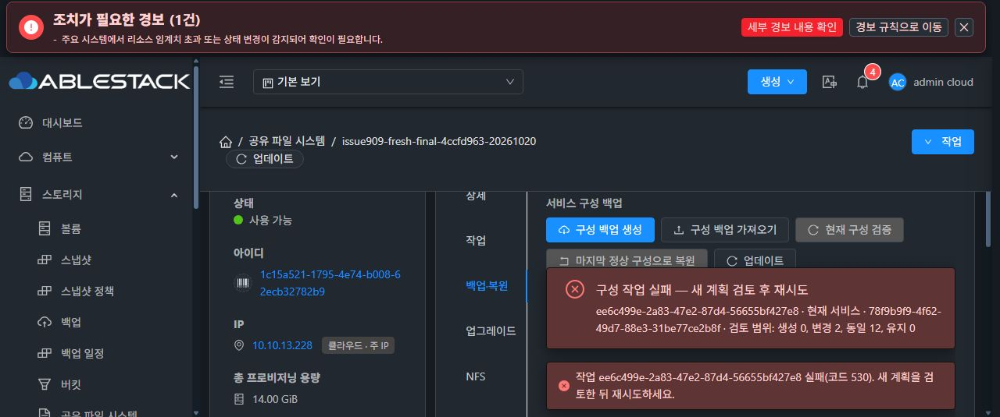

# #909 새 VM 최종 실환경 검증 중단 — SOURCE render-import 자료형 불일치

2026-10-20 / Epic #898 / Draft PR #1271

## 판정

최종 복원 검증은 미완료다. 새 VM에서 실제 UI 전체 백업 다운로드, 설정 변경, 동일 ZIP 업로드·무결성 검증 및 같은 서비스 복원 계획까지 통과했으나, 실제 복원은 SOURCE 기준 구성의 render-import 단계에서 실패했다. 해당 제품 오류 이후 재시도·복구·클라이언트 추가 쓰기·시험 자원 정리는 실행하지 않았다. 이슈는 OPEN, Epic PR은 Draft를 유지한다. 제품 코드를 추가 수정하거나 새 모듈을 빌드·배포한 결과로 보고하지 않는다.

- 배포 코드: `4ccfd963794b9a8416a6ae04a9ced902452d28ab`
- local base / upstream Europa: `248653b58920d2a950393ed3edc7b343b831105d`, `0 0`
- Native CLI SHA-256: `8995418a4194a0b910da6c56a43cbcd795a82ea7ca7ebccf656407083c9de850`

## 새 VM 및 디스크 정책

기존 시험 VM `374ff78d-4bbd-41bd-8c37-f46643fa28bf`와 ROOT를 삭제한 뒤, 2026-10-20 12:37:17 KST에 새 VM `88c1b618-38c7-474c-9b4b-8fa4284e9245`와 ROOT `2bba615a-dc2d-496b-8b2b-b3d7553a939c`를 만들었다. SharedFS `1c15a521-1795-4e74-b008-62ecb32782b9`, instance `fbf32877-7746-4787-9f70-151b48d8f709`다. ROOT와 DATA 4개 모두 SPARSE다. 네 DATA는 각각 새로 생성했고 클론하지 않았다. Mold 자동 MAC `02:0d:00:cc:00:2f`를 변경하지 않았다.

기존 VM 삭제 전에는 기존 원래 작업의 UI 복구 재검증을 완료했고, 이전 시험 DATA 4개는 삭제하지 않고 분리 보존했다. 이번 새 VM은 이전 DATA를 연결하지 않았다.

## 실제로 통과한 범위

1. 실제 Chrome UI로 새 SharedFS 생성 및 서명된 4ccfd963 런타임 업그레이드 완료.
2. NFS·SMB·iSCSI CHAP·NVMe-oF 구성과 네 클라이언트의 동시 접속·I/O 확인.
3. 원본 시험 파일 2개와 블록 시험 영역 4개의 체크섬·파일 메타데이터·파일시스템 UUID·블록 및 계정 식별 정보를 저장.
4. 실제 UI에서 전체 백업 생성 및 다운로드. 사용자가 OS 저장 창을 완료한 실제 Downloads 파일을 검증했다.
   - ZIP: `storage-config-8be554e3-f10c-466b-9ab4-79551074d020.zip`
   - 크기: 9,989 bytes
   - SHA-256: `8795acf01fa2955ed06f7c46db5149b897bb054e3ad73232254d109f3d1c532b`
   - 백업 세대 12, ZIP 내부 체크섬 일치, 비밀번호·CHAP 비밀값 미포함.
5. 실제 UI에서 NFS·SMB의 읽기 전용만 변경. POSIX 입력과 ACL·인증값은 변경하지 않음. 변경 세대 13·14 완료.
6. 변경 후 실제 NFS·SMB 클라이언트 읽기 성공·쓰기 거부 확인. iSCSI·NVMe-oF 원본 읽기 및 네 프로토콜 동시 접속 성공. 기존 데이터·식별 정보 완전 일치.
7. 다운로드한 같은 ZIP을 실제 UI로 같은 서비스에 업로드. 가져오기 `78f9b9f9-4f62-49d7-88e3-31be77ce2b8f`의 ARCHIVE_VALIDATED 확인.
8. 현재 서비스 RESTORE_EXISTING, DATA 4개 동일 매핑, wildcard 수신 주소 유지, 생성 0 / 변경 2 / 유지 12 / 삭제 0 / blockers 0, PRESERVE / automaticFormat=false 계획 확인.

## 시험 준비 누락과 실제 제품 실패 구분

최초 UI 적용 job `043541a2-7bfb-4032-be64-3a4dd3f9ea12`는 새 VM에 검증 프로필이 없어서 `Four-protocol candidate validation is not authorized for this instance`로 거부됐다. 이는 에이전트의 새 시험 VM 사전 준비 누락이다. 이때 관리 writer 생성, Native pending, 서비스 중단, DATA 변경은 없었고, Native 세대 14 및 모든 데이터가 그대로임을 확인했다.

작업 준비 실수는 자체 교정하라는 사용자 지시에 따라 기존 configureStorageRenderedValidationProfile API로 새 VM/ROOT/DATA 4개에 한정한 프로필을 준비했다. 보호된 승인 파일은 해당 자원과 CLI 체크섬에 고정했고 다른 15개 instance를 제외했다. kind=NEW_SPARSE_ALL4_VALIDATION, revision=1, productionCapability=false다. 우회 플래그나 코드 변경은 하지 않았다. 기존 설정을 고치지 않고 같은 실패를 반복한 것이 아니라, 누락된 시험 전제를 보완하고 UI에서 최신 계획을 다시 검토했다.

그 이후 실제 복원 처리는 다음과 같이 실패했다.

- job: `ee6c499e-2a83-47e2-87d4-56655bf427e8`
- 관리 operation: `05a393fa-a3f1-4f24-814f-afb3d9684235`
- action: SERVICE_MAINTENANCE
- 요청 세대: 15
- state / phase: RECOVERY_REQUIRED / RECOVERY_REQUIRED
- 진행률: 0
- API 530: `ROOT runtime step failed: operation generation render-import`

이 제품 오류를 확인한 뒤 환경 변경과 시험을 중단했다.

## 확인된 구체적 하위 원인

실패 후 import/stage/activation 명령을 다시 호출하지 않았다. 현재 source를 읽고, 보호된 기존 자격증명 참조 검사와 렌더링 함수를 RAM에서만 수행하는 읽기 전용 진단을 실행했다. 자격증명 참조 검사는 SMB 1·iSCSI 1·NVMe 1 모두 통과했다. 렌더링은 아래에서 동일하게 거부됐다.

- 예외: `ValueError: Block listener group is invalid`
- `rendered_driver.py`의 render → `native_renderers.py:225-228`의 render_block_candidate
- 기존 canonical iSCSI target의 top-level `listenerPorts`는 문자열 `"3260"`, config.listenerGroupPorts는 정수 배열 `[3260]`다.
- NVMe namespace도 top-level `"4420"`와 config `[4420]` 형태다. 실제 첫 실패는 ISCSI이며 NVMe까지 실행됐다고 주장하지 않는다.
- 렌더러는 top-level 값을 우선 선택한 뒤 정수 배열인지 검사하므로 문자열이 있으면 검증된 config 배열을 사용하지 못하고 거부한다.
- 관리서버의 새 TARGET 후보 작성 경로에는 normalizeRenderedBlockListenerPorts가 있으나, prepareRenderedBatch의 SOURCE import는 기존 canonical 파일을 그대로 전달하여 그 경로를 거치지 않는다.

따라서 이 실패는 네트워크·MAC·데이터 손상이나 복원 후 표시에 대한 오류가 아니다. 기존 수동 적용 경로의 CSV 문자열 표현과 신규 SOURCE 렌더링 경로의 정수 배열 계약이 다르기 때문에, 실제 설정 복원 전에 기준 구성을 만들지 못한 것이다.

## 현재 영향

- Native current는 세대 14 / IN_SYNC이며 pending=null.
- rendered current, activation 없음. rendered 루트도 생성되지 않은 상태로 확인.
- SERVICE/ROOT maintenance hold=false. 서비스 중단 단계에 진입하지 않음.
- 네 리스너 NFS 2049, SMB 445, iSCSI 3260, NVMe TCP 4420 모두 수신 중.
- 파일 2개와 원시 블록 영역 4개, 파일 메타데이터·파일시스템 UUID·장치·계정 식별 정보가 변경 전과 완전히 일치.
- NFS·SMB의 시험용 읽기 전용 설정은 세대 14 그대로 남아 있다. 백업의 읽기/쓰기 설정으로 복원되었다고 보고하지 않는다.
- Mold의 SERVICE_MAINTENANCE 작업은 RECOVERY_REQUIRED로 남아 후속 변경을 막을 수 있다. 원래 작업의 복구·정리 API는 실행하지 않았다.
- 이후 클라이언트 쓰기·CREATE_NEW 두 분기·추가 자원 삭제는 실행하지 않았다.

## 다음 개선 방향 — 미실행

원본 canonical 파일과 세대 체크섬은 유지하고, SOURCE와 TARGET에 공통으로 쓰는 렌더러 입력 경계에서 검증된 CSV/정수 배열의 호환 정규화를 수행하는 방향이 적절하다. 허용 범위·중복·미등록 포트·config 배열과의 불일치는 계속 거부해야 한다. SOURCE 파일 자체를 배열로 덮어써 기존 세대의 해시를 바꾸면 안 된다.

실제 canonical 소스의 문자열 포트를 회귀 fixture에 넣어 기준 import부터 검증하고, import의 안전한 고정 진단도 API까지 전달해야 한다. 개선 후에는 원래 실패 writer의 안전한 정리와 기존 복원 VM 제거를 먼저 수행하고, 새 VM·새 ROOT에서 전체 왕복 검증을 시작해야 한다. 실제 복원 성공, 네 클라이언트 재접속·데이터 보존, CREATE_NEW 기존 DATA 4개 및 전부 새 DATA 4개 분기, 시험 자원 정리까지 미완료다.

## 증거

- [공개 구조화 증거](20261020-issue909-fresh-final-render-import-stop-public.json)
- 실제 UI 실패 화면:

