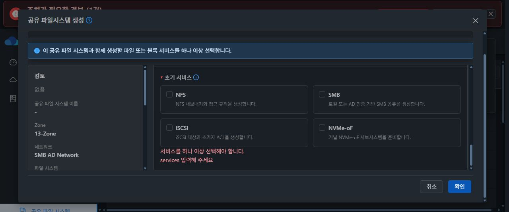
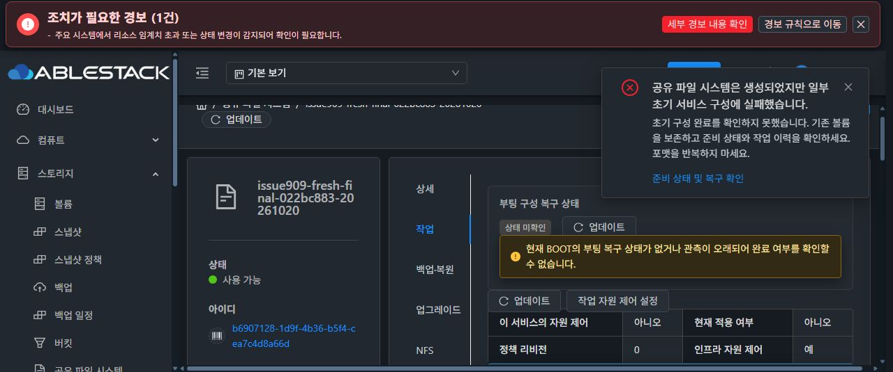

# #909 최종 실환경 검증: 초기 생성 UI 준비 순서에서 중단

2026-10-20 KST. #909는 OPEN, Epic #898 PR #1271은 Draft로 유지한다. 이번 실행은 백업 생성이나 복원 요청에 도달하지 못했으며, 수정된 SOURCE import를 실환경에서 검증한 결과가 아니다. 제품 코드 수정·추가 빌드·추가 배포는 하지 않았다.

## 완료한 범위

- 기존 실패 SERVICE writer 05a393fa-a3f1-4f24-814f-afb3d9684235를 실제 Chrome 작업 탭에서 원래 작업 복구로 한 번 처리했다. 결과는 ROLLED_BACK이며 Native/BOOT/구성 포인터와 파일·RAW canary의 동일성을 확인했다.
- 이전 시험 VM 88c1b618-38c7-474c-9b4b-8fa4284e9245와 ROOT를 제거하고 DATA4를 분리 보존한 뒤 새 VM 565bd024-fe83-4c20-8b05-bc1b2885da0b와 ROOT를 만들었다. ROOT/DATA는 SPARSE, MAC은 Mold 자동값 그대로였다.
- 새 서비스 생성은 실제 Chrome 생성 대화상자로 실행했다. 초기 NFS 활성화는 생성 마법사가 자동 제출했다.

## 최초 실패와 표시 메시지의 관계

| 시각 KST | 실제 증거 |
|---|---|
| 16:29:15 | VM 생성 job 성공 |
| 16:29:16 | UI가 초기 NFS 활성화 job 제출 |
| 16:29:20~23 | VM 내부 ablestack-storage-reconcile.service 실행 |
| 16:29:21 | 게스트가 operation generation begin 실행 |
| 16:29:22 | 게스트가 writer-idle 관측 실행 |
| 16:29:23 | Manager가 exit 75 STORAGE_WRITER_BUSY 수신 |
| 16:29:25 | NFS 활성화 job가 530 / BLOCKED로 종료 |

최초 실패는 초기 NFS 작업의 generation begin이 부팅 리컨실과 겹쳐 Native writer lock을 얻지 못한 것이다. 이어지는 동일 명령의 제한적 재시도 준비에서 BOOT active가 관측되어 차단됐다. BOOT은 16:29:23에 정상 완료했으며 이후 읽기 전용 관측은 WRITER_IDLE이었다.

'rollback is deferred' 문구는 여기서는 실제 복원/원복 실패의 증거가 아니다. 동일한 requireRollbackNativeWriterIdle 헬퍼가 generation begin 재시도 전에도 호출되기 때문에 출력됐다. 스택은 nativeConfigurationGeneration 8118 → prepareDesiredStateNativeCheckpoint 8024 → PREPARED를 가리킨다. 백업 업로드, import, 프로토콜 재생 또는 DATA 포맷에는 도달하지 않았다.

새 VM CLI는 bootstrap 8e14f84e...였고 준비된 서명 runtime CLI e49a54de...는 설치 전이었다. 이번 실패로 최신 SOURCE import 수정이 실패했다고 결론 내릴 수 없다.

## Computer Use로 확인한 UI 제약

실제 Chrome에서 생성 대화상자를 열고 초기 서비스를 모두 해제한 뒤 확인을 눌렀다. 서버에 새 생성 요청은 제출되지 않았고 '서비스를 하나 이상 선택해야 합니다.' 필드 검증을 확인했다. 대화상자는 취소로 종료했다.

소스와도 일치한다.

- ui/src/views/storage/CreateSharedFS.vue:1526은 초기 서비스를 하나 이상 요구한다.
- 같은 파일 2154~2155는 VM 생성 job 완료 직후 초기 구성으로 진행한다.
- 2294~2301은 인스턴스 행이 조회되면 반환하며 Native BOOT 완료는 확인하지 않는다.
- 2206~2207 / 2333은 프로토콜 활성화를 바로 실행한다.
- StorageServiceManagerImpl.java:8112~8118은 Native BUSY 뒤 writer-idle을 확인한다.
- 같은 파일 17039~17041은 BOOT active이면 안전상 차단한다.

UI로 수행할 수 없는 'VM만 생성 → runtime 먼저 설치' 절차를 API로 우회해 시험하려던 접근은 사용자 요구에 맞지 않았다. Running과 Native 준비 완료를 구분하지 않는 초기 생성 UI 흐름을 먼저 바로잡아야 한다. 이번 원인은 복원 알고리즘의 실패가 아니라 초기 생성/준비 단계의 경쟁이다.

## 자원과 작업 방식

사용자 지적 전에 API로 초기 실패 시험 서비스와 VM/ROOT를 정리했다. 해당 시험에는 파일/RAW canary가 아직 없었다. 불필요한 DATA는 삭제 정책의 결과로 Destroy 상태까지 확인했으며 물리적 expunge 완료까지 확인한 것은 아니다. 이전 DATA4는 계속 보존했다. 외부 자원과 다른 시험 서비스는 변경하지 않았다.

사용자가 모든 과정을 UI로 처리하라고 다시 지시한 이후에는 자원/API 변경이나 준비 상태 API 조회를 하지 않았다. Computer Use로 Chrome의 목록과 생성 양식만 확인했다. 추가 생성·서비스 재시도·런타임 적용·백업/복원을 하지 않았다.

## 개선 방향과 재개 조건

1. 생성 UI에서 VM 생성 완료와 Native 준비 완료를 별도 단계로 표시한다. 인스턴스 조회 성공만으로 서비스 활성화를 시작하지 않는다.
2. 현재 BOOT의 리컨실 완료와 writer idle을 확인하기 전 초기 서비스 적용을 실행하지 않는다. 임의 고정 대기 시간이나 writer 보호 해제로 대체하지 않는다.
3. 시험에 필요한 서명 runtime을 UI에서 적용하고 완료/버전을 확인할 수 있도록 준비와 서비스 적용을 순서대로 진행한다.
4. 새 VM/ROOT를 사용해 UI에서 네 프로토콜 구성 → 전체 백업 다운로드 → 설정 변경 → 업로드/복원 → 실제 클라이언트 접속/데이터 보존을 검증한다. 클론으로 대체하지 않는다.
5. UI/API/Backend 오류가 발생하면 최초 명령의 오류와 후속 안전 차단을 구분해 원인까지 분석하고 중단 보고한다.

추가 제품 변경이나 재시험 없이 중단한다. #909 종료 조건은 충족되지 않았다.
