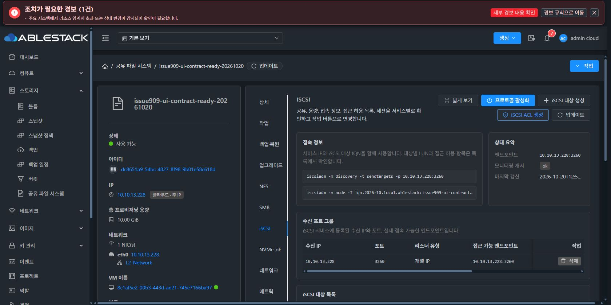
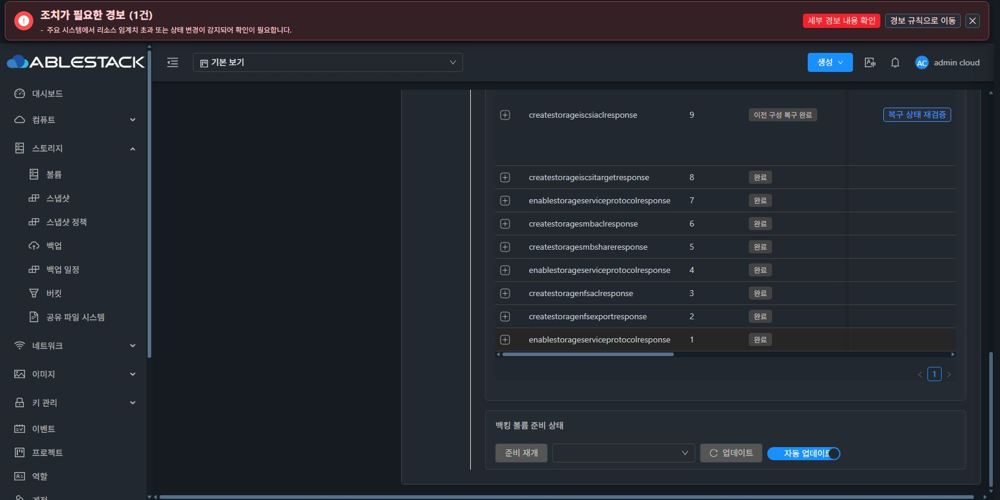
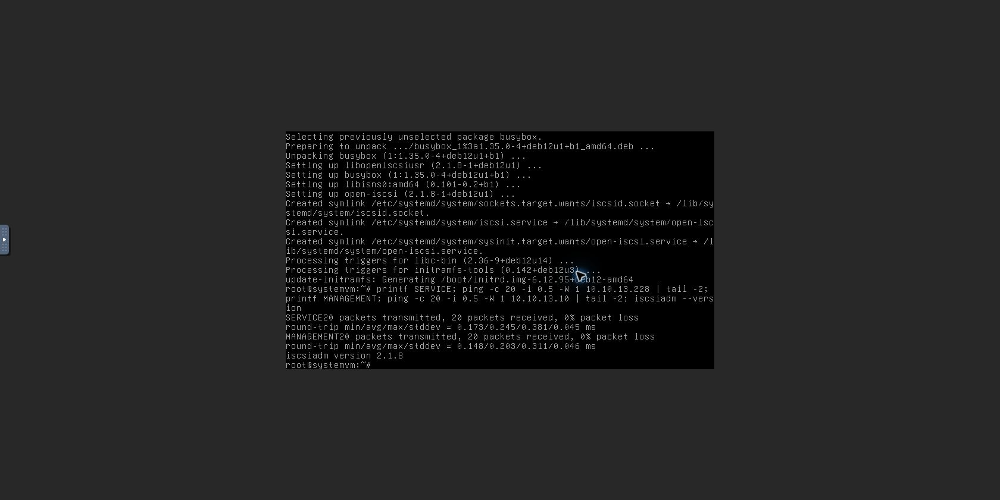
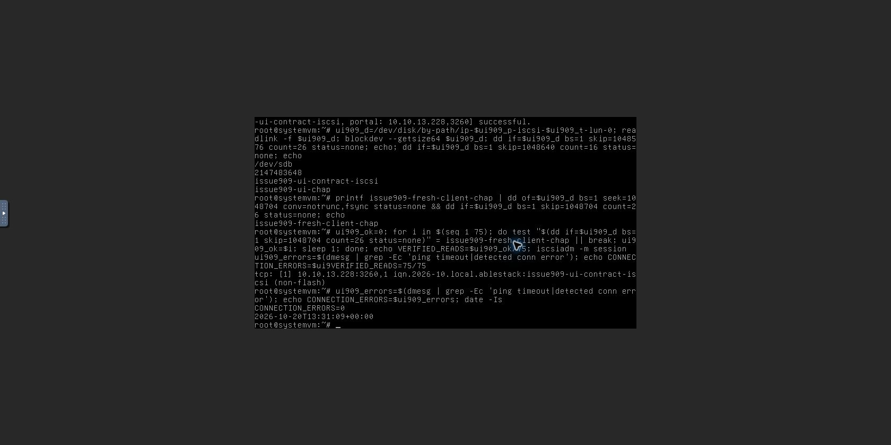
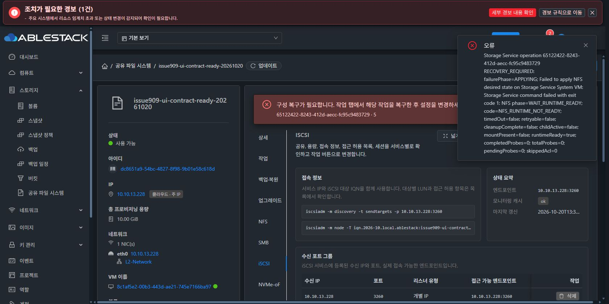
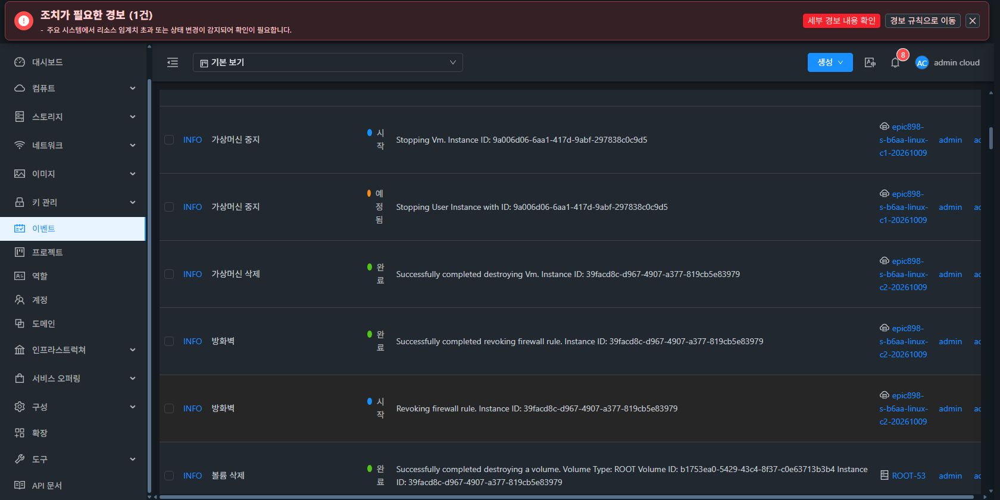
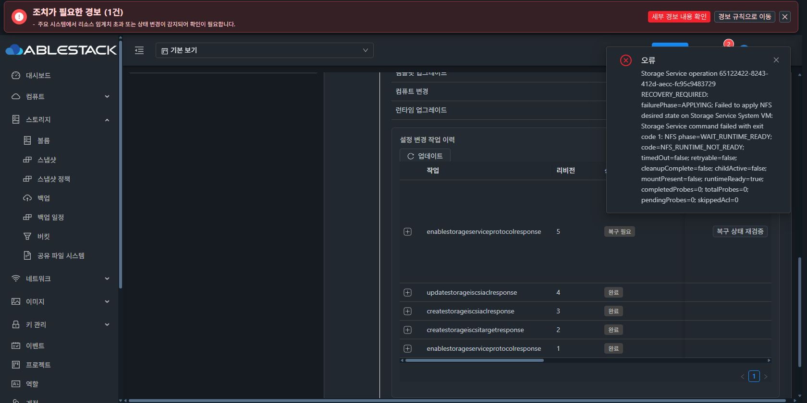

# #909 iSCSI UI 계약 개선 반영 및 신규 클라이언트 검증 — NFS 활성화 차단

2026-10-20 KST. Epic #898 / 기존 Draft PR #1271. 제품·배포 소스는 `7495a38981af1ce0a3bd4af7903761a645439451`이며, 이후 커밋은 이 검증 기록만 추가한다.

**iSCSI 개선·모듈 빌드·13번 배포와 실제 UI/클라이언트 검증은 수행했다. 복합 서비스 준비의 NFS 활성화 revision 5에서 별도 코드 결함을 확인해 중단했다. 전체 백업·복원을 실행하지 않았으며 재개 준비 완료가 아니다. #909 OPEN / PR Draft / #1275 HOLD를 유지한다.**

## 이번 개선과 빌드

- UI/API/Native의 사용자 지정 IQN 계약을 통일했다. 특정 `.local.storage:` 접미사는 요구하지 않는다. UI/API는 IQN·LUN·등록 리스너를 볼륨/작업 생성 전에 검증한다. 일반 대상 LUN 0..65535와 ACL mapped LUN 0..255를 구분한다.
- Native 인증은 실제 Manager가 보낸 대상·볼륨·ACL·writer 소유권을 검증한다. No-CHAP/CHAP/mutual CHAP과 vault 경로를 같은 소유권 계약으로 검사한다.
- 활성 명시 리스너를 재사용하며 임의의 NULL wildcard를 추가하지 않는다. DAO의 임의 `ORDER BY RAND()` 대표 선택을 영속 ID 기준으로 고정했다.
- 일반 iSCSI ACL 변경의 실패 원복과 기존 관리자 UI 복구는 고정된 원래 SOURCE 및 기존 opaque LOCAL 권한을 사용한다. 복원 전용 예외를 일반 ACL에 적용하지 않는다.
- 제품 변경 커밋 `06c00a966f8`, 시험 fixture/강한 격리 보완 커밋 `7495a38981a`. 현 NFS/네트워크 실패 경로는 두 변경 전에도 존재했다.

| 검증 | 결과 |
| --- | --- |
| Maven server/KVM 관련 모듈 빌드 | 성공 |
| 선택 Java 시험 | 147개, 실패/오류/skip 0 |
| Vue UI 단위 시험·lint | 10 suite / 256개, 실패 0, lint 통과 |
| Native 전체 bwrap 격리 시험 | 1195개, 실패/오류 0, skip 6 |
| WSL 계정 파일·제품 소스 | Native 시험 전후 계정 파일 4종 및 제품 소스 무변경 |
| UI production build | 성공, 임시 빌드 설정 정확히 원복, worker 2 |

최초 자동 시험의 fixture IQN 불일치와 격리 하네스 오류는 수정한 뒤 위 전체 범위를 재실행했다. 이 시험 오류와 이후 실환경 제품 오류를 구분해 기록했다. Native 격리 증거: `/tmp/storage-preparation-health-wire-gpyby12b`.

13.10에는 변경 class family 4개(컴파일 class 23개, 실제 변경/추가 21개)를 기존 관리서버 JAR에 반영하고 다른 204654개 엔트리 무변경을 검증했다. 13.1/2/3에는 KVM wrapper class 1개만 반영했다. 기존 JAR과 UI 자산을 백업했고 mold/mold-agent 정상 기동을 확인했다. UI는 신규 asset 10개와 관련 locale을 반영했다.

Native CLI SHA256: `63d4da7f2390a83d18125a9854c5dcc81ef45fbb91a816a674ce0f19b5f83e13`. 공개 TEST 번들은 UI 카탈로그에서 등록→서명 검증→게시하고 새 VM에서 사전 점검→적용 COMPLETE를 확인했다. 서명 개인키 파일은 생성하지 않았다.

## 실제 UI 흐름과 성공 범위

자원 생성·삭제, 런타임 등록/게시/적용, 프로토콜·대상·ACL 변경은 Chrome의 Mold UI로 수행했다. 클라이언트 작업도 Mold VM 콘솔 UI로 수행했다. SSH는 배포 및 읽기 전용 원인 조사에 사용했고, 제품 오류 후 QGA로 읽기 전용 파일·로그만 수집했다. 직접 API로 준비 상태나 변경을 우회하지 않았다.

1. 기존 실패 작업 `d3076374-12bb-41fd-a368-60e91a95a1d8`(revision 9)의 이전 구성 복구를 UI에서 실행해 `INTERRUPTED_WRITER_ROLLED_BACK`과 원래 진단 유지 확인.
2. 기존 VM95 정상 종료→시험 전용 VM/ROOT/DATA 3개 삭제를 UI에서 완료. 보존 대상 DATA는 변경하지 않음.
3. 새 SharedFS/VM96을 일반 생성 UI로 생성. SPARSE ROOT와 새 SPARSE DATA 8GiB, BOOT 준비 COMPLETE. 클론 사용 없음.
4. 새 서명 런타임의 UI 사전 점검 및 적용 COMPLETE.
5. 잘못된 IQN, LUN 65536 제출이 UI에서 차단됨. 같은 이름의 볼륨이 생성되지 않았음을 볼륨 UI에서 확인.
6. 사용자 지정 IQN의 iSCSI 대상과 첫 No-CHAP ACL 생성 COMPLETE. 명시 `10.10.13.228:3260` 리스너 하나, 대상/볼륨 정확 매핑 확인.
7. No-CHAP 접속·읽기/쓰기 및 UI ESTAB 세션 확인. 같은 ACL을 CHAP으로 변경해 COMPLETE, 인증 접속과 기존 데이터 보존·새 쓰기/읽기 확인.
8. NFS 활성화에서 아래 제품 오류를 확인한 뒤 변경·재시도·복구·추가 프로토콜 준비를 중단.
9. 사용자 추가 지시에 따라 구 클라이언트 3대 삭제 후 새 클라이언트로 CHAP 접속을 비교 검증. 서버 설정은 변경하지 않음.

실제 mutual CHAP, SMB/NVMe-oF 준비, 새 DATA 4개 시험 승인, 전체 백업/복원은 미수행이다. 회귀 단위 시험 통과를 해당 실환경 인수 성공으로 대신하지 않는다.




## 구 클라이언트 통신 문제 및 교체 결과

기존 c1은 2026-10-09 생성, MAC `02:01:00:cc:00:0b`였다. 서비스 ping 5개 중 4개, 관리서버 ping 3개 중 1개 손실과 iSCSI NOP timeout/자동 재접속이 관측됐다. 13.2의 해당 MAC FDB가 VM 포트 `vnet35`와 물리 포트 `ens1f0` 사이에서 이동했고, 물리 ingress에서 같은 source MAC의 IPv6 패킷이 포착됐다. 외부 중복 장치와 네트워크 반사 중 근본 발생원은 확정하지 않았다. MAC을 수동 변경하지 않았다.

사용자 지시에 따라 아래 기존 시험 클라이언트를 정상 종료 후 UI의 영구 삭제로 정리했다. 각 VM/ROOT의 삭제 완료 이벤트와 Linux 시험 VM 목록 0개를 확인했다. 사용자 제공 ADSvr/Windows SMB-Client와 공유 서비스 DATA는 삭제 대상이 아니다.

| 삭제한 VM | VM UUID | ROOT UUID |
| --- | --- | --- |
| epic898-s-b6aa-linux-c1-20261009 | 9a006d06-6aa1-417d-9abf-297838c0c9d5 | d5b9fe9d-d988-402f-a7d5-a26baf714ddf |
| epic898-s-b6aa-linux-c2-20261009 | 39facd8c-d967-4907-a377-819cb5e83979 | b1753ea0-5429-43c4-8f37-c0e63713b3b4 |
| epic898-ad-linux-c3-20261009 | dfd7b03f-481f-4f5d-921e-d61670563c79 | cbb72f38-48ae-4ef5-9bb5-d73a16d0b6ab |

새 클라이언트 `issue909-ui-contract-client-20261020`는 일반 VM 생성 UI로 만들었다. VM `94533085-d833-47eb-bb58-0747cbd294b7`, 13.3, SPARSE ROOT 5GiB `30af98d5-17c2-4f33-a5c2-22ca67437179`. Mold 자동 MAC `02:0d:00:cc:00:35`, 실제 IP `10.10.254.188/16`. 도구는 콘솔 UI에서 Debian 공식 저장소로 설치했다.

서비스 ACL을 바꾸지 않고 비교하려고 삭제된 구 c1의 논리 IQN을 시험용 iSCSI iface에만 지정했다. 새 VM의 고유 기본 IQN `iqn.1993-08.org.debian:01:3dc4c8697ca`와 MAC은 그대로 유지했다. 시험 후 세션 logout 및 해당 시험 node/iface 삭제, RAM 시험 암호 해제를 완료했다.

| 새 클라이언트 실제 콘솔 검증 | 결과 |
| --- | --- |
| 서비스/관리서버 ping | 각각 20/20 응답, 손실 0% |
| CHAP discovery/login | 성공 |
| 정확 대상 LUN 크기 | 2147483648 bytes, 2GiB |
| 기존 No-CHAP/CHAP marker 읽기 | 2개 모두 보존 |
| 새 marker 쓰기·읽기 | 성공 |
| 약 75초 연속 marker 읽기 | 75/75 성공 |
| 커널 ping timeout/conn error | 0개 |
| Mold UI 세션 | 새 IP ESTAB, 매핑 정확, CHAP 인증 검증됨 |

이 결과는 새 클라이언트의 제한된 접속 검증이며 장기 부하 검증이나 전체 복원 성공을 의미하지 않는다.






## 중단한 제품 오류의 정확한 원인

작업 `65122422-8243-412d-aecc-fc95c9483729`, revision 5, UI NFS 프로토콜 활성화, 2026-10-20 22:11:42~22:12:02 KST. 결과 `RECOVERY_REQUIRED`.

`APPLYING → WAIT_RUNTIME_READY / NFS_RUNTIME_NOT_READY`, runtimeReady=true, probes 0. 자동 원복은 `Reconciled runtime declarative semantics differ from the verified recovery source`로 거부됐다.

고정 SOURCE와 실제 파일 일곱 개를 읽기 전용 비교한 결과 **유일한 차이**는 다음과 같다.

```
/network-endpoints.json/endpoints/0/port
SOURCE   = 3260
OBSERVED = 2049
SOURCE SHA256   c7bd6d867bffbcb71ba9f42e89e4afc00b5c127553682946334fcb9dbb24e9be
OBSERVED SHA256 5a66553cdb39ba700e4838fec16e3d00f02ea961f04d48cf7c36731a4544381c
```

- Manager `StorageServiceManagerImpl.java:8846`은 NFS 적용 전 `network endpoint apply`를 호출한다. `protocolListenAddressPayload:15555`는 서비스 포트 2049도 주소 payload에 넣는다.
- CLI `network_endpoint_apply:661-675`는 IP만 키로 사용해 같은 IP의 기존 iSCSI 포트 3260을 2049로 덮어쓴다. 작업 자신이 고정된 SOURCE를 변경한다.
- `NfsLegacyDynamicApply.prepare:9930`는 현재 seven-file 해시와 beforeSha256 차이를 거부한다. SOURCE의 NFS 파일이 null인 경우는 지원되지만, 그 처리에 도달하기 전에 실패한다.
- `10888`의 포괄 예외 처리가 SOURCE 불일치를 NFS_RUNTIME_NOT_READY로 변환한다. `10912`의 runtimeReady=true는 아직 configs=[]인 조건의 계산 결과다. 데몬 기동 성공이나 실제 수신 성공의 증거가 아니다.
- 원복의 `rootNetworkBindings:1487`는 IP/MAC/primary/prefix만 사용한다. Native reconcile은 현재 파일로 주소를 확인하고 receipt만 갱신해 port=2049를 남긴다.
- Manager `8479`는 정확 SOURCE 복원(`8482 operation generation restore`) **전에** 동일성 검사를 한다. 포트 차이 때문에 복원 단계에 도달하지 못한다.

따라서 이번 NFS 차단은 구 클라이언트 통신과 무관한 **프로토콜 추가의 네트워크 메타데이터 트랜잭션/원복 순서 결함**이다. NFS 데몬이나 DATA 포맷의 실패로 해석하지 않는다. 기존 iSCSI IQN/CHAP 실패를 재시도한 결과도 아니다. 이번 수정 전후 diff와 실환경 파일 차이를 함께 확인했다.



## 다음 개선 설계와 재개 조건

1. UI는 같은 IP의 주소 준비와 프로토콜별 리스너 포트를 분리해 표시한다. 이미 준비된 IP에 프로토콜만 추가할 때 불필요한 주소 재적용이 생기지 않는 흐름을 기준으로 한다.
2. 백엔드/Native는 공통 주소 상태에 단일 서비스 포트를 덮어쓰지 않게 하고, 필요한 공통 파일 변경도 같은 writer의 계획된 TARGET에 포함한다. SOURCE 검사에서 port만 빼거나 불일치를 무시하는 우회는 하지 않는다.
3. 원복은 원래 opaque writer 권한으로 변경한 공통 상태를 SOURCE로 되돌린 후 동일성·실효 상태를 검증한다. 지금처럼 검사에 막혀 정확 복원에 도달하지 못하는 순서를 교정한다.
4. SOURCE 불일치와 데몬 수신 실패를 제한된 공개 오류 코드/단계로 나눠 UI에 표시한다. 원시 예외·비밀값은 노출하지 않는다.
5. 실제 Manager 요청으로 같은 IP의 iSCSI→NFS와 NFS→iSCSI, 실패 주입 후 정확 원복을 회귀에 포함한다. 다음 실환경 검증은 새 복원 VM과 새 클라이언트를 사용하고, 모든 준비/변경을 실제 UI로 수행한다.

현재 SOURCE 검사와 복구 게이트는 유지한다. 이번 오류 후 재시도·수동 파일 교정·추가 제품 코드 변경·복원 실행은 하지 않았다.

## 보존 자원

- SharedFS `dc8651a9-54bc-4827-8f98-9b01e58c618d`, 이름 `issue909-ui-contract-ready-20261020`
- VM96 `8c1af5e2-00b3-443d-ae21-745e7166ba97`, BOOT `f098eea8-db05-49cf-b61c-99345126c6e8`, IP `10.10.13.228`
- ROOT SPARSE `17dff81e-d10e-42d6-b14b-255b84b0247d`
- 기본 DATA SPARSE 8GiB `402cb9a7-0bc8-40cd-b45e-220680ddcb15`: NFS 미구성, 추가 포맷 없음
- iSCSI DATA RAW/SPARSE 2GiB `3f1f97c4-6fb7-4fbc-948c-9a17e40a3f00`: 시험 marker 보존
- TEST 런타임 번들 `878b5b97-2a81-4115-a7b2-4237d23405a0`, UI AVAILABLE 및 VM 적용 COMPLETE
- 새 클라이언트 VM97 및 ROOT는 위 목록대로 유지한다.

공개 구조화 증거: [검증·배포·정리 메타데이터](20261020-issue909-iscsi-ui-contract-public.json). 내부 전체 빌드/배포 로그는 `/root/work/epic898-preparation/issue909-20261017/report/iscsi-ui-contract-fix-20261020/`에 보존한다. 운영자 암호·서명 개인키는 이 보고서/저장소에 기록하지 않았다.
