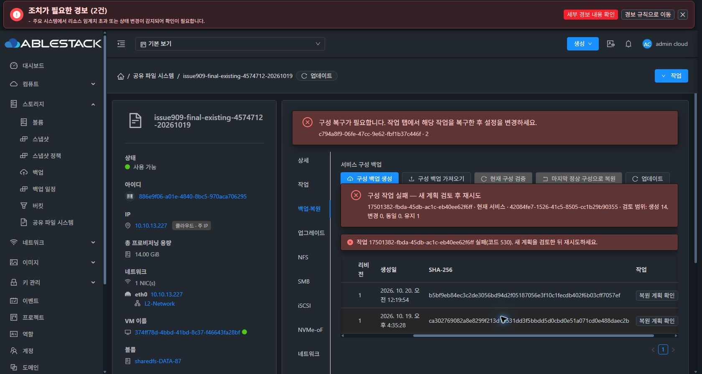
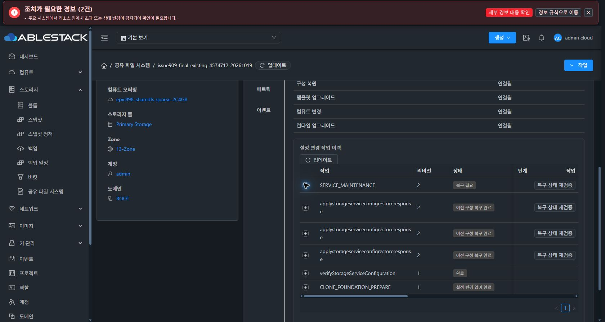

# #909 최종 실환경 재검증 중단 — SMB 응답 판독·자동 역복구 실패

2026-10-20 KST. 제품 구현 ab3f0edfaf0627025906c9d6f393934c62fd0965, 검증 시작 HEAD 5fd3bc5c51195e5a3ff357fd5ee98e6aee32c720. #909 OPEN / Epic PR #1271 Draft 유지.

## 결과

실제 Chrome UI에서 현재 서비스 복원을 1회 접수했다. 00:40:09 KST에 API job 17501382-fbda-45db-ac1c-eb40ee62f6ff가 jobstatus2 / error530으로 종료됐다. 응답은 “Rendered generation activate failed; inspect its scoped recovery receipt”다.

UI의 서비스 중단 동의를 선택한 같은 서비스 복원 경로는 applyStorageServiceApprovedMaintenance API를 사용한다. 해당 API는 검토된 계획으로 storageServiceConfiguration을 실행하는 정식 경로이며 CREATE_NEW 또는 clone을 사용하지 않았다. Storage operation c794a8f9-06fe-47cc-9e62-fbf1b37c446f(revision2)는 SERVICE_MAINTENANCE / RECOVERY_REQUIRED다.

제품 오류 확인 후 추가 적용·수동 reconcile/복구·서비스 정지/시작·클라이언트 I/O·코드 수정·빌드·배포는 실행하지 않았다. 읽기 전용 상태/데이터 확인과 기록만 수행하고 다음 지시를 기다린다. 이슈를 닫을 단계가 아니다.

## 사전 점검과 단일 실행

- origin/upstream fetch 후 local base와 upstream ablestack-europa248653b5892가 0 0임을 확인했다. 작업 트리는 깨끗했다.
- Native CLI b0468a9… / TEST bundle0fef4b3d… / profile4, IN_SYNC·pending/hold 없음·health=ok를 확인했다.
- 같은 VM374ff78d·BOOT·Mold MAC02:0d:00:cc:00:2e, ROOT+DATA4 모두 Ready/SPARSE를 확인했다.
- FILE6/RAW4 이전 검사 기준과 일치, 외부 클라이언트 도구·route·binary·세션 사전 점검이 통과했다.
- UI에서 기존 매핑을 유지해 새 계획을 검토했다. IMPORT42084fe7… / ZIP SHA b5bf9eb8… / RESTORE_EXISTING / 기대 revision1 / 동일 DATA4 / PRIMARY13.227 / 자동 포맷false / PRESERVE / 생성14·보존1·blocker0.
- 기존 SMB/CHAP 비밀값과 정확한 서비스 이름·중단 동의를 입력하고 ‘확인한 계획 적용’을 한 번 눌렀다.
- 확인란 입력 전 브라우저 연결이 한 번 끊겼다. 실제 제출 전임을 확인한 뒤 남은 입력만 완료했다. 제품 POST나 복원 재시도는 없었다.

## Native가 보존한 실패 단계

| 항목 | 관측 |
|---|---|
| prerequisites | started=true / verified=true |
| startedDomains | NFS, SMB |
| appliedDomains | NFS |
| activeDomain | SMB |
| forwardFailure | protocol=SMB, phase=TRANSPORT, code=NATIVE_CHILD_OUTPUT_INVALID |
| rollbackFailure | protocol=GENERATION, phase=TRANSPORT, code=NATIVE_CHILD_FAILED |
| activation phase | RECOVERY_REQUIRED |

이번에는 NFS 적용 단계를 지나 SMB 단계에 도달했다. SMB 자식 명령의 출력을 정상 JSON 응답으로 받아들이지 못한 것이 확인됐지만, 원래 예외·빈 출력 여부·원래 stderr의 정확한 내용은 이번 실행에서 확인하지 않았다. GENERATION 역복구 자식 명령 실패의 더 하위 원인도 미확정이다. 네트워크 문제나 같은 Ganesha family 결함의 재발로 단정하지 않는다.

고정 진단 code는 Native activation journal에 보존됐다. 바깥 유지보수 API/operation은 아직 일반 오류/일반 진단만 보여준다. 이 둘을 구분해 기록한다.

## 현재 자원과 데이터

- Native committed pointer는 원래 baseline1/current를 가리키지만 generationStatus=PENDING, pending=c794a8f9…, SERVICE bootHeld=true다. 이전 포인터가 남아 있는 것을 자동 rollback 성공으로 간주하지 않는다.
- LKG1은 동일한 ACTIVE_LKG와 SHA를 유지한다. 원래 checkpoint/journal/cipher6 SHA·BOOT·MAC·ROOT/DATA5 Ready/SPARSE가 유지됐다.
- DB/API에는 프로토콜4, NFS/SMB 공유 각1, iSCSI 타깃1, NVMe subsystem/namespace 각1이 관측된다. 부분 생성된 행을 정상 복원 성공으로 간주하지 않는다.
- 읽기 전용 ss에서는 NFS 0.0.0.0:2049, SMB10.10.13.227:445 listener가 남아 있다. 외부 NFS 접속·PRIMARY 전용 주소 검증을 완료하지 않았다. 부분 acceptor를 정리하거나 재시작하지 않았다.
- FILE6 내용과 파일/디렉터리 메타데이터·FS UUID, RAW4 검사 영역은 보존됐다. 차이는 NFS alias bind mount가 추가로 남은 것뿐이다.
- 전체 볼륨 checksum, 실제 LOCAL 계정/SID 동일성, 최종 외부 4프로토콜 동시 I/O는 검증하지 않았다.
- 새 VM/디스크, MAC 변경, 포맷, 오류 후 DATA 쓰기/외부 클라이언트 I/O는 0이다.

## 다음 상태

현재 시험 자원과 실패 receipt를 보존한다. 사용자 다음 지시 전에는 오류 수정이나 수동 복구·재검증을 수행하지 않는다. #909 OPEN / #920 미착수 / 최종 UI 정리 #1275 HOLD를 유지한다.

[공개 API·Native·데이터 결과와 전체 SHA](20261020-issue909-nfsinverse-final-stop-public.json)
