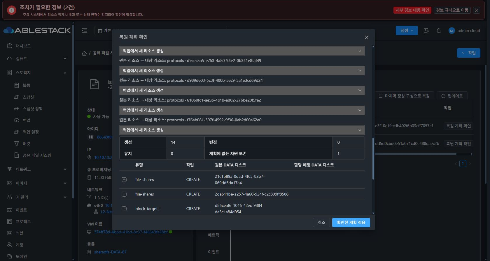
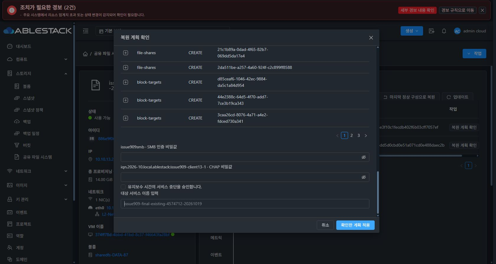

# #909 NFS 활성화·역복구 개선 및 검증 재개 준비

2026-10-20 KST. 구현 커밋 `ab3f0edfaf0627025906c9d6f393934c62fd0965`. Epic #898 / Draft PR #1271.

사용자 지시에 따라 개선·빌드·13번 배포와 검증 재개 준비를 완료했다. 최종 복원 적용은 실행하지 않았으며 #909를 닫지 않는다.

## 수정한 원인과 동작

1. **Ganesha 주소 family 불일치**: IPv6 비활성 VM에서 AI_ADDRCONFIG 조회는 AF_INET을 선택하지만 IPv6 socket 생성은 성공할 수 있었다. Ganesha 5.5.3이 IPv4 sockaddr를 IPv6로 해석해 지정 IP 대신 [::]:2049에 바인딩했다. 고정 upstream 소스에 bind-addr-resolved-family-v1 패치를 적용해 실제 Bind_Addr family로 socket을 선택한다. PRIMARY 일치 검증은 유지한다.
2. **빈 baseline inverse 실패**: current를 빈 이전 구성으로 전환하면 live 설정 symlink가 dangling이 되어 DBus 검사에서 정지 전에 실패했다. 역복구에 한해 immutable TARGET/이전 manifest·scope·해시·설정 파일을 검증해 정지할 source를 식별한다. 다른 작업·변조된 source는 거부한다.
3. **정지·마운트 해제 순서와 기록 유실**: 소유 daemon 정지 후 exact alias/backing inode를 확인해 일반 umount한다. EBUSY/해제 확인 실패 시 alias/fstab/소유 기록을 유지하고 정상 해제 후 정리한다. 승인된 inverse의 PID0·설정 부재 상태는 재개할 수 있다. lazy/force umount는 사용하지 않는다.
4. **하위 오류 소실**: Native→Agent→Backend에서 고정 schema의 protocol/phase/code만 전달한다. forwardFailure와 rollbackFailure를 별도로 보존한다. timeout·빈/잘못된 JSON·수신 주소 불일치·alias 해제 실패를 구분하고 stderr·비밀값·임의 경로를 복사하지 않는다.

## 빌드와 검증

| 범위 | 결과 |
|---|---|
| Backend·KVM Agent | 38 reactors package 성공, 10 suites / 124 tests 통과 |
| Native 전체 회귀 | 1,090 tests 중 1,087 통과, opt-in 실제 OS 결합 3건은 기본 실행에서 skip |
| 실제 CLI+Ganesha 결합 | 최종 CLI b0468a9…로 ROOT/SERVICE 3건 별도 실행 모두 통과 |
| 진단 transport 별도 시험 | 16건 통과 |
| Ganesha 모듈 | 5.5.3-1+ablestack2 .deb 컴파일, 주소 family 5경우와 NFSv4.1 I/O·다른 주소 거부·기존 POSIX ACL 자체 시험 통과 |
| 형식·호환 | 변경 Java 4파일 Checkstyle 통과, 기존 Java 멤버 보존/Java55 일치, Native inline/source·bash syntax 확인 |

실제 결합 시험은 DBus·socket·NFS mount·파일 I/O·EBUSY를 사용했다. holder만 해제한 뒤 같은 scope/activation/writer proof/receipt로 inverse가 재개되어 mount·fstab·receipt를 정리하는 것도 확인했다. 보호 generation/maintenance 기록은 시험에서 준비했고 systemctl만 고정 프로세스 shim이다. Backend/UI 전체 복원 성공으로 계산하지 않는다.

Native 계정 파일 시험은 private /etc·/var·/run·/tmp와 마스킹한 operator profile을 가진 격리 공간에서 실행했다. 오래된 시험의 AST 의존성·typed exception·역사 버전 fixture 전제를 수정했고 제품 보호 조건은 유지했다. 역사 CLI fixture는 실제 고정 SHA의 ASCII 압축본이다.

전체 Checkstyle은 변경하지 않은 upstream CNI/user-data 시험 5파일의 AvoidStarImport 11건 때문에 통과하지 못했다. package는 checkstyle.skip=true로 실행하고 변경 Java를 별도 검증했다.

## 13번 배포와 실패 작업 정리

- Management: 기존 JAR에 Manager class 1개만 overlay. 나머지 204,663 entry SHA와 UI index/config 보존. mold active, HTTP200/API 정상.
- 13.1/13.2/13.3: Agent wrapper class 1개씩 overlay. 다른 entry SHA 보존, mold-agent active·세 호스트 Up. 기존 JAR 백업 보관.
- 시험 VM 374ff78d: Ganesha .deb와 manifest를 기존 패키지·4 ELF·설정·manifest 백업 후 설치. 4 ELF·2 service binding SHA 및 의존성 검증.
- Native: 정상 TEST 서명 등록→검증→AVAILABLE→preflight→upgrade COMPLETE. bundle `0fef4b3d-ff16-40f8-82ad-213dbea7b9c2`, upgrade `c2652fb9-03c4-4d04-9ebc-af6ddb9a43f6`.
- 최종 CLI SHA `b0468a911f2d81a3493b9561721f1805c6a2fd43c64bdef179e17a4b1a49c1f9`.
- 정상 configure API로 hold 작업을 승인하는 새 profile revision4 발급. 원래 artifact/pin은 보존. TEST private key는 메모리/봉인 FD만 사용하고 폐기.

기존 CLI는 dangling 설정 때문에 health가 degraded여서 바로 업그레이드할 수 없었다. exact operation71e0d23c·PID/start ticks·cgroup·endpoint·manifest·alias/backing inode·연결0을 검증하고 **해당 NFS unit 정지→일반 umount→exact dangling link 삭제**만 운영 정비로 수행했다. 보호 journal·pending·activation·checkpoint 암호문은 편집하지 않았다. old CLI health=ok 이후 정상 업그레이드·profile 승인을 수행했다.

이어 **실제 Chrome 작업 탭의 ‘복구 상태 재검증’**을 1회 실행했다. operation `71e0d23c-541d-4b61-85d4-5cbc0d0ca473`은 ROLLED_BACK / INTERRUPTED_RENDERED_WRITER_ROLLED_BACK으로 완료됐다. Native baseline1·IN_SYNC, pending 없음, boot hold 해제·SERVICE RELEASED, NFS PID0·alias mount 없음이다. 원래 실패 진단은 감사 이력으로 보존된다.

SOURCE checkpoint/journal/cipher 6파일 SHA, BOOT, Mold MAC, ROOT와 DATA4/SPARSE가 유지됐다. FILE6 내용·파일/디렉터리 메타데이터·FS UUID와 RAW4 검사 영역이 이전 기준과 동일하다. 전체 볼륨 checksum 검사는 아니다. 새 VM/디스크·MAC 변경·포맷·DATA 쓰기 0이다.

## 다음 검증의 준비 상태와 한계

기존 IMPORT c1181cde…의 CREATE_NEW frozen plan과 allocation/execution/baseline/mapping 5필드를 보존했다. old runtime pin을 바꿔 해당 plan을 재사용하지 않았다.

동일 ZIP SHA `b5bf9eb84ec3c2de3056bd94d2f05187056e3f10c1fecdb402f6b03cff7057ef`를 실제 Chrome에서 현재 시험 서비스에 새로 가져와 검증했다.

- 새 IMPORT `42084fe7-1526-41c5-8505-cc1b29b90355`, ARCHIVE_VALIDATED / PLANNED.
- RESTORE_EXISTING, 현재 VM/서비스·기존 DATA4 그대로. clone/VM 생성 없음.
- 기대 revision1, DATA4 동일 UUID, 수신 PRIMARY=10.10.13.227, automaticFormat=false / PRESERVE.
- 생성14·변경0·기존 미사용 기본 NFS1 보존·blocker0.
- 기존 NFS 행에 주소 변경을 매핑하면 PROTOCOL_ENDPOINT_UPDATE_UNSUPPORTED가 뜨는 보호 동작을 확인했다. 해당 방식은 사용하지 않고 기존 행을 보존하며 백업 항목을 생성하는 정상 계획을 검토했다.
- SMB/CHAP 비밀값·확인 이름 공란, 서비스 중단 동의 미선택, **복원 적용0**.

다음 지시 후 fresh plan을 재검토해 적용하고 API·실제 UI·네 클라이언트 동시 접속/쓰기·데이터 보존을 확인해야 한다. 현재 결과는 최종 forward restore 성공이나 CREATE_NEW 최종 인수 성공이 아니다. 원래 CREATE_NEW 실패 이력과 현재 서비스 재개 검토를 구분한다.

전체 appliance 이미지 재빌드·운영 템플릿 공개/키 전환은 수행하지 않았다. #909 OPEN / PR Draft, #920 미착수, 최종 UI 표준화 #1275 HOLD를 유지하고 다음 명령을 기다린다.

## 실제 UI

[공개 결과와 전체 SHA](20261020-issue909-nfsinverse-ready-public.json)
