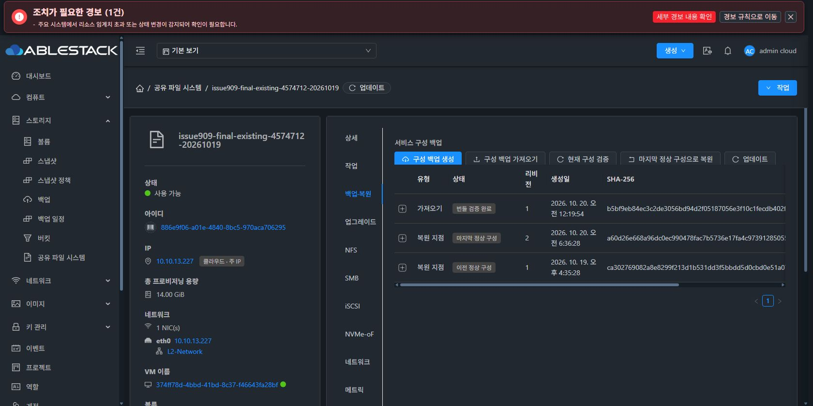

# #909 복원 완료 메타데이터 개선 및 검증 재개 준비

사용자가 승인한 개선 범위는 과거 복원 오류코드의 성공 응답 잔존을 수정하고 13번 환경에 반영한 뒤 검증 재개 전 대기하는 것입니다.

## 원인과 변경

같은 IMPORT에서 실패 후 복원에 성공하면 일반 완료 경로가 restoreState=COMPLETE만 저장하고 이전 errorCode=CONFIG_RESTORE_FAILED를 남겼습니다. 검증 완료 뒤 호출하는 completeRestore로 일반 완료 및 클론 발행 회복 경로를 통일하고 현재 오류코드를 제거합니다. 클론 발행 회복의 previousErrorCode와 기존 실패 operation 기록은 보존합니다.

계획 검토 및 실패 경로의 오류 기록, frozen CREATE_NEW 자원 매핑, updateRestoredArtifact의 현재 수명주기 보존, Native 검증 및 LKG 승격 조건은 변경하지 않았습니다. UI·프로토콜 런타임·DB 스키마 변경은 없습니다.

## 검증 범위

- 수정 전 실패→동일 IMPORT 재계획→성공 시험에서 “A successful restore must not return a previous attempt's failure”로 결함 재현
- 수정 후 성공 응답·저장 상태·IMPORTS 목록의 오류코드 부재와 기존 실패 operation 기록 불변 확인
- 첫 복원 성공, 생성 자원 재사용 후 복원 성공, 클론 발행 회복의 과거 오류 보존, 재실패 시 오류 유지 확인
- 고정 할당/매핑 및 기존 복원 시점의 수명주기 회귀 확인

빌드 결과: mvn -B -pl server -am package, 26개 reactor 모듈 성공. 지정 회귀 테스트 58건(복원 전체 경로 4, 조회 권한/수명주기 4, 템플릿 고정 19, 할당 근거 31), 실패·오류·생략 0건입니다. 통합 시험(IT)은 이번 모듈 빌드에 포함하지 않았습니다.

## 배포 및 운영 경계

server 모듈과 의존 모듈을 빌드하고 13번 관리서버의 StorageServiceConfiguration 및 ClonePublicationCompletion 두 클래스를 반영했습니다. 전체 JAR의 다른 엔트리 204,662개가 바이트 단위로 동일함을 확인했습니다. 호스트 에이전트와 게스트 런타임은 변경하지 않습니다.

실환경 복원은 추가 실행하지 않습니다. 기존 IMPORT와 이미 끝난 async job 응답은 이력으로 그대로 유지하며, 소급 갱신하거나 DB에서 오류코드만 수동 삭제하지 않습니다. 새 완료 처리의 실환경 검증은 다음 사용자 지시 후 수행합니다.

#909 OPEN, Epic PR #1271 Draft를 유지합니다. #920 미착수 및 최종 UI 표준화 #1275 HOLD는 유지합니다.

## 반영 결과와 대기 상태

- 제품 코드 커밋: 7a39cb4b10b87daf72a7241d1cc01d52a0f7739d
- 관리서버 mold: active, 새 PID 2804452
- 배포 JAR SHA-256: 88218dcd26aa2616301705ae8485da60bc96f32a7879bbf278bc5947dfdef104
- 로컬 빌드 클래스 2개의 SHA-256과 배포 JAR의 클래스가 일치합니다.
- 재기동 후 HTTP 200과 인증된 API 조회를 확인했습니다. 초기 기동 중 포트가 열리기 전 수행한 조회는 연결 거부를 받았으며, HTTP 준비 완료 후 조회를 통과했습니다.
- 대상 서비스 Native revision 2 / IN_SYNC / pending 없음 / health ok, ACTIVE_LKG revision 2를 유지합니다.
- 기존 완료 operation 및 IMPORT 조회 내용이 배포 전후 동일하며, VM Running, 원래 MAC·BOOT·CLI와 5개 Ready/SPARSE 디스크를 유지합니다.
- 실제 Chrome에서 재로그인 후 서비스 사용 가능 상태 및 백업·복원 탭의 기존 IMPORT·ACTIVE_LKG2·이전 LKG1 목록 로딩을 확인했습니다.
- 브라우저 제어의 오래된 요소/연결 해제는 같은 Chrome 탭을 다시 연결해 처리했습니다. 서비스 변경이나 복원 실행은 하지 않았습니다.
- 기존 완료 IMPORT에 남았던 errorCode 및 과거 async job 응답을 소급 수정하지 않았습니다. 이번 수정의 실환경 성공 응답 검증은 다음 사용자 지시 후 수행해야 합니다.

다음 검증은 사용자 지시 후 새로 검토한 복원 계획을 사용해 완료 응답·현재 IMPORT 목록에서 restoreState=COMPLETE 및 현재 errorCode 부재를 확인하고, API·실제 UI·클라이언트 및 데이터 보존 결과를 대조하는 것입니다. 현재는 추가 apply·원복·계획 재생성 없이 대기합니다.

공개 근거: [20261020-issue909-restore-completion-metadata-ready-public.json](20261020-issue909-restore-completion-metadata-ready-public.json)
