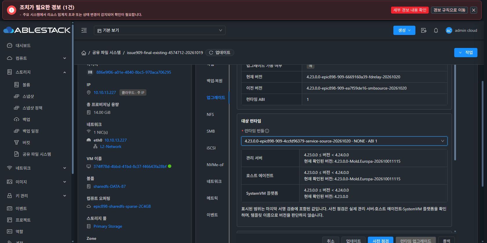

# #909 SOURCE 단계 계약 개선 — 반영 완료·실환경 검증 대기

## 결과와 범위

소스 `4ccfd963794b9a8416a6ae04a9ced902452d28ab`의 관리서버·KVM 변경을 13번 환경에 반영했습니다. Native 수정은 서명 검증한 TEST 번들 `4.23.0.0-epic898-909-4ccfd96379-service-source-20261020`로 등록해 AVAILABLE 상태로 준비했습니다. **실환경 복원은 재개하지 않았고 #909 OPEN / Epic PR #1271 Draft를 유지합니다.**

기존 VM은 삭제·재부팅·MAC 변경·런타임 업그레이드·복구/reconcile 없이 보존했습니다. VM BOOT·CLI 해시와 Native current/pending/SERVICE/activation 파일 해시가 작업 전과 일치합니다. 이전 실패 operation e15fb44d-20d5-472a-a234-48a5607e9fb0의 RECOVERY_REQUIRED 및 NFS·SMB HELD 상태가 이번 반영으로 해제된 것은 아닙니다.

## 원인과 반영 내용

기존 유지보수는 활성 LOCAL SOURCE의 NFS·SMB를 정지시킨 뒤, 렌더링에서 그 SOURCE를 다시 가동 상태로 검사했습니다. 정지 절차와 다음 단계의 원본 건강 검사 조건이 충돌한 것입니다. 과거 실패의 하위 예외 원문은 사후 확보하지 못했습니다. 이번 수정은 코드 경로·격리 통합 시험으로 확인한 계약 불일치를 교정한 것이며, 과거 원문을 확보했다고 소급 주장하지 않습니다.

- 활성 LOCAL 복원도 기존 SERVICE 흐름을 재사용해 PRESTOP 검증 → 승인 정지 → AFTERSTOP 영수증 → 암호화 SOURCE 체크포인트 순서로 진행합니다.
- SOURCE 체크포인트를 새 임의 키로 덮지 않고 원래 렌더링 키·writer·generation·BOOT·원본 해시를 검증해 재사용합니다.
- KEEP ACL의 재입력 SMB 암호·CHAP·DH-CHAP은 소유자·프로토콜·principal·권한·상태·인증 정책이 검토 결과와 일치할 때만 메모리의 TARGET 입력으로 전달합니다. KEEP 리소스의 CRUD/권한 변경은 하지 않습니다.
- 내용이 같아도 해당 유지보수에서 실제 정지한 NFS·SMB는 인증된 정지 영수증에 따라 다시 적용합니다. 블록 프로토콜을 임의 재시작 대상으로 추가하지 않습니다.
- canonical SMB/AD·실제 소유 SMB/winbind·알려진 SAM DB가 모두 없는 NFS 단독 SOURCE는 읽기 전용 부재 증거를 사용합니다. SAM/SID를 만들지 않으며 기존 SMB/AD의 SID 검사는 유지합니다.
- 정지 전 fence 실패는 원래 관리자의 명시적 복구에서 DB·원본·동일 writer를 확인한 뒤 자기 pending만 중단할 수 있습니다. 자동 원복이나 변경된 SOURCE 검사 우회가 아닙니다.
- Native 단계 오류7종을 고정 코드로 분류해 작업별 첫 실패 영수증에 보존하고 KVM → Manager → 작업 결과까지 전달합니다. 원문·키·암호·요청 본문을 공개 진단에 넣지 않습니다.

## 검증

| 구분 | 결과 |
| --- | --- |
| 관리서버·KVM 패키징 | exit0, 대상·의존 모듈 빌드 성공 |
| Java 회귀 | 188건, 실패0, 오류0, skip0 |
| Native 전체 회귀 | 1157건 중 1151건 통과, 환경 의존6건 skip |
| 추가 SAM 부재 focused 시험 | 8건 통과 |
| 활성 네 프로토콜 반복 복원 | 격리 controller에서 revision3·4 정상 완료 |
| 실패 복구 | 정지 전 실패 중단·staging 실패 후 원본 재개·NFS 단독 복원 통과 |
| 배포 확인 | 관리서버 active, 호스트3대 Up/Enabled·mold-agent active |
| Native 번들 | 서명·manifest·파일 SHA 검증, AVAILABLE, 개인키 파일 생성0 |
| 기존 VM 보존 | BOOT·CLI·상태 파일 해시 및 VM·MAC·SPARSE 디스크5개 작업 전과 일치 |

Native 및 Java Native controller 시험은 bwrap의 호스트 루트 읽기 전용·독립 /etc·/var·/run·/tmp·네트워크 격리에서 수행했습니다. Native skip6건은 별도 실제 NFS/Samba 일회성 컨테이너가 필요한 시험입니다. 이 결과를 13번 실환경 복원 성공으로 대체하지 않습니다. Java 수치는 전체 회귀의 통과 사례와 시험 모델 보정 후 해당 실패·인접 경로 및 모듈 패키징 재실행 결과를 사례별로 합친 고유 건수이며, 공개 JSON의 provenance에 각 실행 출처를 기록했습니다.

통합 시험의 OS_ONLY_EMPTY_NVME_SOURCE_SUPPORTED는 활성 NVMe SOURCE를 금지하던 시험 모델 제한이었습니다. ledger에서 원문을 확인한 뒤 제품 변경 없이, 원본/대상 바인딩과 configfs 실측이 같은 범위만 실제 Native identity/cleanup 생산자로 재적용하도록 모델을 보완했습니다. 추가로 응답 유실 후 원복에서 SMB 전용 unit 조회를 전체 unit 질의만 받던 모델이 SERVICE_OS_UNIT_QUERY_SCHEMA로 거부한 것을 확인해, 고정 NFS/SMB/전체 pattern 집합과 소유 unit 필터링을 지원하도록 모델만 교정했습니다. 두 사례의 원인을 제품 NVMe 적용 결함으로 계산하지 않았습니다.

## 배포와 다음 단계

관리서버·호스트 10.10.13.1·.2·.3은 기존 JAR를 백업하고 변경 클래스만 교체했습니다. 나머지 엔트리의 바이트 일치를 확인했습니다. 기존 서비스 VM의 Native는 변경하지 않았습니다.

새 VM용 runtime catalog ID는 `1bc48542-2e85-403a-b370-15127732e6b7`입니다. 현재 단계는 등록·서명·다운로드 해시 및 UI 후보 표시 확인까지입니다. 새 VM에 대한 적용·사전 점검은 다음 지시 후 수행합니다.

다음 실환경 시험은 기존 복원 VM을 정상 정리한 뒤 **새 VM·새 ROOT, SPARSE 이상**에서 시작합니다. 이전 VM의 HELD 상태는 원래 범위의 명시적 복구로 정리 가능한지 먼저 확인하며 DB 상태 강제 변경이나 보호 검사 생략으로 삭제하지 않습니다. DATA 보존 정책·MAC 자동 할당을 유지하고 기존 VM을 반복 복원 시험 대상으로 재사용하지 않습니다.

실환경 복원·클라이언트·DATA 보존 재검증, CREATE_NEW 기존 DATA4 재사용/새 SPARSE DATA4 분기, 시험 자원·계정 정리의 최종 인수는 남아 있습니다. 개선 반영과 재개 준비에서 중단하고 다음 지시를 기다립니다.

공개 근거: [20261020-issue909-service-source-contract-ready-public.json](20261020-issue909-service-source-contract-ready-public.json)

