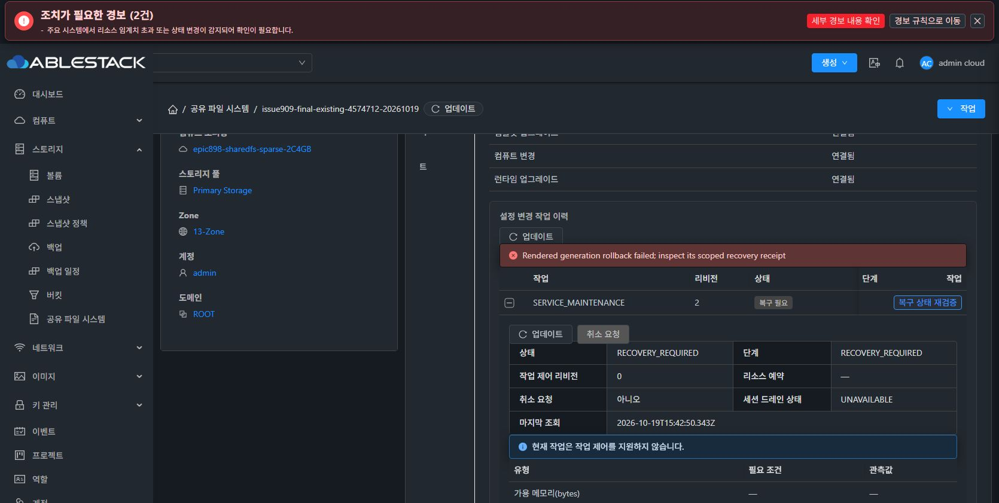

# #909 SMB 응답·서비스 역복구 개선 배포와 공식 복구 중단

구현과 서명 런타임 배포는 완료했으나 **검증 재개 준비는 미완료**다. 실제 Chrome에서 기존 실패 작업의 공식 복구를 한 번 실행했을 때 Rendered generation rollback failed; inspect its scoped recovery receipt가 발생했다. 추가 복구 실행·새 forward 복원 적용·제품 수정은 중단했다. #909 OPEN, Epic PR #1271 Draft를 유지한다.

## 개선 내용

- Samba smbpasswd 등의 일반 출력이 성공 JSON 앞에 섞이던 문제를 실제 도구로 재현했다. SMB 자식 명령의 기본 stdout/stderr를 닫고 명시적인 PIPE/capture는 유지한다. 예외는 고정된 안전한 오류 응답으로 반환하며 Native의 엄격한 JSON 검사는 유지한다.
- SMB만 정지할 때 다른 도메인인 NFS의 깨진 설정 링크를 먼저 검사하던 순서를 고쳤다. 선택된 도메인만 소유권을 확인하며 외부 프로세스·변경된 소유자에 대한 거부는 유지한다.
- 실제 systemd의 bash 감독 프로세스와 자식 smbd를 PID 파일·부모 PID·argv·cgroup·startTicks로 함께 검증한다. SERVICE와 ROOT 신원 검사에서 같은 판정 로직을 사용한다.
- rendered SMB 적용은 불필요한 legacy nmbd를 시작하지 않는다.
- 빈 원본 구성의 역복구에서 원래 없던 smb-managed-identities.json을 빈 객체로 재생성하던 문제를 실제 CLI로 재현했다. disabled rendered·이전/현재 identity 없음·기존 파일 부재 조건에서만 빈 receipt 생성을 생략한다. endpoint 정리와 기존/manual/enabled receipt 동작은 유지한다.

소스 커밋: 8e5d963fe0b 및 ea7f59de163. 관리 서버·KVM Java·Vue 소스는 이번 변경 대상이 아니며 Native 런타임 모듈을 빌드했다.

## 최종 소스 검증

| 범위 | 결과 | 한계 |
|---|---|---|
| 전체 Native | 1,121건 중 1,115 PASS, 실행 조건에 따른 6 SKIP, 오류 0 | WSL 계정 파일은 읽기 전용이며 /etc·/var·/run은 격리 |
| 실제 Samba 4.17.12 | 11/11 PASS | systemctl은 고정된 컨테이너 프로세스 어댑터 |
| 실제 Ganesha/NFS | 3/3 PASS | netbase 포함 깨끗한 컨테이너·격리 namespace |
| bash·inline source 계약 | PASS | 전체 Native 회귀에 포함 |

Samba 시험은 실제 SAM의 성공·실패, Native strict parent, 클라이언트 인증 읽기/쓰기, 빈 원본 역복구 후 endpoint 정리·receipt 부재·SAM 및 데이터 보존을 포함한다. NFS 시험은 ROOT/SERVICE 적용과 빈 baseline 역복구, 사용 중인 mount의 실패 기록 보존과 동일 scope 재개를 포함한다. 이 결과를 실환경 전체 복원 성공으로 간주하지 않는다.

## 13번 배포와 준비 작업

정상 서명·카탈로그·preflight·런타임 업그레이드 경로를 사용했다. 개인키는 sealed memfd에서만 사용하고 버퍼와 descriptor를 정리했다. 최종 버전은 4.23.0.0-epic898-909-ea7f59de16-smbsource-20261020, CLI SHA는 0dfcb9e6bcbfb0a250d64ac2cf363a42fe923d763aadc63ac4582de25bdfc5bf다.

- bundle 8de7350c-4834-4c6f-bac4-ca2a3646bea7, upgrade ae50c010-0063-4310-b7ca-3ac7a8b80b15: COMPLETE.
- 공식 profile API로 리비전 4→5와 실제 새 CLI pin을 확인했다. 기존 원본 checkpoint/key/pin을 바꾸지 않았다.
- 배포 전 실패한 TARGET에 속한 NFS와 nmbd만 소유 범위를 증명한 뒤 정상 정지했다. NFS alias는 일반 umount, 정확한 dangling config link만 정리했다. SMB acceptor와 SAM은 이 수동 정리에서 유지했다.
- nmbd disable은 rendered 445 구성에 맞춘 명시적인 정리다. 원본의 owners=[]는 inactive를 증명할 뿐, 원래 disabled였다는 증거로 사용하지 않는다.
- VM 재부팅·MAC 변경·볼륨 생성/삭제·포맷은 하지 않았다. ROOT와 DATA 총 5개는 모두 Ready/SPARSE다.

## 실제 UI 공식 복구 결과

Chrome 작업 탭에서 기존 operation c794a8f9-06fe-47cc-9e62-fbf1b37c446f의 **원래 작업 복구를 한 번만 실행**했다. 현재 로컬 신원 보존 방식으로 바꾸거나 새 복원 적용을 실행하지 않았다.

UI는 위 rollback 오류를 표시했고 API 작업은 RECOVERY_REQUIRED / Rendered scoped recovery remains pending이다. Native baseline1은 남아 있지만 PENDING과 SERVICE bootHeld=true가 해제되지 않았다. SMB acceptor registry는 1개이며 원본 계정·SAM 복구의 완료 조건도 충족하지 못했다.

원래 activation JSON과 그 안의 GENERATION/TRANSPORT/NATIVE_CHILD_FAILED 기록은 이전 실패 시점과 동일하다. 따라서 이를 **이번 실행의 정확한 새로운 하위 원인으로 단정하지 않는다**. 현재 확정된 사실은 공식 복구가 다시 실패했고 원본 상태 복구가 완료되지 않았다는 것이다. 새로운 하위 예외 원인은 미확정이며 재시도하지 않았다.

## 보존과 남은 작업

읽기 전용 검사에서 기존 시험 파일 6개와 raw 검사 영역 4개, 파일시스템 UUID·BOOT·Mold MAC이 유지됐다. 원래 LOCAL checkpoint 6개와 generic 신원 checkpoint, 기존 CREATE_NEW IMPORT의 고정 매핑·실행 계획도 그대로다. 인증된 원본 캡슐에서 공개 체크섬·존재 여부만 추출해 비교했으며 개인키·SAM 원문·계정 파일 원문을 반출하거나 저장하지 않았다. 아직 원본 신원과 동일하지 않다는 결과도 함께 보존했다.

다음은 새 하위 실패 원인을 확정하는 작업이다. 그 원인을 고친 뒤 공식 복구가 완료돼 PENDING과 hold가 해제되어야 최종 네 프로토콜 동일 서비스 복원을 재개할 수 있다. 외부 클라이언트 I/O와 최종 forward 복원 성공은 이번에 검증하지 않았다. 추가 구현·재시도는 다음 지시까지 대기한다.

공개 근거: [JSON](20261020-issue909-smbresponse-improvement-stop-public.json).
