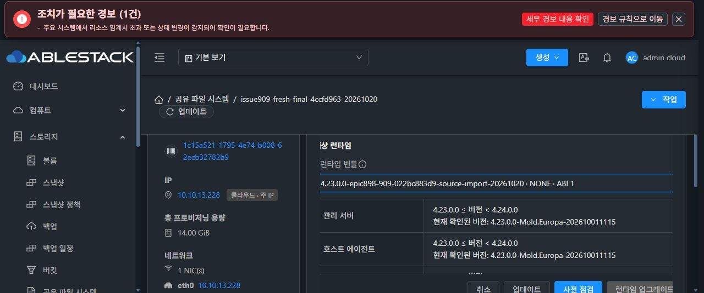

# #909 SOURCE import 호환·진단·사전 실패 정리 개선 반영 및 재개 준비

2026-10-20 / Epic #898 / Draft PR #1271

## 결과와 작업 경계

소스 `022bc883d90afeaa7e05b4db6ee8a0ec3dd86d3a`의 개선·회귀·관리서버/KVM 모듈 빌드와 13번 환경 반영을 완료했다. 다음 새 VM에 설치할 서명 TEST Native 런타임은 AVAILABLE로 준비했다. 기존 복원 VM에 새 Native 런타임을 설치하거나 원래 실패 작업의 복구·삭제, 새 VM 생성, 실환경 복원·클라이언트 I/O를 재개하지 않았다. #909는 OPEN, PR #1271은 Draft, 최종 UI 정리 #1275는 HOLD다.

## 개선 사항

기존 canonical의 iSCSI `listenerPorts="3260"`, NVMe namespace `"4420"`와 config의 정수 배열이 새 렌더러에서 충돌하던 문제를 고쳤다. SOURCE import와 TARGET stage가 같은 Native resolver를 사용해 CSV/정수 배열을 메모리에서 해석한다. 기존 별칭 및 빈 값 fallback을 보존하고, 원본 canonical 파일·세대·체크섬은 바꾸지 않는다. 잘못된 타입·범위·중복·미등록 포트·병렬 필드 불일치는 계속 거부한다. 다중 namespace 리스너 합산 정책은 이번 범위에서 변경하지 않았다.

render-import의 입력·자격증명 참조·렌더링·SOURCE scope·후보 검증·SOURCE 검증·공개 단계에 고정 IMPORT 코드를 부여했다. 렌더 중 실패한 실제 프로토콜만 표시하고 나머지는 GENERATION으로 제한한다. Native→KVM→Manager에서 폐쇄 진단을 검증해 API 오류와 원래 writer의 안전한 receipt에 전달한다. 원문 예외·stderr·비밀값과 다른 action의 STAGE/IMPORT 진단 차용은 차단한다.

재개 준비 점검에서 발견한 정리 차단점도 보완했다. 기존 checkpointless SERVICE 복구는 writer2/source1 클론 초기 경계만 지원해 이번 writer15/source14를 정리할 수 없었다. 후기 세대의 pre-import 실패를 별도 경로로 분리했으며 기존 NFS 및 초기 클론 경계는 유지했다. 원래 관리자의 명시적 reconcile에서만 다음을 입증한 뒤 **원래 DB writer만 ROLLED_BACK**으로 종료한다.

- 원래 실패 row·사용자·요청 fingerprint, 직전 유일 COMPLETE SOURCE, 이전/현재 DB snapshot·VM/ROOT/DATA binding·BOOT·해시 일치.
- SOURCE의 ACTIVE_LKG archive/checksum·당시 runtimeEvidence와 현재 Native/frozen의 일치. 당시 source 자신의 PENDING 수집 상태와 현재 IN_SYNC/pending=null을 구분.
- ROOT/SERVICE/rendered hold·rendered current/activation·논리 reservation·다른 미해결 writer·포맷터 부재.
- 네 프로토콜 실효 상태, FILE 2개와 RAW 2개를 포함한 모든 DATA 식별 정보의 최신 관측 및 최종 재관측 일치.

진단 텍스트는 복구 권한 근거로 사용하지 않는다. 유효한 폐쇄 non-STAGE runtime 및 NFS validator receipt를 설명 자료로만 허용한다. Native import/replay/format/release, SQL snapshot restore, DATA 변경은 이 정리 경로에서 수행하지 않는다. 과거 검증 프로필의 하루 만료를 새 적용 권한처럼 요구하지 않으며 원본·현재 증명으로 안전 종료를 판단한다. 이번에는 해당 실환경 정리 API를 호출하지 않았다.

## 검증

- Native 전체 1178건: 1172건 통과 / 6건 별도 NFS·Samba 컨테이너 의존 skip / 실패·오류0.
- 집중 Native 79건과 임베디드 CLI 원본 일치·shell syntax 확인.
- 저장한 실제 실패 SOURCE 입력의 iSCSI/NVMe 렌더링 통과, 원본 해시 불변. 이 검사는 격리된 오프라인 검사이며 장치·인증 조회를 대역으로 제공했고 실환경 적용 증거로 계산하지 않았다.
- Java 전체 회귀 및 최종 경계 회귀의 고유 208건 통과 / 실패·오류0. 첫 전체 package에서 195건·whole-flow20건을 실행했고, 최종 코드에서는 사전 실패 정리·기존 초기 클론·활성 반복 복원·실패 원복과 관련 회귀를 재실행했다. 케이스별 실행 출처를 보존했다.
- 최종 Maven reactor 38개 모듈 package 성공. 사전 실패 정리 신규 테스트는 순수6개·Manager7개로 원래 관리자·후기 세대·FILE/RAW·LKG·무효과 종료·위조/드리프트 거부를 검증했다.
- 테스트는 WSL canonical ext4에서 수행했다. Native는 host root 읽기 전용·별도 /etc,/var,/run,/tmp 및 격리 network의 bwrap 안에서 실행했다.

최종 검증 계약을 동결하기 위해 중간 Java 빌드 한 번을 의도적으로 중단한 기록은 보존했다. 이후 성공한 최종 package만 배포했다. 실환경 제품 오류나 성공한 인수 결과로 집계하지 않았다.

## 반영과 보존 확인

관리서버 `mold`와 13.1·13.2·13.3의 `mold-agent`는 기존 JAR를 보관한 뒤 변경 class family만 반영했다. 변경 외 JAR entry의 바이트 일치를 검증했고 서비스 active·호스트 Up을 확인했다. DB schema/테이블/컬럼 변경은 없다. UI 코드는 변경하지 않았으므로 UI 재빌드는 하지 않았다.

- Native TEST version: `4.23.0.0-epic898-909-022bc883d9-source-import-20261020`
- bundle ID: `56dea2de-7dcc-4017-9b72-8f38102e2fc8`, state AVAILABLE
- Native CLI SHA-256: `e49a54deeed660da8dde5668b0676a7c5cfcff8245428db9bb0b923ea1b0d400`
- 서명 개인키 파일 생성0, RAM descriptor 사용 후 폐기·버퍼 지움, 공개 신뢰 키와 서명·파일 해시 검증.
- API 카탈로그 및 실제 Chrome UI의 신규 번들 표시를 읽기 전용으로 확인. 업그레이드 사전 점검·적용·복원 버튼은 실행하지 않았다.

기존 VM `88c1b618-38c7-474c-9b4b-8fa4284e9245`, ROOT와 SPARSE 디스크5개, 자동 MAC, Native CLI/BOOT/세대14/current·pending·hold 상태 해시는 작업 전과 같다. 원본 시험 파일2개·원시 블록 영역4개의 체크섬과 파일 메타데이터·장치/파일시스템/계정 식별 정보도 QGA 읽기 전용 재관측에서 마지막 실패 직후와 일치했다. 원래 작업 `05a393fa-a3f1-4f24-814f-afb3d9684235`의 RECOVERY_REQUIRED도 그대로다. 이는 이번 작업에서 복구를 재개하지 않았기 때문이다.

## 다음 지시 후 재개 순서

1. 새 관리서버 코드로 원래 작업의 명시적 무효과 정리를 수행하고 종료·DATA 보존을 확인.
2. 기존 복원 VM·ROOT 제거를 확인한 뒤 새 VM·새 ROOT·SPARSE 이상 DATA로 시작. MAC은 Mold 자동값 유지.
3. 위 AVAILABLE 번들을 새 VM에 설치·서명/CLI 핀 확인하고 새 VM 전용 검증 프로필을 복원 적용 전에 준비.
4. 실제 UI 백업 다운로드→공유 설정 변경→같은 서비스에 ZIP 업로드·복원, API/UI/네 클라이언트/데이터 보존 검증.
5. 성공 후 남은 CREATE_NEW 기존 DATA4·전부 신규 DATA4 분기 및 시험 자원 정리, 이슈 종료 검토.

새 VM 실환경 복원 성공과 최종 이슈 종료 조건 충족은 아직 주장하지 않는다. 현재는 개선 반영 및 검증 재개 준비를 마친 상태로 다음 지시를 기다린다.

[구조화된 공개 근거](20261020-issue909-source-import-compat-ready-public.json)

