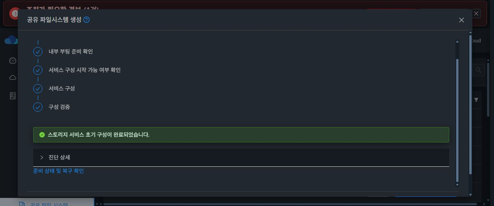
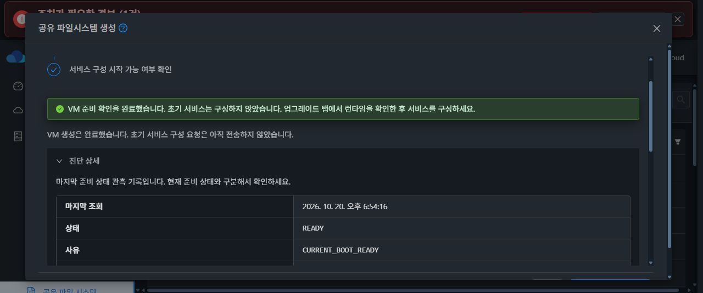
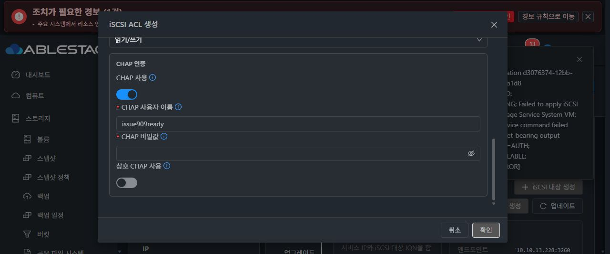

# #909 초기 부팅 준비 UI 개선·13번 반영 및 실환경 중단 결과

제품 소스: 9b41c7645b16d86039b61bb65ba44b97af86bc18. #909 OPEN / Epic PR #1271 Draft 유지.

## 결과

요청한 초기 부팅 관측·표시 개선을 구현하고 모듈 빌드해 13번에 반영했다. 기본 생성 경로와 나중 구성 경로 모두 실제 Chrome UI에서 성공했다. 다만 복원 재개용 복합 서비스 준비 중 iSCSI ACL의 별도 제품 결함을 발견해 즉시 중단했다. 복원 재개 준비 완료가 아니며 전체 백업·복원은 실행하지 않았다.

## 구현과 빌드

- 정상 live health의 BOOT 메타데이터 미발행, 이전 BOOT 캐시, 관측 도중 BOOT 교체를 읽기 전용 대기로 구분한다.
- 실제 RPC/수집 오류, 잘못된 응답, hold, formatter·generation 미해결 상태는 통과시키지 않는다.
- VM 생성 완료와 첫 서비스 변경 시작을 구분하고, 만료 상태의 태그·본문·버튼을 하나의 UI 상태 모델로 계산한다.
- 진단은 허용된 공개 비교 필드 14개만 취급하고 최초 실패 기록을 현재 관측과 구분한다.
- Maven server -am package 성공. 관련 Java 44개, UI 14 suite / 258개, lint 통과.
- 격리된 Native 생산자 테스트 9개와 공통 wire 표본 14개. Native 호스트 실행 없음, WSL 계정 파일 무변경 확인.
- DB 스키마, 호스트 에이전트, Native 제품 코드와 복원 엔진은 이번에 변경하지 않았다.

## 배포

관리서버에서 Java 3개 클래스 계열 24개를 비교해 다른 16개 클래스를 교체했고 나머지 JAR 항목 204657개가 동일함을 검증했다. mold 정상 기동을 확인했다. UI 자산 8개와 한·영 번역 키 각 36개를 반영했다. 기존 UI 자산 4434개와 보호된 다른 파일 20개를 보존했다. 브라우저를 다시 로그인해 새 UI로 시험했다.

## 실제 UI 성공

준비·생성·설정·런타임 적용은 실제 Chrome UI로 수행했다. 별도 API 준비 확인이나 콘솔 우회는 하지 않았다.

1. 기본 경로: 새 VM 생성 → 내부 부팅 대기 → 동일 BOOT 준비 확인 → NFS 활성화·내보내기·ACL → 최종 구성 검증 COMPLETE. 공유와 CIDR, 3개 구성 작업 COMPLETE 및 ROOT/DATA sparse를 UI에서 확인했다.
2. 나중 구성: 이전 시험 VM/ROOT를 UI에서 제거한 뒤 새 VM을 생성했다. BOOT 관측 대기 문구를 거쳐 초기 서비스 쓰기 없이 준비 COMPLETE를 확인했다. 구성 작업 이력도 비어 있었다.
3. 완료 화면의 런타임 버튼으로 업그레이드 탭에 진입했다. 번들을 명시 검색·선택하고 서명·호환 범위를 확인했다. PREFLIGHT_READY / PREFLIGHT_OK 뒤 UI 활성화로 COMPLETE / 100%와 현재 버전 변경을 확인했다.
4. 새 서비스에서 NFS 활성화·내보내기·ACL, SMB 활성화·전용 SPARSE DATA·로컬 인증 공유와 ACL, iSCSI 활성화·전용 RAW SPARSE DATA·대상 생성까지 COMPLETE였다.

기본 경로 시험 SharedFS 710e4cf3-1760-4a11-9cc6-a91ca9692274 / VM f3e50eb8-ead8-4393-951c-7f13f0b7f120 / ROOT e45062a2-7fb1-4f6f-9395-8a1feb967c06 / DATA ff4637fd-c3c3-49ff-af4f-c21116cb538d는 다음 시험 전에 UI 정상 종료·전용 자원 삭제를 수행했다. ROOT 삭제 이벤트도 확인했다. DATA의 물리 GC 완료까지 별도로 단정하지 않는다.

## 중단한 오류와 정확한 원인

2026-10-20 19:07 KST, iSCSI 첫 ACL 작업 d3076374-12bb-41fd-a368-60e91a95a1d8 / revision 9가 APPLYING에서 실패하고 RECOVERY_REQUIRED로 종료됐다.

UI 진단: ISCSI guard=AUTH / category=VALUE_ERROR. 자동 rollback 진단: Recovery iSCSI primary has no exact original writer authority.

최초 원인은 IQN 계약 불일치다. UI SharedFSTab.vue의 대상 IQN은 편집 가능하며 .local.storage: 제한 안내·검증이 없다. API CreateStorageIscsiTargetCmd도 일반 문자열을 받고 Manager는 대상 이름을 그대로 저장·적용한다. UI에서 iqn.2026-10.local.ablestack:issue909-prepared-iscsi 대상 생성이 revision 8 COMPLETE였다.

반면 Native iscsi_auth.py의 iscsi_auth_name(target=True)는 .local.storage:가 없으면 ValueError를 발생시킨다. planned_iscsi_lun_access는 ACL이 없으면 이 검사를 건너뛰고, 첫 ACL에서 검사한다. 이 검사는 CHAP 값 처리 전이므로 사용자명·16자리 비밀값이 원인이 아니다. CHAP을 끈 ACL도 같은 이름에서 차단될 수 있다.

읽기 전용 현장 확인에서 설치 CLI SHA e49a54deeed660da8dde5668b0676a7c5cfcff8245428db9bb0b923ea1b0d400, embedded·별도 라이브러리 모두 같은 제한을 확인했다. 저장된 대상에는 ACL 0개이며 configfs 대상은 존재하고 해당 초기자 ACL은 없다. 수정·재시도·복구 명령은 실행하지 않았다. 유효한 사용자 지정 IQN을 UI/API가 허용한 뒤 Native 인증이 거부하므로 명시된 입력 제한을 무시한 시험 실수가 아니다.

후속 rollback은 별도 범위 결함이다. preserveRecoveryIscsiPrimary는 SOURCE와 재구성 primary 표현이 다르면 복원·LKG 두 작업만 허용한다. 일반 createstorageiscsiaclresponse의 자동 rollback은 이 작업 종류 검사로 거부된다. 운영자 승인이 부족한 것이 아니다. 실제 frozen SOURCE와 재구성 payload의 listenIp 값·존재 여부 중 무엇이 달랐는지는 이 실행에서 추가 확인하지 않았다.

## 다음 개선 방향 (미구현)

- UI 대상 생성과 ACL에 동일 IQN 계약을 적용하고 새 볼륨 생성 전에 검증한다. 기존 공개 계약대로 사용자 지정 IQN을 지원하되 Native 소유권은 접미사 대신 정확한 관리 대상·볼륨·writer 바인딩으로 검증한다.
- UI에는 대상 이름 검증 실패, 서비스 변경 여부, 원복 결과를 분리해 표시한다. 비밀값과 원문 stderr는 노출하지 않는다.
- 일반 ACL 실패는 원래 writer와 SOURCE 범위로 원복한다. 복원 전용 예외를 일반화해 우회하지 않는다.
- 사용자 지정 IQN의 대상 생성 → CHAP 없음/단방향/상호 CHAP ACL → 실제 클라이언트 접속과, 초기 거부 시 기존 대상 보존·작업 종료를 함께 검증한다.

## 보존 자원과 미진행 범위

- SharedFS a52dbb5c-925e-45de-8bb4-f5c4fcd1438a, VM caf20e42-5199-4bff-90d6-1b9e92514c7f (i-2-95-VM), host 10.10.13.2.
- ROOT 019ed59a-659d-4881-9e6b-85c137d1c0b4.
- 새 SPARSE DATA: NFS c63fc46d-cfc9-4821-8a39-19cabbd3eb8c (8GiB), SMB ad471070-e760-4cd3-bf46-60f1d16feaf5 (2GiB), iSCSI 3e499ff0-8247-40f9-aac5-295a4149a5b5 (2GiB).
- 적용 런타임 번들 56dea2de-7dcc-4017-9b72-8f38102e2fc8 / 4.23.0.0-epic898-909-022bc883d9-source-import-20261020.
- 실패 후 retry/recovery, NVMe-oF, 시험 전용 승인, 백업·복원, 클라이언트 I/O는 하지 않았다. MAC 변경 없음. 기존 다른 서비스와 보존 DATA는 변경하지 않았다.

