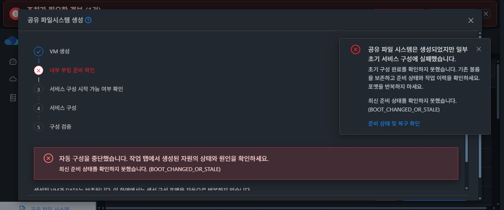
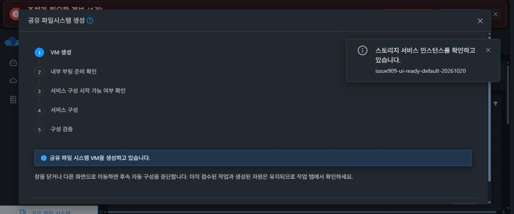
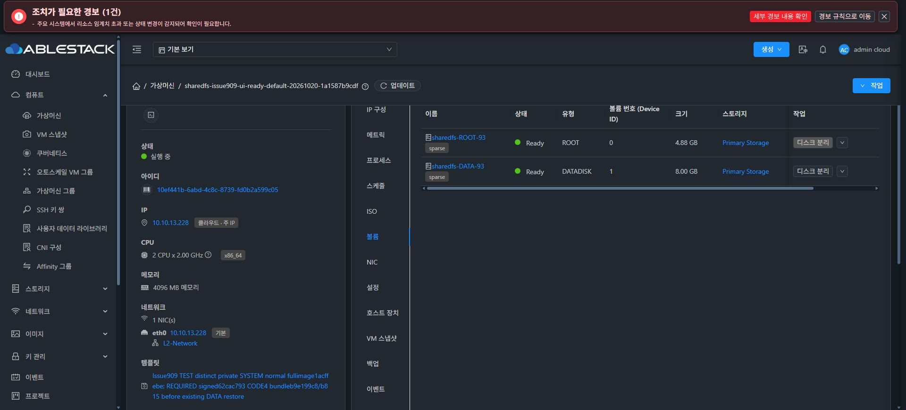

# #909 UI 준비 흐름 개선 반영 후 실제 UI 검증 중단

2026-10-20 KST. 구현·모듈 빌드·13번 배포는 완료했지만 실제 UI의 첫 준비 확인에서 결함이 발생했다. 복원 검증 재개 준비 완료가 아니다. #909 OPEN, Epic PR #1271 Draft를 유지하고 추가 수정·시험·자원 삭제 없이 원인 분석 후 중단한다.

## 구현과 배포

소스 커밋: 9f0b6787d1163f18e834bed424e33e101a97ccb3.

- 생성 UI에 서비스까지 구성 / VM 준비 후 나중에 구성 모드를 추가했다. 진행 창을 유지하고 현재 BOOT의 준비 확인 후 초기 서비스를 실행하도록 했다.
- 창 닫기·이동·취소 시 후속 조회·자동 구성을 중단하고, 같은 창에서 중복 VM 생성 요청을 막으며 임시 인증값을 정리했다.
- 작업 탭에 준비 상태와 관리자 시험 전용 승인 UI를 연결했다. 시험 승인은 신규 SPARSE/FAT ROOT 및 DATA4, 실제 서명 런타임, 소유권·원본 제외 범위를 확인하며 productionCapability=false를 유지한다.
- 런타임 목록의 임의 첫 항목 자동 선택을 제거하고 검색·명시 선택·서명과 해시 표시를 보완했다. 기존 런타임 안전 점검과 정상 legacy 업그레이드 경로를 유지했다.
- 첫 일반 설정은 desired writer를 만들기 전에 준비 상태를 검사한다. 기존 검증된 내부 복원·baseline 문맥은 별도로 유지했다. 복원 실행 로직, RuntimeUpgradeManagerImpl, Native CLI를 수정하지 않았다.

Java 고유 회귀 116개와 통합 UI 12 suite/230개가 통과했다. 최종 패키지 단계에서는 수정된 State/Admission/Fixture 및 InitialBaselineFlow 23개를 재컴파일·실행했다. 기존 whole-flow 20개는 bwrap 격리 Native RPC로 검증했다. 그러나 이 결과는 아래 실제 초기 부팅 응답 조합을 검증하지 못했다.

관리 서버는 필요한 21개 클래스 항목을 반영하고 나머지 204652개 항목의 내용 동일성을 검증했다. mold 재기동 후 active. 관리 JAR SHA256: cb1f96cbe3a4c134a93283bfa669df19e7c68c3c3fb5bbfa58fdcaf15716d6fb.

UI는 새 자산 46개와 영어·한국어 92개 키씩을 반영했다. 기존 자산 4388개와 다른 설정·번역 항목은 유지했다. index SHA256: 73f389975459620995325425d305861c4bd5e0f36fa0f601c28200a409c7194f. 호스트 에이전트와 Native 런타임은 이번 배포에서 교체하지 않았다. DB 스키마 변경은 없다.

## 실제 UI 검증과 중단 위치

Chrome Computer Use에서 로그인·생성 양식 입력·확인을 실행했다. 셸/API로 시험 자원 생성이나 준비 상태 확인을 수행하지 않았다.

- 서비스: issue909-ui-ready-default-20261020
- SharedFS: 390a5307-fc9d-4c13-99ef-c25d82a05310
- VM: 10ef441b-6abd-4c8c-8739-fd0b2a599c05 / i-2-93-VM / ablecube13-3
- ROOT: cf9088ce-0705-498a-9535-adf7949b61f5
- DATA8GiB: 69e9dd36-1ae8-440a-add2-72f1d1622b0a
- ROOT와 DATA는 UI에서 sparse / Ready로 확인했다. MAC 수동 변경은 없다.

생성 창은 유지됐고 VM 생성 → 내부 부팅 준비 확인으로 전환됐다. 첫 준비 확인이 OBSERVATION_UNAVAILABLE / BOOT_CHANGED_OR_STALE로 반환되어 UI가 자동 구성을 중단했다. NFS 활성화·내보내기·ACL·포맷 작업은 시작하지 않았다. 이후 UI의 작업 이력은 데이터 없음, Native 부팅은 같은 BOOT에서 READY/SKIPPED로 표시됐다.

## 원인과 증거

UI에서 중단한 뒤 서버·게스트 로그와 설치된 코드만 읽어 분석했다. 서비스 변경, 생성·구성 재시도, 런타임 적용 또는 복원은 하지 않았다.

| 시각 KST | 같은 BOOT의 게스트 로그 |
|---|---|
| 17:44:33 | generation status |
| 17:44:34 | health 조회 |
| 17:44:35 | writer-idle 조회 |
| 17:44:36 | maintenance status |
| 17:44:37 | volume operation status |
| 17:44:38 | monitor 시작, boot reconcile 시작, 두 번째 generation status |
| 17:44:39 | boot reconcile 정상 완료 |

현재 BOOT은 c7021d19-c7cd-40a7-b29e-2129ba839125이며 같은 부팅 저널에 위 조회가 모두 남아 있다. health 조회는 monitor 시작보다 4초 빨랐다. 실제 재부팅이 있었다고 판단할 근거가 아니다.

설치된 bootstrap CLI SHA256은 8e14f84ea70b81ffd54dced38a48e31ff1a7202537557c414dabf28f0c2a5197이다. 실제 설치 파일을 읽어 확인한 live health 출력에는 generatedEpoch/observedEpoch가 있지만 bootId와 bootReconcile이 없다. 두 필드는 monitor가 캐시를 작성할 때 추가한다.

새 StorageServicePreparationState 판정기는 before/after generation의 실제 BOOT 변경과 health.bootId 누락을 같은 BOOT_CHANGED_OR_STALE로 묶는다. health가 BOOT 정보를 아직 제공하지 않는 경우도 뒤의 BOOT_NOT_STARTED / WAITING_BOOT 분기 전에 종료된다. UI는 OBSERVATION_UNAVAILABLE을 즉시 중단으로 처리한다. 정상 초기 관측 과도기를 실패로 분류하는 producer → API → UI 계약 결함이다.

최초 raw health 응답 원문은 저장돼 있지 않다. 따라서 그 응답의 health.bootId가 실제 누락이었는지 이전 캐시 값이었는지 오류 코드만으로 구분할 수는 없다. 다만 설치 코드의 두 응답 형식 차이, monitor 이전 조회, 동일 BOOT 로그, 이후 정상 READY 전환을 확인했으므로 오류 코드를 실제 BOOT 변경으로 해석해서는 안 된다.

## 단위 검증이 놓친 이유

- Java fixture는 health.bootId를 항상 넣었고, 초기 관측 없음 시험에서도 중첩 bootReconcile만 제거했다.
- UI fixture는 이미 API가 WAITING_BOOT으로 올바르게 분류한 응답을 가정했다.
- OBSERVATION_UNAVAILABLE 즉시 중단을 정답으로 검증해 잘못된 API 분류와 결합되는 문제를 보지 못했다.
- 실제 Native cache miss/live 출력 → 준비 API → 생성 UI를 연결한 계약 검증이 빠졌다. 테스트 수가 이 누락을 대신하지 못했다.

근거: StorageServicePreparationState.java 49~50, CreateSharedFS.vue 2327~2330, ablestack-storagectl 689~691 및 2593~2613, ablestack-storage-monitor 935~947.

## 다음 보완 방향

1. UI는 정상적인 초기 관측 준비 중을 해당 단계의 대기로 표시하고 제한된 읽기 전용 조회를 유지한다. 서비스 변경은 계속 금지한다.
2. API는 실제 generation BOOT 교체, 이전 BOOT 캐시, live 응답의 BOOT 정보 부재, 손상·조회 실패를 구분한다. 누락된 BOOT 값을 임의로 채워 READY로 만들지 않는다.
3. 실제 동일 BOOT의 완료 증거가 생겼을 때만 READY로 전환한다. 모든 관측 오류를 무조건 재시도하도록 완화하지 않는다.
4. 준비 확인 단계 중단 문구는 서비스 적용 전 중단임을 표시한다. 서비스를 실행하지 않았는데 일부 서비스 구성이 실패한 것으로 안내하지 않는다.
5. 설치된 Native의 두 wire 형식과 cache miss/expiry/old-BOOT를 API와 UI까지 연결해 검증한 뒤, 새 VM의 실제 UI 생성부터 재검증한다.

## 남은 범위와 현재 상태

기본 모드 NFS 완료, 나중 구성 모드 실행, UI 서명 런타임 적용, DATA4 구성과 시험 승인 실행은 이번 실제 UI 시험에서 통과하지 못했거나 아직 시작하지 않았다. 전체 백업·복원은 제출하지 않았다.

새 시험 VM/ROOT/DATA는 보존했고 오류 후 추가 제품 수정·재시도·삭제를 하지 않았다. 기존 서비스와 기존 DATA에는 작업하지 않았다. 복원 검증 재개 준비 완료를 선언하지 않고 다음 지시를 기다린다.
