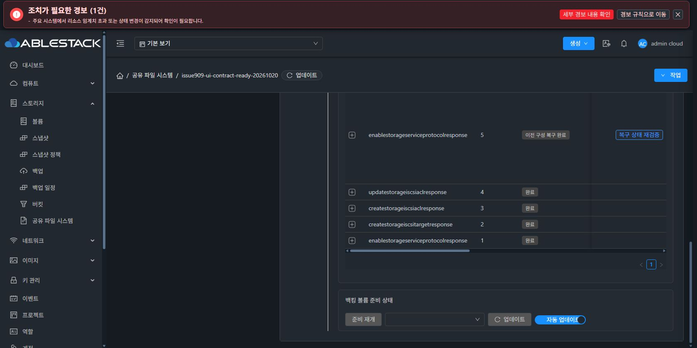
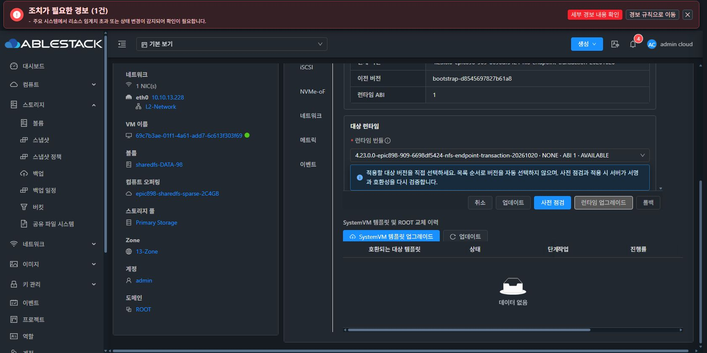

# #909 NFS 공통 주소 트랜잭션 개선

2026-10-20 시작 / 2026-10-21 기록. Epic #898, 기존 Draft PR #1271. **구현·빌드·13번 배포 완료, UI 검증 일부 대기. 전체 복원 검증 재개 준비 완료로 판정하지 않습니다.**

## 구현 내용

iSCSI와 NFS가 같은 IP를 사용할 때 공통 `network-endpoints.json`의 port를 3260에서 2049로 먼저 덮어써, NFS가 캡처한 SOURCE와 달라졌다고 거부했습니다. 이 실패가 런타임 미준비로 오분류됐고, IP/MAC/prefix만 비교하던 원복은 port를 복구하지 못했습니다.

- 같은 writer·BOOT·이전 세대에 묶인 **주소 준비 → NFS 적용 → 공통 설정 게시**로 분리했습니다. 준비 단계에서 canonical SOURCE와 다른 프로토콜 포트를 변경하지 않습니다.
- 정확한 NFS 목표와 나머지 여섯 파일을 검증한 뒤 게시합니다. 원복은 해당 writer가 새로 만든 주소 및 DB 별칭만 정리하고 기존 주소는 유지합니다.
- 지원 여부를 writer 전과 동일 writer의 preflight 경계에서 확인합니다. 구 CLI에 새 flag를 전달해 우회하지 않습니다.
- SOURCE 불일치 `NFS_SOURCE_CHANGED / VERIFY_SOURCE`와 런타임 미준비를 구분합니다. 새 SOURCE 진단은 stderr에 덮이지 않고 기존 일반 진단 호환성을 유지합니다.
- 내부 `configurationBatch` 복원 경로를 보존하면서 다른 인스턴스의 batch와 일반 작업의 권한 우회는 차단합니다.
- UI는 주소 준비·프로토콜 리스너 구성·최신 VM 관측 여부·원복 결과를 구분합니다. 자동 재전송하지 않으며 #1275 최종 레이아웃 정리는 변경하지 않았습니다.
- 실제 구버전 rev5 실패에는 원 요청 HMAC·BOOT·pending/이전 세대·단일 port 차이·NFS 부재·LOCAL 증거가 일치할 때 기존 명령만 사용하는 제한된 원복 호환 경로를 적용했습니다.

제품 커밋: `6698df542462cc714f793da192d03b01d3008351`. DB 스키마 변경 없음.

## 빌드·시험·배포

| 항목 | 결과 |
|---|---|
| 관리서버·KVM `-am package` | BUILD SUCCESS |
| Java 19개 suite | 218개 통과, 실패/오류/skip 0 |
| Native 강한 bwrap 전체 | 1,214개 실행: 1,208 통과, skip 6, 실패 0 |
| WSL 계정 파일 4종 / Native 소스 | 시험 전후 무변경 |
| Vue 시험 / lint / production build | 10 suite 227개 통과 / 성공 / 성공 |
| 시험 런타임 서명 | ED25519 검증 성공, 개인키 파일 생성 0 |

Native 시험은 `2b74921653963d3125edd37916036c56cbc437c0`, UI artifact는 `a607138400bb2c6b52859702c5a3e1796337b2e5`에서 실행·빌드됐습니다. 각각 최종 제품의 systemvm/UI 소스 트리와 정확히 같은 것을 별도 검증했으며 실제 실행 pin을 덮어쓰지 않았습니다. 사전 시험에서 발견한 고정 SHA fixture 누락과 진단 호환성 회귀를 보완한 뒤 최종 시험을 통과했습니다. 동봉 JSON에 근거를 보존했습니다.

13번 관리서버는 기존 JAR 백업 후 변경 클래스 2개 계열만 반영했고 나머지 204,655개 entry가 동일합니다. 호스트 13.1/13.2/13.3은 KVM 래퍼 클래스 1개만 반영했습니다. `mold`와 `mold-agent` active입니다. UI는 새 asset 5개, en/ko locale 각 22개 key를 반영하고 기존 asset 4,452개와 보호 파일 20개를 보존했습니다.

## 실제 UI 확인 결과

1. 기존 rev5 `65122422-8243-412d-aecc-fc95c9483729`를 **작업 → 복구 상태 재검증 → 원래 작업 복구**로 실행해 `INTERRUPTED_WRITER_ROLLED_BACK / 이전 구성 복구 완료`를 확인했습니다. 구버전 7495 CLI와 기존 BOOT를 유지했고 iSCSI 리스너·대상·CHAP ACL은 READY로 보존됐습니다. 원래 실패 진단도 유지됩니다.
2. 해당 전용 시험 VM96과 ROOT/DATA2개만 UI에서 정상 종료·최종 삭제했고 성공 이벤트를 확인했습니다. 다른 서비스·보존 DATA·ADSvr·Windows SMB-Client는 정리 대상에서 제외했습니다.
3. 새 서비스 `issue909-nfs-transaction-ready-20261021`을 새 VM98/ROOT/SPARSE 8GiB DATA로 생성했습니다. UI에서 내부 부팅 준비 완료와 새 BOOT를 확인했습니다. 복제·수동 MAC 변경은 하지 않았습니다.
4. 서명 런타임을 **UI 카탈로그 등록 → 검증 → 게시**, 새 VM에서 **UI 사전 점검 → 업그레이드 COMPLETE**로 적용했습니다.
5. iSCSI 리스너 → 새 SPARSE 2GiB RAW 대상 → 새 클라이언트 IQN/CHAP ACL을 UI로 생성해 모두 READY를 확인했습니다. VM 볼륨 탭에서 ROOT·DATA2개 모두 sparse, NIC 탭에서 자동 MAC `02:0d:00:cc:00:36`을 확인했습니다.
6. 새 클라이언트 VM97의 실제 Mold 콘솔에서 새 서비스 통신 5/5와 iSCSI 대상 탐색을 확인했습니다. CHAP 값은 비표시 런타임 입력으로 전달했습니다.

## 중단 지점과 미완료

긴 콘솔 입력 중 CUA 실행기의 시간 제한이 발생했습니다. 같은 Chrome의 새 UI 탭은 정상 제어됐지만 기존 콘솔 탭의 제어 연결이 분리됐습니다. 기존 콘솔 주소를 새 탭에서 열었을 때 연결 실패/토큰 만료 문구가 표시됐으나, 이 문구만으로 만료나 제품 결함을 확정하지 않습니다.

이후 Windows Computer Use 도구가 **현재 브라우저 URL을 충분히 확인하지 못해 정책을 적용할 수 없다는 이유로 이번 턴의 제어를 중단**했습니다. 이후 UI 조작과 자원 변경을 하지 않았습니다. 새 NFS 활성화 요청은 아직 전송하지 않았으므로 새 NFS 제품 오류가 발생한 결과도 아닙니다.

미완료: CHAP 로그인 명령의 최종 입력/실행 여부와 클라이언트 I/O, 같은 IP NFS 활성화, 역순·신규 별칭 UI 시험, SMB/NVMe 동시 구성 및 시험 전용 준비 승인. **전체 백업·복원은 시작하지 않았습니다. #909 OPEN / Epic PR Draft / #1275 HOLD 유지.**

다음에는 정상 VM 상세 UI의 **작업 → 콘솔 URL 복사**로 새 주소를 발급받아 즉시 새 탭에서 엽니다(`ActionButton.vue`의 `openConsole(true)`). 잔여 콘솔 입력을 취소하고 세션·장치·입력 상태부터 확인합니다. 비밀값을 출력·복호화해 회수하지 않으며 필요하면 UI에서 전용 시험 ACL의 비밀값을 갱신합니다. 그 뒤 iSCSI → 동일 IP NFS 활성화를 이어갑니다.

자원 UUID와 확인 여부: [ui-progress-public.json](ui-progress-public.json).
