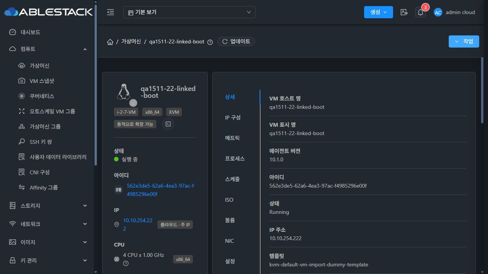
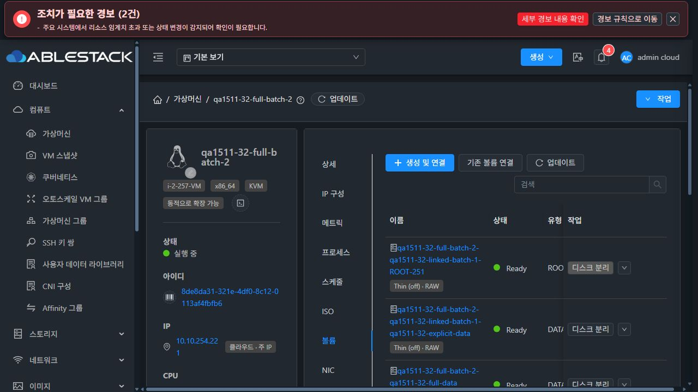
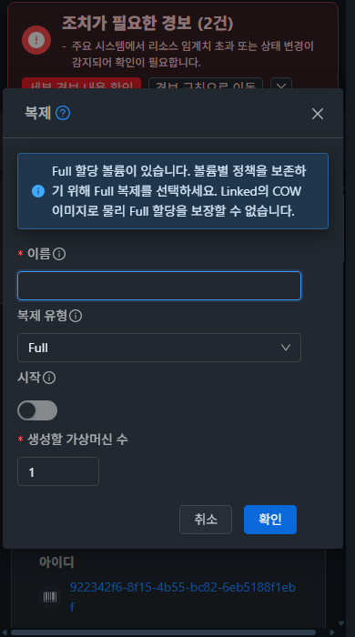

# #1511 명시적 할당 정책 VM 복제 복원 검증

Epic [#1510](https://github.com/ablecloud-team/ablestack-cloud/issues/1510) / Draft PR [#1514](https://github.com/ablecloud-team/ablestack-cloud/pull/1514).

22번에서 정책 존재만으로 거절되던 `rocky98-base`의 실제 UI Full 복제를 복원했다. 22·31·32에서 **UI 복제 요청 12건으로 VM 15대**를 생성했고, 복제 볼륨 **31개**의 실물과 상속을 확인했다. 시작한 **11대**는 호스트 Running, QGA ping·OS 및 실제 디스크 연결이 일치했다. 제품 소스는 `75f5797b295bef8b378e540859e64fdc79cae50a`다.

- [설계](../../design/issue-1511-allocation-clone.ko.md)
- [UI Job·상속·이미지·부팅·DB·배포 근거](evidence-summary.json)
- [정리 및 보호 대상 최종 상태](cleanup-summary.json)

## 구현

할당 정책의 존재만 검사하던 clone 차단을 clone 전용 검증으로 바꿨다. 원본의 intent만 대상에 상속하고, 실제 Agent 복사/복제 결과의 UUID·pool·크기·형식·정책·메서드·관측값을 대조한 후 Ready와 새 적용 증거를 저장한다. 원본의 옛 관측 증거를 새 대상의 증거로 복사하지 않는다.

| 경로 | 실행 계약 |
| --- | --- |
| RBD raw off / Full | 독립 이미지로 복사·내용 검증. allocation off를 유지한다. |
| RBD raw off / Linked | 정확한 보호 부모 snapshot을 참조하는 COW 자식 생성·내용·자식 사용량 검증. |
| RBD raw full / Full | thick 생성과 `convert -n -S 0`, 전체 내용 비교, 실제 사용량이 논리 크기 이상인지 검증. |
| RBD raw full / Linked | COW와 per-image Full의 충돌을 UI에서 설명하고 Linked를 비활성화한다. API도 생성 전에 거절한다. |
| GFS2 explicit qcow2 / Running | 기존 source overlay로 고정한 원본을 정책을 적용하는 독립 복사 어댑터로 복사한다. 기존 overlay 복구 흐름을 유지한다. |
| GFS2 explicit RAW·QCOW2 / Stopped | 원본의 전원과 경로를 바꾸지 않는 검증된 독립 복사. |
| GFS2 explicit RAW / Running | 구체적인 형식·상태 조건으로 정지를 안내한다. 정지 후 실제 복제가 가능하다. |

정지 RBD는 전원을 켜거나 freeze를 호출하지 않는 storage-only snapshot 경로를 사용한다. 실환경에서 추가로 드러난 정지 RBD 백업 추적 검사의 로컬 경로 오판도 수정했다. pool 인증을 사용해 실제 RAW 이미지와 크기를 확인하며, 조회 실패·checkpoint·dirty bitmap은 계속 차단한다. resize/migrate/restore/export의 일반 보호 검사는 완화하지 않았다.

Linked 부모는 참조하는 자식이 있는 동안 보존한다. RBD backing 경로도 실제 `rbd:pool/image@snapshot`을 기록한다. GFS2의 불확실한 overlay rollback은 live 경로 확인 없이 원본이나 의존 파일을 삭제하지 않는다.

## 실제 UI 행렬

모든 복제는 Mold의 **작업 → 복제** 폼에서 제출했다. API는 시험 원본/오퍼링/DATA 준비, 관측 및 정리에 사용했다. 실제 UI GET/POST와 async Job을 연계했으며, 마지막 32번 legacy Linked 요청은 CDP 이벤트 보관 기간 경과로 UI 제출 관측과 DB `async_job`의 허용된 요청 필드를 대조했다.

| 환경 | 원본 / 정책 | UI 옵션 | 결과 |
| --- | --- | --- | --- |
| 22 RBD | 기존 정지 `rocky98-base`, ROOT off/raw | Full, 1, 시작 끔 | 성공. 독립 ROOT·전체 내용 동일. 새 VM을 UI로 부팅. |
| 22 RBD | 위 복제본을 시험 원본으로 사용, Running ROOT+DATA off/raw | Linked, 1, 시작 켬 | 성공. 부모·DATA 내용·패턴·게스트 부팅 확인. |
| 31 GFS2 | Running ROOT+DATA metadata/qcow2 | 2, 시작 끔 | 2대 성공. 새 증거와 독립 이미지, 원본 overlay 복구 확인. |
| 31 GFS2 | Stopped ROOT+DATA metadata/qcow2 | 1, 시작 끔 | 성공. ROOT·DATA 전체 내용 동일, UI로 부팅. |
| 31 GFS2 | Stopped ROOT+DATA off/raw | 1, 시작 켬 | RAW 유지, 자동 부팅 성공. |
| 31 GFS2 | Running legacy ROOT+DATA | 1, 시작 켬 | 기존 복제·Flatten·부팅 회귀 통과. |
| 31 GFS2 | Stopped falloc/qcow2 ROOT 100GiB + full/qcow2 DATA 1GiB | 1, 시작 끔 | 전체 내용·실제 할당 확인 후 UI 부팅 성공. |
| 31 GFS2 | Stopped metadata 원본 | 기존 이름 → 수정한 이름, 1, 시작 끔 | 중복은 Job/대상 생성 전 거절. 폼 입력 유지 후 같은 폼 재시도 성공. |
| 32 RBD | Running explicit off/raw ROOT+DATA | Linked, 2, 시작 끔 | 2대 성공. 부모 snapshot과 ROOT·DATA 전체 내용 동일. 첫 복제본 UI 부팅. |
| 32 RBD | 위 Linked 복제본에 시험용 full/raw DATA를 추가한 Running 원본 | Full, 2, 시작 켬 | 2대 모두 Running. 세 볼륨의 off/off/full 정책·독립 이미지·새 증거 확인. |
| 32 RBD | Running legacy ROOT+DATA | Full, 1, 시작 켬 | 복제·부팅 성공. 자동 snapshot 정리 잔류는 CL-02로 분리. |
| 32 RBD | 위 legacy Full 복제본 | Linked, 1, 시작 켬 | 후속 복제·부팅 성공. |

생성된 15대 모두 ROOT/DATA 수·Device ID·논리 크기·디스크 오퍼링·provisioning/cache, CPU·메모리·OS·컴퓨트 오퍼링·소유자·도메인·네트워크가 원본과 일치한다. MAC은 새로 생성된다. 대상이 나중에 별도 시험 DATA를 추가받은 경우에는 복제 당시의 볼륨만 상속 비교에 포함했다.

- 실물 이미지 31개: 형식·논리 크기·독립성 또는 정확한 COW 부모 확인.
- 전체 내용 비교 22개: 정지 ROOT 및 부팅 전 Linked ROOT 대표 사례와 모든 DATA. DATA 16개는 1MiB/512MiB 위치의 `0x5a`/`0xa5` 패턴도 일치한다. 부팅 후 ROOT에는 게스트 쓰기가 발생하므로 그 이후 원본과 동일하다고 주장하지 않는다.
- GFS2 falloc ROOT 실할당 `107602178048`바이트 ≥ 논리 100GiB. full DATA `1076203520`바이트 ≥ 논리 1GiB. RBD Full DATA 두 개도 각각 1GiB 이상 실제 할당을 확인했다.
- 게스트 11대: Rocky Linux 9.8/9.5 x86_64, QGA ping/OS, domain XML의 각 볼륨 UUID·형식·연결 대상 일치.
- GFS2 RAW Running은 UI 안내/제출 비활성 및 API `ALLOCATION_CLONE_REQUIRES_STOPPED`를 확인했다. 정지 후 같은 원본의 복제와 자동 시작이 성공했다.
- Full 할당+Linked는 UI 비활성 옵션의 클릭이 선택을 바꾸지 않으며, API `ALLOCATION_CLONE_TYPE_CONFLICT`로 Job 생성 전 거절된다.
- 필수 이름은 요청 없이 차단된다. 중복 이름의 동기 오류와 수정·재시도, 390×700 폼의 안내·입력·확인/취소 표시를 확인했다.

## 빌드와 배포

WSL ext4 전용 clone에서 변경한 Maven 모듈 7개만 빌드했다. `-am`이나 전체 Cloud/Release 빌드는 실행하지 않았다.

- Java 집중 검사 **15개 스위트·214개 테스트**, UI 회귀 **3개 스위트·49개 테스트** 통과.
- 전체 UI lint 및 production UI 빌드 통과.
- 관리 fat JAR와 Agent JAR는 기존 파일에서 변경 클래스와 필요한 의존 클래스를 교체했다. 수정하지 않은 항목을 보존하고 전체 패키지 교체는 수행하지 않았다.
- Mold 3대·Agent 9대, 활성 JAR **48개**가 최종 배포 계획 해시와 일치한다. 백업과 오류 시 롤백을 준비했고 최종 전 노드가 정상이다.
- 각 Mold 정적 파일 **931개** 해시 일치. 설정·WEB-INF/META-INF 보존, `/client/` 200, Mold active, 호스트 9대 Up.
- 활성 FTCTL 표시 문자열과 새 clone 안내 문자열을 확인했다. 최종 배포 후 확인 구간에 Java linkage/bean 생성 오류가 없다.
- 제품은 테스트 환경의 클래스 단위 배포로 검증했다. 정식 전체 패키지 빌드나 전체 Cloud/Release CI 성공을 의미하지 않는다.

첫 시험 원본 준비에서는 배포 패키지의 `VolumeAllocationLifecycle` 의존 클래스 누락이 드러나 보완·재배포했다. 첫 22번 UI 시도는 정지 RBD 백업 검사 오류로 실패했고, 해당 경로를 수정한 최종 제품으로 재시도가 통과했다. 실패 Job을 성공 건수에 포함하지 않았다.

## 정리와 보호 대상

정상 API로 시험 VM **21대**, 볼륨 **46개**의 정리를 수행했다. 컴퓨트 오퍼링 6개와 직접 생성한 디스크 오퍼링 9개 및 암묵 ROOT 오퍼링은 정상 삭제 결과인 Inactive로 남는다. 활성 VM·볼륨·VM/스토리지 snapshot·snapshot store 참조·시험 오퍼링은 0이다. 실제 GFS2 파일/overlay/작업 경로, RBD 이미지·작업 이미지·trash의 시험 잔여도 0이다.

VM 삭제는 DATA를 분리해 보존하므로, 자식 DATA를 먼저 삭제한 뒤 부모 snapshot을 삭제하는 순서로 정리했다. 앞선 잘못된 정리 순서에서 거절된 부모 삭제는 이 순서와 정상 삭제 API 재시도로 해소했다. 직접 DB 수정이나 원본/부모의 강제 삭제는 사용하지 않았다. `Destroyed` snapshot 이력 행은 정상 이력으로 보존했다.

기존 GFS2 falloc 안전 실패의 진단 파일도 manifest의 소유 UUID를 확인해 이번 시험 파일 3개만 삭제했다. 업로드한 임시 배포 파일을 제거했고, 롤백 백업은 유지한다.

22번 보호 대상 `rocky98-perftest`와 연결 ROOT/DATA에는 변경 요청을 보내지 않았다. 종료 시 Running / `ablecube22-3`, 경로·연결·정책·관측 증거가 기준선과 같다. QEMU PID `219715`, 시작 tick `191152358`도 배포 전부터 정리 후까지 동일하다. `rocky98-base`는 Stopped, ROOT 경로·정책·기존 관측 증거를 유지하고 이번 복제의 활성 snapshot이 없다.

## 남은 Epic 범위와 검증 한계

- **CL-02는 미완료**다. 32번 legacy Full은 복제·부팅은 성공했지만 자동 VM snapshot 삭제가 `Expunging`에 남았다. 실제 자식 의존성이 해소된 후 정상 삭제 API 재시도로 이번 시험 잔류를 정리했다. explicit Full의 임시 snapshot 두 건은 자동 정리됐고 Linked 부모 보존도 확인했지만, 이를 전체 CL-02 해결로 표현하지 않는다.
- 빈 GFS2 falloc DATA 준비 한 건은 기존 [#1437](https://github.com/ablecloud-team/ablestack-cloud/issues/1437)의 제한 재시도 후 안전 실패로 끝났다. 실패 이미지는 공개되지 않았다. 별도로 정상 준비한 falloc ROOT와 full DATA의 실제 복제·할당·내용 검증은 통과했다.
- 부분 실패/응답 유실/외부 대상 충돌/불완전 증거는 집중 검사에서 주입 검증했다. 실제 클러스터에서 Agent 중단이나 장애를 강제로 발생시키는 전체 장애 행렬은 수행하지 않았다.
- 관리자로 검증했다. 일반 사용자/프로젝트·암호화·Windows·UEFI/TPM 전체 실환경 행렬은 수행하지 않았다. 기존 보호 검사를 유지한다.
- #1513 다운로드와 CL-03~CL-06의 나머지 API/진행 표시/UX 범위는 이 변경의 완료 대상으로 포함하지 않는다.

## 화면

검증 당시의 화면이며 시험 개체는 이후 정리했다.

