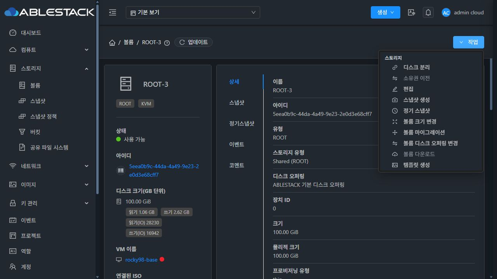
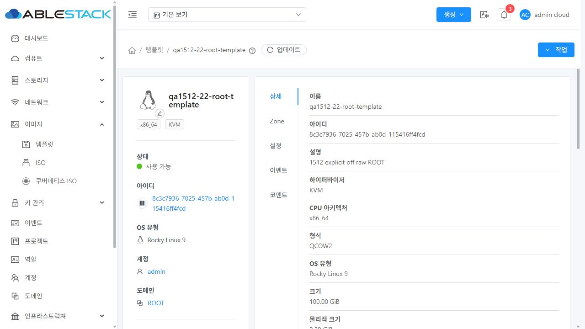
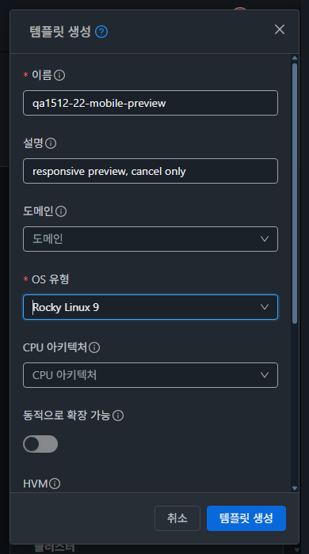

# #1512 명시적 할당 정책 볼륨의 템플릿 생성 복원

상위 Epic: [#1510](https://github.com/ablecloud-team/ablestack-cloud/issues/1510) · 대상: [#1512](https://github.com/ablecloud-team/ablestack-cloud/issues/1512)

## 변경

`storage.js`의 볼륨 `createTemplate` 액션에서 명시적 할당 정책의 존재만으로 비활성화하던 조건을 제거했다. 기존 `CreateTemplate.vue`와 `createTemplate` API를 그대로 사용한다. 원본의 allocation 정보를 제거하거나 생성 템플릿에 원본 적용 증거를 복사하지 않는다.

Ready 및 VM 정지/분리 조건, 실행 중인 Flatten 차단과 설명을 유지한다. 액션 권한을 처리하는 공통 UI와 서버의 소유권·상태·암호화 검사는 변경하지 않았다. 다운로드는 별도 이슈 #1513 범위다.

제품 소스: `2768106140d`.

## 자동 검사

- 집중 회귀 검사: 4개 스위트, 44개 테스트 통과. legacy와 RBD/GFS2 explicit 정책, ROOT/DATA 상태, Flatten, 요청 중복 방지, 실패 시 입력 보존과 재시도를 포함한다.
- 전체 UI lint 통과.
- production UI 빌드 통과. 동일 아티팩트의 정적 파일 931개 해시가 세 서버 모두 일치했다.
- Maven/JAR 변경이 없으며 전체 Cloud 빌드는 실행하지 않는다.

## 실환경 검증

검증일: 2026-10-28. 관리 UI는 실제 볼륨 상세의 작업 메뉴와 템플릿 생성 대화상자를 사용한다. API 호출은 생성 결과·정책 보존·정리 및 새 VM 부팅의 대조에 사용한다.

31번 GFS2는 explicit metadata/qcow2, 22·32번 RBD는 explicit off/raw로 검증한다. 각 환경에서 별도의 legacy DATA 경로도 대조한다. 전용 explicit DATA 1GiB의 1MiB와 512MiB 위치에 각각 64KiB의 0x5a/0xa5 패턴을 기록한다. 원본과 생성 이미지 전체를 `qemu-img compare`로 비교하고 패턴도 읽는다.

22번은 기존 중지된 `rocky98-base`의 ROOT를 읽기 전용 원본으로 사용한다. 해당 VM 및 볼륨을 삭제하거나 변경하지 않는다. 다른 검증 자원은 `qa1512-<cluster>-` 이름과 생성 시 기록한 UUID로 소유권을 제한한다.

| 환경 | UI에서 생성한 템플릿 | 실제 이미지 및 내용 | 생성 ROOT 템플릿으로 부팅 |
| --- | --- | --- | --- |
| 22 RBD | explicit off/raw ROOT, explicit DATA, legacy DATA 모두 Ready | QCOW2, ROOT 100GiB·DATA 각 1GiB. 3개 모두 전체 내용 동일, DATA 패턴 2곳 통과 | 새 VM `i-2-5-VM` Running, QGA ping/OS 정보, Rocky 9.8 x86_64 |
| 31 GFS2 | explicit metadata/qcow2 ROOT, explicit DATA, legacy DATA 모두 Ready | QCOW2, ROOT 100GiB·DATA 각 1GiB. 3개 모두 전체 내용 동일, DATA 패턴 2곳 통과 | 새 VM `i-2-777-VM` Running, QGA ping/OS 정보, Rocky 9.5 x86_64 |
| 32 RBD | explicit off/raw ROOT, explicit DATA, legacy DATA 모두 Ready | QCOW2, ROOT 100GiB·DATA 각 1GiB. 3개 모두 전체 내용 동일, DATA 패턴 2곳 통과 | 새 VM `i-2-250-VM` Running, QGA ping/OS 정보, Rocky 9.5 x86_64 |

생성 이미지 9개는 모두 backing file 없는 독립 QCOW2이며 `qemu-img compare` 종료 코드 0이었다. OS 유형·x86_64·admin 소유·비공개·비추천 metadata를 확인했다. 원본 경로와 allocation 전체 필드는 변경되지 않았고, 템플릿에 원본 allocation 증거를 복사하지 않았다. GFS2 sparse 이미지에서는 API `physicalsize`의 파일 길이와 `qemu-img`의 실제 할당 바이트가 다르므로 두 관측값을 [증거 요약](./evidence-summary.json)에 구분해 보관했다.

22번 배포 전 disabled → 배포 후 enabled를 실제 작업 메뉴에서 확인했다. 빈 폼 제출 시 이름·OS 필수 검사가 동작했다. Running VM 볼륨에서는 액션이 보이지 않고, 직접 API도 530 `volume is attached to a non-stopped Instance`로 거절했다. Flatten pending/running, 중복 제출 1회 요청, 동기 API 오류 시 입력 보존/재시도는 집중 회귀 검사로 검증했다. 비동기 생성 결과는 관리 DB의 Job과 대조했다. 다운로드의 별도 차단은 유지된다.

1280×720 데스크톱 및 390×700 모바일에서 밝은/어두운 테마의 폼·고정 하단 버튼·스크롤·취소를 확인했다. DOM 뷰포트와 PNG 실제 픽셀 크기를 대조했다. 390×844 DOM 검사 시 native 캡처가 잘못 축소되는 도구 문제가 있어 그 이미지는 증거에서 제외했다. 검증 후 테마와 뷰포트를 원복했다.

## 배포와 복구

WSL ext4에서 빌드한 동일 UI 아티팩트를 활성 웹앱 `/usr/share/cloudstack-management/webapp`에 정적 파일 단위로 반영한다. `config.json`을 덮어쓰지 않으며 `index.html`은 마지막에 교체한다. 기존 해시 자산을 삭제하지 않는다.

교체 대상 정적 파일을 백업하고, WEB-INF·META-INF·관리 설정·JAR를 보호 백업 및 SHA256으로 대조한다. 배포 전후 Mold PID, 서비스 active, WEB-INF 존재, `/client/` HTTP 200과 기존 FTCTL 마커를 확인한다. 실패 시 교체한 정적 파일만 복구한다.

세 환경 모두 보호 파일 19개의 해시와 config.json, Mold PID가 동일했다. PID는 22=`4094435`, 31=`3720809`, 32=`3736392`였으며 서비스 재시작 없이 반영했다. 서버별 백업 위치와 배포 결과는 [증거 요약](./evidence-summary.json)에 기록했다.

## 환경 용량 오류와 31번 개발 이미지 정리

31번 legacy 첫 생성은 `cannot find an image store for zone 1`로 실패했다. 생성된 ROOT 시험 템플릿이 추가되면서 2차 스토리지 사용률이 약 91%가 된 환경 용량 문제다. 실패 Job `335f7316-fa11-458c-9ef5-dc95b7233495`를 PASS로 세지 않았다.

사용자 추가 지시에 따라 참조 없는 개발용 Kubernetes 버전 51개와 연결 ISO 51개, 미사용 Process ISO 16개, `nginx-lb-test.qcow2` 템플릿 1개를 정상 API로 삭제했다. VM/볼륨/장착 ISO/Kubernetes 클러스터 참조를 먼저 대조하고 API의 미완료 업그레이드 참조 검사도 우회하지 않았다. 시스템·기본 이미지, 사용 중인 Process ISO와 Kubernetes 버전/노드 템플릿, 용도가 불분명한 AS-PROD 이미지는 보존했다. 임의 DB 수정이나 이미지 파일 직접 삭제를 사용하지 않았다.

삭제 API 68건은 모두 성공했고 대상 실제 파일 잔여는 0이다. 여유 공간은 약 35GiB에서 79.7GiB로 늘었고, 이번 시험 템플릿까지 정리한 최종 시점에는 약 83.1GiB였다. 용량 확보 후 같은 legacy UI 경로를 재시도해 Job `8bcf3b90-c6ce-4959-9723-21f3fffa5687` 성공, Ready와 전체 내용 동일성을 확인했다. [삭제 대상 및 결과](./31-dev-image-cleanup.json).

## 최종 정리와 보호 자원

전용 VM 5대, 볼륨 11개, 템플릿 9개를 정상 API로 정리했다. 세 환경 모두 활성 시험 VM/볼륨/템플릿 0, 실제 기본 저장소 볼륨 및 2차 저장소 템플릿 파일 잔여 0이다. 시험 컴퓨트·디스크 오퍼링은 제품의 정상 삭제 동작인 Inactive로 전환됐으며 과거 참조용 DB 이력은 보존했다. [정리 대조](./cleanup-summary.json).

사용자가 보호를 지정한 22번 `rocky98-perftest` VM과 ROOT/DATA 볼륨 UUID를 변경 거부 목록에 추가했다. 해당 VM에는 변경 명령을 보내지 않았다. 정리 후에도 같은 호스트에서 Running이고 볼륨 경로·allocation이 기준선과 같다. 22번 원본 `rocky98-base`도 Stopped/Ready 및 경로·allocation이 같다.

## 검증 한계

일반 사용자/프로젝트별 권한과 암호화 볼륨을 새로 구성하는 실환경 행렬, Windows/UEFI/TPM은 이번 UI 조건 수정의 실환경 범위에 포함하지 않는다. 해당 서버 검사 경로와 공통 권한 코드는 변경하지 않았다. UI 빌드·집중 테스트의 성공을 전체 Cloud/Release CI 성공으로 해석하지 않는다.
