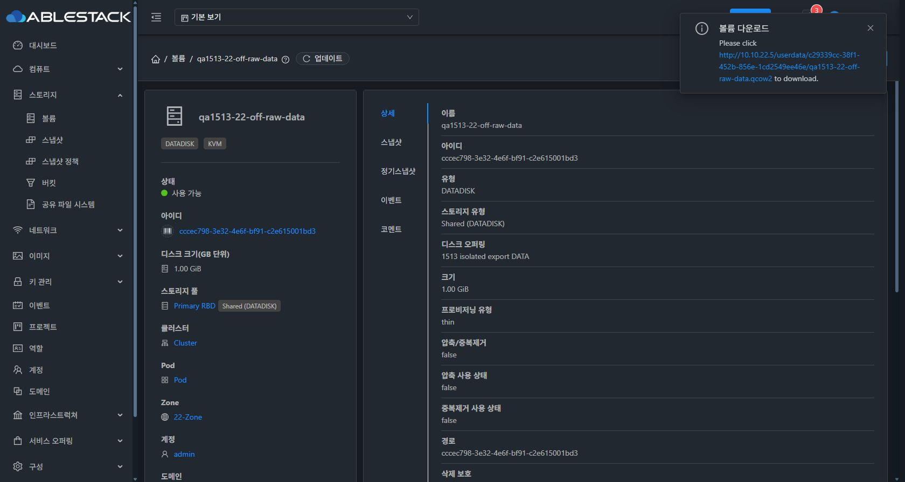
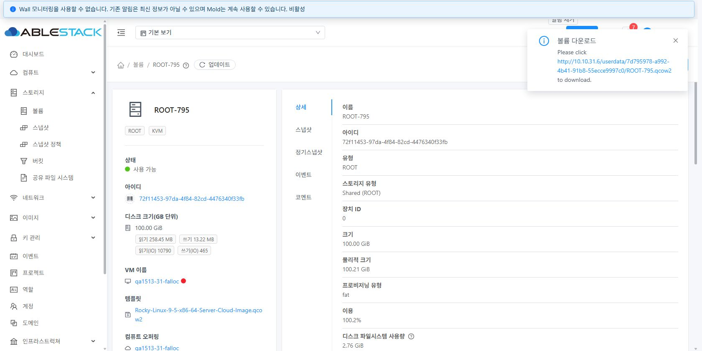
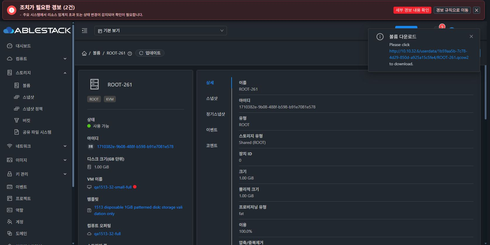

# #1513 다운로드 복원 최종 검증

2026-10-29 KST · Epic #1510 · [Draft PR #1514](https://github.com/ablecloud-team/ablestack-cloud/pull/1514)

남은 **10개 UI 조합을 모두 완료해 전체 17개 조합이 통과**했다. UI 요청 23건의 Job 성공, 요청 볼륨 ID와 화면 URL의 일치, 실제 내려받은 QCOW2의 전체 내용 비교·해시를 확인했다. 실패·재시도·변환 중단·동시 요청·실행 중 차단·확인창 취소·URL 만료·stale 캐시 재생성을 검증하고 시험 자원을 정리했다.

제품 소스와 실제 배포는 `7eefbf9324fc2bd1ec4f5ba7553038fa28bf9699`이다. 이번 이어서 수행한 작업은 추가 실환경 검증과 정리·근거 보완이며 제품 코드를 변경하지 않았다. 이전 7개 조합은 5753f797450/9e691be1d28에서 검증했고, 최종 배포본에서 새 10개 조합과 22 off DATA·31 falloc ROOT 재시도를 추가 검증했다.

## UI와 실제 파일

| 클러스터 | 볼륨 | 원본 정책 / 형식 | 연결 상태 | 논리 GiB | 파일 바이트 | UI·HTTP·전체 비교 |
|---|---|---|---|---:|---:|---|
| 22 | ROOT-3 | off / raw | 정지 VM | 100 | 2454978560 | PASS |
| 22 | qa1513-22-off-raw-data | off / raw | 분리 | 1 | 524288 | PASS |
| 22 | qa1513-22-full-raw-data | full / raw | 분리 | 1 | 524288 | PASS |
| 22 | qa1513-22-legacy-raw-data | thin / raw | 분리 | 1 | 524288 | PASS |
| 31 | ROOT-794 | metadata / qcow2 | 정지 VM | 100 | 2744844288 | PASS |
| 31 | ROOT-795 | falloc / qcow2 | 정지 VM | 100 | 2744844288 | PASS |
| 31 | ROOT-796 | thin / qcow2 | 정지 VM | 100 | 2744844288 | PASS |
| 31 | qa1513-31-off-raw-data | off / raw | 분리 | 1 | 589824 | PASS |
| 31 | qa1513-31-full-raw-data | full / raw | 정지 VM | 1 | 524288 | PASS |
| 31 | qa1513-31-full-qcow2-data | full / qcow2 | 정지 VM | 1 | 524288 | PASS |
| 31 | qa1513-31-legacy-qcow2-data | thin / qcow2 | 정지 VM | 1 | 524288 | PASS |
| 31 | ROOT-797 | falloc / qcow2 | 정지 VM | 1 | 524288 | PASS |
| 32 | ROOT-260 | thin / raw | 정지 VM | 100 | 2744844288 | PASS |
| 32 | qa1513-32-off-raw-data | off / raw | 정지 VM | 1 | 524288 | PASS |
| 32 | qa1513-32-full-raw-data | full / raw | 정지 VM | 1 | 524288 | PASS |
| 32 | qa1513-32-legacy-raw-data | thin / raw | 정지 VM | 1 | 524288 | PASS |
| 32 | ROOT-261 | full / raw | 정지 VM | 1 | 524288 | PASS |

표의 마지막 31 off DATA는 캐시 무효화 시험에서 세 번째 패턴을 주입한 **시험 전용** 원본의 새 출력이다. 기존 두 패턴을 보존하면서 768MiB 위치에 64KiB의 `0x3c`를 기록했고, 새 QCOW2의 SHA256은 `7d5c5d04bde6e741619516d68d7fed7e408720ca921f4ea1d071fe267d51856c`이다. 32의 대형 Full ROOT 생성 시험 자원은 내려받기 성공 조합에 포함하지 않았고, Full ROOT 다운로드는 1GiB의 별도 시험 VM으로 검증했다.

모든 다운로드 파일은 QCOW2이며 backing file이 없다. 논리 크기가 원본과 같고 Secondary와 내려받은 파일의 SHA256이 일치한다. 전체 `qemu-img compare`가 통과했다. legacy Image ref의 기존 size/physical_size=0은 실제 파일 크기로 대체 측정했으며 explicit export receipt의 physicalSize는 파일 바이트와 일치했다.

### 브라우저 파일 저장 근거와 도구 제약

Chrome의 UI 링크 클릭/다운로드 시도로 **Windows Downloads에 실제 기록된 파일 4개**를 확인했다. 22 explicit off/raw DATA의 UI 링크 클릭 직후 생성된 파일을 포함하며, 각 파일은 524,288바이트·논리 1GiB의 완전한 QCOW2이다. 전체 SHA256 `a59d3e2fce3d4dedf3ef8a69794c4ff3969540e12c799a81be23a59a1df78b19`가 Secondary 및 독립 HTTP 저장 파일과 같다. 브라우저가 파일에 전체 본문을 기록한 사실은 파일시스템에서 독립 검증했다.

**브라우저 자동화의 download 완료 이벤트와 정상 파일명으로의 전환은 확인하지 못했다.** Chrome 저장 파일은 UUID `.tmp` 이름으로 남았다. 자동화 도구는 완료 이벤트를 반환하지 않았으므로 일반 사용자 화면의 다운로드 완료 표시·파일명 전환까지 통과했다고 보고하지 않는다. 브라우저 보안 경고를 우회하지 않았다. HTTP 본문 저장 근거와 브라우저 파일 기록 근거를 구분했다.

## 실패·중단·재시도·만료

- **읽기 실패:** 31의 분리된 시험 DATA 파일만 같은 디렉터리의 전용 이름으로 임시 이동했다. UI 실패 표시와 Job 530을 확인하고 원래 이름·같은 inode로 복구했다. UI 재시도는 성공했고 원본 Ready·정책·경로를 보존했다.
- **실행 중단:** 31의 시험 falloc ROOT와 `.volume-export-*/image.qcow2`를 함께 인자로 가진 `qemu-img convert`만 종료했다. UI 요청과 뒤이은 API 재요청이 실패했고, 감시 종료 후 UI 재시도는 성공했다. 관리 서버·Agent·VM 프로세스를 중단하지 않았다. 성공 파일의 전체 비교·해시도 재검증했다.
- **동시 요청:** 정상 재시도가 Migrating 중인 동안 별도 추출 요청은 431 `VOLUME_EXPORT_BLOCKED`로 거절됐다. 해당 볼륨의 Image 출력은 하나였다.
- **정당한 상태 차단:** 32의 시험 소형 Full VM만 시작해 ROOT 다운로드 메뉴가 사라지고 직접 API도 530으로 거절됨을 확인했다. 시험 VM은 다시 정지했다. 이전 별도 일반 계정의 권한 밖 요청은 531로 거절됐고 임시 계정은 삭제했다.
- **요청 전 취소:** 확인창에서 취소하면 창이 닫히며 extractVolume 요청이 0건이었다.
- **URL 만료:** 31 시험 DATA의 참조 한 건만 생성 시각을 이틀 전으로 주입했다. UI 재요청 시 기존 파일/URL을 지우고 새 파일/URL을 생성했다. 이전 URL은 404였다.
- **stale 캐시:** 동일 이름 updateVolume은 기존 캐시를 유지했다. 이후 시험 원본에만 세 번째 패턴과 `volumes.updated` 변경 시각을 주입하자 UI 재요청이 이전 Image/URL을 제거하고 변경 내용을 포함한 새 파일을 만들었다. 새 파일 전체 비교가 통과했다. 이 경로는 원본 변경 시각을 주입한 검증이며, 동일 이름 수정 API가 내용을 무효화한다고 주장하지 않는다.

암호화·FT/보호·스냅샷·Agent receipt 오류·시간 제한·삭제 실패 등의 집중 검사는 기존 Java 테스트에 포함한다. 모든 조건의 실환경 전체 행렬을 수행한 것으로 확대하지 않는다.

## 원본과 보호 대상

22·31·32에서 볼륨 20개의 DB 필드 전체와 allocation/clone 상세를 검증 전후 비교해 모두 일치했다. 시험 주입은 위에서 명시한 31 전용 DATA의 내용과 변경 시각에 한정했다.

22 **rocky98-perftest의 전원·호스트·ROOT/DATA·정책을 보존**했다. 최종 QEMU PID `219715`, 시작 tick `191152358`이 처음과 같다. 이 VM에 전원·디스크·QGA·마이그레이션 요청을 보내지 않았다. 기존 rocky98-base도 Stopped·원본 경로·형식·정책·연결을 유지했고 시험용 export 참조는 0이다.

## 자원 정리와 배포 확인

정상 API로 VM **7대**, 새 Primary 볼륨 **17개**, 패턴 템플릿 **2개**, 컴퓨트 오퍼링 **5개**, 디스크 오퍼링 **10개**를 정리했다. API 삭제 후 유효기간 때문에 보존된 시험용 다운로드는 소유 목록을 대조해 조기 회수했다. 인증된 호스트를 통해 SSVM의 해당 시험 symlink만 제거하고, 지정된 Secondary 파일과 Expunged 시험 볼륨의 Image 참조/잔여 tombstone을 정리했다. 주기적 GC를 가속하거나 자동 정리가 즉시 수행된 것처럼 보고하지 않는다. 기본 URL 만료 14,400초·정리 간격 7,200초 등 전역 설정은 변경하지 않았다.

세 클러스터 모두 활성 시험 VM/볼륨/오퍼링/템플릿/스냅샷/추출 참조 **0**, 실제 Primary 이미지·RBD trash·Secondary 파일·export stage·시험 libvirt domain **0**이다. 템플릿의 실제 시험 파일과 RBD 인증 임시 디렉터리도 남지 않았다. 기록한 추출 URL **20개 전부 HTTP 404**를 확인했다. 롤백 백업과 삭제 이력은 보존했다.

최종 관리 서버 3대의 Mold active·HTTP 200, 정적 파일 각 931개 해시·설정·WEB-INF 보존과 FT 마커를 확인했다. Agent 9대 active, 활성 JAR **48개**의 최종 배포 해시가 일치하며 LinkageError 계열 오류는 없었다.

## 빌드·범위

WSL ext4에서 변경 Maven 모듈 5개만 빌드했다. Java **11개 스위트 205개**, UI **20개** 검사, UI lint·production 빌드가 통과했다. 이번 추가 검증에서는 제품 코드가 바뀌지 않아 같은 검사를 반복하지 않았다. 전체 Cloud/Release 빌드·CI는 요청되지 않아 실행하지 않았다.

#1513 구현과 본 보고서 범위의 검증을 완료했다. Epic PR은 **Draft / 미병합**으로 유지하며 CL-02~06과 Epic #1510은 계속 진행한다.

[설계](../../design/issue-1513-volume-export.ko.md) · [검증 근거](evidence-summary.json) · [정리 근거](cleanup-summary.json)

