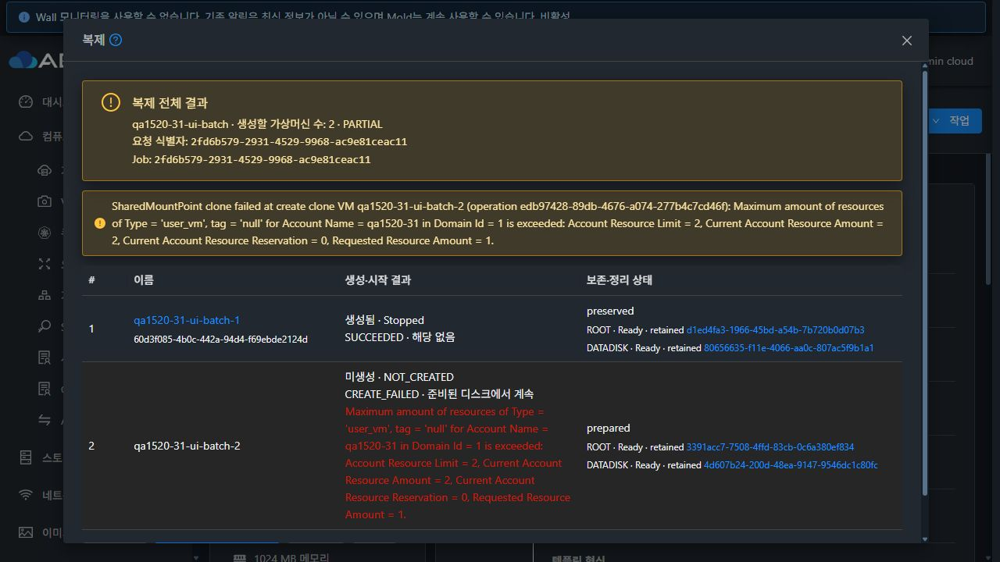
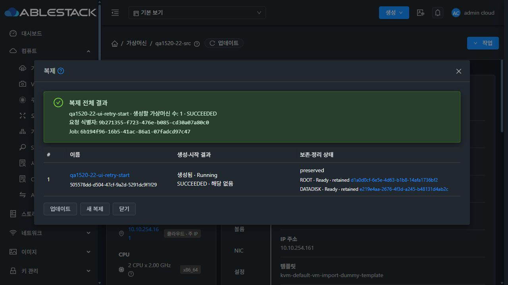
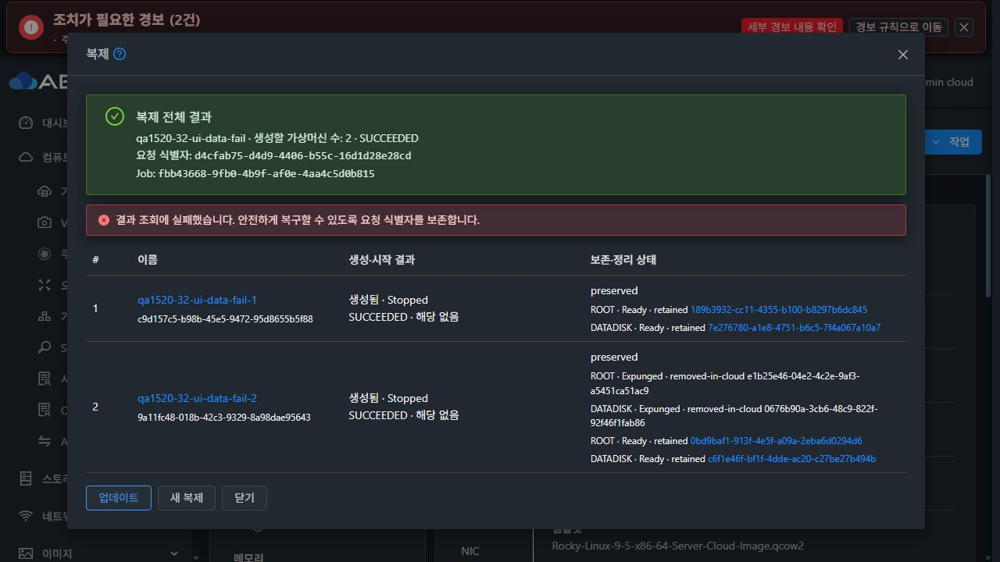
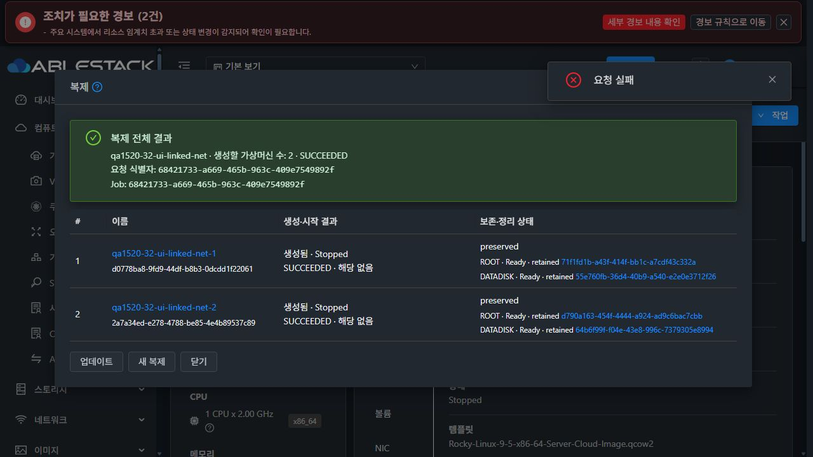

# #1520 복제 전체 결과·부분 실패·재시도 검증

## 변경 범위

기존 단일 `UserVmResponse`를 유지하면서 `clonebatch`를 추가하고, 실패한 Job의 전체 결과는 `queryVMCloneBatch`로 조회한다. 배치 UUID와 시도별 Job을 DB에 보존한다. 동일 요청의 재전송은 기존 Job을 반환하며, 재시도는 원래 대상 번호를 유지한다.

UI는 전체 대상과 ROOT/DATA, 생성·시작·오류·보존·정리 상태를 표시한다. 성공 대상을 다시 만들지 않으며 CREATE, GFS2 RESUME, 기존 VM START를 구분한다. 모달 재진입·로그인 복구, 상세 이동, 조회 경합과 통신 오류를 처리한다. 생성 완료 VM의 시작은 일반 시작 경로를 사용해 시작 실패가 디스크 삭제로 이어지지 않게 한다.

## 실환경 검증

| 환경 | 시험 | 확인 결과 |
| --- | --- | --- |
| 32 RBD | count=1 기존 응답, 같은 요청 동시 재전송 2회 | 같은 Job·VM, 대상 수 1 유지 |
| 32 RBD | count=2, 두 번째 VM quota 초과 | 첫 VM·ROOT·DATA 보존, 두 번째만 실패 표시 |
| 32 RBD | Mold 재시작 후 UI 결과 복구·두 번째 재시도 | 같은 배치 복원, 첫 UUID 유지, 대상 2개 완료 |
| 32 RBD | count=2 자동 시작 | 두 VM Running, QGA Rocky 9.5, ROOT+DATA 연결 및 DATA 패턴 확인 |
| 32 RBD | 두 번째 DATA 복사 실패 주입 | 첫 VM 보존, 실패 디스크와 pending 표시, 자동 재시도 차단 |
| 32 RBD | 잔여 디스크 정리 확인 후 두 번째만 재시도 | 첫 VM·디스크 UUID 유지, 두 번째 새 대상만 생성 |
| 31 GFS2 | count=2, 두 번째 VM quota 초과 | 첫 VM 보존, 두 번째 준비 ROOT·DATA와 RESUME 표시 |
| 31 GFS2 | 두 번째 UI 재시도 | 준비된 ROOT·DATA UUID 그대로 사용, 첫 VM UUID 유지 |
| 31 GFS2 | 두 대상 부팅·flatten | QGA Rocky 9.5, 두 DATA 패턴 일치, 4개 디스크 backing 제거 확인 |
| 22 RBD | 명시적 off/raw, 시작 실패 주입 | VM Stopped와 ROOT·DATA Ready 보존 |
| 22 RBD | UI 시작 재시도 | 같은 VM `505578dd-…`와 ROOT `d1a0d0cf-…`·DATA `e219e4aa-…`로 Running, QGA Rocky 9.8 및 DATA 패턴 확인 |
| 32 RBD | 계정 권한 변경 | 다른 계정 NOTFOUND, 이전 소유자 조회에서 대상 UUID·디스크·원래 오류 비노출 |
| 32 RBD | 결과 VM/볼륨 링크 | 해당 상세로 이동하고 복제 모달 종료 |
| 32 RBD | 결과 조회 지연·연결 종료 | 조회 중 새 요청 차단, 실패 후 세션·이전 2행 유지, 오류 안내와 수동 조회 복구 |
| 32 RBD | Linked/count=2 접수 응답 및 조회 응답 유실 | 접수 불명확 안내, 새 요청 차단, 같은 UUID 재전송이 원래 Job 반환, 대상 수 2 유지 |
| 32 RBD | Linked 첫 대상 삭제 | 삭제된 성공 대상 재생성 불가, 두 번째 VM·ROOT·DATA UUID와 보호된 부모·각 1개 자식 참조 보존 |
| 32 RBD | 남은 Linked 대상 UI 시작 | Running·QGA Rocky 9.5 및 DATA 패턴 확인 |

응답 유실 배치/원래·재전송 Job은 모두 `68421733-a669-465b-963c-409e7549892f`다. 해당 배치에는 정확히 2대와 ROOT+DATA 4개가 기록됐다. 첫 대상 삭제 후에도 두 부모 스냅샷의 보호 상태와 두 번째 대상만 참조하는 자식 목록을 실물에서 확인했다.

## 분리한 결함

DATA 복사 실패 후 물리 이미지가 없는데 soft-removed 볼륨 기록이 `Expunging`에 남는 기존 복사/정리 경로 결함을 #1524로 등록하고 Epic #1510의 실제 하위 이슈로 연결했다. #1520은 이 상태를 `pending`으로 표시하고 재시도를 차단한다.

32번 실패 DATA `0676b90a-3cb6-48c9-822f-92f46f1fab86`는 RBD 이미지·임시 이미지·store 참조 부재를 확인한 뒤, 해당 테스트 행만 수동으로 Expunged에 맞췄다. resource_count는 바꾸지 않았다. 이후 UI 재시도를 검증했다. 제거된 볼륨의 stale `SNAPSHOT_ID=317`도 자동 VM 스냅샷 삭제를 막았다. 물리 부재·UUID·Expunged/removed·미연결 상태를 다시 확인하고 해당 detail 한 행만 수동 제거한 뒤 정상 삭제 API 성공을 확인했다. **이 수동 시험 자원 정리를 자동 정리 기능의 성공으로 계산하지 않는다.** 원인·실패/성공 Job을 [#1524의 추가 근거](https://github.com/ablecloud-team/ablestack-cloud/issues/1524#issuecomment-6516424703)에 기록했으며 해당 이슈는 열린 상태로 유지한다.

## 빌드와 테스트 경계

WSL ext4에서 API/schema/server 변경 모듈과 UI만 빌드했다. 전체 Cloud·Release 및 qemu GitHub Actions 빌드는 실행하지 않았다. 테스트 배포는 이미 적용된 #1518/#1519 보호 로직과 통합했으며, PR은 #1520 변경만 포함한다.

PR 단독 소스에서 API 응답 JSON/XML 4개와 server 23개, UI 21개로 집중 테스트 **48개**가 통과했다. #1519와 통합한 소스에서는 기존 API 입력 테스트 6개를 추가해 **54개**가 통과했다. UI lint와 production build도 통과했다. 마지막 backend 변경은 server 모듈을 다시 빌드했으며 API/schema 코드는 그 전 성공 빌드와 동일하다.

넓은 `UserVmManagerImplTest`에는 257개 중 기존 실패 10개가 있었다. 이전 기준 소스에서도 동일한 테스트 이름과 오류 유형 10개를 재현해 비교했다. 이 결과를 전체 CI 성공으로 표시하지 않는다.

## 배포와 안전

관리 서버의 기존 JAR 비변경 항목, WEB-INF/META-INF, UI 설정을 보존했다. 신규 테이블 DDL을 두 번 실행해 기존 배치 데이터 유지와 멱등성을 확인했다. 에이전트·qemu 패키지를 재시작/교체하지 않았다.

22번 `rocky98-perftest` 및 연결 디스크는 모든 변경 명령에서 제외했다. API/DB 메타데이터와 호스트 `/proc`의 PID/startTicks만 읽었으며 전원·디스크·QGA·마이그레이션 명령을 보내지 않았다.

32번 관리 서버 용량은 이번/직전 작업이 만든 오래된 배포 백업만 WSL ext4에 보관하고 모든 파일 SHA256을 대조한 뒤 확보했다. 활성 JAR와 최신 롤백 백업, VM 이미지는 보존했다.

## 최종 정리·운영 상태

- 22/31/32의 활성 QA VM·볼륨·계정·네트워크·오퍼링·NIC·volume_store_ref 및 미완료 볼륨 상태는 모두 0건이다. 정상 삭제가 Inactive로 남기는 오퍼링 기록과 Job/배치/제거된 VM 이력은 감사 기록으로 보존한다.
- 22 RBD 이미지 6개, 31 GFS2 파일 10개, 32 RBD 이미지 24개를 포함해 계획된 디스크 UUID 40개 및 관련 임시 이름의 부재를 확인했다. RBD trash에도 관련 이미지가 없다. 호스트 9대에서 QA 도메인과 RBD 매핑이 모두 0건이다.
- 초기 VLAN 설정 시험의 실패 VM `i-137-281-VM`에 남은 ROOT `c3d312cd-…`는 도메인·사용 프로세스 부재를 확인한 뒤 해당 krbd 매핑 하나를 force 없이 해제했다. 이후 정상 deleteVolume API로 삭제했다. 이는 배치 검증 이전 QA 준비 자원 정리이며 #1520의 자동 복구 성공으로 계산하지 않는다.
- 관리·에이전트 12개 서비스와 설치 JAR 30개 해시가 기대값과 일치한다. 세 관리 서버의 최종 정적 파일 931개 해시, WEB-INF, HTTP 200, 설정 및 UI 배포 중 PID 보존을 확인했다.
- 22 `rocky98-perftest`는 Running, PID `1516803`, startTicks `201077163`으로 작업 전후 동일하다. 해당 VM 및 `rocky98-base`의 상태·오퍼링·템플릿·호스트와 연결 디스크 3개의 UUID·경로·크기·정책이 기준과 일치한다.

최종 배포 소스는 PR의 `667bb2f8d6e`와 #1518/#1519를 통합한 테스트 소스 `5fb8d475713`이다. 이후 커밋은 검증 문서·근거만 추가한다. 자세한 값은 [evidence.json](./evidence.json)에 기록한다.

## 대표 화면

