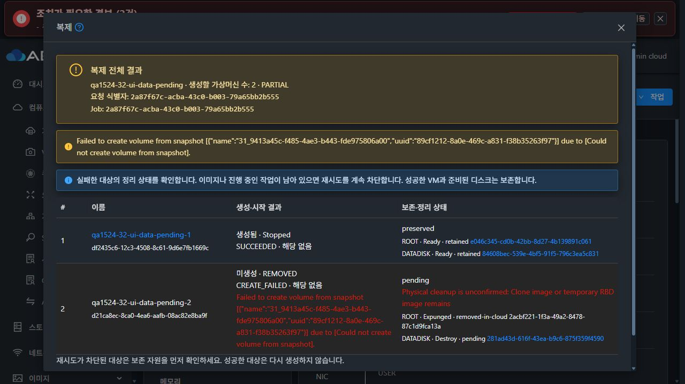
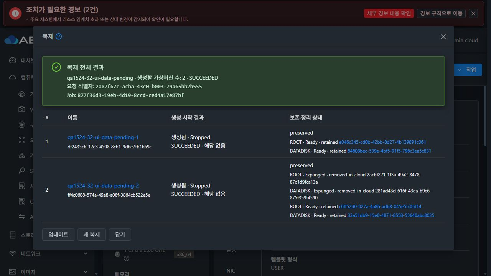
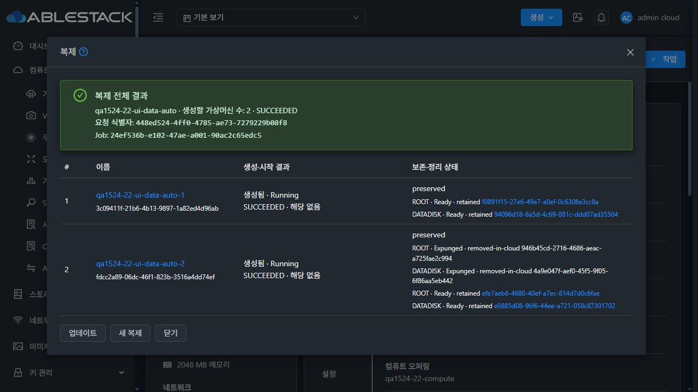
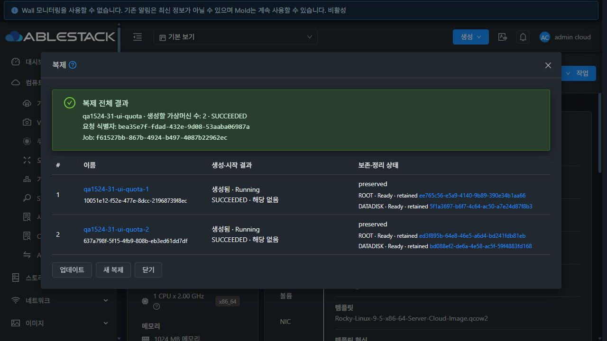

# #1524 복제 실패 자원 정리 구현·실환경 검증

2026-10-30 KST · Epic #1510 · 선행 PR #1525

실패한 두 번째 DATA 볼륨의 물리 부재를 확인한 뒤 Cloud 상태, stale `SNAPSHOT_ID`, 자동 VM 스냅샷을 정상 API/UI로 정리하도록 구현했다. 22/32 RBD의 실제 DATA 복사 실패와 UI 재시도, 31 GFS2의 준비 디스크 보존·재개를 검증했다. 운영자가 직접 SQL UPDATE/DELETE로 시험 기록을 보정한 횟수는 **0건**이다.

기계 판독 근거와 배포 JAR SHA256, 검사한 클래스 수, 시험 UUID, 자원 정리 결과는 [evidence.json](evidence.json)에 기록했다. 원시 API·DB·호스트·빌드 기록은 이 디렉터리의 로컬 `raw/` 및 WSL ext4 `/home/ablecloud/work/issue-1524/`에 보존했다. 인증 정보가 섞일 수 있는 원시 기록은 Git에서 제외했다.

## 구현

- 실패한 `CopyCmdAnswer`, 응답 부재, null 복사 결과를 성공으로 처리하지 않고 원래 오류를 유지한다. 실패 응답의 `newVolume` NPE 경로를 차단한다.
- 배치 원장에 실패 정리, 재시도 횟수·지연, 자동 VM 스냅샷 ID를 저장한다. 백그라운드는 최대 3회 확인하며 관리자는 `cleanupVMCloneBatch(requestid)`와 UI **실패 자원 정리 재시도**로 다시 확인할 수 있다.
- 원장 UUID·원본 볼륨·계정·풀·제거 상태·연결·보호·스토리지 참조를 검증한다. 제거된 ROOT의 기존 VM 연결 기록은 해당 실패 대상의 제거 이력과 일치해야 한다.
- Agent가 기존 활성 풀을 읽기 전용으로 조회한다. 풀 UUID·유형·경로, RBD 최종/임시 이미지·trash·매핑·프로세스 또는 GFS2 마운트·하위 파일을 대조한다. 풀 누락·비활성·조회 오류나 실물 잔존은 pending 사유로 남긴다.
- 물리 부재 영수증이 일치한 실패 볼륨만 Expunged로 수렴하고 `SNAPSHOT_ID`를 제거한다. 이미 제거할 때 반영한 자원 계수는 다시 차감하지 않는다. 기록된 자동 VM 스냅샷은 기존 삭제 API의 의존성 보호를 거친다.
- 성공 VM, 원본, 준비된 GFS2 디스크 및 활성 RBD Linked 부모를 보존한다. 실제 정리 Job이 실행 중일 때 복제 재시도를 차단한다.

실환경에서 추가 발견한 상태 열 저장 누락도 수정했다. GenericDao가 `setData` 내부의 다른 필드 변경까지 추적하지 않아 상태 열이 QUEUED로 남았다. 상태·갱신 시각을 각각 저장하고, 기존 기록도 정리 플래그로 검색해 직접 DB 보정 없이 복구한다. 프레임워크 의사 Job을 실제 정리 Job으로 취급하던 차단과 UI 번역 키 충돌도 수정·재배포했다.

## UI·API·실물 검증

| 환경/경로 | 실제 검증 결과 |
|---|---|
| 32 RBD Full/count=2/start=false | 첫 VM 완료 뒤 두 번째 DATA 부모 스냅샷 이름을 잠시 바꿔 실패 주입. 첫 VM UUID·디스크 보존, 실패 ROOT/DATA Expunged, SNAPSHOT_ID·자동 스냅샷 정리, 자원 계수 불변. UI에서 두 번째 대상만 재시도해 성공 |
| 32 RBD 임시 이미지 잔존 | 실패 DATA UUID가 포함된 1 MiB 전용 임시 이미지 주입. 자동 확인과 UI 재시도 모두 pending·실물 잔존 사유·재생성 차단 유지. 주입 이미지만 원복한 뒤 UI 정리 4번째 확인 성공, 스냅샷·detail 정리 및 두 번째 대상 복제 성공. 첫 대상·계수 불변 |
| 22 RBD 명시적 off/raw | 전용 원본 ROOT+DATA에서 동일한 두 번째 DATA 실패 재현. 호스트 연결 확인 불가 시 pending 유지 후 자동 복구. 실패 볼륨·SNAPSHOT_ID·자동 스냅샷 정리와 UI에서 두 번째 대상만 재시도 성공 |
| 31 GFS2 | 전용 계정 VM 한도를 2로 설정해 두 번째 VM 할당 실패. 첫 VM과 준비된 ROOT/DATA 보존, RESUME 표시. 한도 원복 후 UI 재개 성공, 준비 디스크 UUID 동일. 두 복제본 부팅 및 flatten 후 backing 부재 확인 |
| 최종 읽기 전용 Agent | 보강한 Agent를 9대에 배포한 뒤 32 DATA 실패를 다시 주입. 기존 활성 풀 조회로 실패 디스크 2개 부재 확인·자동 정리 성공. 활성 Linked 부모/스냅샷 보존. UI에서 두 번째 대상 재시도 성공 |
| RBD Linked 보호 | 별도 Linked VM ROOT/DATA 부모 2개와 자동 스냅샷을 확보. 정리 API 호출 및 다른 Full 배치의 실패 정리 뒤에도 동일 부모·디스크·Ready 스냅샷·계수 유지 |
| 권한·멱등성 | 다른 계정 조회는 NOTFOUND로 UUID/오류/정리 Job을 노출하지 않고 정리 요청은 실패. 소유자 정리 및 반복 호출 성공, 별도 VM 생성·계수 중복 차감 없음 |
| 세션·중복 실행 | 관리 서버 재시작 후 로그인하고 복제 화면을 다시 열어 같은 요청·실패 결과 복구. 실제 정리 중 UI 새 복제/재시도 차단. 의사 Job은 차단 대상으로 노출하지 않음 |

32의 첫 시험은 부팅 전 Allocated ROOT 때문에 복제 전에 차단됐다. 전용 원본을 부팅·정지해 Ready로 준비한 뒤 DATA 실패를 다시 재현했으며, 이 준비 실패를 DATA 정리 성공으로 계산하지 않았다. 실패 주입 때 바꾼 전용 스냅샷 이름은 각 Job 종료 후 원복했다.

22·31·32에서 대표 복제본 **6대의 부팅/QGA·ROOT+DATA 연결**과 DATA의 **1 MiB/512 MiB 두 구간 패턴**을 확인했다. GFS2 복제본 2대의 ROOT/DATA는 flatten 후 backing이 없었다. 전체 볼륨 해시 비교를 새로 수행했다는 의미는 아니다.

## 변경 모듈 빌드·집중 검사

Windows PR 소스와 별도의 WSL ext4 PR 소스 트리, #1518/#1519가 포함된 통합 트리를 구분했다. 선행 기준은 `a83fad0c6837674e1ce87ef3fa155dfa4b115308`, 최종 기능 코드는 `8d980e4be59`다.

| 검사 | 결과 |
|---|---:|
| PR 단독 backend: API 4 + server 36 + volume 5 + KVM 9 | 54 PASS / 실패·오류·생략 0 |
| UI CloneBatch 13 + CloneAllocation 11 | 24 PASS |
| PR 단독 집중 검사 합계 | **78 PASS** |
| #1518/#1519 통합 backend 및 UI | **84 PASS** |
| 변경 UI 파일 lint / production build | PASS |

변경 Maven 모듈은 `api,core,engine/schema,server,engine/storage/volume,plugins/hypervisors/kvm`만 빌드했다. 모든 Maven 빌드·검사는 WSL ext4에서 수행했다. 전체 Cloud/Release 및 qemu Actions 빌드는 시작하지 않았다. 위 수치는 집중 검사이며 전체 Cloud CI 성공을 뜻하지 않는다.

## 배포·정리·보호

- 관리 서버 3대와 Agent 9대의 역할별 변경 클래스를 배포했다. 최종 **12개 서비스 active, JAR 30개 해시/선택 클래스 검증**을 통과했다. 변경하지 않은 JAR 항목은 압축 바이트를 보존했다.
- 관리 UI 3곳의 **931개 정적 파일 해시**를 확인했다. WEB-INF/META-INF·설정·UI 배포 시 관리 PID를 보존했고 `/client/` HTTP 200을 확인했다. 화면 근거는 1280×720 실제 JPEG이며 해시·크기는 evidence에 기록했다.
- 32번 Agent 1회의 서비스 중지 취소는 기존 JAR로 롤백 후 정상 재배포했다. 최종 9대 Agent의 역할별 클래스 해시와 실제 확인 명령 응답을 확인했다.
- 정상 API로 전용 VM·볼륨·스냅샷·계정·네트워크·오퍼링을 정리했다. 세 클러스터의 활성 자원, NIC, 미정리 볼륨, 스토리지 참조 **0건**. 알려진 물리 UUID **36개**와 관련 임시 파일/이미지·trash 잔여 **0건**. 호스트 9대 QA 도메인·RBD 매핑 **0건**이다. 제거된 이력 및 Inactive 오퍼링은 정상 감사 기록으로 남는다.
- 32번의 구 배포 백업 JAR 2개(약 528 MiB)는 SHA256 일치 확인 후 WSL ext4에 보관하고 서버의 해당 구 백업 파일만 제거했다. 최신 서버 롤백 백업은 유지했다.
- **22 rocky98-perftest 및 연결 디스크에 전원·디스크·QGA·마이그레이션·내용 명령을 보내지 않았다.** PID `1516803`, startTicks `201077163`은 전후 동일하다. 보호 VM/허용된 기존 base의 VM 메타데이터와 연결 디스크 3개 메타데이터도 동일하다.

선행 PR #1525는 미병합이다. 이 후속 브랜치는 그 기준을 포함하며, #1524 자체 변경은 위 기준 커밋과 비교해야 한다. PR 병합과 Epic 종료는 이번 작업 범위에서 수행하지 않는다.
