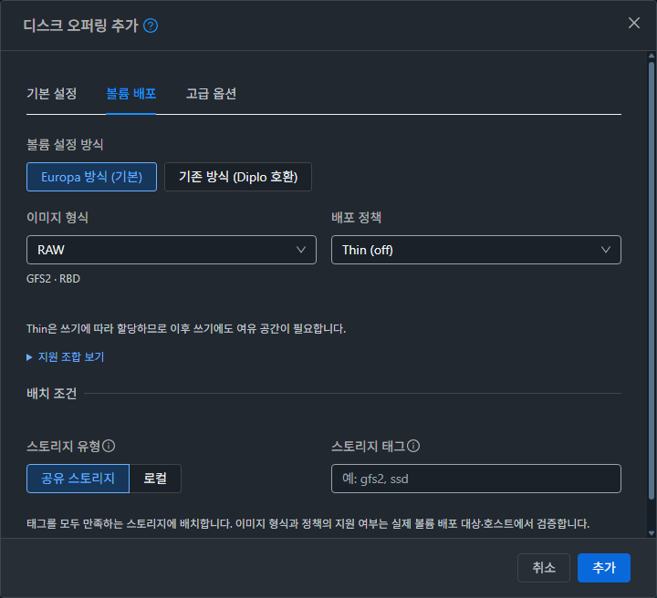
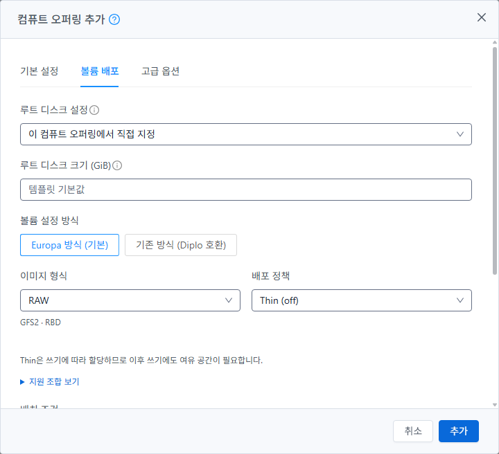

# 오퍼링 추가 대화상자 개선 완료 보고

Epic #1422 · 누적 Draft PR #1435 · 검증일 2026-10-23(KST).
승인한 목업을 컴퓨트·디스크 오퍼링 추가에 적용하고 31 GFS2 / 32 RBD에 배포했다. 이번 작업은 UI만 변경하며 기존 시스템/복제/편집 폼의 동작과 실제 볼륨 배포 검증은 유지한다.

## 적용한 설계

- 두 폼을 **기본 설정 / 볼륨 배포 / 고급 옵션**으로 나눴다. 기본 설정은 이름·설명·컴퓨트 사양 또는 디스크 크기이며, 고급 옵션은 관련 설정을 접어서 표시한다. 공통 MOLD-DIALOG 쉘과 단일 고정 푸터를 사용한다.
- **볼륨 설정 방식**에서 **Europa 방식 (기본)**을 먼저 선택한다. **기존 방식 (Diplo 호환)**은 thin/sparse/fat를 유지한다. 새 매개변수가 없는 API는 기존 방식으로 시작한다.
- 참조 스토리지 선택과 이에 따른 풀·호스트·capability 조회를 제거했다. 관리자가 이미지 형식과 **배포 정책**을 정의하며, 스토리지 태그는 별도 배치 조건이다. 실제 배포 대상의 지원 여부와 용량·실행 결과는 기존 볼륨 경로에서 검사한다.
- 컴퓨트에서 디스크 오퍼링을 연결하면 형식·정책·태그를 읽기 전용으로 표시한다. 컴퓨트 자체의 정책·캐시·QoS를 중복 제출하지 않는다.
- 하이퍼바이저 QoS는 기본 한도 4개와 접을 수 있는 버스트 입력 8개로 나눴다. 탭과 접힌 그룹의 입력을 유지하고 저장 오류가 있는 탭·그룹을 자동으로 연다.
- GFS2 RAW off/falloc/full, QCOW2 metadata/falloc/full의 정의를 제공한다. RBD는 RAW off/full만 지원 표에 표시하며 QCOW2/falloc/지속 예약을 지원한다고 주장하지 않는다. falloc은 GFS2 전용으로 표시한다.

## 실제 검증 중 추가로 수정한 오류

1. 컴퓨트의 숫자형 네트워크 속도 기본값 10000과 루트 디스크 크기가 문자열 길이 검사 때문에 POST에서 빠지는 오류를 수정했다. 최종 UI에서 기본값 10000과 입력한 루트 크기 1GiB가 API·DB에 반영되는 것을 확인했다. 초기 31 연결 오퍼링의 NULL 값은 수정 전 재현으로 별도 기록하며, 수정 후 32 연결 오퍼링은 10000이다.
2. Zone 선택의 사용자 지정 control ID 때문에 오류 탭으로 이동하지 않던 문제를 수정했다. 모든 Zone과 특정 Zone을 함께 선택하면 고급 옵션과 사용 범위 그룹을 열고, 교정 후 정확한 도메인·Zone UUID로 저장한다.
3. 중첩된 디스크 추가의 버튼이 부모 푸터로 합쳐지던 문제를 별도의 공통 대화상자와 form-actions 슬롯으로 수정했다. 두 대화상자의 취소/추가가 각각 유지된다.
4. 모달 폭을 720px 공통 크기로 맞추고 공통 테마 토큰으로 링크·경계선·배치 조건 제목 대비를 보완했다.

## 빌드와 집중 테스트

- 관련 **8 suites / 129 tests 통과**, 실패·보류 0. 정책 조합·구 API·상속·탭/그룹 입력 보존·오류 이동·숫자 payload·부모/자식 푸터·기존 기능 회귀를 포함한다. 변경 Vue/JS 린트 및 마지막 스타일 린트 통과.
- 기능 검증 소스: `12b3ff3fd683024864327a8e44acdaef053d05e8`.
- 최종 배포 소스: `2b244f6dd778f37f367ab83915d0e700d6b2b928`. 마지막 두 변경은 CSS뿐이며 모든 템플릿·스크립트가 기능 검증 소스와 같음을 확인했다. [스타일 변경 증거](style-only-proof.json).
- WSL ext4 clone에서 Node 14.21.3 표준 최적화 UI production build 성공, 446초, exit 0. Maven/Agent/qemu 변경·배포 및 전체 Cloud/Release CI는 실행하지 않았다.

## 31·32 실제 UI 검증

전용 이름 `OFFDLG-31-*`, `OFFDLG-32-*`로 디스크 12개와 컴퓨트 7개를 **브라우저 UI에서 생성**했다. [19개 API·DB 대조](api-db-cases.json), [UI 검증 기록](ui-checks.json).

- Europa 기본 RAW/off, QCOW2 metadata/falloc/full, RAW full, 기존 fat/sparse/thin, 사용자 지정/고정 디스크 크기를 확인했다. RAW에서 선택한 full/falloc이 QCOW2 전환 후 유지됐다.
- 고정/범위 제한/제한 없는 컴퓨트, 직접 ROOT 정의/일반 디스크 연결, HA·CPU 제한·네트워크 속도, 비공개 ROOT 도메인·특정 Zone을 API·DB와 대조했다.
- QoS 읽기 한도 1MiB/s·버스트 2MiB/s·2초를 입력하고 버스트 영역을 접은 뒤 기본 탭에서 저장해 POST와 API·DB에 같은 값이 남는 것을 확인했다.
- 필수 이름·네트워크·음수 QoS·Zone 오류의 탭/그룹 이동과 입력 보존을 확인했다. 취소 후 새 폼은 이름이 비고 Europa 기본값으로 초기화됐다.
- 생성 요청 하나에만 제어된 HTTP 503을 주입했다. 서버 생성 없이 폼·세션을 유지하고 재시도로 실제 1건을 생성했다. 별도 더블 클릭 시 실제 생성 POST는 1건이었다.
- 컴퓨트 안에서 디스크 오퍼링을 추가하면 부모 입력을 유지하며 새 오퍼링이 선택됐다. 연결 모드 POST에는 자체 정책·캐시·QoS가 없었다.
- 320·736px와 1280px 화면에서 모달 경계·본문 가로 넘침·입력란·확장 QoS·고정 푸터를 확인했다. 밝은/어두운 테마를 점검하고 원래 어두운 테마를 복원했다. [화면 실측](visual-checks.json).

## 생성한 볼륨과 실물 대조

UI에서 만든 오퍼링을 사용해 전용 DATA 볼륨 5개를 API로 생성했다. UI 오퍼링 정의 → 생성 API/job → DB → 호스트 이미지의 형식·논리 크기·관측 할당량을 대조했다. 모두 논리 크기 1GiB, Ready 및 evidence=verified이며 QCOW2는 qemu-img check도 통과했다. [실물 검증 요약](volumes.json).

| 경우 | 형식 / 정책 | 상태 / 증거 | 실제 방식 | 관측 byte |
|---|---|---|---|---:|
| 31-disk-metadata | qcow2 / metadata | Ready / verified | qemu-preallocation-metadata | 348,160 |
| 31-disk-full | raw / full | Ready / verified | qemu-preallocation-full | 1,075,871,744 |
| 32-disk-thin | raw / off | Ready / verified | rbd-thin | 0 |
| 32-disk-full | raw / full | Ready / verified | rbd-thick-create | 1,073,741,824 |
| 31-disk-final-qos | qcow2 / metadata | Ready / verified | qemu-preallocation-metadata | 348,160 |

GFS2 Full 관측량에는 파일시스템 할당 오버헤드가 포함된다. RBD Thin의 현재 0 byte와 Full의 1GiB는 생성 직후 rbd du --exact 관측이며 영구 용량 예약 보장이 아니다. 이번 falloc 확인은 오퍼링 정의·저장까지만 수행했으며 새 물리 falloc 실행이나 커널 수정의 완료를 주장하지 않는다. 기존 #1437 해결 상태는 유지한다.

## 배포·정리·보존

- 두 관리 서버의 활성 `/usr/share/cloudstack-management/webapp`에 정적 파일 각 914개를 배포하고 전체 해시를 대조했다. index를 마지막에 교체하며 과거 해시 파일은 유지했다. [배포 기록과 백업 경로](deployment.json).
- WEB-INF/META-INF·설정·관리 JAR·Mold PID와 32의 별도 qcow2 운영 파일을 보존했다. `/client/` HTTP 200 및 기존 FTCTL/신규 폼/QoS 활성 번들 표식을 확인했다.
- 오퍼링 19개와 자동 내부 ROOT 정의, DATA 볼륨 5개를 전용 API로 정리했다. 활성 DB 잔여 0, GFS2 파일/RBD 이미지 부재, 기존 운영 inventory 일치, 관리 runtime 일치, 호스트 6개 Up을 확인했다. [정리 증거](cleanup.json).
- 원래 FT 작업 공간의 HEAD·전체 status·diff hash가 시작 시점과 같음을 확인했다. Epic 전용 Windows/WSL ext4 작업 공간을 사용했다. [종합 요약](summary.json).

## 완료 범위와 다음 작업

이번 요청의 추가 대화상자 구현·UI 모듈 빌드·31/32 배포·개별 기능 검증을 완료했다. 누적 Epic PR #1435는 **Draft·미병합**이며 #1433 완료 상태와 Epic #1422·#1434 열린 상태를 유지한다.

다음은 **#1434 최종 통합 회귀**이다. 승인된 새 오퍼링을 포함해 실제 VM 생성/ROOT 적용·부팅·게스트 I/O, 전체 복사·수명주기·다중 풀 이동, 역할별 경로와 실패 회복, 최종 UI 지원표를 함께 대조한 뒤 Epic 종료를 판정한다. 이번 결과를 전체 Cloud CI나 GPU/vGPU·임대·모든 역할·모든 저장소 조합의 실물 인증으로 확대하지 않는다.

## 최종 배포 화면

