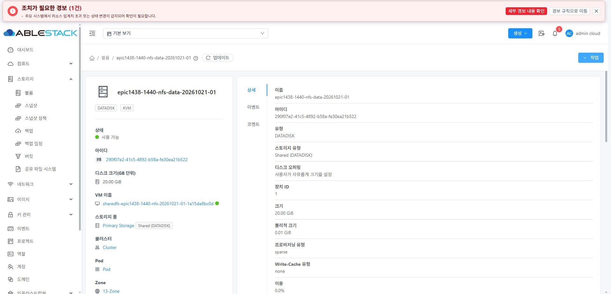
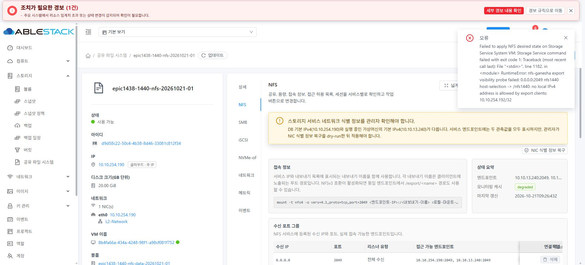

# #1440 볼륨 통합본 13번 배포 및 실제 UI 검증 — 2026-10-21

## 결론

통합 소스 **be2bae799750650ef6432995c4dee896daefd1d1**을 관리 서버·세 KVM agent·UI에 배포했다. 새 SPARSE SharedFS DATA에서 **UI 이름만 변경, 삭제 보호 ON/OFF**가 모두 성공했고, 실제 POST에서 path가 생략됐다. API·읽기 전용 DB·실행 디스크 식별 비교로 경로와 비대상 정보 보존을 확인했다.

다만 새 클라이언트만 허용하는 NFS ACL을 UI에서 적용하는 과정에서 **기존 미해결 이슈 #1460과 동일한 제품 오류를 새로 재현**했다. 명시된 오류 중단 원칙에 따라 **후속 변경·접속 시험을 중단**했다. NFS 클라이언트 I/O·파일 checksum·기존 볼륨 실제 연결은 미완료이며 **#1440을 닫지 않는다.** 이번 배포 성공과 전체 SharedFS 인수 완료를 구분한다.

## 소스·빌드·배포

- 로컬 Europa와 upstream 기준은 0e6b5093d51079f0cfd9bfc88b6e37a795be55a3, divergence 0 0이었다. 수용 원본은 Volume Epic #1422 / PR #1435 head ba4cfd1d52979f487959786f6b40b364ad11b359, 정상 merge는 0dea71588808cfb434b9f0cc73a5a22460e09877이다.
- 이번 작업에서 제품 소스를 추가 수정하지 않았다. 기존 공통 볼륨 구현과 #1439 조회 수정을 그대로 검증했다. PR #1435를 upstream에 병합했다는 의미가 아니다.
- api, core, engine/orchestration, engine/storage/volume, server, plugins/hypervisors/kvm, plugins/storage/volume/default, plugins/storage/volume/ablestack의 변경 클래스를 새로 빌드했다. 의존성 포함 **43 모듈 clean package**, 선택한 **20 suites / 403 tests**, 실패·오류·skip 0. [시험 집계](evidence/backend-test-summary.json).
- Checkstyle/RAT는 생략했다. 전체 Release CI·전체 UI·모든 스토리지 정책 실환경 시험 결과가 아니다. 이전 통합 단계의 UI 197개 통과는 이전 보고서의 결과이며 이번 작업에서 단위 시험을 다시 실행한 수치로 세지 않는다.
- 실제 설치 JAR를 원본으로 사용해 변경 클래스 묶음과 bean XML만 반영했다. 관리 fat JAR는 157개 엔트리 변경, **나머지 93,590개 엔트리의 바이트 동일성**을 확인했다. 세 agent의 기존 JAR도 동일성을 확인한 뒤 후보를 만들었다. ZIP 무결성·중복·서명 부재를 확인하고 실제 서버의 JVM에서 -Xverify:all 클래스 로딩/제공자 검사를 통과했다.
- 세 agent를 한 대씩 적용하고 UI에서 정상 재연결을 확인한 후 관리 서버, 마지막으로 UI를 배포했다. 게스트·템플릿·libvirtd·MAC·DB schema는 변경하지 않았다.
- 배포 전후 각 호스트 기존 VM의 UUID·디스크 소스/serial·MAC·domain 상태가 보존됐다. 새 서비스·클라이언트는 배포 후 UI로 생성했다.
- UI production compile 성공. 최초 postbuild는 작업자가 넣은 유효하지 않은 release-version 환경 입력을 거절했다. 해당 환경 입력을 제거하고 postbuild만 정상 수행했으며 제품 코드 수정이나 반복 compile은 하지 않았다. source public/config.json은 원래 바이트로 복원했다.
- UI **899개 파일 SHA-256 대조**, index를 마지막에 교체했다. 설치된 config.json과 systemvm 디렉터리 inode를 보존했다. 표시 buildVersion V4.0-4.0.15는 기존 값을 유지했으며 배포 출처는 commit·해시로 구분한다.

| 대상 | unit / 새 PID | 적용·확인 |
|---|---|---|
| 10.10.13.10 | mold.service / 2983986 | 새 fat JAR SHA·실제 프로세스 열린 파일 일치, active, UI 로그인 성공 |
| 10.10.13.1 | mold-agent.service / 2968049 | 적용 JAR SHA·프로세스 일치, active, UI 호스트 정상 |
| 10.10.13.2 | mold-agent.service / 2053821 | 동일 |
| 10.10.13.3 | mold-agent.service / 3220776 | 동일 |

관리 fat JAR: 69afe59ca4ebf3108f4963c8f30b01c9fbf2dce759633258804bfeb97164a41d
UI bundle: 40bfa118423ef47fbac61187dd0e6efe945fae9d689d8c7a72c3234132658cdc
UI index: 0faf92758cb88b19329c417697f39a633143e96d8ccbc6e536db63b6ceecf548

[배포 영수증·JAR 해시](evidence/deployment-receipts.json). 각 호스트의 원본은 /var/tmp/epic1440-be2bae799750-10-10-13-<호스트 끝자리>-rollback에 보존했다. 관리 서버에는 이전 UI backup도 있다. DB migration은 없다. 롤백은 이전 UI → 이전 백엔드 순서로 한 쌍을 복원해야 한다.

## 새 UI 시험 자원

이전 VM·클라이언트·DATA를 재사용하지 않았다. compute/disk offering과 템플릿 정의는 기존 정의를 선택했으며, 새로 생성한 **ROOT/DATA 네 개 모두 DB sparse / QCOW2**를 확인했다. UI 기본값의 THIN offering은 선택하지 않았다.

| 자원 | UUID / 식별 |
|---|---|
| SharedFS epic1438-1440-nfs-20261021-01 | d9d58c22-50c4-4b38-8d46-33081c812f34 |
| SharedFS VM | 8b4fa66a-434a-4248-98f1-a98cf081f752 / i-2-103-VM / 10.10.13.1 |
| SharedFS ROOT | 5d5ef65b-37bd-4939-8664-0071e0745ef9 / 5,242,880,000 bytes |
| SharedFS DATA | 290f07e2-41c5-4892-b58a-fe30ea21b522 / 20 GiB |
| 별도 빈 DATA | e8a2ccc5-a64a-4866-a1ae-ec60f335efe3 / 20 GiB / Ready·분리 상태 |
| 새 Rocky9 클라이언트 | fd6ecae3-ef41-40c0-bfa9-acf88b67b6e5 / i-2-104-VM |
| 클라이언트 ROOT | fa8a39ae-9ce0-4573-89b0-912edc0713a6 / 100 GiB |
| NFS export | nfs1440 / 내부 /export/nfs1440 / NFSv4 전용 / TCP 2049 |

compute offering은 epic898-sharedfs-sparse-2C4GB, DATA offering은 사용자 정의 디스크 오퍼링(c48ab8d8-faba-4d43-85a6-e98a9ecc0cd5)이다. 사용자가 아닌 이번 작업의 자원만 생성·변경했다. 새 서비스 runtime IP는 UI에서 지정한 **10.10.13.240/16**, 새 클라이언트는 DHCP **10.10.254.192/16**이다. MAC을 임의로 변경하지 않았다.

## 완료한 실제 UI 검증

Mold UI로 생성/편집했고, UI가 보낸 요청·비동기 작업·조회 응답을 CDP로 관찰했다. 별도 API 호출이나 QGA로 준비·변경을 대신하지 않았다. DB/host 진단은 읽기 전용이다.

| UI 작업 | 관찰한 부분 POST | 결과 |
|---|---|---|
| DATA 이름만 변경 | id + name, path/deleteprotection 없음 | job 6ffcf02c-060c-4b62-8cb7-a9b4ccc1158b, status 1 |
| 삭제 보호 ON | id + deleteprotection=true, name/path 없음 | job 26939e4e-04fe-4954-93eb-e91f321448e9, status 1 |
| 삭제 보호 OFF | id + deleteprotection=false, name/path 없음 | job 941f34fb-e7c0-49d7-93f4-bc4eebbbfea1, status 1 |

위 표는 command/response 같은 공통 전송 인자를 생략한 표기다. [실제 요청과 최종 작업 결과](evidence/volume-ui-mutations.json), [UI 조회 API의 볼륨 snapshot](evidence/volume-ui-api-snapshots.json).

- 최종 이름은 epic1438-1440-nfs-data-20261021-01, 삭제 보호 false다.
- API에서 path UUID, pool UUID, Ready, 20 GiB, sparse, VM·device 1 연결이 유지됐다.
- DB 전체 비교에서 최종 차이는 **해당 DATA의 name 한 필드뿐**이었다. 보호 ON 시에는 name과 delete_protection만 달랐고, OFF 후 보호는 원래 0으로 돌아왔다. path·chain_info·pool·format·state·size·account/domain·instance/device·provisioning·display와 다른 세 볼륨은 그대로였다.
- libvirt와 실물 QCOW2 헤더/stat 비교에서 두 새 VM의 UUID·MAC·파일 경로·target·serial·inode/device·virtual size·backing이 **완전히 동일**했다. 실행 중 파일 전체 hash를 데이터 보존 증거로 잘못 사용하지 않았다.
- 실행 중 VM에 연결된 DATA의 편집 창은 경로 편집을 허용하지 않고 “연결된 가상머신을 정지한 후 경로를 변경하십시오”라고 안내했다. 명시적 경로 권한·상태 보호는 관련 단위 시험과 이 실제 UI 안내로 확인했으며 다른 권한 계정의 실환경 재시험은 하지 않았다.
- 새 NFS 서비스 생성, enableNFS, export, 최초 ACL은 모두 UI 비동기 작업 status 1이었다. 상세/NFS 조회가 끝나고 볼륨 매핑 “정확”, XFS·20 GiB·변경된 이름이 정상 표시됐다. 이번 범위에서 #1439 무한 로딩 재발은 관찰되지 않았다. 기존 #1439 전체 fault-injection 인수를 다시 수행한 것은 아니다.
- 새 빈 DATA가 “기존 볼륨” 선택 목록에 나타나는 것까지 확인했다. **연결은 아직 실행하지 않았다.** 초기 생성의 기존 볼륨 모드에 남은 diskoffering 의존성은 기존 #1442의 소스 근거이며 그 경로를 제출해 성공했다고 기록하지 않는다.
- 클라이언트는 실제 VM 콘솔로 로그인했다. 콘솔 입력 도구의 기호 키 전달 문제를 보정했고, 실제 ens3 주소와 서비스 방향 route를 확인했다. 기본 템플릿에 없던 nfs-utils는 콘솔에서 공식 Rocky repo로 설치했다. 인증정보는 저장하지 않았다. **NFS mount/파일 생성은 아직 하지 않았다.**

[DB/물리 상태 차이 요약](evidence/metadata-comparison.json), [원본/최종 영속 상태](evidence/before-metadata-db.json), [최종 영속 상태](evidence/after-protection-off-db.json).

### 관찰 도구의 자체 보정

최초 API observer가 trailing slash와 listVolumesMetrics를 놓쳐 편집 전 listVolumes를 “변경 후”로 고른 적이 있다. 제품 변경을 재시도하지 않고 observer를 수정했다. 해당 snapshot은 superseded로 표시하고 실제 UI Metrics 재조회로 대체했다. 최종 판정은 작업 status 1·정상 UI·최신 Metrics·읽기 전용 DB·물리 식별 비교에 근거한다.

## 중단된 단계와 정확한 원인 — 기존 #1460

### 새 재현

1. 서비스 생성 때 ACL은 10.10.13.0/24였다. 이는 서버 runtime 13.240을 포함하므로 로컬 probe가 통과했다.
2. 새 클라이언트 실제 주소는 10.10.254.192이다. 이 주소는 같은 물리 /16에 있고 route가 서비스로 직접 이어진다. 기존 /24 ACL 밖이므로 **접속 전에 UI의 ACL 편집에서 이 클라이언트 한 대인 10.10.254.192/32로 수정**했다. rootSquash/allSquash/sync/secure 설정은 유지했다.
3. 실제 UI updateStorageNfsAcl POST는 정상 접수됐으나 job **532ba6fc-be74-4afa-a253-d9cb68841c00**이 **status 2 / error 530**으로 끝났다.

~~~text
nfs-ganesha export visibility probe failed:
0.0.0.0:2049 nfs1440 host-selection -> /nfs1440:
no local IPv4 address is allowed by export clients: 10.10.254.192/32
~~~

[실제 실패 요청·응답](evidence/nfs-acl-failure.json). 이것은 외부 클라이언트의 timeout/인증 실패나 단순 표시 차이가 아니다. **실제 클라이언트 접속 전에 서버 내부 probe 대상 선택에서 발생한 코드 오류**다. 서버 자신을 ACL에서 제외하는 것은 정상적인 보안 설정이다.

### 코드 경로와 부작용

- UI SharedFSTab.vue의 updateNfsAcl은 사용자가 입력한 principal과 기존 옵션을 updateStorageNfsAcl에 보냈다. UI 입력이 잘못 변환된 근거는 없다.
- StorageServiceManagerImpl.updateStorageNfsAcl(778–795행)은 **새 principal과 Updating을 DB에 먼저 저장한 뒤** applyNfsDesiredState를 호출한다.
- ablestack-storagectl의 select_mount_host(4067–4079행)는 서버 자신의 local IPv4 중 ACL에 포함된 주소만 고른다. 클라이언트 전용 /32에는 서버 주소가 없으므로 host-selection을 실패로 만든다(4129–4142행).
- 적용 경로(4516–4531행)는 설정 생성·Ganesha 시작 뒤 이 검사를 실행하고, 실패하면 **인자 없는 stop_ganesha_endpoints()로 전체 엔드포인트 정지를 호출한 뒤 RuntimeError를 발생**시킨다. 실제 Ganesha PID/종료 완료 여부는 이번 중단 이후 guest에서 추가 실행해 확인하지 않았다. UI 모니터링 cache는 degraded다.
- 관리 서버는 guest exit 1을 API 오류로 전달한다. 실패 전에 저장한 ACL은 **DB와 UI 모두 10.10.254.192/32 / Updating**으로 남은 것을 확인했다. READY 리스너/사용 가능 헤더는 이 작업의 성공 증거로 사용하지 않았다.
- 위 storagectl 및 StorageServiceManagerImpl 파일은 Europa 기준 0e6b5093d51과 통합 head에서 **바이트가 같다**. 이번 볼륨 merge에서 이 검사·NFS 적용 로직을 변경하지 않았다. 실제 오류 문자열/단계가 소스와 일치하지만 guest 전체 스크립트 hash를 추출했다는 의미는 아니다.
- 기존 이슈 **#1460의 목표와 정확히 일치하는 새 재현**이다. 실패 후 상태 원복 부재는 #1444와 관련된 관찰이다. 새 이슈를 만들지 않았고 다른 기능 구현도 시작하지 않았다.

### 개선 방향 — 미구현

사용자는 같은 ACL 편집 UI에서 클라이언트 CIDR을 지정하고 정상 완료를 확인할 수 있어야 한다. 서버 IP를 UI에서 허용 목록에 추가하도록 요구하거나 자동 추가해 검사를 통과시키면 안 된다.

1. **UI/API 상태 계약:** 설정 적용·프로세스/listener/export 준비와 외부 접근 검증을 구분한다. 로컬 probe 주체가 ACL에서 제외된 경우 “서버 내부 접근 검사는 ACL 때문에 미실행, 실제 클라이언트 확인 필요”로 표시하되 설정 실패로 만들지 않는다. 명백한 설정/권한 오류는 실패로 유지한다.
2. **Guest probe:** host-selection의 “허용된 로컬 주소 없음”을 실제 mount 실패와 별도로 분류한다. ACL은 그대로 두고 프로세스·listener·export 설정 확인을 수행한다. 이 미검사 분기 때문에 정상 전체 Ganesha를 중지하지 않는다.
3. **실제 적용 오류의 상태 처리:** 진짜 실패에서 이전 정상 설정/상태를 보존하거나 명시적으로 복구하는 흐름을 설계한다. Updating이 무기한 남지 않아야 하며 #1444의 원자적 롤백 범위와 겹치는 부분을 명확히 한다.
4. **인수:** 새 서버·새 허용/비허용 클라이언트로 /32 ACL과 허용 철회, 기존 다른 export·PID/listener·계속 허용되는 I/O를 실제 UI·콘솔로 확인한다. 이후 #1440의 기존 볼륨 연결과 파일 checksum 인수를 재개한다.

이번에는 개선을 구현하거나 ACL을 넓혀 재시도하지 않았다. 사용자 다음 지시 전까지 변경 시험을 중단한다.

## 현재 남은 상태와 종료 판단

- **완료:** 통합 패키징, 관리/agent/UI 배포와 무결성 대조, 새 SPARSE 자원 생성, UI 부분 POST 3건과 API/DB/물리 경로 보존.
- **미완료:** NFS 실제 접속·파일 데이터/checksum 보존, 별도 기존 볼륨 실제 연결 후 경로 인수. 따라서 #1440 OPEN 유지.
- 새 시험 SharedFS·클라이언트와 별도 빈 DATA는 증거와 후속 확인을 위해 보존했다. 실패한 ACL은 Updating 상태로 남아 있다. 원복·재적용·삭제·추가 NFS 작업은 하지 않았다. 다른 사용자 자원은 변경하지 않았다.
- Cloud 주 IP 10.10.254.190과 runtime 10.10.13.240 표시는 서로 다르다. 관측값과 경고를 기록하고 NIC 복구/MAC 변경은 하지 않았다. 접속 자체의 실패 원인으로 단정하지 않았다.
- 볼륨 legacy sparse의 확정/실제 정책과 관측 할당량이 “알 수 없음/미검증”으로 표시되는 점을 기록했다. DB sparse/QCOW2와 물리 identity는 별도로 확인했으며 explicit 새 할당 정책의 실환경 시험으로 확대하지 않는다.
- 최종 UI #1468은 HOLD 유지. Epic PR #1470은 Draft다. 본 보고서는 이전 배포 전 보고서를 덮어쓰지 않는 후속 기록이다.
