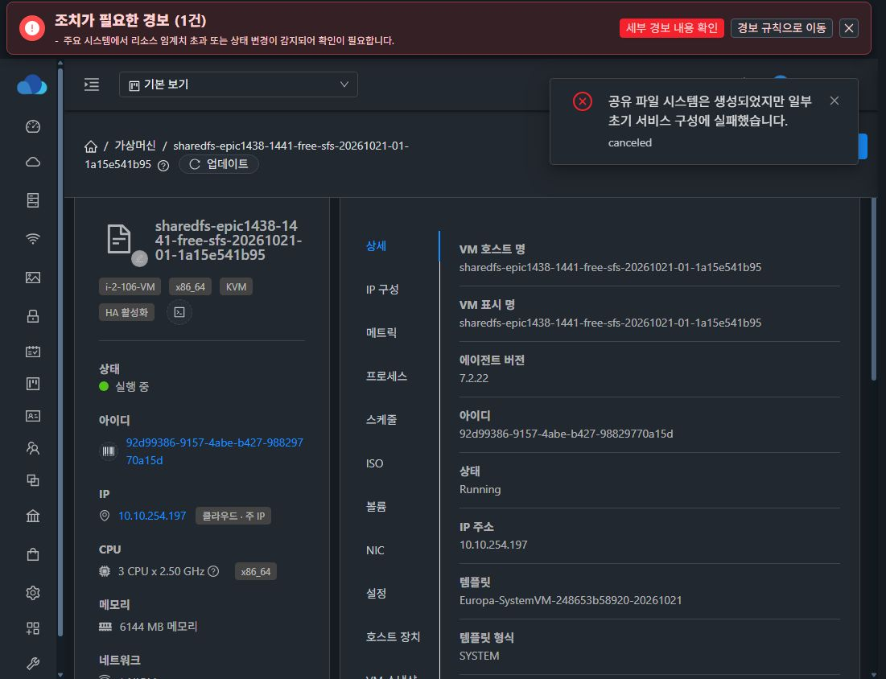
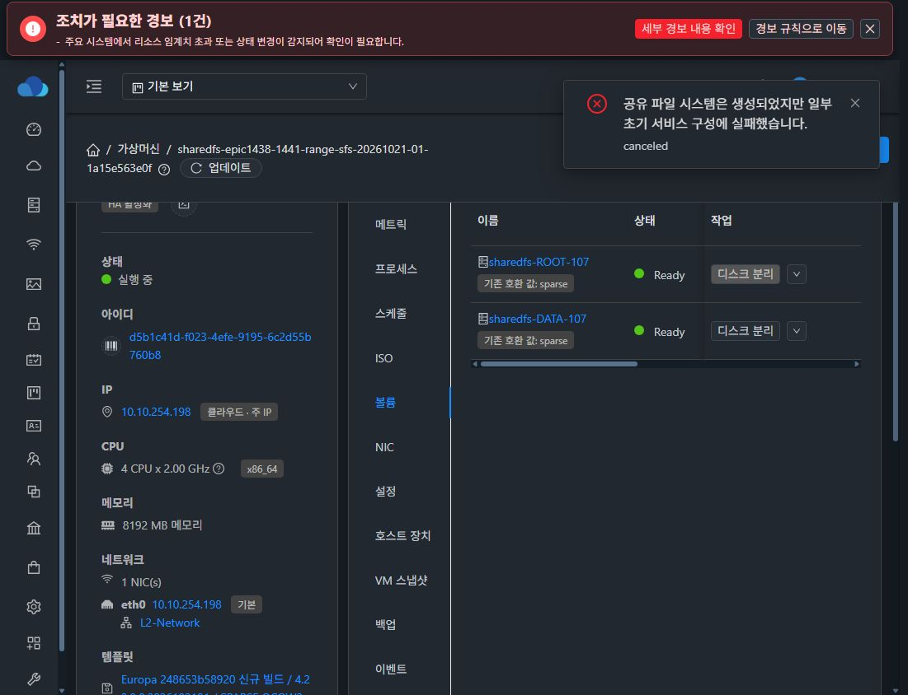

# #1441 구현·13번 실제 UI 검증 — 2026-10-21

## 결과와 범위

SharedFS 초기 생성의 고정·자유·범위·부분 커스텀 컴퓨트 오퍼링 지원을 구현했다. 기존 일반 VM의 검증·오퍼링 사본 구체화·VM detail 저장과 VM 생성 경로를 재사용한다. 목록과 생성이 동일한 CPU/RAM·HA·ROOT·아키텍처 조건을 사용한다.

실제 Mold UI에서 이번 과제용 오퍼링 세 개와 새 SharedFS/VM/ROOT/DATA 세 세트를 만들었다. 세 생성 job은 모두 status 1이며 UI의 요청값과 실제 VM 자원·SPARSE/QCOW2 디스크가 일치한다. 기존 VM/시험 디스크를 재사용하거나 MAC을 변경하지 않았다.

운영 중 오퍼링 변경, 온라인 확장 강제(#1464), NFS ACL·클라이언트 I/O, 백업/복원 및 최종 UI(#1468)는 구현·인수 범위에 추가하지 않았다. 공통 오퍼링 생성 폼·KVM agent·guest storagectl·SystemVM 템플릿·DB schema 변경도 없다.

## 소스와 최소 변경

- 브랜치: epic/1438-sharedfs. 착수 fetch 후 local ablestack-europa/upstream divergence **0 0**, 기준 **0e6b5093d51079f0cfd9bfc88b6e37a795be55a3**.
- 설계/주입 검증 기록: **44c62c6c36d2c32182b3a284db4bd2badac4d577**. 해당 시점의 목업은 현재 제품 인수 증거와 구분한다.
- 주 구현: **9877c171cdd9db64976a4d589e08928235a5945b**.
- 일반 VM 최소값 교집합 보존: **001ca8c0bd883972dd441f993d305848cb4ae4c7**.
- 실제 AntD 입력의 무음 보정 제거: **51d70541f110d88ec8cecff2270cfecbd4c66d9a**. Java 변경은 없으며 최종 코드와 배포 backend의 소스는 동일하다.

추가한 listSharedFileSystemServiceOfferings는 기존 검색 서비스의 권한 내 후보·페이징을 재사용한다. CPU/RAM/속도의 필드별 고정·가변 구분과 교집합 범위, HA·ROOT SPARSE/FAT 및 준비된 SystemVM 아키텍처 판정을 반환한다. THIN/미확인 ROOT는 선택 불가 이유를 표시한다. 동적 확장 OFF만으로 생성에서 제외하지 않는다.

CreateSharedFSCmd는 cpunumber/cpuspeed/memory 세 인자만 추가한다. 최종 검증은 persist 전과 비동기 배포 전에 수행하며, UserVmManager.validateCustomParameters 및 ServiceOfferingDao.getComputeOffering을 사용한다. 고정값 덮어쓰기·알 수 없는 인자·누락·소수·범위 밖 입력을 거절한다. 원본 오퍼링을 저장하지 않고 기존 VM별 detail로 전달한다.

UI는 권한 내 적합/부적합 후보와 이유를 표시하고, 재조회 중·0건·실패 시 생성할 수 없게 한다. 현재 입력으로 생성 가능 여부와 후보 선택 가능 여부를 구분한다. 가변 필드만 제출하며 고정 필드는 비편집/비제출한다.

## 모듈 빌드와 시험

- backend 34개 모듈 package 성공. API·server·storagevm 관련 **4 suites / 65 tests**, 실패·오류·skip 0.
- UI production build 성공. 최종 **3 suites / 26 tests** 통과 및 대상 파일 lint 통과.
- 실제 AntD 입력 시험에는 RAM만 가변인 부분 커스텀, 고정 필드 disabled, 범위 밖 숫자·소수의 원문 값 전달/거절을 포함한다.
- 고정 요청 호환, 자유/범위/부분 커스텀, whitelist, 최소/최대·전역 상한·고정 override, ROOT/arch 및 catalog 범위·권한 경로, stale 응답·0건·실패·번역 계약을 관련 시험에서 확인했다.
- Node20/기존 Webpack4 빌드에는 legacy OpenSSL provider를 사용했다. 의존성 버전은 바꾸지 않았다. public/config.json은 빌드 후 원문 바이트로 복구했다.
- Checkstyle/RAT 및 전체 Release CI, 전체 UI 회귀·다른 프로토콜 인수는 실행하지 않았다. 위 65/26을 저장소 전체 통과 수치로 확대하지 않는다.

[backend 시험](evidence/backend-test-summary.json) · [최종 UI 빌드](evidence/ui-build-final-result.json) · [최종 UI 시험](evidence/ui-tests-final.log)

## 배포 무결성

관리 서버 **10.10.13.10/mold.service** 및 UI만 배포했다.

- 실제 고유 클래스 공급자인 cloudstack-4.23.0.0.jar의 변경 class **12 entries / 8 families**를 반영했다. 나머지 **93,741 entries**의 비대상 내용은 byte 동일하다.
- 원본 JAR SHA-256: 69afe59ca4ebf3108f4963c8f30b01c9fbf2dce759633258804bfeb97164a41d
- 설치 JAR SHA-256: fde8f1b25207256c19b0e858d299d24eed061d126eefa17b9703d6607223d83d
- 실제 서버 JVM의 -Xverify:all 클래스 검증과 재시작 후 PID **3003800**의 열린 JAR inode/설치 파일 일치를 확인했다.
- 최종 UI 파일 수·번들/설치 해시는 배포 영수증에 기록했다. 실제 webapp 경로에 정적 파일을 검증해 설치하고 index를 마지막에 교체했다.
- 설치 config.json 원문과 systemvm inode 보존. DB migration 없음.
- backend/초기 UI rollback: /var/tmp/epic1441-001ca8c0bd88-10-10-13-10-rollback
- 최종 입력 UI rollback: /var/tmp/epic1441-51d70541f110-ui-rollback

[관리 서버 배포](evidence/management-install-stdout.json) · [실제 JVM](evidence/management-after-runtime.json) · [최종 UI 배포](evidence/ui-install-final-stdout.json) · [비대상 JAR 보존](evidence/jar-update-plan.json)

배포 helper의 관리 서버 domain 조회가 None인 항목은 VM identity 보존의 측정 근거로 사용하지 않는다. 새 시험 VM의 실제 identity·디스크·CPU/RAM은 각 호스트의 별도 읽기 전용 관측으로 대조했다.

## 실제 Mold UI 생성 인수

모든 오퍼링·서비스 자원은 실제 UI에서 만들었다. 관측한 UI 네트워크 응답은 결과 대조용이며 숨은 API/QGA로 준비하거나 완료 판정을 대체하지 않았다.

| 유형 | 오퍼링 조건 | 실제 요청 custom 인자 | UI/실제 VM | 결과 |
|---|---|---|---|---|
| 고정 | 2 CPU / 2000 MHz / 4096 MiB, HA, 동적 확장 OFF | 없음 | 2 / 2000 / 4096 | Ready / Running |
| 자유 | CPU·RAM·속도 가변, HA, 동적 확장 OFF | cpunumber=3, cpuspeed=2500, memory=6144 | 3 / 2500 / 6144 | Ready / Running |
| 범위+부분 고정 | CPU 2–4, RAM 1024–8192, 속도 고정 2000 | cpunumber=4, memory=8192; cpuspeed 없음 | 4 / 2000 / 8192 | Ready / Running |

범위형은 CPU/RAM만 가변이고 속도는 고정인 **실제 부분 커스텀** 사례다. RAM만 가변인 조합은 실제 AntD/서버 단위 시험으로 확인했으며 별도의 RAM-only 실VM을 생성한 것으로 기록하지 않는다. 오퍼링의 dynamic_scaling_enabled와 VM/템플릿의 dynamically_scalable은 별개이며 범위형 VM의 값은 false다. 온라인 확장은 시험하지 않았다.

| 유형 | SharedFS UUID | VM UUID | 호스트 | 런타임 IP |
|---|---|---|---|---|
| 고정 | 39a07f24-cb99-4784-aa2d-c45b858290c4 | b6a39a5d-c451-4b60-9a68-3e4d102a4ea4 | 13.3 | 10.10.13.242 |
| 자유 | 2b0cd79a-243c-4fba-bae2-7fefe06e54e8 | 92d99386-9157-4abe-b427-98829770a15d | 13.1 | 10.10.13.243 |
| 범위 | f5ac9a11-55e0-4a97-8b2e-100e131ce7a0 | d5b1c41d-f023-4efe-9195-6c2d55b760b8 | 13.2 | 10.10.13.244 |

각 ROOT는 5,242,880,000 bytes, DATA는 20 GiB다. 여섯 볼륨 모두 UI·DB에서 **sparse / QCOW2 / Ready**, 실제 libvirt disk driver와 QFI 헤더·virtual size가 일치한다. ROOT disk offering은 선택한 컴퓨트 오퍼링에 연결된 ROOT offering과 일치한다. 새 THIN 디스크를 만들지 않았다.

원본 자유/범위 오퍼링의 CPU/RAM null 및 범위 detail은 생성 후에도 보존됐다. VM detail에는 자유 세 필드, 범위 두 필드만 저장됐다. 실제 virsh vCPU/currentMemory도 각각 2/4096, 3/6144, 4/8192와 일치했다. 활성 디스크 전체 해시·오프라인 fsck나 guest 변경은 하지 않았다.

[UI 생성 API/완료 job](evidence/creation-api-proof.json) · [실제 catalog](evidence/live-catalog.json) · [DB 자원](evidence/db-resource-proof.json) · [물리 관측](evidence/physical-resource-proof.json)

### 실제 구현 UI — 목업 아님

## 실제 시험에서 교정한 부분과 검증 한계

- 첫 고정 사례에서 작업자가 초기 서비스의 마지막 조회 전에 VM 화면으로 이동해 조회가 canceled 됐다. SharedFS 생성 job은 status1이고 VM/볼륨은 정상이다. 이 취소 알림을 제품 생성 API 실패로 기록하거나 초기 서비스 전체 무오류 성공으로 과장하지 않는다. 자유 사례에서는 초기 구성 완료의 녹색 알림까지 확인했고 범위 사례는 생성/초기 서비스 job 및 NFS 활성 표시를 확인했다.
- 실제 AntD에 min/max를 지정하면 범위 밖 원문과 부모 model의 이전 유효값이 달라지는 동작이 있었다. 새 입력 컴포넌트의 min/max 무음 보정을 제거하고 서버 bounds 기반 validation에 원문을 전달했다. 최종 UI의 재검증 근거는 아래 별도 파일이다. 수정 전 13번 screenshot을 최종 거절 근거로 사용하지 않는다.
- 실제 서버의 catalog는 접근 가능한 9개 중 SPARSE 6개를 선택 가능, THIN 3개를 이유와 함께 선택 불가로 반환했다. 실제 UI disabled 선택 시 이전 선택 보존을 확인했다.
- 0건·조회 실패·미배포 API·stale 응답과 일부 잘못된 요청은 단위/컴포넌트 시험으로 확인했다. 이를 13번 전체 설정을 조작해 재현한 것으로 확대하지 않는다.
- 아키텍처 별칭은 단위 시험, 실제 생성은 x86_64 템플릿으로 확인했다. ARM 실VM을 생성한 결과는 아니다.
- Cloud 주 IP 10.10.254.*와 요청 런타임 10.10.13.* 표시는 기존 표시 차이로 기록만 한다. 동작 변경/MAC 보정/최종 UI 정리는 수행하지 않았다.
- DB 확인은 read-only transaction이며 인증정보는 런타임에서만 사용했다. 관리 서버 key/db.properties 원문이 전후 동일함을 확인했고 비밀은 결과에 포함하지 않았다.

[최종 실 UI 입력 검증](evidence/final-ui-input-guards.json)

## 종료 판정

고정·자유·범위·부분 커스텀의 생성 적합 판단, UI 입력 및 가변 인자 전달, 실제 새 VM 자원 적용과 ROOT/DATA SPARSE를 #1441 범위에서 확인했다. 완료 근거를 이슈와 Epic PR #1470에 기록한 뒤 #1441을 종료한다. PR은 Epic 전체가 진행 중이므로 Draft로 유지하며 병합하지 않는다.

다음 대상은 **#1442 초기 생성 시 기존 볼륨 경로의 디스크 오퍼링 의존성 제거**다. 이번 작업에서 구현·시험을 시작하지 않았다.
