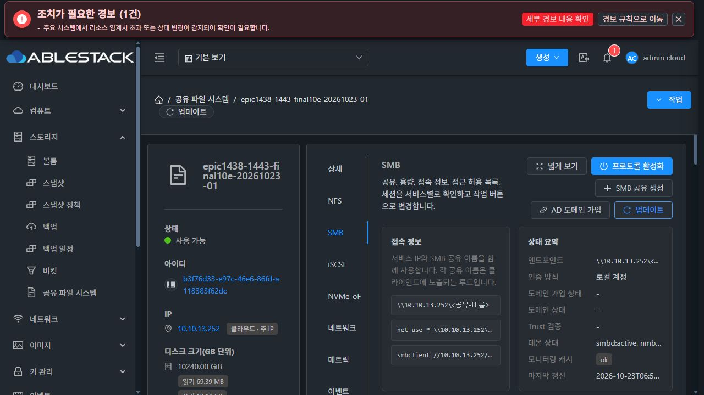
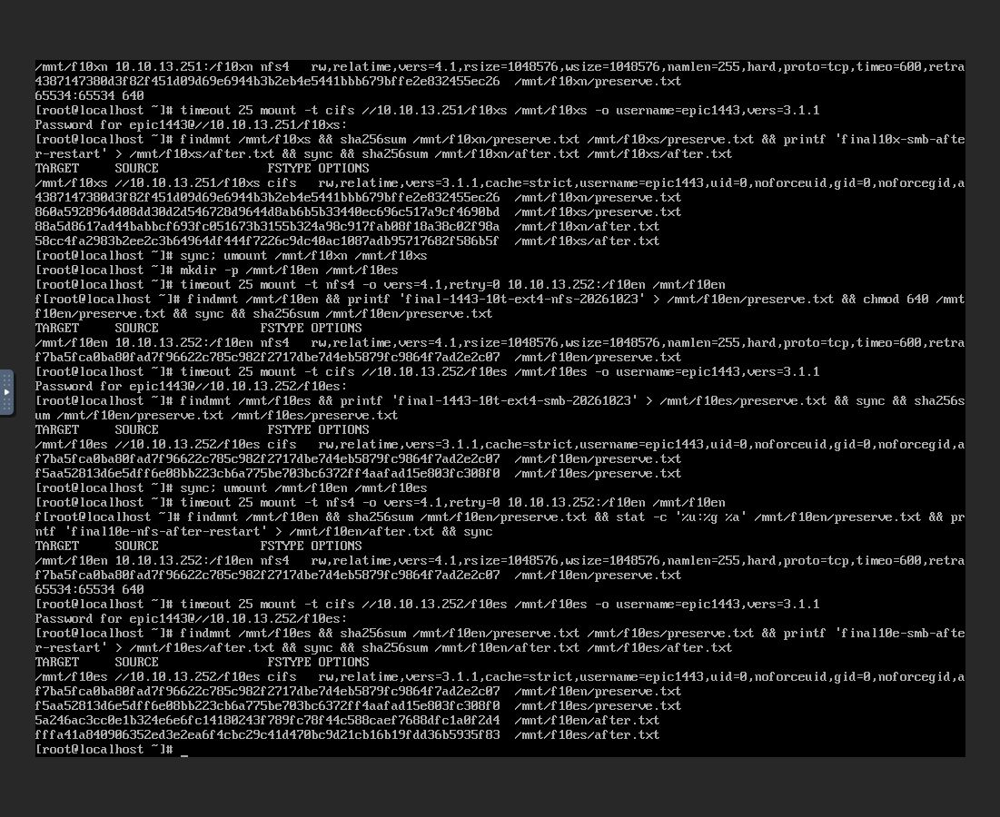
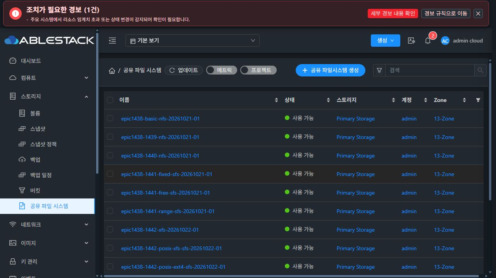

# #1443 최종 대용량 순차 인수 (2026-10-23)

**2TiB XFS → 10TiB XFS → 10TiB EXT4 모두 PASS. 각 시험은 새 SharedFS·VM·ROOT·DATA로 실제 UI에서 생성했다. ROOT·DATA 모두 SPARSE이며 시험 간 VM/디스크 복제·재사용이나 MAC 임의 변경은 없다.**

| 시험 | 실제 준비 시간 | 관리 재시작 후 UI 재개 | VM 재시작·원래 IP | 포맷 횟수 | NFS/SMB 접속·데이터·권한 |
|---|---:|---|---|---:|---|
| 2TiB XFS | 58.8초 | PASS | PASS / 10.10.13.250 | 1 | PASS |
| 10TiB XFS | 1869.5초 | PASS | PASS / 10.10.13.251 | 1 | PASS |
| 10TiB EXT4 | 1864.4초 | PASS | PASS / 10.10.13.252 | 1 | PASS |

## 실행 경로와 확인 방법

1. Mold 생성 UI에서 L2·STATIC·SPARSE 컴퓨트/디스크 오퍼링·파일시스템·NFS4·SMB 로컬 인증·접근 규칙을 입력했다. 새 ROOT/DATA UUID와 선택된 SYSTEM template을 VM/볼륨 UI로 확인했다.
2. 실제 UI FORMATTING/RUNNING 중 관리 서버를 재시작했다. **관리 서버 UI에는 재시작 동작이 없어 승인된 SSH `systemctl restart mold.service`로 장애를 주입했다.** 이후 UI 재로그인·준비 상태 관찰·암호 재입력·준비 재개로 같은 creation request/operation/VM/DATA를 이어갔다. 새 async 재개 job은 기존 durable 작업을 재사용한다.
3. Mold의 Linux 클라이언트 noVNC 콘솔에서 NFS4.1·SMB3.1.1 마운트, 기준 파일 쓰기·sync·SHA256 확인 후 언마운트했다. 클라이언트268b256e-bfd2-4a3f-9a3b-ce3f0ad78ecc는 현행 MAC 정책 이후 만든 #1443 시험 클라이언트다.
4. SharedFS UI 재시작(정리=false) 성공을 확인한 뒤 원래 IP로 새 마운트하여 기존 파일 읽기/체크섬과 새 쓰기를 검증했다. UI 준비 상태는 PREPARED, 포맷 횟수1을 유지했다.
5. QGA/SSH는 읽기 전용 증거 대조에만 추가 사용했다. VM boot ID 변경, DATA 크기/serial·FS UUID·formatStartedAt·operationId·formatCount1, 실제 DATA의 파일 SHA·UID/GID/mode를 전후 비교했다. NFS65534:65534/0640, SMB1001:1001/0660 모두 동일하다. 10TiB XFS의 DATA 경로는 sdb→sda로 바뀌어도 stable identity로 정상 복구했다.

API 증거는 UI가 실제 발행한 요청의 응답을 수동 캡처한 것이다. 직접 API 호출이나 QGA로 생성·설정·재개를 대신하지 않았다. 10TiB XFS/EXT4의 포맷 완료까지 UI 관찰은 각각286개/283개이며 RUNNING/PREPARED와 formatCount1만 기록했다. 두 포맷 모두1920초 기한 이내 자연 완료했다.

관리 서버 장애 주입 때 발생한 로그아웃과 재시작 전 보조 탭의 만료 세션 요청은 UI 세션 갱신으로 교정했다. 시험의 생성·준비·재개·재시작·공유 적용에서 제품 실패 응답은 없었다. 집계 도우미의 선택 필드 null/생략 차이는 정규화하여 교정했다. 이를 제품 코드 변경이나 재시험으로 처리하지 않았다.

준비 완료 뒤에도 늘어나는 경과시간·WORKER_RUNNING 원문/이전 캐시 사유 등 실행에 영향 없는 표시 차이는 #1468 최종 UI 정리 대상으로 기록하며 이번에 변경하지 않았다.

## 코드·빌드·배포 범위

이번 실행은 남은 인수만 수행했다. 제품 소스·포맷 옵션/기한·신원/재포맷 보호·전역 용량 설정·권한 정책을 바꾸지 않았다. local Europa를 upstream a7543feb62a로 먼저 갱신하고0/0 확인 후 feature에 merge7b527a461d77로 반영했다. 이 upstream 차이는 스냅샷 UI 범위이며 SharedFS 실행 코드는 동일하다.

배포본은 제품3214dfed5c9, SYSTEM template f6ae443d-9965-4f86-bd22-043c94dbcae6이다. 실제10TiB XFS/EXT4 VM 모듈 SHA256은 [result.json](result.json)의7f22d9aa…와 일치했다. 구현 전 실제10TiB 주입·guest54개(WSL/실VM 각각)·UI50개·Java78개·모듈 빌드/배포 무결성 및 잘못된 ROOT/DATA·불명/부분 FS 차단 근거는 [앞선 구현 보고서](../sharedfs-1443-observation-fix-20261023/report.ko.md)에 보존되어 있다. 이번 순차 인수가 앞선 회귀 시험을 새로 실행한 것은 아니다.

## 자원 정리와 보존

각 통과 후 클라이언트 언마운트 → UI SharedFS 강제·영구 삭제 → Destroy DATA의 UI 영구 삭제 순서로 전용 자원만 회수했다. 호스트 읽기 전용 확인에서 시험 VM3개와 이미지6개 모두 부재다. Ready template·게시 이미지·검증 자료와 기존 클라이언트는 보존했다.

기존13개 Ready의 VM/DATA 관계와 STATIC 주소는 동일하다. DHCP 서비스의 목록 API ipaddress는 이전 null/현재 생략으로 같은 의미다. 별도 실제 UI NIC의10.1.1.222를 확인했다. 보존 JSON에는 원본 응답과 선택 null 필드 정규화 결과, UI 주소 근거를 구분했다.

- [시험별 UUID·시간·체크 항목](result.json)
- [기존13개 보존](evidence/baseline-preservation.json), [시험 자원 최종 부재](evidence/final-owned-cleanup.json)
- [실제 UI API·작업·관찰](evidence/ui-api-summary.json)
- [2TiB 보존](evidence/2x-preservation.json), [10TiB XFS 보존](evidence/10x-preservation.json), [10TiB EXT4 보존](evidence/10e-preservation.json)

