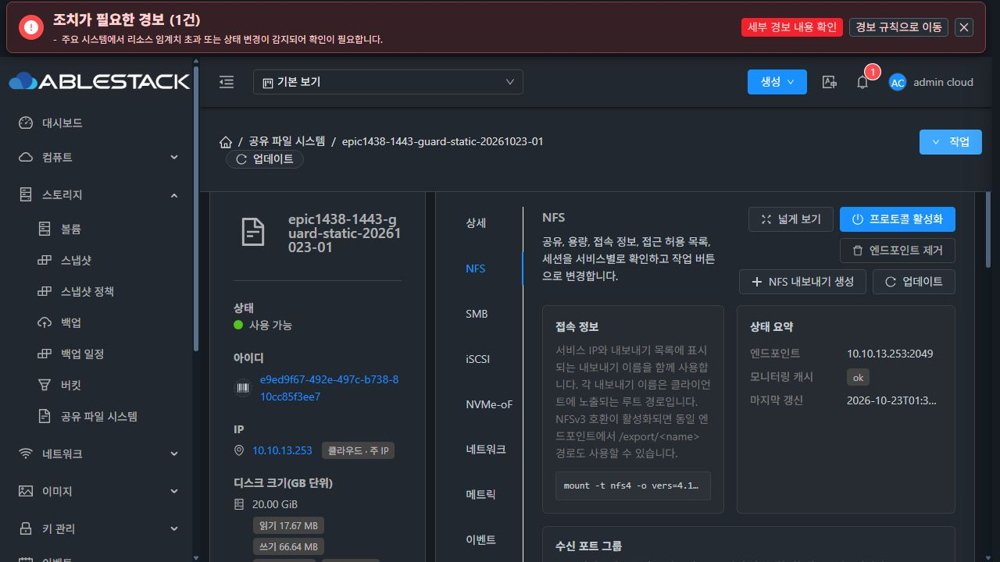
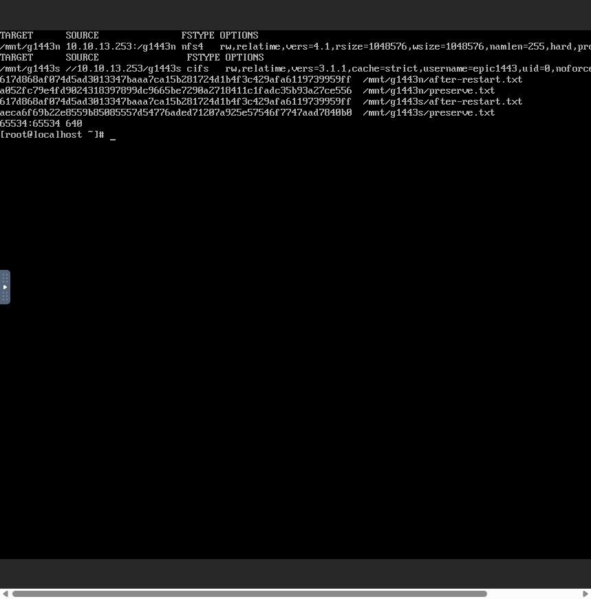
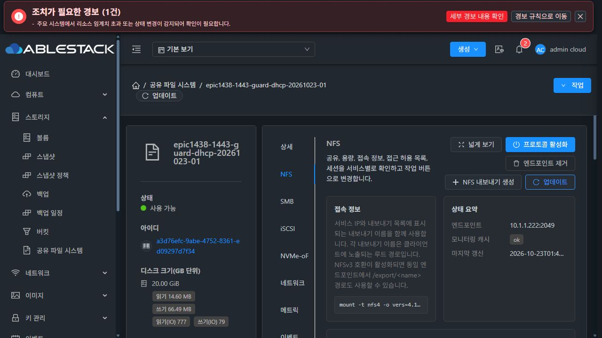

# #1443 guard·STATIC 대기 구현 및 13번 소형 UI 인수 (2026-10-23)

**결과: 요청한 guard 구현·관련 모듈 빌드·13번 배포·새 VM 최초 생성/재시작/원래 IP 재접속 인수 PASS. 대용량 재개 준비 완료 후 중단한다. 2TiB/10TiB 인수는 재개하지 않았고 #1443은 OPEN이다.**

## 제품 변경과 보호 범위

제품 source `d69133fffd2ba86b9aeba761aad198812345f323`. 설계/주입 근거 `8d155ab6d99b6c7f359af41f0469dea6231411f3`. 착수 fetch 후 local/upstream Europa `929cbff799d` 비교0/0, 기존 epic/1438-sharedfs에서 작업했다. origin feature 일반 push, 기존 Epic Draft PR #1470 head가 제품 commit과 일치하는 것을 확인했다.

- **SharedFSServiceImpl**: DHCP 즉시 return 유지. 명시적 bootstrap PENDING은 STATIC 전용360초 단조시계 deadline으로 관찰한다. RPC60초/간격2초는 잔여 예산으로 제한한다. 일반 미분류 오류의 기존30회 보호, interrupt 처리와 기존 주소 payload를 유지한다.
- PENDING deadline만 전용 예외로 구분해 기존 OBSERVATION_PENDING/Error 분기로 보낸다. 같은 vmId/planned UUID/owned ROOT·DATA/request를 보존하고 CONTINUE로 재개한다. Ready로 오인하거나 자동 expunge하지 않는다.
- **KVM wrapper**: cloud-early-config의 성공 종료와 cloud-init-local/cloud-init network의 실행/queued Job 종료를 확인한다. metadata 없는 L2의 cloud-init 실패 종료를 STATIC의 새 실패 조건으로 삼지 않는다. required unit 실패/손상 상태는 terminal 진단으로 구분한다.
- 실패 시 bounded 내부 resultJson에 실제 unit 상태를 기록한다. 성공 guard는 stdout을 추가하지 않아 기존 helper의 단일 주소 JSON과 섞이지 않는다. 마지막 MAC/IPv4/프리픽스/선택 route 검증은 기존 helper를 사용한다.
- 기존 guest bootstrap/helper/worker·공통 SSH/cloud-init·DHCP lease·NFS/SMB 기능·공용 볼륨·UI·전역 timeout·DB schema는 이번에 변경하지 않았다. #1468 최종 UI 정리도 미착수다.

## 빌드·회귀·배포

| 회귀 suite | tests | 실패/오류/skip |
|---|---:|---|
| SharedFSStaticNetworkBootstrapTest | 7 | 0/0/0 |
| SharedFSCreationFlowTest | 14 | 0/0/0 |
| SharedFSServiceImplTest | 36 | 0/0/0 |
| LibvirtStorageServiceHostCommandWrapperTest | 13 | 0/0/0 |
| 합계 | **70** | **0/0/0** |

126초 PENDING 후 성공,360초 종료/마지막 RPC 예산, DHCP dispatch0회, terminal·queued network Job, 성공 stdout 보존, malformed 응답, 기존 볼륨 흐름, PENDING timeout 후 생성 context 보존·동일 VM 재개를 확인했다. 생성 보존/replay 회귀는 실제 서비스 분기와 JSON 저장·재파싱을 사용하되 mock DAO이며 새 실DB 시험이라고 표기하지 않는다.

`mvn -pl server,plugins/hypervisors/kvm -am package` 및 관련 선택 시험 reactor38모듈 BUILD SUCCESS(1분44초). 전체 저장소 CI 통과로 확대하지 않는다. UI/guest 소스 변경이 없어 해당 모듈을 다시 빌드/배포하지 않았다.

현재 운영 JAR을 내려받아 기존 SharedFS class가 앞선 배포본과 일치하는지 대조한 뒤 클래스만 교체했다.

| 대상 | 배포 SHA-256 | 다른 entry 보존 |
|---|---|---:|
| 관리서버13.10 cloudstack-4.23.0.0.jar | 7a00a376a686bb6fe120c617e77552867abcd71db2b35bf169c5e051d85853ee | 93,756 |
| 호스트13.1/13.2/13.3 KVM JAR | 0be334b2e9d9a4ab8c15b92fdc97ab664abc60c2ddd208996fc6f1f61f517b66 | 524 |

서버는 SharedFSServiceImpl class family(새 예외 포함), 호스트는 wrapper1개만 대상이다. staged 실제 JVM `-Xverify:all` 검증 후 원자적 교체·서비스 restart·새 PID/설치 해시를 확인했다. rollback은 발생하지 않았으며 이전 파일/metadata/영수증은 각 서버의 전용 /var/tmp 경로에 보존했다. 호스트3대의 기존 VM/디스크/MAC 관계가 restart 전후 동일했다. 관리 서버 HTTP200 및 실제 UI 재로그인도 확인했다.

## 실제 UI 신규 STATIC 서비스

| 항목 | 값 |
|---|---|
| SharedFS | e9ed9f67-492e-497c-b738-810cc85f3ee7 |
| VM / 호스트 | 8144aac2-225b-3b0f-95ae-f2d490d4ef76 / i-2-118-VM / 13.3 |
| ROOT | a81169df-e3a4-4aaa-bdf2-0254a82224f9 |
| 새 DATA | e3e223fb-6843-4e8c-b235-9c6df2dbfae9 / 20GiB |
| STATIC | 10.10.13.253/16, gateway10.10.13.1 |
| 초기 서비스 | g1443n NFSv4.1 / g1443s SMB3.1.1 LOCAL |
| template | 2a8fa5b1-faac-4576-a2cd-14c1938bebd8 |

실제 Mold UI 생성 폼에서 새 서비스/새 VM/새 ROOT·DATA를 만들었다. 고정 sparse SO·custom sparse DO를 선택했고 UI VM 볼륨 탭에서 ROOT/DATA 모두 SPARSE를 확인했다. 이전2TiB/실패10TiB DATA를 재사용하지 않았다. MAC은 Mold 정책 그대로 사용했다.

실제 준비 상태 PREPARED→SharedFS Ready→NFS/SMB 공유·규칙 Ready를 확인한 뒤 클라이언트 `268b256e-bfd2-4a3f-9a3b-ce3f0ad78ecc`(10.10.254.195)의 **Mold noVNC 콘솔**로 접속했다. 이번 소형 guard 인수는 기존 정상 클라이언트를 사용하며, 새 클라이언트 생성이나 대용량 최종 인수로 표기하지 않는다.

1. 원래 지정 IP의 NFS/SMB 각각 fresh mount·파일 쓰기·읽기·해시 확인.
2. 두 mount 정상 해제 후 **SharedFS UI 재시작(cleanup=false)** 실행.
3. UI 성공과 실제 restart API job `4b3b1f30-ea7f-4b87-b2f5-c7a01bb19d5a` status1/resultcode0 확인.
4. 원래 IP 10.10.13.253으로 두 프로토콜 fresh mount·기존 파일 읽기·해시 및 새 파일 쓰기 성공.
5. 사후 read-only QGA 대조에서 실제 boot ID 변경, FS UUID·operation·formatCount=1, 원본 UID/GID/mode/해시 및 실제 DATA filesystem 소속 유지 확인.
6. 증거 보존 후 클라이언트 mount만 정상 해제. 시험 서비스는 Ready로 남겼다.

| 파일 | 원본 SHA-256 / 서버 권한 |
|---|---|
| NFS preserve.txt | a052fc79e4fd9024318397899dc9665be7290a2718411c1fadc35b93a27ce556 / 65534:65534 / 0640 |
| SMB preserve.txt | aeca6f69b22e8559b85085557d54776aded71207a925e57546f7747aad7840b0 / 1001:1001 / 0660 |
| 재접속 뒤 두 after-restart.txt | 617d868af074d5ad3013347baaa7ca15b281724d1b4f3c429afa6119739959ff |
| DATA FS UUID | 9fff071b-eac0-45d6-aed7-1d727ea68a16, 동일 |
| journal | operation adae2c82-e78b-3ac9-8a2f-04bd54c8e47f, PREPARED, formatCount1 |

### 실제 새 VM에서 guard의 기다림 확인

| 부팅 기준 시각 | 최초 생성 | UI 재시작 |
|---|---:|---:|
| cloud-early-config 종료 | 130.241초 | 11.099초 |
| cloud-init network 종료 | 130.189초 | 139.147초 |
| 최종 STATIC unit 실행 | 130.924초 | 146.800초 |

최초 부팅은 기존 약88초 한도를 넘고도 정상 완료했다. 재시작에서는 cloud-early가11초에 끝나지만 metadata network 단계가139초까지 계속됐다. 새 guard는 이를 기다린 뒤 최종 STATIC을 적용했다. 이는 대기 한도와 network stage gate를 함께 보완해야 한다는 설계의 실제 새 VM 근거다. 단순 즉시 성공/짧은 timeout/네트워크 검사 생략으로 통과시킨 것이 아니다.

## 실제 UI DHCP 보존 인수

이미 Running인 r-18-VM이 제공하는 Admin-Isoloated-Net(10.1.1.0/24, UserData/DHCP VirtualRouter 지원)을 UI에서 확인했다. 네트워크/라우터 설정 변경이나 새 라우터 생성을 하지 않았다.

| 항목 | 값 |
|---|---|
| SharedFS | a3d76efc-9abe-4752-8361-ed09297d7f34 |
| VM / 호스트 | 0c9f5ce2-2328-33a1-a290-b0d6a6619ba5 / i-2-119-VM / 13.1 |
| ROOT / DATA | 057e0836-bc68-4af6-8528-54cf0d32c731 / a7a5adcc-f202-4103-a735-a32a8144c57d |
| DHCP 주소 | 10.1.1.222/24, DHCP server10.1.1.1 |
| 서비스 | g1443d NFSv4.1 / 새20GiB XFS |
| FS UUID | 83b98916-b5bc-456d-9a99-a3333936ba3c |

실제 UI 최초 생성·NFS/규칙 Ready → UI 재시작 → 같은 DHCP 주소와 NFS Ready를 확인했다. restart API job `988b5a52-971b-48f0-bc1d-c967a24b0c76` status1/resultcode0이다. 새 ROOT/DATA 모두 UI SPARSE 확인.

사후 guest read-only 대조에서 boot ID 변경, 같은 FS UUID/operation/fstab·formatCount1, DHCPACK/bound 및 UserData 성공 marker 유지, **STATIC state와 unit 부재**를 확인했다. DHCP가 STATIC guard나 설정으로 바뀌지 않았다. 이 격리 네트워크에는 클라이언트를 새로 만들거나 연결하지 않았으므로, DHCP 사례의 클라이언트 I/O까지 시험했다고 확대하지 않는다. 실제 NFS/SMB client I/O와 데이터·권한 보존은 위 STATIC 사례의 근거다.

## 범위 보존과 현재 상태

- UI 실제 응답 전후 비교에서 비대상11개 SharedFS의 Ready·VM/DATA/IP 관계가 동일하다. 새 두 서비스를 포함한13개 모두 Ready.
- 생성·설정·재시작은 실제 Mold UI로, client I/O는 실제 noVNC 콘솔로 실행했다. 숨은 API/QGA로 준비 상태나 공유 설정을 만들지 않았다. API는 UI가 실행한 응답을 수집했고 QGA/SSH는 배포·사후 read-only 진단에 사용했다.
- source2파일/관련 시험 외 기능 확장, MAC 수동 변경, THIN, 클론, 전역 timeout 변경, 새로운 이슈 분기는 없다.
- DHCP SharedFS 공통 헤더 IP가 비어 있고 NIC/서비스 endpoint에는 실제 IP가 표시되는 기존 표시 차이는 기능 차단이 없어 #1468 최종 UI 참고 사항으로만 기록했다. 기존 Wall/인프라 경보도 이번 guard 인수의 신규 오류로 간주하지 않았다.
- 제품 오류 없이 소형 인수를 마쳤다. PENDING timeout과 취소 보존은 회귀 시험 근거이며 실제360초 강제 장애를 새 서비스에서 주입한 것은 아니다.

## 다음 단계 — 사용자 지시 전 실행하지 않음

**대용량 재개 준비 완료 상태에서 중단한다.** 후속은 새 VM/DATA로 2TiB XFS→정리/용량 확인→10TiB XFS→정리/용량 확인→10TiB EXT4를 SPARSE 이상으로 순차 수행하는 기존 계획이다. 관리 서버 재시작 중 동일 작업 재개·중복 포맷 방지와 NFS/SMB 데이터·권한 보존도 남아 있다. 현재 소형 인수를 대용량 완료로 대체하지 않으며 #1443을 닫지 않는다.

[회귀 집계](evidence/test-summary.json) · [변경 class·나머지 JAR 무결성](evidence/jar-plans.json) · [실제 UI API/비대상 보존 대조](evidence/ui-api-summary.json) · [STATIC 전후](evidence/static-after-restart.json) · [DHCP 전후](evidence/dhcp-after-restart.json) · [실제 부팅 시각](evidence/static-unit-timing.json)
