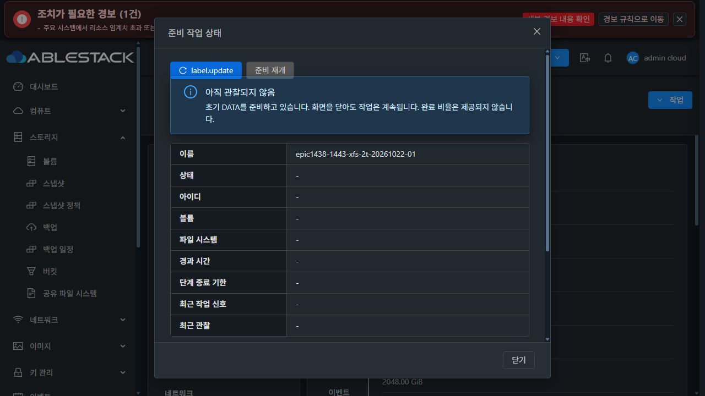

# #1443 구현·배포 및 첫 실환경 검증 중단 기록 (2026-10-22)

상태: **구현·모듈 빌드·13번 배포 완료 / 실제 UI 응답 해석 결함으로 인수 중단 / 이슈 OPEN**.

공통 기준에 따라 최초 제품 UI 결함을 확인한 뒤 후속 기능 시험을 중단했다. 이 문서는 완료·종료 근거가 아니다. 10TiB나 재시작·접속·데이터 보존 성공으로 확대 해석하지 않는다.

## 구현과 배포

- local Europa/upstream 기준: `929cbff799d`, 비교 0/0. 공개 Epic 이력을 보존한 동기화 merge `0586438dab100aebb284b1510150f8ff6e753200`.
- 구현: `b3dbcd8c37908d480f0a294783c6e665a96525a7`. origin의 `epic/1438-sharedfs`에 일반 push, Epic Draft PR #1470에 포함.
- 초기 NEW NFS·SMB DATA만 durable guest journal/lock, 분리된 단계별 제한 시간, 엄격한 장치 식별, 비포맷 재개, Ready gate를 적용한다. 기존 format/mount/fstab 함수를 재사용한다.
- #1442 EXISTING import/POSIX 보존, BLOCK 전용 iSCSI·NVMe-oF 초기 생성은 기존 경로다. 일반 프로토콜 폴링 전역 확장·새 테이블/DDL·host agent 배포는 없다.
- Backend 34개 모듈 빌드 성공. Java 대상 시험 **132개**(전용 loopback MariaDB의 실제 DAO 저장·재조회 **5개**, skip 0 포함), UI 대상 **63개**, guest 준비 단위 시험 실행 **45개**, 기존 identity **6개**, 초기 NFS POSIX **4개** 통과. guest 단위 시험은 fixture/임시 journal이며 실제 대용량 인수를 대체하지 않는다.
- UI production build 성공. 관리 JAR `fc6ee2fa446a3782e1c8c0c01529067f7a1b6ffa4fba3c922cfd109f150413d2`, 기존 JAR의 비대상 **93,737개 entry byte 동일**.
- UI index `9aea9b407ef97c6cb1fe6b37180d04d1382c574361e66b5dcf36002ec4434708`, 배포 파일 **901개** 대조. 운영 config SHA와 기존 systemvm 디렉터리 inode 보존.
- SystemVM 이미지: 기존 Europa 기반에서 storagectl과 volume_preparation.py만 변경, 비대상 **33,921개 경로** 유지, qemu-img check/bzip2 검사 통과. 압축 SHA `4a5a5cc1cf951f9af6a386f71c6b2b3ca075e5128a8b1f2e869429e022bf1804`.
- 실제 Mold UI로 등록한 SYSTEM/KVM/QCOW2/x86_64/Debian12 교차 Zone 템플릿 `c83b4e03-272a-4c51-a4a0-cf93cd758501`은 UI에서 사용 가능 확인.
- rollback: 관리 JAR `/var/tmp/epic1443-b3dbcd8c3790-10-10-13-10-rollback`, UI `/var/tmp/epic1443-b3dbcd8c3790-ui-rollback/ui-static.tgz`.

## 첫 2TiB 사례에서 실제 확인한 범위

실제 UI에서 새 서비스 `epic1438-1443-xfs-2t-20261022-01`와 새 Rocky 클라이언트를 만들었다. 기존 시험 자원 재사용·MAC 수동 변경은 없다.

| 자원 | 식별 / 관찰 |
|---|---|
| SharedFS | `a88c8813-d8de-4648-8f92-352970bb3602`, XFS, 2048GiB, 10.10.13.250 |
| SystemVM | `492c6b13-4500-3f94-8be7-76f146d9ba49`, i-2-116-VM / 13.3 |
| DATA | `942aee61-490d-493e-b60d-8cb81ce8f9da`, **2,199,023,255,552 bytes / SPARSE / QCOW2** |
| SystemVM ROOT | `f155538f-6bac-412c-af02-b6620a2edb84`, **SPARSE / QCOW2** |
| 새 클라이언트 | `268b256e-bfd2-4a3f-9a3b-ce3f0ad78ecc`, i-2-115-VM / 13.2 |
| 클라이언트 ROOT | `2f4550fa-6951-46fb-95a4-4d5b4b7d2b22`, **100GiB / SPARSE / QCOW2** |
| operation | `33447f4c-0e5a-3d85-8ce3-11a794441052` |
| 준비 결과 | guest PREPARED, SharedFS Ready, 전체 준비 **58.8초**, formatCount **1** |
| FS UUID | `bbaf069a-c5b9-4a55-be4f-774d7ad80583`, canonical mount/fstab 항목 **1개** |
| guest 설치 무결성 | storagectl `db4c648179c23f12b746d550e6b7ccf49a9be063c81b06c5117b601a948d61cb`, module `71842294cb2fd47e1a4f3a92446d17ec38e92ace3d2ef496a33ac725884739f0`, 소스/이미지와 일치 |

실제 UI에 의해 NFS·SMB 활성 상태까지 진행됐다. 클라이언트에는 실제 noVNC 콘솔로 nfs-utils/samba-client/cifs-utils를 설치했으나 **파일 접속·읽기/쓰기·hash/stat 검증은 시작하지 않았다**. 완료 전 의도된 재시작이나 fault injection도 하지 않았다.

## 최초 제품 결함: 실제 API wire 응답과 UI decoder 불일치

### 실제 API 응답

HTTP 200, CloudStack serializer의 정상 중첩 구조:

```json
{
  "getsharedfilesystempreparationresponse": {
    "sharedfilesystempreparation": {
      "preparation": {
        "status": "PREPARED",
        "phase": "PREPARED",
        "formatCount": 1,
        "canResume": true
      }
    }
  }
}
```

[실제 전체 응답](evidence/preparation-api-wire.json) · [guest read-only 관찰](evidence/first-case-stop-guest.json).

### 잘못 구현한 UI 경로

- `ui/src/utils/sharedFsPreparation.js`의 초기 생성 observer와
- `ui/src/views/storage/CreateSharedFS.vue`의 준비 상태 observer가
- `response.getsharedfilesystempreparationresponse.preparation`을 읽는다.

실제 중간 `sharedfilesystempreparation` 객체를 빠뜨렸으므로 preparation은 undefined가 된다. 전용 대화상자는 빈 객체를 fresh 관찰로 취급하여 상태/UUID/시간을 '-'로 표시한다. 초기 생성 observer도 상세 phase 대신 DB creationstage만 통지한다. 안전한 재개 판정 역시 같은 decoder에 의존하므로 재시작 후 재개 인수를 진행할 수 없다.

`GetSharedFSPreparationCmd.execute`는 objectName을 sharedfilesystempreparation으로 설정하며, 기존 `server/.../ApiResponseSerializer.java`는 일반 단일 응답을 objectName으로 감싼다. API 명령/dispatcher/guest가 잘못된 상태를 반환한 근거는 없다. **이번에 작성한 UI의 wire 계약 해석 결함이다.**

단위 시험의 API mock도 중간 객체 없는 평평한 응답을 사용했다. API response 시험은 Gson 객체 필드만 확인했고 실제 ApiResponseSerializer를 통과하지 않아 이 불일치를 놓쳤다. 시험 통과를 UI wire 인수 성공으로 판단해서는 안 된다.



스크린샷의 `label.update` 문자 노출은 별도의 단순 문구 표시 사항으로 기록한다. 중단 사유는 응답 해석에 따른 관찰·재개 계약 결함이며, #1468 전체 UI 정리는 시작하지 않았다.

## 중단·보존 조치와 다음 최소 수정안

- UI reload로 해당 페이지의 초기 설정 observer/후속 JS 작업을 종료하고, 진단 후 상태 대화상자도 닫았다. 이미 완료되었거나 전송된 작업을 취소했다고 주장하지 않는다.
- 실행 중일 수 있던 mkfs를 강제 종료하거나 DATA를 삭제하지 않았다. 이후 read-only 관찰에서 PREPARED, formatCount=1, formatter 프로세스 없음, fstab 1개를 확인했다. 시험 자원·journal은 보존했다.
- Backend가 실제 FS 준비를 검증한 후 Ready로 전환한 것은 확인했지만 **첫 2TiB 사례 전체 성공으로 판정하지 않는다**.
- 후속 수정은 UI decoder를 실제 named-object 응답에 맞추어 두 observer가 함께 사용하도록 한정한다. 현재 근거상 API/Backend/guest 포맷 로직 변경은 필요하지 않다.
- 실제 ApiResponseSerializer의 wire 계약 회귀와 그 응답 fixture를 사용하는 UI RUNNING/PREPARED/OBSERVATION_PENDING/통신 실패·재개 허용 시험을 추가한다. Ready gate의 모든 종료 분기도 fresh 준비 결과를 확인하도록 점검한다.
- 수정 UI 모듈 빌드/13번 배포/실제 상태 대화상자 확인 후, 별도 지시에 따라 2TiB NFS·SMB 접속·데이터·권한 → 재시작/중복 포맷 없는 재개 → 10TiB XFS → 10TiB EXT4 순차 시험을 재개한다. 앞 사례 용량 반환 전 다음 대용량 DATA를 만들지 않는다.
- **10TiB, 재시작 후 재개, 클라이언트 데이터·권한 보존, 20GiB 기존/신규 실환경 회귀는 미완료**다. 추가 제품 수정이나 다음 이슈 착수는 하지 않았다.

이슈 #1443을 닫지 않는다. 새 이슈로 분기하지 않는다. Epic PR #1470은 Draft를 유지한다.
