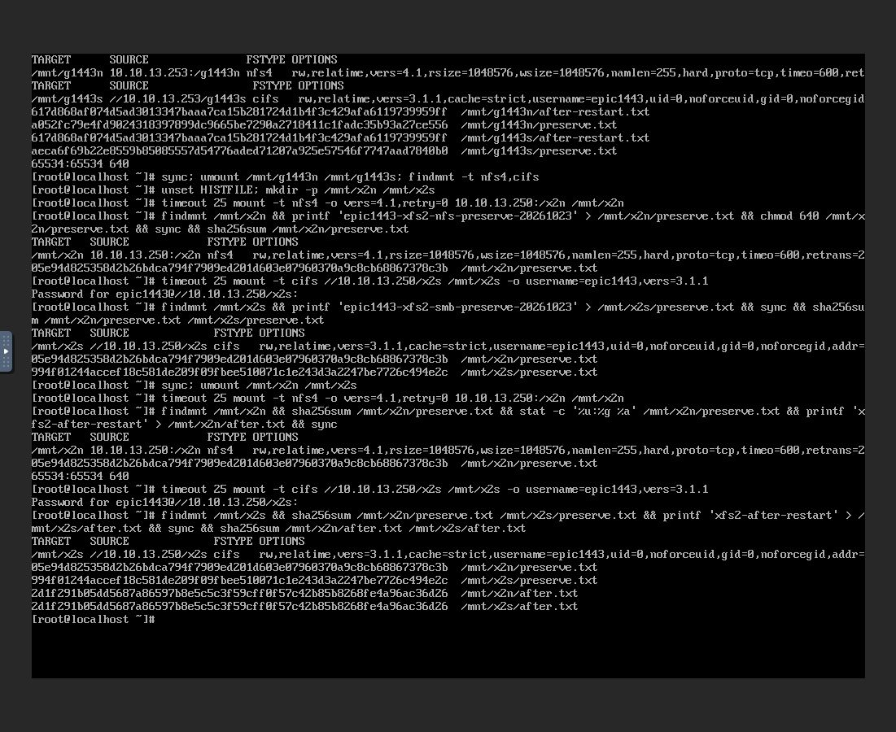
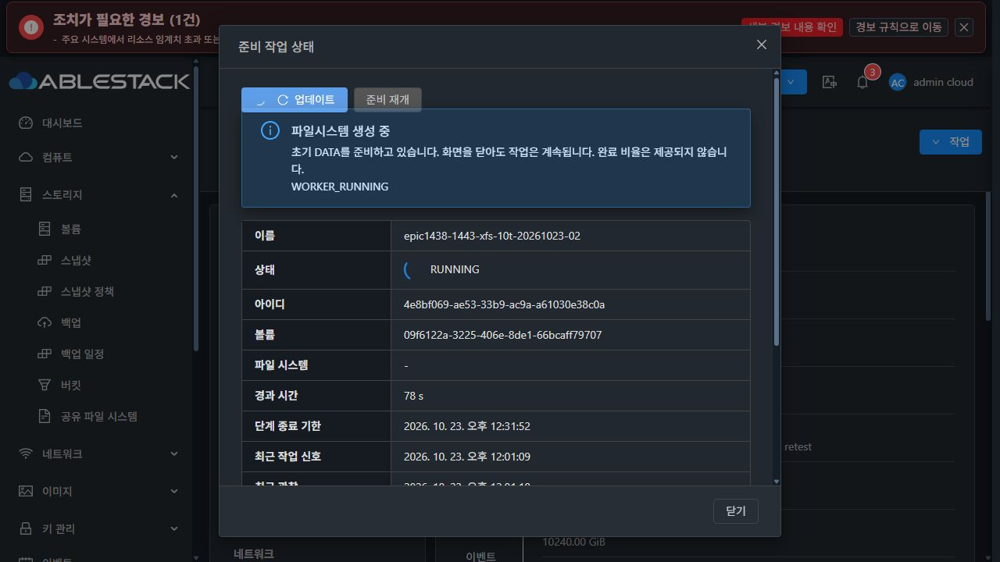

# #1443 대용량 실환경 인수 및 관찰 경로 결함 (2026-10-23)

**2TiB XFS PASS. 새10TiB XFS에서 제품의 준비 상태 조회 결함을 확인해 후속 시험을 중단했다. 10TiB EXT4 미실행, #1443 OPEN. 제품 수정·추가 배포·재시험은 하지 않았다.**

## 실행 범위

착수 fetch 후 local/upstream Europa 비교0/0, 작업 브랜치 epic/1438-sharedfs HEAD `12bcd688bd1`. 배포 제품은 앞선 guard 구현 `d69133fffd2` 및 기존 SystemVM template `2a8fa5b1-faac-4576-a2cd-14c1938bebd8`이다. 이번 변경은 검증 문서/증거뿐이다.

| 순서 | 새 자원 | 결과 |
|---|---|---|
| 2TiB XFS | 새 VM·ROOT·DATA, ROOT/DATA SPARSE, DATA cache none | UI 생성·관리 프로세스 재시작 뒤 UI 준비 재개·VM UI 재시작·원래 IP NFS/SMB fresh mount·데이터/권한 보존 PASS |
| 10TiB XFS | 별도 새 VM·ROOT·DATA, ROOT/DATA SPARSE, 고정10TiB DATA cache writeback | 최초 부팅·STATIC 적용·worker FORMATTING 진입. 진행 중 상태 조회가 복구 필요로 잘못 분류돼 중단 |
| 10TiB EXT4 | 아직 생성 안 함 | 미실행 |

자원 생성·초기 NFS/SMB 설정·준비 재개·VM 재시작·정리는 Mold UI로, 클라이언트 I/O는 실제 Mold noVNC 콘솔로 수행했다. 관리 서버 UI에는 재시작 기능이 없어 승인된 장애 주입만 SSH의 mold.service restart를 사용했다. 게스트 QGA는 읽기 전용 사후 진단이었다. 숨은 API/QGA로 준비·공유 생성을 대신하지 않았다. MAC 변경·THIN·클론·전역 timeout/저장소 factor/임계치 변경은 없다.

클라이언트는 기존 #1443 Linux 시험 VM `268b256e-bfd2-4a3f-9a3b-ce3f0ad78ecc`(10.10.254.195, SPARSE ROOT)을 사용했다. 새로 생성했다고 표기하지 않는다. 각 대용량 서비스 VM/ROOT/DATA는 새로 만들었으며 이전 디스크를 재사용하지 않았다.

## 2TiB XFS 완료 근거

| 항목 | 값 |
|---|---|
| SharedFS | d401c6b4-da3a-406b-b3e6-f37576262128 |
| VM / 호스트 | 1d2f3d1e-d302-3357-aa5c-3c63721fa9e8 / i-2-120-VM / 13.3 |
| ROOT / DATA | f6ab50f9-15f4-4924-b8f5-13bc28b7bdb6 / fcb8fa34-7d48-4087-8153-74a00c9ac4e3 |
| IP / 서비스 | 10.10.13.250 / x2n NFSv4.1 + x2s SMB3.1.1 LOCAL |
| operation | 09293eed-5690-38d9-8df1-0a99e6b71de5 |
| FS UUID | 47bdc00b-c2ae-4f88-af78-4819030f0376 |
| 재시작 API job | 83089f97-ab04-4b81-89a4-84a54f11fbdf, status1/resultcode0 |

- 실제 초기 준비 약57.25초, formatCount1. 관리 프로세스 재시작 시점은 **포맷 완료 직후 초기 공유 적용 도중**이었다. 포맷 도중 관리 서버 중단 시험으로 확대하지 않는다.
- 재로그인 후 ‘준비 작업 상태’에서 같은 요청을 준비 재개하고 저장되지 않은 SMB 암호를 다시 입력해 NFS/SMB 초기 구성을 완료했다.
- noVNC에서 두 프로토콜 fresh mount·각각 preserve.txt 생성/읽기 → sync/unmount → UI VM 재시작(cleanup=false) → 같은 IP fresh mount → 원본 읽기 및 after.txt 새 쓰기를 확인했다.
- 게스트 boot ID 변경, operation·DATA·FS UUID·formatStartedAt·formatCount1 동일. 파일이 ROOT가 아닌 실제 DATA filesystem에 있음을 findmnt로 대조했다.

| 파일 | 재시작 전후 SHA-256 | 서버 UID:GID / mode |
|---|---|---|
| NFS preserve.txt | 05e94d825358d2b26bdca794f7909ed201d603e07960370a9c8cb68867378c3b | 65534:65534 / 0640 |
| SMB preserve.txt | 994f01244accef18c581de209f09fbee510071c1e243d3a2247be7726c494e2c | 1001:1001 / 0660 |

증거 보존 후 이 시험 서비스만 정상 중지·파기했다. 파기는 VM·DATA 할당을 남기므로, 사용자 작업 시점 승인을 받아 SharedFS 전용 삭제로 VM·ROOT·DATA를 영구 정리했다. pool 할당은4,011,383,602,704→1,807,117,467,152bytes로 반환됐다. 앞서 미연결 상태로 남았던 이전 실패10TiB DATA `63b0ccf3-ca97-4cf1-8528-e1adbbf531a0`는 일반 삭제했다.

정리 중 일반 VM의 DATA 분리를 잘못 시도해 SharedFS VM 분리 보호에 거부됐다. 제 작업 경로 선택 실수이며 즉시 취소했고 해당 거부를 #1443 포맷 결함으로 분류하거나 보호를 우회하지 않았다. 최종 정리는 승인된 SharedFS 전용 UI 경로였다.

## 10TiB XFS 제품 오류와 정확한 발생 경로

| 항목 | 값 |
|---|---|
| SharedFS | ab23ee86-c019-4d4e-ae7c-786fea59162c |
| VM / 호스트 | 093de0e0-0fe2-3faa-874b-53542640a372 / i-2-121-VM / 13.2 |
| ROOT / DATA | fcd7b575-935c-4d0c-af85-19271579e454 / 09f6122a-3225-406e-8de1-66bcaff79707 |
| IP | 10.10.13.251 |
| operation | 4e8bf069-ae53-33b9-ac9a-a61030e38c0a |

**UI ‘준비 작업 상태’ → getSharedFileSystemPreparation → guest volume_preparation.snapshot → inspect → blkid/wipefs** 경로의 오류다. 이번10TiB에는 관리 서버/VM 재시작을 아직 주입하지 않았다.

1. 실제 worker는 11:59:52 KST에 FORMATTING에 진입했다. 10TiB 포맷 예산1920초가 설정됐고 포맷149초 시점에도 mkfs.xfs PID5168, worker PID5148 및 heartbeat가 유지됐다.
2. `snapshot()`은 **alive(s)보다 inspect(p)를 먼저 호출**한다(해당 소스235/239행). inspect는 ROOT/DATA serial·용량뿐 아니라 파일시스템 서명도 조회한다.
3. 포맷 중에는 아직 최종 XFS signature가 없거나 장치 I/O에 대기할 수 있다. 실제 `blkid -p` 및 `wipefs --no-act --json`가 각각8초 제한을 넘었다. wipefs는 읽기 전용이며 데이터를 지운 명령이 아니다.
4. CLI 예외 처리437~441행이 조회 TimeoutExpired를 `RECOVERY_REQUIRED / VERIFYING_IDENTITY / OBSERVATION_FAILED / canResume=false`로 바꾸고 journal의 phase/heartbeat/formatCount를 응답에서 잃는다.
5. 관리 서버 prepareInitialNewData는 이 응답을 생성 context에 병합해 creationstage=RECOVERY_REQUIRED로 저장한다. 이전 관측값 formatCount0·formatEverStarted=false가 남지만, **실제 guest journal은 RUNNING/FORMATTING/formatCount1**이었다.
6. UI는 API 응답대로 경고를 표시하고 재개를 비활성화한다. 초기 생성 observer도 해당 상태에서 관찰을 종료한다. 실제 worker 실패와 관찰 일시 실패가 구분되지 않아 기능 흐름이 중단된다.

추가 읽기 전용 진단에서 mkfs.xfs의 실제 명령은 `mkfs.xfs -f /dev/sdb`, 대기 함수는 `submit_bio_wait`였다. /proc/5168/syscall은 ioctl(0x1277)을 가리켰고 로컬 Linux 헤더의 BLKDISCARD 정의와 일치했다. 즉 **mkfs의 초기 discard 장치 I/O를 수행하는 구간**이었다. 이때 아직 XFS signature가 없어 서명 조회가 장치 I/O를 기다리다가8초를 넘었다. 포맷을 새로 실행하거나 discard를 비활성화한 것은 아니다.

따라서 포맷 예산 부족·STATIC guard 재발·MAC 변경이 확인된 원인이 아니다. **살아 있는 포맷 작업을 조회하면서 아직 완성되지 않은 filesystem을 먼저 검사하는 순서와 예외 분류가 문제**다. 2TiB보다 포맷 시간이 긴10TiB에서 이 동시 실행 구간이 길게 노출됐다. UI 조회 실패만으로 실제 mkfs가 실패했거나 디스크가 손상됐다고 단정하지 않는다.

배포 guest 모듈 SHA `71842294cb2fd47e1a4f3a92446d17ec38e92ace3d2ef496a33ac725884739f0`가 소스와 동일하다. 캡처한 실제 journal을 사용하는 **로컬 읽기 전용 호출 순서 시험**에서 inspect TimeoutExpired 발생 시 alive 호출0회를 확인했다. 제품/guest 파일을 수정하지 않았다.

## 최소 영향 개선 방향 — 미구현

- UI 기준으로 진행 중인 작업의 phase/deadline/heartbeat와 마지막 검증된 formatCount를 유지한다. 일시적인 조회 실패를 ‘복구 필요’로 단정하지 않고 관찰 불가와 구분한다. 관찰 불가 동안 재개/포맷 버튼은 차단한다.
- guest snapshot에서 journal·payload binding, 현재 boot ID·unit·PID start ticks와 ROOT/DATA의 serial/크기를 먼저 확인한다. **활성 formatter 확인 시 signature probe 없이 RUNNING 상태를 반환**한다. 신원 확인을 생략하는 단순 성공 처리는 하지 않는다.
- worker가 종료된 뒤 기존 전체 signature/FS UUID/mount/health 검사를 유지한다. 중단 후 partial/unknown FS·다른 UUID·다른 VM 장치는 계속 자동 재포맷 금지다.
- transient observation timeout은 journal을 보존한 OBSERVATION_PENDING으로 분류하고, 실제 identity mismatch/손상 journal/formatter 실패만 RECOVERY_REQUIRED로 구분한다. Backend context와 API는 관측하지 못한 새 값을0으로 확정하지 않도록 상태 계약을 맞춘다.
- 회귀에 ‘active worker + signature probe timeout’, ‘active 경로에서 blkid/wipefs 미호출’, ‘API 실직렬화 결과의 UI 단계·재개 차단’, ‘inactive/partial/wrong identity 보호 유지’를 추가해야 한다. 이후 모듈/새 template 배포와 새10TiB UI 인수로 검증한다. 전역 timeout 증가만으로 해결하지 않는다.

기존 guest 준비/identity/worker 회귀45개는 통과했지만, alive 시험이 inspect를 성공으로 mock해 이 동시 I/O timeout 조합을 다루지 못했다. 이45개를 실제10TiB 성공으로 대체하지 않는다.

## 중단 상태와 남은 인수

- 오류 확인 후 UI 준비 상태 대화상자를 닫았다. 재개/재생성/재포맷·강제 중지·추가 배포를 하지 않았다. 게스트 worker는 이미 시작된 작업이므로 강제 종료하지 않고 자연 종료하도록 자원을 보존했다.
- 마지막 읽기 전용 진단(12:07:05 KST)에서도 guest journal은 RUNNING/FORMATTING·formatCount1·활성 worker였다. 이미 실행 중인 formatter의 자연 진행을 그대로 두었으며 완료를 주장하지 않는다.
- 새10TiB XFS VM·DATA와 journal을 진단용으로 보존한다. 해당 서비스의 관리 서버/VM 재시작·NFS/SMB 접속·데이터/권한 보존 인수는 미완료다.
- 새10TiB EXT4는 생성하지 않았다. 별도 이슈 분기나 #1468 UI 정리를 시작하지 않았다.
- #1443은 닫지 않는다. 다음 단계는 위 관찰 경로 보완과 검증 재개에 대한 사용자 지시를 기다리는 것이다.

[2TiB 결과](evidence/xfs2-result.json) · [2TiB 전](evidence/xfs2-before-vm-restart.json) · [2TiB 후](evidence/xfs2-after-vm-restart.json) · [관리 프로세스 재시작](evidence/management-restart.json) · [10TiB 포맷 진입](evidence/xfs10-formatting-before-error.json) · [오류 시 실제 guest](evidence/xfs10-error-diagnostic.json) · [원인 실증](evidence/observation-root-cause.json) · [UI 실제 API 응답 요약](evidence/ui-api-summary.json) · [guest 회귀](evidence/guest-regression.log)

[중단 후 마지막 guest 상태](evidence/xfs10-final-diagnostic.json) · [장치 I/O 대기](evidence/xfs10-io-diagnostic.json) · [실제 BLKDISCARD syscall](evidence/xfs10-mkfs-syscall.json)
