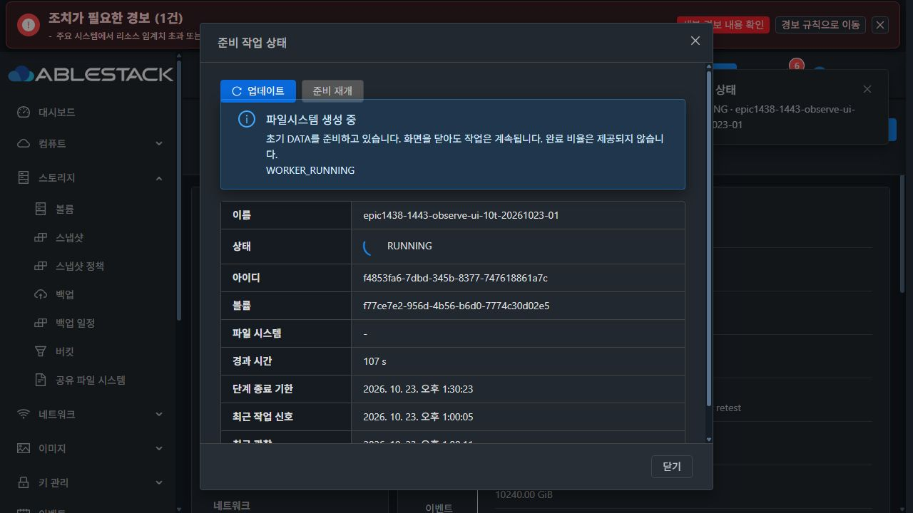
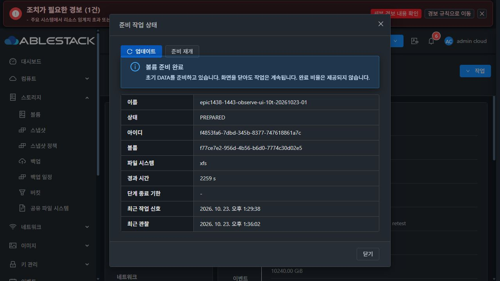

# #1443 진행 중 formatter 상태 조회 보완 및 재개 준비 (2026-10-23)

**요청한 최소 변경·회귀·모듈 빌드·13번 배포·실제 UI 검증 PASS. 전용 시험 자원을 정리했으며 대용량 전체 인수 재개 지시를 기다린다. #1443은 OPEN이다.**

## 구현 전에 실제 SystemVM에서 확인한 것

제품 파일을 수정하기 **전**, 기존 오류 VM i-2-121-VM(093de0e0-0fe2-3faa-874b-53542640a372, 호스트13.2)의 실제10TiB XFS/SPARSE formatter가 BLKDISCARD를 수행하는 중에 시험했다. 로컬 mock만으로 사전 검증을 대체하지 않았다.

| 사전 시험 | 실제 결과 |
|---|---|
| 배포본 snapshot 원래 경로 | blkid -p /dev/sdb가8.317초 후 TimeoutExpired |
| VM 메모리에만 주입한 분리 조회안 | 같은 실제 작업을0.061/0.013/0.011초에 RUNNING으로 반환 |
| 신원 음성 시험 | 잘못된 ROOT 및 DATA UUID 모두 차단 |
| 보호 확인 | 제품 파일 SHA·operation·volume·formatCount1·formatStartedAt 동일 |

사전 시험은12:18:37 KST에 끝났다. 대상 소스 SHA는71842294cb2fd47e1a4f3a92446d17ec38e92ace3d2ef496a33ac725884739f0였으며, 제품 파일/서비스/formatter를 변경하거나 재시작하지 않았다. **이 근거를 확보한 뒤에** 기능 commit3214dfed5c938d7376622ec9813cc4b0e11dd1ce를 구현했다.

[실제10TiB VM 사전 테스트의 명령·실측·신원 차단·변경 없음](evidence/actual10t-preimplementation.json)

## 최소 기능 변경

실행 동작의 변경은 systemvm/debian/usr/local/lib/ablestack-storage/volume_preparation.py에 한정했다.

- 활성 worker의 boot ID·unit·PID start ticks를 확인하고, ROOT/DATA serial·whole disk·크기·파티션·외부 mount 보호를 **서명 조회 없이** 수행한다. lsblk에도 FSTYPE/UUID 열을 요청하지 않는다.
- 신원 확인 후 journal과 worker를 다시 읽어 실행 중임을 확인한 경우에만 RUNNING을 반환한다. 종료 경합이면 기존 전체 signature/FS UUID/mount 검사를 수행한다.
- 상태 조회의 TimeoutExpired/관찰 예산 소진은 journal의 단계·heartbeat·포맷 횟수를 보존한 OBSERVATION_PENDING으로 반환한다. observationAvailable=false와 canResume=false를 유지하며 Ready나 새 포맷 허가로 바꾸지 않는다.
- 신원 불일치·손상 journal·partial/unknown signature·종료 후 FS UUID 변경은 계속 차단한다. formatter 명령, 포맷/검사 예산, 재포맷 보호, STATIC/DHCP bootstrap 및 기존 볼륨/권한 처리 동작은 변경하지 않았다.
- 기존 API의 상태 계약을 사용하므로 이 기능을 위해 API/Backend/UI의 로직이나 DDL을 추가로 변경하지 않았다.

## 기반 동기화와 빌드 검사 정리

착수 fetch에서 local Europa가 upstream보다115 commits 뒤인 것을 확인했다. local ablestack-europa를bb40d23119e로 fast-forward한 뒤 비교0/0을 확인했다. 공개된 기존 Epic 이력은1f97b5df610 병합으로 보존했다. 강제 push나 upstream 직접 push는 하지 않았다.

locale은 양쪽의 변경을 보존했고, 목록 갱신은 upstream의 routeKey와 SharedFS의 requestScope를 함께 유지했다. 관련 UI31개 시험과 생산 빌드로 통합을 확인했다.

upstream의 빌드 검사에 걸린 기존 SharedFS 와일드카드/중복/미사용 import는01611b721492daabba8c232664ccf9e879f57af1에서 명시적으로 정리했다. API·스키마·서버 및 관련 시험14파일의 **import 외 소스가 동일함**을 대조했다. API 파라미터/권한·SQL/DDL·Java 메서드 동작을 바꾸지 않았고, 빌드 산출물인 서버/KVM JAR이나 UI bundle을13번에 덮어쓰지 않았다.

[import 외 코드 동일 대조](evidence/explicit-import-proof.json)

## 회귀·빌드 결과

| 검증 | 결과 |
|---|---|
| guest 준비/신원/worker/실제 오류 경로 회귀 | WSL Python3.9에서54개 PASS |
| 같은 시험 소스·fixture를 실제 새 SystemVM에서 실행 | Python3.11.2에서54개 PASS, 제품 파일 동일 |
| API 준비 계약·실제 API 직렬화·생성/STATIC/서비스/KVM 회귀 | 78개 PASS, 실패/오류/skip0 |
| 목록/상세 통합 UI 회귀 | 31개 PASS |
| 실제 직렬화 fixture를 사용하는 준비 UI 회귀 | 19개 PASS |
| 서버·KVM 및 의존 reactor package | BUILD SUCCESS |
| UI 생산 빌드 | BUILD SUCCESS |
| 서버/KVM Checkstyle | skip 없이0위반 |

9개 추가 Python 시험은 실제 오류 때 캡처한10TiB journal fixture로 snapshot/identity/CLI main을 실행한다. 활성 경로에서 blkid/wipefs 미호출, CLI JSON의 RUNNING/진행 정보, ROOT/DATA/크기/파티션/외부 mount 오식별 차단, 일시 조회 timeout과 formatter 실패 구분, worker 종료 경합의 전체 검사, partial/unknown 및 FS UUID 변경 차단을 다룬다. 기존처럼 inspect를 성공으로 mock한 결과만으로 판단하지 않는다.

UI 생산 빌드의 첫 실행은 Node20/webpack4 도구 환경의 OpenSSL 호환 옵션을 빠뜨려 실패했고 빌드 전용 옵션으로 교정했다. Maven import 정리 과정의 assertion import 누락도 교정한 뒤 패키지와 관련 시험을 통과했다. 제품 오류로 분류하거나 검사를 생략하지 않았다. 전체 저장소 CI가 모두 green이라는 주장으로 확대하지 않는다.

[시험·빌드 집계](evidence/test-build-summary.json) · [실제 VM 회귀](evidence/actual-guest-regression.json) · [guest 회귀 로그](evidence/guest-regression.txt)

## 13번 배포와 무결성

| 항목 | 값 |
|---|---|
| 제품 모듈 SHA-256 | 7f22d9aab691c7367e22b7cf053b2ca285e7a9bb604981699c7f02fa34c66f7e |
| 배포한 SYSTEM template | f6ae443d-9965-4f86-bd22-043c94dbcae6 |
| 이름 | Europa-SystemVM-1443-observation-3214dfed5c93-20261023 |
| 이미지 압축 SHA-256 | 3333bd054a17a34d71120fdabcddcd9cf05aa1702da9dabd10ab7bc1a1f062b1 |
| 새 이미지의 변경 경로 | usr/local/lib/ablestack-storage/volume_preparation.py 1개 |
| 기존 관리 서버 JAR | 7a00a376a686bb6fe120c617e77552867abcd71db2b35bf169c5e051d85853ee, 동일 |
| 관리 서버 PID | 3221479, 이 작업에서 재시작하지 않음 |

먼저 기존 오류 VM의 해당 모듈만 원자적으로 교체했다. 계정·fstab·helper·bootstrap 파일과 formatter intent가 유지됐고 VM/formatter 재시작0회였다. UI에서 실제 PREPARED 조회와 같은 요청 준비 재개가 성공해 초기 NFS/SMB 구성이 Ready가 됐으며 formatCount1이 유지됐다. 이 요청의 복구를 전체 대용량 인수로 표기하지 않는다.

새 SystemVM 이미지는 검증된 기존 template에 한 파일만 덮어 만든 모듈 overlay다. 다른33,924개 guest 경로의 내용/유형/모드/소유자와 WSL 호스트 계정 파일이 유지됐다. qemu-img check와 압축 검사, 관리 서버 게시 파일 SHA를 확인했다. 실제 UI 등록 후 SYSTEM/KVM/x86_64/cross-zone/Ready를 확인했고, 새 VM이 이 template을 선택한 것도 UI와 guest 모듈 SHA로 대조했다.

[모듈 빌드](evidence/module-build.json) · [이미지 빌드/보존](evidence/guest-module-build.json) · [기존 VM 한 파일 배포](evidence/live-deployment.json) · [게시 SHA](evidence/published-image.json) · [관리 서버 보존](evidence/management-unchanged.json)

## 새 VM·DATA의 실제 UI 검증

| 항목 | 값 |
|---|---|
| SharedFS | 4af5e8c3-ac8f-4a44-ac6f-8e270ac22e31 |
| VM / 호스트 | 4e4bd682-8700-3b0c-8571-7790487d286d / i-2-122-VM / 13.3 |
| ROOT | 6aa9e350-6be5-43ad-ac4c-18b2d8397a08 / UI SPARSE |
| 새 DATA | f77ce7e2-956d-4b56-b6d0-7774c30d02e5 / 10240GiB / UI SPARSE |
| IP | 10.10.13.252 |
| operation | f4853fa6-7dbd-345b-8377-747618861a7c |
| 최종 FS UUID | 931059e8-29aa-4581-8381-275841550bc2 |

이번 새10TiB는 수정한 **포맷 중 상태 조회 기능의 UI 인수**에 한정했다. 남은 재시작·NFS/SMB 클라이언트 보존·EXT4 전체 인수로 대체하지 않는다. VM·ROOT·DATA는 새로 생성했고, 클론·수동 MAC 변경·THIN·검사/예산/저장소 factor 우회는 없다.

1. 실제 UI 생성 폼에서 새 NFS 서비스와 고정10TiB SPARSE DATA를 구성했다.
2. VM UI에서 새 template과 ROOT/DATA SPARSE를 확인했다.
3. 실제 mkfs.xfs가 BLKDISCARD ioctl(0x1277)에 있는 동안 준비 대화상자를 열었다. UI는 RUNNING/파일시스템 생성 중·단계 기한·heartbeat를 표시했고 준비 재개는 비활성화됐다.
4. 같은 시점의 **수정된 실제 제품 함수**는0.014초에 응답했다. 실행 명령 추적에 blkid/wipefs/mkfs 재호출이 없었고 실제 ROOT/DATA 신원 검사는 수행됐다.
5. 수집한 UI 실제 API 관찰66개는 RUNNING/PREPARED뿐이고 모두 formatCount1이었다.
6. formatter를 강제 종료하지 않고 자연 종료를 기다렸다. formatStartedAt→PREPARED는1875.37초(약31분15초), 기한1920초 내 완료했다.
7. UI PREPARED 전환과 초기 NFS 내보내기/접근 규칙/백킹 볼륨 Ready, /dev/sdb 정확 매핑을 확인했다. 마지막 전체 상태 조회는 FS UUID·mount를 검증한 PREPARED였고 operation·formatStartedAt·formatCount1이 유지됐다.

[수정된 제품 함수의 실제10TiB 명령 추적](evidence/new10t-active-product-probe.json) · [실제 UI 관찰](evidence/active-ui-observations.json) · [자연 완료 journal](evidence/new10t-natural-completion.json) · [런타임 결과 집계](evidence/runtime-summary.json)

## 정리와 대기 상태

사용자가 이번 작업의 정리·삭제를 명시적으로 사전 승인한 범위에서 기존 오류 시험 서비스(ab23ee86...)와 새 UI 시험 서비스(4af5e8c3...)의 VM·ROOT·DATA만 SharedFS UI로 정리했다. 새 formatter는 PREPARED/Ready를 확인한 후 정리했으며 실행 중 삭제 보호를 우회하지 않았다. 일반 VM 볼륨 분리 경로를 사용하지 않았다.

기존13개 SharedFS는 모두 Ready이며 VM/DATA/IP 관계가 전후 동일하다. 새 template과 배포 이미지/검증 증거는 보존했다. 빌드 중간 raw 이미지2개와 관리 서버의 중복 업로드 stage(약474MiB)를 정리했고, 압축 원본과 게시 이미지는 보존했다. UI에서 pool 할당1,807,117,663,840bytes와 factor4.0 유지도 확인했다.

**수정 기능의 구현·배포·UI 검증과 대용량 재개 준비는 완료됐다. 여기서 중단한다.** 새 자원의2TiB XFS→10TiB XFS→10TiB EXT4 순차 시험에서 관리 서버/VM 재시작 후 재개, NFS/SMB 클라이언트 접속·데이터·권한 보존을 확인하는 전체 인수는 아직 재개하지 않았다. #1443을 닫지 않으며 다른 이슈나 #1468 최종 UI 정리를 시작하지 않는다.

진행 UI의 WORKER_RUNNING 원문 표시는 기능 차단이 없는 기존 표현으로 최종 UI 정리 참고 사항만 남겼다.

[전용 자원 정리·기존13개 보존](evidence/ui-cleanup-preservation.json) · [실제 준비 전후 신원](evidence/new10t-ui-identity.json)
