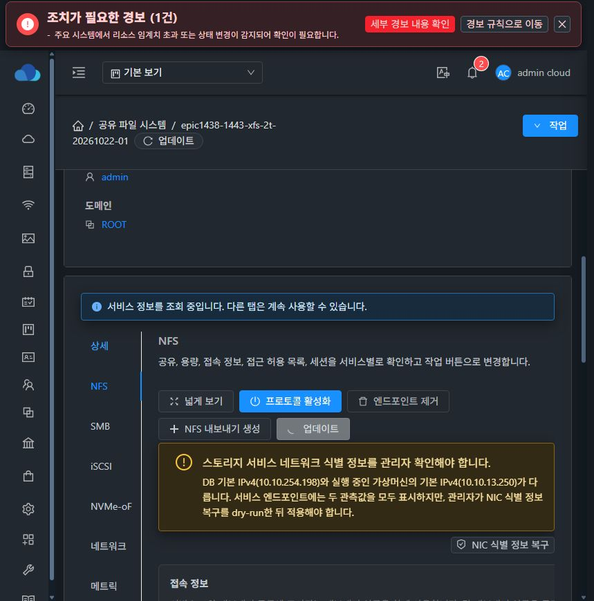
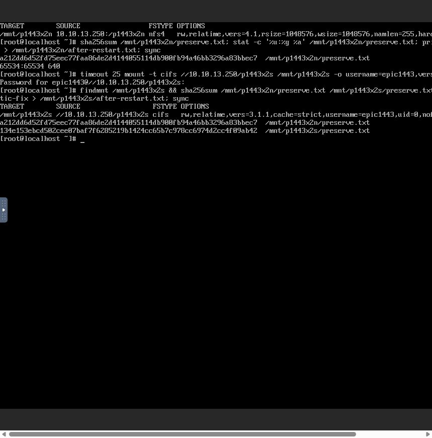
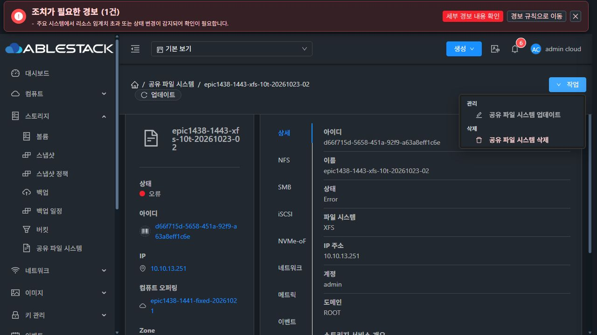
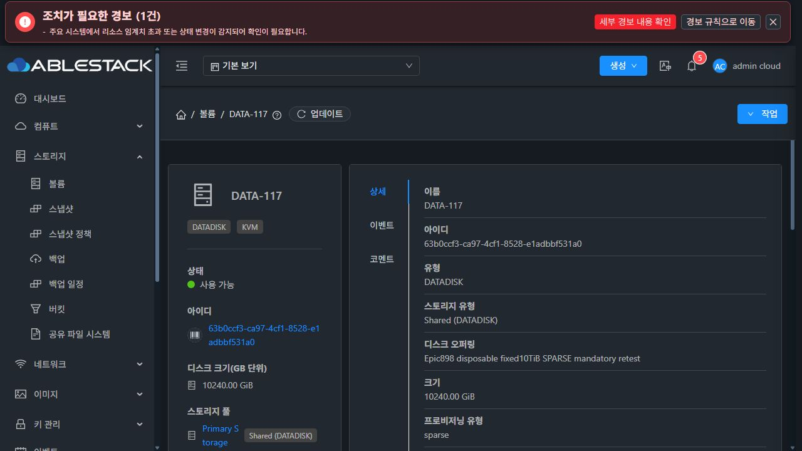

# #1443 STATIC 부트스트랩 수정·배포·실환경 인수 (2026-10-23)

**최종 상태: 2TiB 기존 서비스의 STATIC 재시작·재접속은 통과했다. 새 10TiB XFS 생성은 추가한 bootstrap 완료 guard에서 실패했으므로 인수를 중단했다. #1443 OPEN, Epic PR #1470 Draft를 유지한다.**

## 범위·소스·배포

- 제품 구현 commit: `cf5351e0557063780c4392b45e72b88333cd30da`. 기반 Europa local/upstream `929cbff799d`, 비교 0/0 확인 후 feature 작업. origin `epic/1438-sharedfs`에 일반 push.
- guest의 `sharedfs_bootstrap_network.py`는 root 소유·private·regular JSON과 MAC/IPv4/CIDR/DNS를 검증한다. 유효한 STATIC은 기존 helper로 복원하고 SharedFS bootstrap의 직접 dhclient를 건너뛴다. 상태가 없으면 기존 DHCP 명령을 유지한다. 손상된 STATIC을 DHCP로 대체하지 않는다.
- static unit은 `cloud-early-config.service` 뒤로 순서를 지정했다. host wrapper는 상태/helper/unit을 저장한 뒤 해당 unit의 active/exited/success를 기다리도록 했다. **이 host guard의 최초 부팅 인수가 아래와 같이 실패했다.**
- 공통 init/common, 다른 SystemVM, formatter/worker, UI 제품 소스는 이번에 변경하지 않았다. UI는 이전 수정 `57cc5293429` 배포본을 사용했다. DDL 없음.
- guest 회귀 10개, 실제 생성 shell guard를 bash로 실행하는 KVM wrapper 회귀 5개 및 관련 KVM Maven reactor package 통과. 이 시험의 systemctl 상태 스텁은 실제 새 VM의 전체 부팅 수명주기 검증을 대신하지 못했다.
- 13.1/13.2/13.3 agent JAR의 wrapper class 한 개만 교체했다. 다른 524 entries는 동일하다. 새 JAR SHA-256 `168350ffb5e9345b7ba2eee91a1e1c38d35cd47b209ab0caad58be7c0a97ec55`. 호스트별 전후/rollback/VM·disk·MAC 대조 receipt를 첨부한다.
- 기존 2TiB guest에는 bootstrap 두 파일만 배포했다. 네트워크 helper 실행으로 재시작 시험을 우회하지 않았으며 실제 UI 재시작으로 인수했다.
- 신규 guest 모듈 이미지는 기존 검증 image에서 두 파일만 변경하고 33,922 다른 paths와 WSL 계정 파일 무결성을 대조했다. 압축 image SHA-256 `1d1f4c05f3f719642c4c1d9a17a0ade58a97024281cf8921ecfceb37079d19d3`, UI 등록 SYSTEM template `2a8fa5b1-faac-4576-a2cd-14c1938bebd8`. 새 10TiB VM의 실제 UI template도 일치했다.

## 통과: 2TiB SPARSE XFS·원래 STATIC IP 재접속

SharedFS `a88c8813-d8de-4648-8f92-352970bb3602`, VM `492c6b13-4500-3f94-8be7-76f146d9ba49`, DATA `942aee61-490d-493e-b60d-8cb81ce8f9da`. ROOT/DATA 모두 SPARSE/QCOW2. 이전 요청을 재생성하지 않고 같은 서비스를 UI에서 재시작했다.

1. 클라이언트 noVNC 콘솔에서 기존 NFS/SMB 마운트를 해제했다.
2. 실제 SharedFS 재시작(cleanup=false) UI 실행 후 Ready·원래 IP `10.10.13.250`를 확인했다.
3. 새 boot의 guest journal은 STATIC 복원 → bootstrap DHCP skipped → bootstrap 뒤 static helper 성공을 기록했다. 활성 IPv4는 10.10.13.250/16이고 후발 DHCPACK는 없다.
4. 동일 클라이언트의 실제 UI 콘솔에서 원래 IP의 NFSv4.1과 SMB3.1.1 LOCAL에 각각 새로 마운트했다. SMB 암호는 프롬프트로만 입력했다.
5. 두 기존 파일 읽기·해시, 재접속 뒤 신규 쓰기·해시 읽기 성공. guest read-only stat으로 아래 UID/GID/mode와 같은 DATA filesystem 소속을 대조했다.

| 항목 | 재시작 후 결과 |
|---|---|
| FS UUID | bbaf069a-c5b9-4a55-be4f-774d7ad80583, 동일 |
| journal | PREPARED, formatCount=1, operation 동일 |
| NFS preserve.txt | a212dd6d52fd75eec77faa86de2d4144055114db900fb94a46bb3296a83bbec7 / 65534:65534 / 0640 |
| SMB preserve.txt | 134e153ebcd502cee07baf7f6285219b1424cc65b7c978cc6974d2cc4f09ab42 / 1001:1001 / 0660 |
| 두 신규 after-restart.txt | 0c3d0bb40f372902ff8e6e85029d857b5f277cfb91b4ff058b5e08c21f7435a7 |
| fstab | canonical DATA UUID mount 1개, NFS alias bind 별도 유지 |




2TiB 시험 완료 후 클라이언트 정상 unmount → SharedFS UI 정지 → 정지 확인 → 전용 자원 삭제를 수행했다. 비대상 11개 SharedFS는 Ready를 유지했다. 처음 정지 전 삭제 요청은 정상 선행 조건에 거절됐고, 정지 순서를 누락한 시험 조작을 교정했다.

## 10TiB 시험 입력 교정과 실제 생성

처음 자유 입력 오퍼링에 10240GiB를 넣어 `custom.diskoffering.size.max=4096` 검증에 거절됐다. 이 요청은 VM/DATA를 만들지 않았다. 시험 오퍼링 선택을 누락한 조작 오류로 구분하고, 무자원 예약 `25496d2e-497a-4ed8-9aef-d205dc4a0f61`만 UI로 삭제했다. 정책 상한/스토리지 factor를 올리지 않았다.

실제 UI에서 기존 고정10TiB 오퍼링 `80ea41ff-feec-4eb8-9919-7bb850b6e503`의 크기 10240GiB·SPARSE·shared·glue-gfs·writeback을 확인해 새 요청을 만들었다. 오퍼링 정의 재사용과 VM/DATA 재사용을 구분한다. 새 VM과 디스크를 생성했으며 MAC은 Mold 기본 정책을 사용했다.

- SharedFS `d66f715d-5658-451a-92f9-a63a8eff1c6e`
- 생성 request `161597c4-fddc-456c-a22d-4376d7470616`, job `4add6d51-0736-4ba6-95a5-db49b1cb4a03`
- VM `dd732018-0e3c-38cd-bb5e-61ca2008fbd9`, i-2-117-VM, host 13.3
- ROOT `6540cde1-10fb-4c1a-b5e4-18e5e53ceec6`, DATA `63b0ccf3-ca97-4cf1-8528-e1adbbf531a0`
- UI VM 볼륨 탭에서 ROOT/DATA sparse·DATA 10240.00GB 확인. 원래 계획의 NFS+SMB LOCAL, STATIC 10.10.13.251, XFS 요청.

## 중단: 최초 부팅 STATIC 완료 gate

실제 UI의 queryAsyncJobResult 응답은 HTTP 200이지만 jobstatus=2, resultcode=530이다.

```
Failed to configure static SharedFS network through QGA:
Storage Service command failed with exit code 75:
SHAREDFS_BOOTSTRAP_PENDING: waiting for guest network initialization
```

| KST | 실제 기록 |
|---|---|
| 03:02:18 | UI 생성 요청 접수 |
| 03:02:25~03:03:29 | 호스트에서 새 10TiB QCOW2 SPARSE 메타데이터 생성 |
| 03:03:30 | 새 QEMU VM 기동 |
| 03:03:36 | QGA 명령 실행 가능 |
| 03:03:37~03:05:05 | STATIC 완료 guard가 계속 exit 75. 기존 30회 dispatch 루프 소진 |
| 03:05:05~03:05:12 | 기존 초기 생성 catch → cancelCreation → VM 자동 destroy/expunge |
| 03:05:12 | API FAILED/530, SharedFS Error/CANCELLED |

**직접 원인:** 이번 수정이 STATIC 성공 조건을 `cloud-early-config.service` 전체의 active/exited/success에 결합했다. QGA가 올라온 최초 부팅과 전체 bootstrap 완료는 다른 시점인데, 기존 configureStaticNetwork의 30회·2초 간격(각 QGA 관찰 약 1초 포함, 이번 약 87초) 안에 gate가 열리지 않았다. guest unit 자체 TimeoutStartSec는 5분이다. PENDING을 일반 CloudRuntimeException으로 바꾸면 아직 preparation journal이 없는 초기 분기는 일시 상태로 보존하지 않고 취소한다.

**왜 2TiB 재시작 통과와 다른가:** 2TiB는 최초 설정이 끝난 기존 guest의 재부팅/STATIC skip 경로였다. 새 template의 최초 boot는 상태 파일이 생기는 시점과 DHCP/일반 bootstrap 순서가 다르다. 기존 guest 통과와 상태 문자열 스텁 회귀만으로 새 guest 생성 보존을 검증하지 못했다. 이는 10TiB formatter timeout 또는 데이터/권한 손상이 입증된 결과가 아니다. static 단계에서 예외가 나므로 prepareInitialNewData는 호출되지 않았다.

**확정하지 못한 하위 항목:** 실패 순간 unit의 ActiveState/SubState/Result와 guest 내 마지막 실행 명령은 guard 오류에 포함되지 않았다. 기존 자동 취소가 ROOT를 삭제해 사후 guest journal을 가져올 수 없다. 그러므로 특정 NTP·DHCP·monitor 작업이 정지 원인이라고 단정하지 않는다. 단순 대기 시간 연장만으로 해결된다고 주장하지 않는다.



### 자원·영향

추가 UI 삭제나 재생성·재시도는 하지 않았다. VM/ROOT는 제품의 기존 취소 경로가 자동 제거했다. DATA는 미연결 Ready로 남아 있다. UI와 호스트 read-only 확인 결과 QCOW2·논리 10995116277760 bytes, 관측 할당 1807642624 bytes, corrupt=false이다. 이 DATA를 새 시험이나 포맷에 재사용하지 않았다.



새 guard는 13번 세 호스트에 설치된 상태이며 **새 STATIC 생성의 호환성은 미통과**다. template도 시험 후보 상태로 남아 있다. DHCP 모드는 코드 경로·회귀 시험으로 보존했지만, 이번 새 template의 실환경 DHCP 생성/재부팅 인수는 하지 못했다. 제품 오류 중단 지시에 따라 추가 수정·rollback 배포도 실행하지 않았다.

## 최소 후속 개선 방향 — 이번에 구현하지 않음

1. UI는 STATIC 초기화 대기를 명시적 진행 상태로 표시하고, 그 상태에서 Ready/실패를 성급히 확정하지 않는다. 실제 주소 검증 완료 뒤 기존 포맷·초기 공유 순서를 진행한다.
2. guest는 전체 cloud-early-config 완료가 아니라 **이번 boot의 네트워크 변경 구간 완료**를 식별할 수 있어야 한다. DHCP 실행 직전 STATIC 상태를 다시 읽어 초기 boot 중 뒤늦게 도착한 intent도 반영하고, STATIC 적용/기존 DHCP 경로 완료 후 boot ID·모드·NIC의 checkpoint를 원자적으로 기록하는 방안을 검증한다.
3. host는 그 boot의 checkpoint와 지정 MAC/IP를 확인한다. 잘못된 상태·실패는 fail-closed를 유지한다. 다른 SystemVM과 DHCP 동작은 바꾸지 않는다.
4. Backend는 네트워크 준비 중임을 일반 영구 실패와 구분해 기존 생성 context/UI에서 관찰·재개하게 한다. 현재 unit 상태·최근 단계·실제 주소를 실패 응답에 포함하고, 일시 대기 때문에 ROOT 증거가 자동 소실되지 않게 한다.
5. 회귀는 문자열 상태 스텁뿐 아니라 첫 DHCP 모드 판정 후 STATIC intent 도착, 같은 boot의 network 완료 뒤 비네트워크 작업 지연, 새 boot의 낡은 checkpoint, 기존 DHCP와 STATIC 재부팅을 실행 순서로 검증한다. 실제 UI의 새 소형 STATIC 생성부터 확인한 뒤 10TiB를 재개한다.

전체 bootstrap 기다림을 없앤다는 이유로 실제 주소 확인·권한·포맷 보호를 완화하지 않는다. 새 이슈를 분기하지 않았다. #1468 UI 표준 정리는 착수하지 않았다.

## 미완료

- 새 VM 최초 STATIC 생성의 정상 완료
- 10TiB XFS·EXT4 준비 및 NFS/SMB 데이터·권한 보존
- 관리 서버 재시작 중 동일 작업/UUID·formatCount=1의 UI 재개
- 새 template의 실환경 DHCP smoke

**#1443은 닫지 않는다. 제품 오류 원인 분석 후 추가 기능 실행을 중단하고 다음 지시를 기다린다.**
