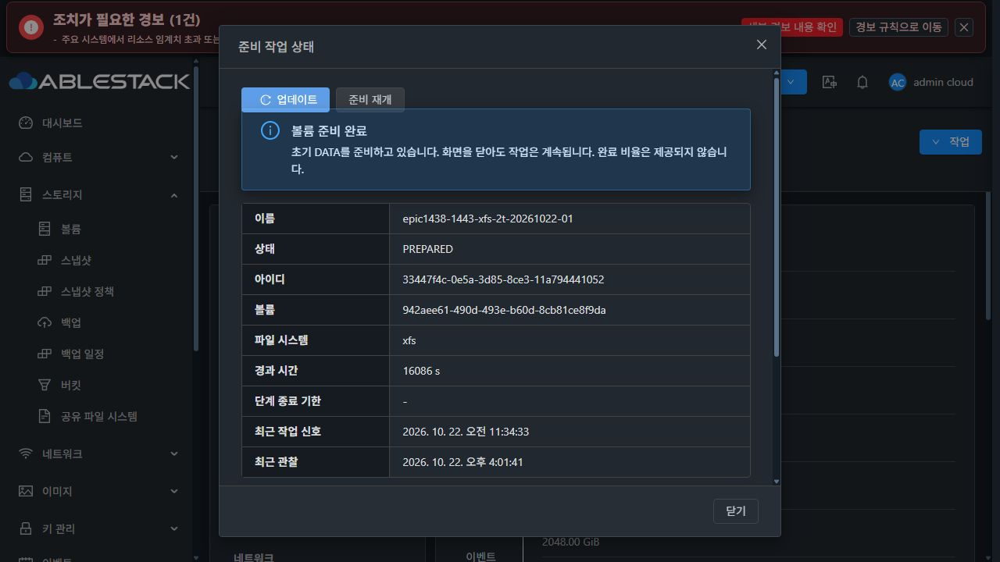
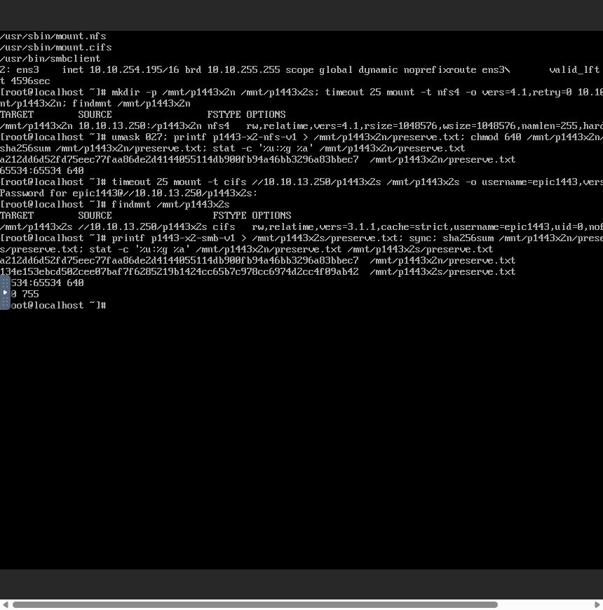
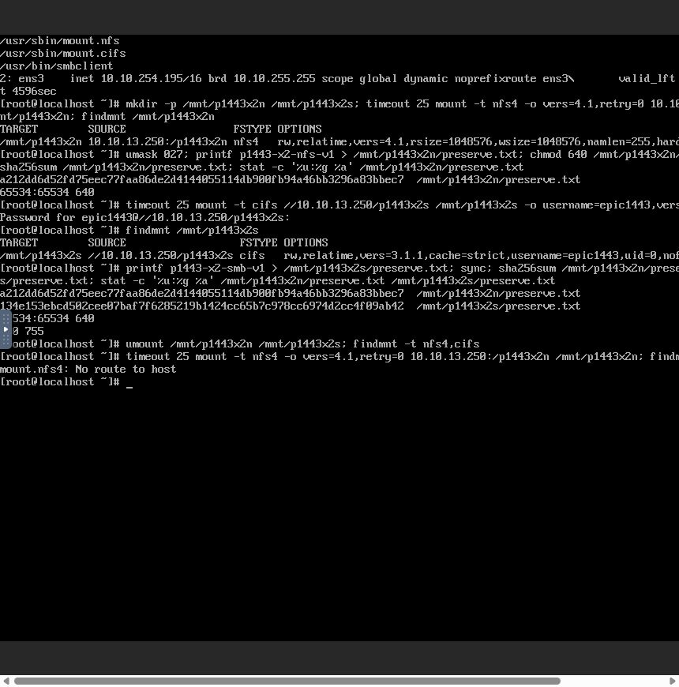

# #1443 UI 응답 해석 수정·13번 검증 결과 (2026-10-22)

**상태: UI 응답 해석 수정·빌드·배포·실제 화면 확인 완료. 2TiB 재시작 후 STATIC IP가 DHCP로 덮어써지는 제품 결함에서 중단. #1443 OPEN.**

## 완료한 변경과 시험

- 구현 `57cc5293429062b515bb181d16e15f75f0502eff`. local Europa/upstream `929cbff799d`, 비교 0/0 확인 후 기존 Epic 브랜치에서 작업하고 origin으로만 push했다.
- 생성 observer와 준비 상태 observer가 공통 decoder로 실제 `getsharedfilesystempreparationresponse.sharedfilesystempreparation.preparation`을 해석한다.
- 실제 13번 응답 fixture와 실제 `ApiResponseSerializer.toSerializedString` 출력 전체 JSON의 일치 시험 **1개**, 관련 UI 회귀 **69개** 통과.
- 관찰 불가 응답은 fresh/canResume로 승격하지 않는다. fresh PREPARED 이전 공유 적용 차단 및 wizard snapshot 없는 재접속 관찰도 시험했다.
- UI production build 성공. build 시작 이전에 최종 제품 소스가 저장됐음을 timestamp로 대조했다.
- 13번 UI 파일 **901개** 설치/해시 대조, index SHA `d2ceee21369a08e5aecd5001d49618a7571f944a52564c2377385f0d81fd2b3c`.
- 운영 config SHA `71c175523a2e251faf574bd5d977c37e81d21c9cc0b8a98dfb1642c6b8a448d7`, systemvm 디렉터리 inode 보존. 관리 서버 JAR/guest/host agent 제품 코드는 이번 수정에서 변경하지 않았다.
- 실제 상태 대화상자에서 PREPARED/operation/DATA UUID/XFS/관찰 시간이 정상 표시됨을 확인했다.

## 첫 2TiB 사례: 재시작 전 실제 NFS·SMB 접속 성공

같은 시험 서비스 `a88c8813-d8de-4648-8f92-352970bb3602`, VM `492c6b13-4500-3f94-8be7-76f146d9ba49` / i-2-116-VM / 13.3, SPARSE/QCOW2 DATA `942aee61-490d-493e-b60d-8cb81ce8f9da`(**2,199,023,255,552 bytes**)를 유지했다. 새 시험 클라이언트 `268b256e-bfd2-4a3f-9a3b-ce3f0ad78ecc` / i-2-115-VM / 13.2의 ROOT도 SPARSE/QCOW2다.

이전 중단 시 NFS·SMB는 프로토콜 활성화까지만 진행된 상태였다. 수정된 UI의 '준비 재개'에 SMB 암호를 다시 입력하여 같은 DATA로 초기 공유/ACL 설정을 완료했다. UI에서 NFS 내보내기/10.10.0.0/16 RW·Root Squash, SMB LOCAL 사용자 RW와 각각 Ready를 확인했다.

클라이언트 작업은 실제 Mold noVNC 콘솔에서 수행했다.

| 접속 | 실제 결과 | 서버 파일 SHA-256 / 권한 |
|---|---|---|
| NFSv4.1, 10.10.13.250:/p1443x2n | 마운트·파일 쓰기·해시 읽기 성공 | `a212dd6d52fd75eec77faa86de2d4144055114db900fb94a46bb3296a83bbec7`, **65534:65534 / 0640** |
| SMB3.1.1 LOCAL, //10.10.13.250/p1443x2s | 암호 인증·마운트·쓰기·해시 읽기 성공 | `134e153ebcd502cee07baf7f6285219b1424cc65b7c978cc6974d2cc4f09ab42`, **1001:1001 / 0660** |

두 파일이 ROOT가 아닌 실제 DATA 파일시스템에 있음을 read-only QGA stat/해시로 대조했다. CIFS 클라이언트 표시 권한(0:0/0755)과 서버의 실제 POSIX 권한을 구분했다.

## 최초 새 제품 결함: 재시작 후 고정 IP 유실

클라이언트 마운트를 정상 해제하고 **Mold SharedFS의 '재시작', cleanup=false**로 같은 VM을 재시작했다. 이후 원래 NFS 주소로 재접속한 단 한 번의 시도에서 **No route to host**가 발생하여 후속 시험을 중단했다. 다른 주소로 우회 접속하거나 IP/MAC을 수동 변경하지 않았다.

- DB: networkMode=STATIC, 요청 IP=**10.10.13.250**, CIDR=10.10.0.0/16, gateway=10.10.13.1 유지.
- guest의 저장된 sharedfs-network.json도 같은 STATIC IP와 MAC을 유지한다.
- guest 실제 eth0는 **10.10.254.198/16, dynamic**만 보유한다. 10.10.13.250은 없다.
- 저장된 MAC, 실제 NIC, DHCP journal의 MAC은 모두 **02:0d:00:cc:00:48**이다.
- 재시작 UI는 사용 가능/공유 Ready를 표시하지만 요청한 고정 주소는 접속되지 않는다. 단순 UI 표시 차이로 분류할 수 없다.

### 정확한 하위 원인과 시간 순서

시간은 guest journal UTC이며 한국 시간은 +9시간이다.

| UTC | 실제 기록 |
|---|---|
| 07:07:13 | ablestack-sharedfs-network.service가 10.10.13.250 적용 성공 |
| 07:07:14 | 관리 서버 start 경로가 같은 static helper를 다시 기동하여 10.10.13.250 적용 성공 |
| 07:07:15 | 부트 초기화가 /etc/network/interfaces를 legacy cmdline의 10.10.254.196/netmask null로 다시 작성 |
| **07:07:16** | **cloud-early-config → sharedfsvm.sh가 직접 dhclient를 실행. DHCPACK/bound to 10.10.254.198** |

문제가 된 배포 스크립트 5개(sharedfsvm.sh/init.sh/common.sh/postinit.sh/cloud-early-config.service)의 전체 SHA가 현재 소스와 동일하다. 예를 들어 sharedfsvm.sh는 `5ff45d6a2696d98fe6a04964e9c46a6bba108a45a3962d66f1ea25b7cda9d320`이다.

- `LibvirtStorageServiceHostCommandWrapper`의 static 복원 unit은 `Before=network-pre.target network.target`이며 cloud-early-config 완료 이후라는 순서가 없다.
- helper는 `cloud-dhclient@eth0.service`만 disable/stop한다. 이번 guest에서 해당 unit의 FragmentPath는 비어 있다.
- **실제 DHCP는 `systemvm/.../setup/sharedfsvm.sh:49`가 별도 dhclient 프로세스로 직접 실행한다.** 이 경로는 static 상태 파일을 확인하지 않는다.
- 따라서 boot restore와 관리 서버의 순간 성공 검사 이후에 후발 bootstrap/DHCP가 IP를 덮어쓴다. `SharedFSServiceImpl.restartSharedFS → startSharedFS → configureStaticNetwork` 호출 자체가 빠진 것은 아니다.
- postinit.sh의 dhclient 종료는 이미 바뀐 IP를 고정 IP로 되돌리지 않는다.

즉, **영속 STATIC 복원과 기존 SharedFS 부트 초기화의 네트워크 설정 주체·실행 순서 충돌**이다. 이번 UI decoder 수정과 별개이며 이 경로는 이번 수정에서 변경하지 않았다.

[실제 DB](evidence/reboot-network-db.json) · [guest 주소/상태 파일/unit/파일 보존](evidence/reboot-network-guest.json) · [배포 소스 무결성과 DHCP journal](evidence/reboot-bootstrap-source-journal.json).

## 데이터·권한·단일 포맷의 재시작 전후 대조

실제 재부팅은 boot ID `cea507c7-5336-49da-bbc0-175ccb6d7f23` → `86f29f93-1859-4b4b-8b38-a219b8272a6d`로 확인했다.

read-only guest 비교 결과:

- operation/DATA/FS UUID 유지. FS UUID `bbaf069a-c5b9-4a55-be4f-774d7ad80583`.
- journal **formatCount=1** 유지, formatter 프로세스 없음.
- NFS·SMB 파일 각각의 SHA·UID·GID·mode 및 DATA 파일시스템 위치가 재시작 전후 동일.
- canonical DATA fstab 항목 1개 유지. 별도의 정상 NFS alias bind 항목과 중복 항목을 혼동하지 않았다.

이는 **guest 내부 보존 확인**이다. 원래 IP의 실제 재접속이 실패했으므로 재시작 후 클라이언트 접속 인수를 통과했다고 표기하지 않는다.

## 다음 최소 개선 방향 — 이번에 구현하지 않음

1. **UI 흐름**: 재시작 수락 → guest 초기화/고정 IP 복원 관찰 → 요청 MAC·IP가 실제 활성 주소에 유지됨을 확인 → 서비스/Ready 표시 순서로 한다. 실패 시 요청/실제 주소와 실패 단계를 표시하고 DATA를 보존한다.
2. **guest**: 유효한 root 소유 STATIC 상태와 해당 NIC의 MAC이 확인되는 SharedFS에 한해서 부트스트랩의 DHCP 덮어쓰기를 막는다. DHCP 모드 및 첫 부팅의 기존 동작은 유지한다. 일반 Router/다른 SystemVM 초기화까지 바꾸지 않는다.
3. **순서**: SharedFS의 최종 static 복원이 해당 bootstrap 네트워크 초기화 뒤에 실행되도록 단일 권한·순서를 정리한다. 단순한 대기 시간 증가나 임시 IP 추가로 통과시키지 않는다.
4. **API/Backend**: 순간 helper 성공만으로 Ready를 확정하지 않고 guest 초기화 완료 및 지정 STATIC IP 활성 상태를 검증한다. 새 API를 늘리기 전에 기존 상태/생성·재시작 계약을 재사용한다.
5. 실제 배포된 bootstrap 경로의 DHCP 실행과 static restore 순서를 회귀 시험으로 재현한 뒤 같은 데이터의 UI 재시작·원래 IP 재접속을 확인한다. 그 다음에만 10TiB 순차 시험을 재개한다.

단순 표시는 #1468 참고 사항으로만 기록한다: PREPARED 뒤 경과 시간이 finishedAt 대신 마지막 관찰 시각까지 증가하고, 일반 안내 문구가 계속 '준비 중'으로 남는다. 이번 중단 사유가 아니다. #1468 전체 UI 정리는 미착수다.

## 중단 범위·미완료

- 추가 제품 수정, IP 복구, MAC 변경, 우회 접속, 반복 재시작, DATA 삭제/재포맷은 하지 않았다.
- 2TiB 서비스·두 파일·새 클라이언트·journal을 보존했다. 10TiB XFS/EXT4 자원은 아직 만들지 않았다.
- **미완료**: 재시작 후 원래 주소의 클라이언트 재접속, 관리 서버 재시작 중 작업 재개, 10TiB XFS·EXT4 순차 인수.
- #1443을 닫거나 다른 이슈로 분기하지 않는다. Epic PR #1470은 Draft 유지. 사용자 지시에 따라 원인 분석 후 중단한다.
