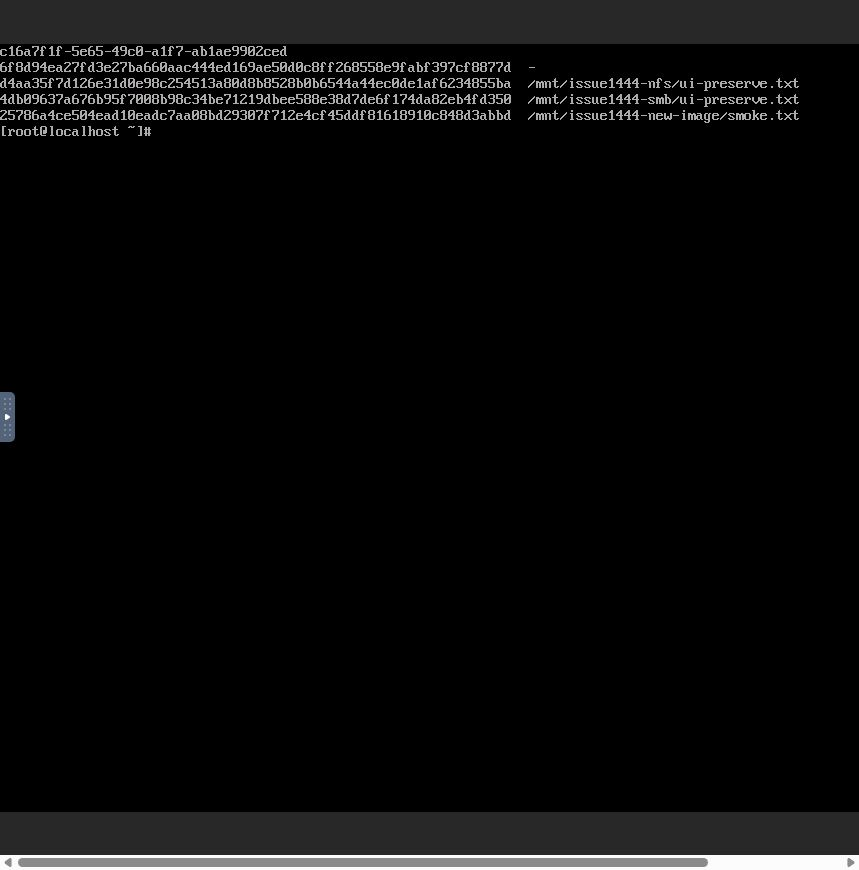
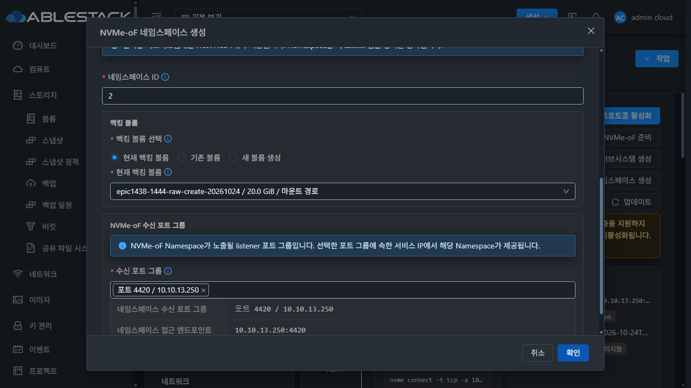
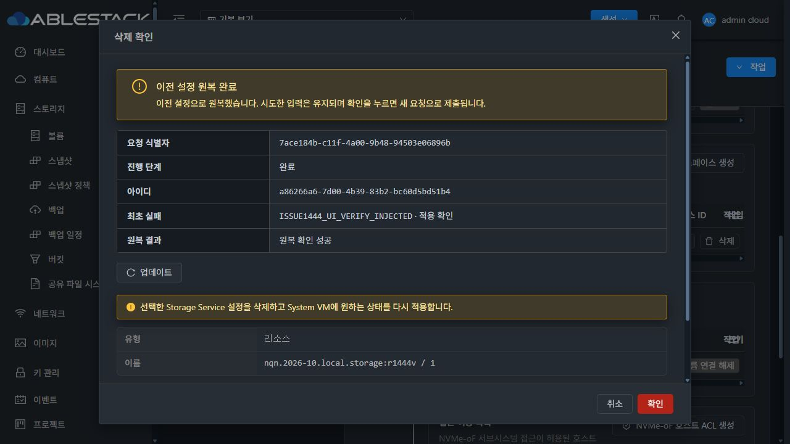
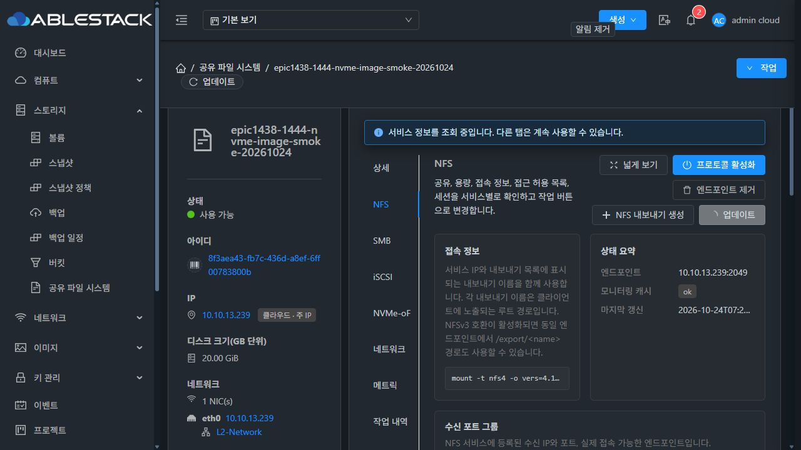

# #1444 설정 실패 원복·UI 보호·재부팅 최종 검증 (2026-10-24)

**PASS. 제품 구현 f25235648a129aaa23c37224039dc9ca47814fba. #1444 범위를 완료했으며 Epic #1438 전체는 진행 중이다.**

## 변경 내용과 경계

기존 설정 API29개·검증/백킹 resolver/desired-state builder를 재사용했다. requestid·revision·SQL 예약과 전용 journal로 중복/경쟁 변경을 제어하고, 후보 적용/확인 후에만 DB를 확정한다. 실패하면 직전 설정을 복구·검증하고 최초 실패와 원복 결과를 따로 유지한다. 긴 guest RPC 동안 SQL 트랜잭션을 유지하지 않는다.

guest는 기존 rtslib 조회 계약·LIO before-image·안전한 절대 configfs 링크 원복을 사용한다. UI는 실제 API 직렬화 계약으로 작업을 해석하며 page를 명시한다. NFS 폼은 NFS 포트만 후보로 사용한다. 인스턴스의 보호 상태를 모달 초안과 분리하고 서버 configurationprotection·GET 관찰·지연 응답 fence를 반영한다. 복구 필요 상태에서 재진입/새로고침/재시작해도 차단과 진단을 유지하며, 원래 작업 복구 후 서버 해제를 확인해야 새 변경을 허용한다.

관련 UI는 기존 MoldDialog/Actions와 의미 색상 토큰을 사용한다. 전 탭 일괄 재배치 #1468은 HOLD다. 기존 포맷 엔진·STATIC/DHCP·POSIX 보호·KVM transport는 이번 NVMe 후속 수정에서 변경하지 않았다.

## NVMe 부팅 UUID의 최소 수정과 구현 전 실증

일반 boot reconcile이 namespace 디렉터리·device_path·enable만 재생성해 kernel UUID가 바뀌었다. 트랜잭션 원복은 native snapshot을 사용하지만 일반 부팅은 그 경로를 거치지 않았다.

제품 파일을 수정하기 전에 같은 설계 모듈을 실제 SystemVM의 private 경로에 주입했다. 포트 없는 임시 kernel namespace와 미사용 SPARSE20GiB RAW 볼륨으로 **4건 PASS**: 활성화 전 영속화, namespace 삭제/재생성 후 UUID·NGUID 복원, 활성 identity 불일치 차단, 기존 활성 namespace의 무변경 승계. DATA 표본 불변·새 포트0·임시 namespace 정리를 확인했다. 미지원 EUI64에 대한 시험 가정은 사전 실증 중 교정했다. 실제 커널이 제공하는 속성만 관찰한다. [사전 결과](preimplementation-native.json)

검증한 prototype과 제품 nvmeof_identity.py는 바이트가 같다(SHA-256 12272fe888ede3e048333946f46ad056b0a4fc508ac437d03a1ff5e505b9e144). NVMe apply의 두 호출과 전용 helper만 추가했다.

- NQN·NSID·namespace UUID·Volume UUID에 결합한 kernel 식별자를 비밀 없는 root 전용0600 ledger에 원자적 replace/fsync로 기록한다.
- 기존 활성 장치의 현재 identity는 쓰기 없이 승계하고, 활성 identity/백킹 불일치는 거부한다.
- 비활성 namespace는 enable 전에 저장된 UUID/NGUID를 복원하고 실제 값을 검증한다. 지원되지 않는 속성을 강제로 만들지 않는다.
- ledger는 desired 설정이 아니라 장치 identity의 불변 기록이다. 실패한 설정 원복이 과거 identity를 삭제하지 않는다. 삭제된 후보의 기록이 남아도 ledger 자체가 runtime namespace를 생성하지 않는다.

## 회귀·빌드·배포

| 항목 | 결과 |
|---|---|
| 신규 identity 회귀 | WSL11 PASS·native3 skip, 실제 SystemVM14/14 PASS(native configfs3 포함) |
| transaction 회귀 | 현재 WSL11 PASS, 기존 동일 transaction 모듈의 SystemVM19 PASS 기록 유지 |
| UI | 실제 SFC 신규6 포함45 tests / 6 suites, lint·production build PASS |
| Backend | 실제 별도 MariaDB DAO2·wire serializer1·plan3 등 대상6 PASS, 기존 관련 Maven 모듈 package PASS |
| guest image | qemu-img check·bzip2 검사 PASS, 지정3파일만 변경·33,922경로 동일 |
| 보호 대상 | WSL 계정 파일·guest 계정/네트워크/formatter 파일 보존 |

[실제 SystemVM14개 회귀](native-product-regression.json) · [UI45개](ui-regression.log) · [Maven 빌드](backend-module-build.log) · [이전 SystemVM19개](previous-native-regression.json)

실행 중 SharedFS SystemVM14대에 모듈만 배포했고, 해당 기존 파일을 보호했다. 실행 중 native UUID를 승계한 뒤 UI 재시작했다. 새 이미지 VM1대에서도 설치 파일 SHA가 일치한다. 관리 서버/기존 UI는 변경되지 않은 검증 배포본을 유지한다.

| 산출물 | SHA-256 |
|---|---|
| management fat JAR | 8e911db81386034633e3f868c82699a32b5984ca8c798de5202ec49c1d7bcc71 |
| 배포 UI index | 72df1d943baf6026fc8e2a44990decf06ce6c74b019d24d3c5aa1e9bcee1fd1d |
| storagectl | 6134eba4acd67bd583700837f2c3ee10cb272f1131e90c9dda3f3b19ecf65a70 |
| configuration_transaction.py | 99dba671f64f8cd2ccb99c8d28c3ffe401b586adffd15517b1da4325e616fe44 |
| nvmeof_identity.py | 12272fe888ede3e048333946f46ad056b0a4fc508ac437d03a1ff5e505b9e144 |
| 새 SYSTEM 이미지 | de0b0cdc86db361e4a072a806f41f7c8ed3e2500a4b6aef9e0ab593721b13214 |

[이미지 빌드](guest-module-build.json) · [14대 배포](guest-deployment.json) · [새 이미지 실VM 일치](new-image-native-integrity.json)

## 실제 UI·API·클라이언트 인수

1. 기존 네 프로토콜 생성/삭제 실패 원복8건과 편집/ACL 실패 원복, 최초 실패·원복 진단·중복 방지 결과를 현재 API 작업 내역과 다시 대조했다.
2. NFS/SMB/iSCSI/NVMe 모달 재진입·전체 화면 새로고침·VM 및 관리 서버 재시작/재로그인 후 같은 작업/진단/확인 비활성화, 원래 작업 복구 후 서버 보호 해제를 실제 UI에서 확인했다. 관리 서버 재시작만 일반 UI가 없어 승인된 SSH 장애 주입이었다.
3. NVMe 수정 후 실제 Mold UI에서 VM을 재시작했다. 기존 클라이언트의 자동 재접속과 명시적 disconnect/connect 모두 같은 UUID **c16a7f1f-5e65-49c0-a1f7-ab1ae9902ced**와 원본 데이터를 유지했다. 기존 활성 값을 승계했으며 온라인에서 이전 UUID를 임의로 써 넣지 않았다.
4. 새 모듈에서 Namespace2 생성과 원래 Namespace1 삭제의 적용 후 검증 실패를 각각 주입했다. 작업 **aee85c18-e302-4c99-8c15-71734862ec8e**, **a86266a6-7d00-4b39-83b2-bc60d5bd51b4** 모두 ROLLED_BACK/SUCCEEDED. 최초 진단·원래 namespace UUID·데이터 보존, 중복 runtime namespace 없음.
5. 주입기를 제거한 뒤 **실패 원복 이후 다시 UI VM 재시작**했다. UUID·ledger·기존 namespace1개·같은 DATA를 유지했다. boot ID는 6fddf43c-d268-4729-b16e-8790aa47ae54 → 59de2055-863d-4718-aebc-2ab6472204c1 → 59de3cf8-7b2f-45c6-9922-b571a91032d8로 바뀌었다.
6. 최종 API18개 작업은 **원복16·확정2**, 모두 종료 상태다. 각 requestid 작업1개, revision2·configurationprotection=false. HTTP 관측은 일부 요청 계약 대조용이며 전 HTTP의 완전한 추적을 주장하지 않는다. 판정은 실제 UI·작업 DTO·guest journal·native 상태를 함께 사용했다. [최종 API](api-operations.json)
7. NFS/SMB 파일과 iSCSI/NVMe의 원본 4KiB 표본은 실제 클라이언트 콘솔에서 읽어 SHA를 대조했다. NFS 파일65534:65534/0640도 유지했다. 블록 장치는 서버의 /dev/sdX 고정값이 아니라 Volume serial로 확인했다.

| 데이터 | SHA-256 |
|---|---|
| NFS 원본 파일 | d4aa35f7d126e31d0e98c254513a80d8b8528b0b6544a44ec0de1af6234855ba |
| SMB 원본 파일 | 4db09637a676b95f7008b98c34be71219dbee588e38d7de6f174da82eb4fd350 |
| iSCSI 1MiB 위치4KiB | d332e77b715bf506247a502afcccb683e42a44feca3386730176c88fc997ecc8 |
| NVMe 1MiB 위치4KiB | 6f8d94ea27fd3e27ba660aac444ed169ae50d0c8ff268558e9fabf397cf8877d |

## 새 이미지·주소 중복·SPARSE 확인

UI SharedFS 목록과 실행 중14대 실제 IP/MAC을 대조했다. 기존 서비스250의 ARP는02:0d:00:cc:00:52와 일치한다. 새 시험239는 생성 전 duplicate-address probe0응답, 생성 후 ARP02:0d:00:cc:00:54가 실제 새 VM과 일치한다.

새 SYSTEM 템플릿 **c0dea1a6-14f8-441d-a308-0f1571d22931**을 UI 등록/사용 가능 확인 후 새 SharedFS **8f3aea43-fb7c-436d-a8ef-6ff00783800b**를 UI에서 생성했다. VM **8bea5d1f-10e8-34c8-b2e2-371d2fc774a6**의 ROOT **cbe4aab3-66ca-4f93-a03d-694ba1fca3fd**와 DATA **0798f6f0-5d36-4f60-bc09-f309cb1eba72**는 실제 UI 조회 API에서 모두 SPARSE다. [볼륨 증거](volumes.json)

클라이언트 실제 콘솔로239:/r1444newimage 마운트·쓰기·읽기 성공(SHA-256 25786a4ce504ead10eadc7aa08bd29307f712e4cf45ddf81618910c848d3abbd). 새 이미지의 기본 NFS 동작도 보존했다.

이전 시험에서 제가 중복 지정했던249 VM591b5440-9448-387d-92db-076533aa2ce6은 정지 상태로 보존하며 이번 시험에 사용하지 않았다. 해당 NFS 실패는 준비 오류로 분류한다. 새239 시험 결과로 바로잡았으며 기존249 VM은 변경하지 않았다. MAC 변경·THIN·기존 DATA 포맷은 없다.

## DB·제한·완료 판정

기존 #1444 관리 서버 배포에서 적용한 DDL: cloud.storage_service_instance.configuration_revision BIGINT UNSIGNED NOT NULL DEFAULT0, active_configuration_operation_id BIGINT UNSIGNED NULL. 새 cloud.storage_service_configuration_operation 표와 unique(instance_id,request_id)/uuid, instance-created index를 사용한다. snapshot은 MEDIUMTEXT, failure/rollback/observation은 TEXT다. 정확한 전체 DDL은 제품 커밋의 EuropaStorageConfigurationUpgrade.java에 있다. 이번 NVMe 후속 변경은 추가 DDL/API 변경이 없다.

시험 주입기·armed 플래그·임시 native namespace는 제거했다. 원래 모듈 hash와 원본 데이터, 최종 보호 해제를 확인했다. [최종 native 결과](final-native.json)

SMB는 로컬 인증/Host NQN ACL 범위다. 현재 kernel의 미지원 NVMe DH-HMAC-CHAP을 통과로 주장하지 않는다. #1460 제한 NFS ACL·SMB AD·백업/복원·전체 저장소 CI·Epic 전체는 이번 완료 범위가 아니다. #1468 전면 UI 정리는 별도 지시 전 HOLD다. 이전 제품 오류·중단은 이슈 댓글 이력에 남기고 이 최종 결과와 구분한다.

#1444의 완료 조건은 충족했다. 제품 코드를 origin의 Epic 브랜치에 push하고 기존 upstream Draft PR #1470에 반영한 뒤 완료 댓글을 기록하고 이슈를 닫는다. Epic PR은 병합하지 않는다.
