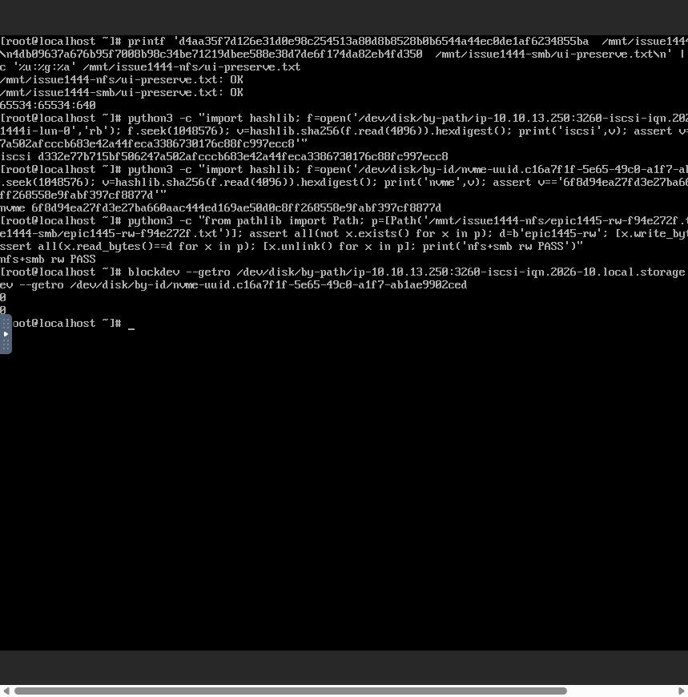
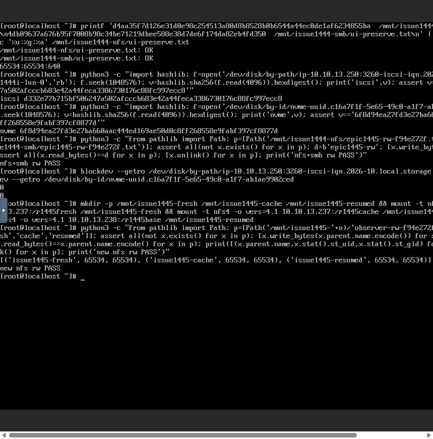

# #1445 최종 구현·배포·검증 결과

**기능 인수 통과. canresume 조기 반환 회귀를 수정하고 초기 생성→COMMITTED→ACL 생성 흐름을 실제 UI/API 및 클라이언트로 확인했다.** [이전 중단 보고서](../sharedfs-1445-stopped-20261024/report.ko.md)는 해당 시점의 이력으로 보존하며 이 보고서로 진행 상태를 갱신한다. Epic #1438 전체 완료를 뜻하지 않는다.

## 최소 수정

- [storageConfigOperation.js](../../../ui/src/utils/storageConfigOperation.js): 원래 job이 jobstatus0이면 RUNNING/COMMITTING/canresume=true에서도 같은 operation GET 관찰을 계속한다. jobid 없는 재진입 및 종료된 job의 명시적 동일 작업 재개는 유지한다. 자동 apply POST 재전송은 없다.
- [CreateSharedFS.vue](../../../ui/src/views/storage/CreateSharedFS.vue): 초기 생성의 후속 설정 요청에도 읽기 전용 사전 점검을 연결했다. 영향 확인이 필요할 때 기존 Mold 확인 대화상자에서 확인하고 fingerprint를 전달한다. 만료된 확인은 재점검·재확인하고, 기존 COMMITTED 요청은 새 적용 없이 재사용한다.
- Backend·guest·formatter·STATIC/DHCP·NVMe identity·DB DDL·KVM agent는 이번 후속 수정에서 변경하지 않았다. guest gate와 연결 보호를 완화하지 않았다.
- 새 볼륨은 필수 storageid를 통해 저장소에 생성한 뒤 Ready가 되는 기존 경로를 확인했다. 준비 볼륨의 Ready/소유권/연결 검증을 임의로 완화하지 않았다.

## 실제 API 응답을 사용한 컴포넌트 회귀

[기록 응답 fixture](../../../ui/tests/fixtures/storage-initial-configuration-wire.json)는 13번 브라우저에서 수집한 응답이다. export 관찰 응답과 같은 export에 대한 후속 ACL 성공 응답을 사용한다. candidate 및 result.config만 제외하며 원래 state/phase/canresume·직렬화 계약을 유지한다.

- 수정 전 mounted CreateSharedFS에서 RUNNING · NOT_NEEDED를 실제 재현했다.
- 수정 후 실제 export 응답의 PENDING → RUNNING/COMMITTING/canresume=true(jobstatus0) → COMMITTED를 끝까지 관찰했다.
- 실제 createInitialFileServices/runStorageServiceSetup/observer 코드를 사용해 COMMITTED 후에만 ACL POST1회가 실행되고 실제 ACL COMMITTED 응답의 ID까지 반환함을 검증했다.
- 자원 차단·영향 확인 취소 시 apply0회, 기존 COMMITTED 요청 재진입 시 새 admission/apply0회, 원래 job/종료 job/명시 재개 분리를 검증했다.
- 관련 UI 회귀 **123개**와 lint 통과. 실제 ACL 응답을 추가한 최종 mounted 컴포넌트 **4개**도 통과했다. UI production build 성공. 저장소 전체 CI나 변경 없는 다른 모듈의 재빌드를 수행했다고 주장하지 않는다.

## 13번 배포

UI 모듈만 교체했다. 이전 asset·operator config·SystemVM 이미지를 보존하고 index를 마지막에 반영했다.

| 항목 | 최종 SHA256 |
|---|---|
| UI index | 2e637bd6eae3855b32a23028b9a669a69354e7d073bf6ac7b1e48b1dcd387bff |
| 관리 JAR: 변경 없음 | 2f3567a3610be2af29b16e1d4c6c6f313e7ec8a21371ad76556a7ef49eb183d5 |
| operator config: 변경 없음 | 71c175523a2e251faf574bd5d977c37e81d21c9cc0b8a98dfb1642c6b8a448d7 |
| guest transaction: 변경 없음 | 0550dd0349d00f7bd9c114d3e14ff370ea8f68b113e02d16fb5e1445e600c474 |
| guest preflight: 주입 해제 후 원본 | a99c77e9cf84d7592c85d10a8e2fea9c5370c7bcb40c0b391074f2d1877de186 |

관리 서비스 active, guest formatter7f22d9aab691·bootstrap91d522e0f81a·NVMe identity12272fe888ed SHA도 기존과 동일하다. 새 SYSTEM 템플릿9d08b23b-4b06-4f24-9588-6bccbbbafe1f와 이미지75525a618480은 앞선 배포본을 사용한다.

[UI 배포](evidence/ui-deployment.json) · [최종 실제 VM 무결성](evidence/final-native-integrity.json)

## 실제 UI·API 인수

자원 생성·재개·설정 적용은 Mold UI에서 수행하고, API 응답은 해당 UI 요청을 CDP로 관찰했다. 임의 API 준비·배포 스크립트로 생성 흐름을 대체하지 않았다. QGA는 제한된 관측값 주입과 읽기 전용 무결성 확인에 사용했다. 클라이언트 명령은 Mold noVNC 콘솔에서 실행했다.

### 1. 이전 미완료 생성 요청 재개

- SharedFS233d2125-fd02-4276-a204-c57b997b40ba / VM2f9185c4-b7e8-3c85-b308-8333b966cc22 /13.238.
- UI ‘요청 상태 확인·이어하기’로 기존 export를 재사용하고 ACL을 생성했다.
- ACL 작업a916d842-c2a7-49d8-a91a-8d10a3e3bea6, 요청8e6df5e3-2579-48a2-ae34-1901c92f4e02. COMMITTING/canresume=true 이후에도 관찰을 유지해 COMMITTED 확인.
- r1445base Ready, CIDR10.10.0.0/16 Ready 및 runtime 검증 후 생성 흐름 정상 종료. pending 생성 배너도 해제됐다.
- 확인 결과가 만료된 경우 재점검·재확인을 거쳤고 실제 ACL POST는1회였다.

### 2. 새 VM·새 DATA 전체 생성

- 실제 UI의 VM31개 인벤토리와 ARP DAD를 확인한 빈13.237을 사용했다. MAC은 Mold 자동 할당을 그대로 사용했다.
- 새 SharedFS0ebf262e-ab9d-441a-8acf-cc24d27880ea / instance3e09d4ea-92c2-42ad-8a08-f6dd6fe0b249 / VM166c890d-0a65-36ee-ac16-8788fd1dedf2 / i-2-131-VM /13.2.
- 2CPU·1024MiB, ROOT019587f4-2e6a-42be-95aa-278a270fa806 및 DATA b9c2f3b3-c905-4ee2-a0f0-86ff5547e2c5(20GiB) 모두 sparse.
- protocol8474f5b0-d8cf-4be0-8cbd-6a1e4ec0bcbe → export a15aebf8-b734-4612-ad4d-49fe4ed9db8f → ACL25b764af-7117-4db5-a772-b8907fd49b16 모두 COMMITTED.
- r1445fresh와 요청 CIDR10.10.0.0/16, 실제 Ganesha active/runtime 검증까지 정상 종료했다.

### 3. NEW 준비 볼륨 재사용·이중 클릭·자원 재검사

- 동일 새 VM에서 r1445cache / NEW20GiB / sparse 오퍼링c48ab8d8-faba-4d43-85a6-e98a9ecc0cd5를 선택했다.
- 첫 UI 점검만 READY로 반환한 후 가용 메모리 관측값을1B로 낮추는 시험 주입을 사용했다. 실제 메모리 압박은 만들지 않았다.
- 이중 클릭에서도 createVolume은1회였다. 생성 볼륨b60d4ffd-016b-4504-b7e8-11e033d83dda가 Ready/sparse/미연결 상태임을 API로 확인했다.
- 서버 재검사는 작업0efe7cdc-5b3d-4462-962b-5b23aa0c3f99를 MEMORY_LOW/PREFLIGHT/원복 불필요로 차단했다. native 설정 동일·볼륨 미연결을 확인했다.
- 주입을 해제하고 모달을 닫았다가 같은 draft로 재진입했다. 다시 이중 클릭해도 추가 createVolume 없이 **같은 b60d4ffd**를 재사용했다.
- 요청02c2990a-4305-4679-97be-20049417e53a / 작업372ceea8-574b-4354-9c98-bcb3d9faf197가 COMMITTED, r1445cache Ready. 모달도 자동 정상 종료했다.
- 최종 ROOT·DATA·재사용 DATA3개 모두 Ready/sparse. 새 볼륨은 XFS UUID2029f24b-d09a-45ea-953a-1b237862c50a와 정확히 매핑된다.
- 시험 주입 mode flag 제거·preflight 원본 SHA 복구 완료. private 진단 폴더만 남겼고 작동하는 주입기는 없다.

[현재 UI/API 증거](evidence/ui-api-evidence.json) · [주입 해제·무변경 증거](evidence/cache-fixture-restored.json)

## 클라이언트 접속·데이터·권한 보존

VM268b256e-bfd2-4a3f-9a3b-ce3f0ad78ecc의 실제 noVNC 콘솔에서 검증했다. 기존13.250 서비스는 앞선 UI VM 재시작 이후 NFS 재마운트, SMB 로컬 인증 재마운트, iSCSI logout/login, NVMe disconnect/connect를 명시 수행했다. MAC·디스크 형식·기존 데이터는 바꾸지 않았다.

| 대상 | 결과 |
|---|---|
| 기존 NFS | 원본 SHA256 d4aa35f7d126e31d0e98c254513a80d8b8528b0b6544a44ec0de1af6234855ba 일치. UID/GID65534:65534·0640 유지 |
| 기존 SMB 로컬 인증 | 원본 SHA256 4db09637a676b95f7008b98c34be71219dbee588e38d7de6f174da82eb4fd350 일치. 재인증 후 임시 파일 쓰기·읽기·제거 성공 |
| 기존 iSCSI | LUN0 by-path 식별, offset1MiB의4KiB SHA256 d332e77b715bf506247a502afcccb683e42a44feca3386730176c88fc997ecc8 일치. blockdev RO=0 |
| 기존 NVMe-oF | 같은 namespace UUID c16a7f1f-5e65-49c0-a1f7-ab1ae9902ced의 by-id로 식별. 같은 범위 SHA256 6f8d94ea27fd3e27ba660aac444ed169ae50d0c8ff268558e9fabf397cf8877d 일치. RO=0 |
| 새 생성 r1445fresh / 재사용 r1445cache / 재개 r1445base | 모두 실제 NFS 마운트·각 경로의 임시 파일 쓰기/읽기·제거 성공. Root Squash의65534:65534 매핑 확인 |

기존 NFS/SMB에도 별도 임시 파일 RW 검증을 수행하고 제거했다. 기존 원본 파일·블록 데이터에 덮어쓰기/재포맷은 하지 않았다. 블록 장치의 기존 데이터는 읽기 및 configured RW 상태를 확인했으며 새 원본 영역 쓰기 시험으로 확대하지 않았다. 설치 nvme-cli의 식별 명령 차이는 시험 명령을 바로잡고 실제 udev UUID by-id를 사용해 검증했다.

## 이전 통과 항목의 적용 범위와 종료 조건

변경 없는 동일 backend JAR2f3567a3610b·guest transaction0550dd0349d0·preflighta99c77e9cf84에서 이미 통과한 자원 부족/공간 부족·동시 요청·310초 child/관리 서버 재시작/같은 작업 명시 재개·QGA45초 단절 실험은 [이전 보고서](../sharedfs-1445-stopped-20261024/report.ko.md)에 SHA와 증거가 있다. 이번에 그 backend/guest를 다시 수정하거나 해당310초·45초 주입을 재실행했다고 주장하지 않는다. 수정된 UI의 원래 job/종료 job/재진입 관찰 분기를 자동화로 확인하고, 실제 COMMITTING→COMMITTED→ACL 생성 및 준비 볼륨 재사용·최종 클라이언트 보존 시험을 완료했다.

- 정상 초기 생성의 조기 실패 회귀 해결 및 실제 응답의 컴포넌트 회귀 통과.
- 모듈 build·13번 UI 반영·실제 UI/API·클라이언트 검증 완료.
- 자원 gate·동일 작업 보호·준비 볼륨 중복 방지 유지.
- 세 검증 instance는 Running, configurationprotection=false, 활성 설정 작업 없음. 새 VM의 native 설정 작업4개도 모두 COMMITTED.
- SPARSE 이상 준수, THIN 생성·수동 MAC 변경 없음. 실제 다크모드 영향 확인 대화상자 가독성·간격을 확인했고 기존 Mold/AntD 스타일을 사용했다.
- 기능 중단을 유발하는 추가 제품 오류 없음. 기존 표시 전용 정리 항목은 기록만 유지하며 #1468 전면 UI 정리는 HOLD다.

이 조건으로 #1445를 완료 처리한다. Epic #1438과 PR #1470은 남은 하위 이슈가 있으므로 계속 진행 중/Draft로 유지하며 병합하지 않는다.
