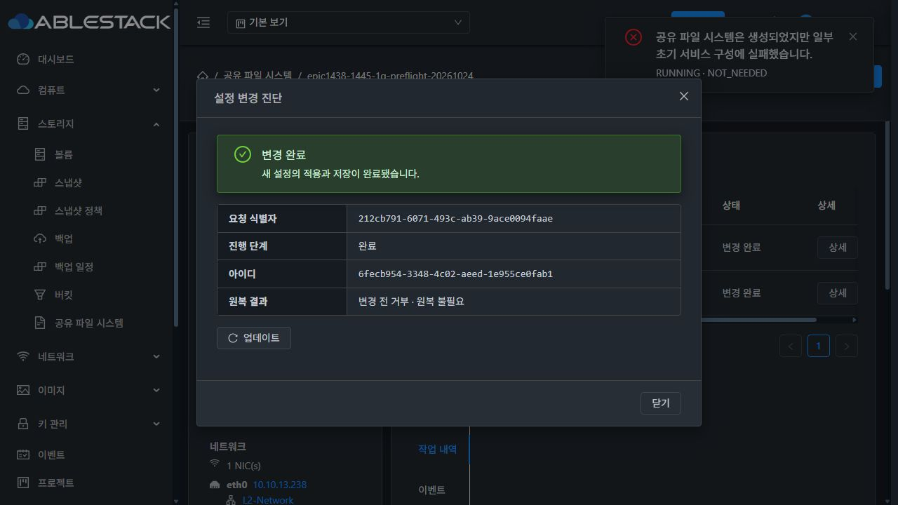
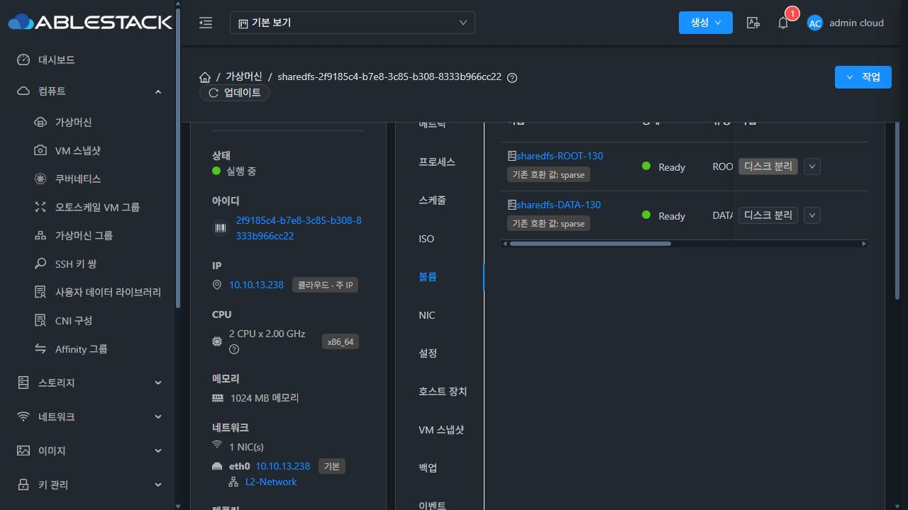

# #1445 구현·13번 배포·실환경 검증 중단 보고

**인수 미완료 / #1445 OPEN / Epic PR #1470 Draft 유지. 제품 UI 회귀를 확인해 추가 구현·재시험을 중단했다.** 아래 통과 결과는 개별 검증의 결과이며 이슈 전체 완료가 아니다.

## 구현과 배포

설계의 사전 점검 API·guest gate, scoped DAO 조회, runtime/config writer 보호, bounded output·heartbeat·soft deadline·동일 작업 관찰, 기존 모달의 영향 확인을 구현했다. 포맷·STATIC/DHCP·NVMe identity 엔진과 DB DDL/KVM agent는 바꾸지 않았다.

- canonical WSL /root/work/ablestack-cloud, epic/1438-sharedfs. 작업 시작 전 fetch 및 local/upstream Europa a7543feb62a728a5a806283b1e0e6134a7305260 비교 0/0 확인.
- Backend 회귀 13개, UI 회귀 115개, 실제 SystemVM 별도 staging 회귀 26개 통과. Maven module package와 UI production build 성공.
- 13번 실행 SharedFS VM 15대 guest 반영. 설치 시 보호 파일 hash 유지. 관리 JAR은 변경 class 14개 외 기존 항목 byte 동일.
- 관리 JAR SHA256 2f3567a3610be2af29b16e1d4c6c6f313e7ec8a21371ad76556a7ef49eb183d5, UI index 563b9ad3dede0dff204b4db81dca8ef42688fed4ca07b0d8a8c7c1d26361c81e. operator config 유지.
- SYSTEM 이미지 75525a618480929363302ed21de975c3a715b50cd80ddc4d03210bbe0eee4463: 검증 base에서 4파일만 교체, 나머지 33,921경로 및 host 계정 파일 보존. qemu-img/bzip2 검사 통과.
- 새 템플릿 9d08b23b-4b06-4f24-9588-6bccbbbafe1f를 실제 UI에서 전체 Zone / SYSTEM / KVM / QCOW2 / Debian12 x86_64로 등록해 Ready 확인. 첫 등록은 시험 입력을 단일 Zone으로 선택해 기존 정책의431 거부를 받았고, 필수값을 전체 Zone으로 바로잡아 등록했다. 이 입력 실수와 아래 제품 회귀를 구분한다.

[모듈 무결성](evidence/management-module-build.json) · [새 이미지](evidence/guest-module-build.json) · [실제 SystemVM staging 시험](evidence/native-stage-tests.json)

## 실제 UI·API에서 통과한 항목

| 항목 | 실제 결과 |
|---|---|
| 정상 사전 점검 | HTTP200 READY, revision/영향·TCP 연결·자원/expiry 표시, 영향 확인 전 적용 비활성 |
| 메모리 부족·공간 부족 | 전용 VM 관측값 주입으로 각각 HTTP200 BLOCKED·UI 적용 차단. 실제 OOM/디스크 포화는 만들지 않음 |
| UI 점검 후 자원 악화 | 요청 be2d1a6c-6ead-4b7c-b6bb-6c96c4bd2177 / 작업9fd7e897-5a49-41bd-9a25-38240f120d68. 서버 재검사 MEMORY_LOW, PREFLIGHT, rollback NOT_NEEDED. 설정 파일 동일, guest apply journal 없음 |
| 자원 회복 후 정상 변경 | NFS 작업9c34ce60-e39b-4609-865d-1f7b95f57142 COMMITTED. UI 업데이트로 완료 확인 |
| 두 UI 동시 요청·이중 클릭 | 두 화면을 READY로 만든 뒤 A 이중 클릭, B 적용. A의 POST와 guest child 각1회. B는 활성 작업 보호로 거부, 두 번째 writer 미실행 |
| 310초 child·관리 서버 재시작 | 작업4aeb652b-fbe0-4c3b-b6e9-6010456e9558 / 요청8d1eb7f5-d3cc-43b3-8c19-189d783eb7c8. 동일 ID·heartbeat 유지, 300초를 넘어 강제 kill/자동 replay 없이 종료. UI 복구 재개로 같은 작업 COMMITTED. child 실행1회 |
| QGA45초 단절 | qemu-ga 주 PID만 SIGSTOP, 독립 watchdog의 guarded SIGCONT로 복귀. 작업fde1e9b1-e711-4e22-8194-13a72ac8ef28는 HTTP200 OBSERVATION_UNAVAILABLE로 보호. 복귀 후 같은 ID COMMITTED, child 실행1회 |
| 기존 설정 복귀·VM 재시작 | NFS 읽기·쓰기를 작업1740b6a3-6af9-43f4-940d-eb13252ff6b9로 복귀. UI VM 재시작 후 원래13.250·QGA active 및 같은 작업 journal COMMITTED 확인. 새 boot ID ea6ed18a-f810-4a2e-abff-39a2b1099823 |
| 새 이미지·최소 메모리 | 새 VM2f9185c4-b7e8-3c85-b308-8333b966cc22, 2CPU/1024MiB,13.238 기동. ROOT4.88GiB·DATA20GiB 모두 UI sparse. 설치4파일 SHA가 새 이미지와 일치, 이번 boot OOM log 없음. **초기 NFS 구성은 아래 회귀로 실패** |

310/90초 지연과 자원 부족은 격리된 시험 주입이다. qga 주 프로세스만 일시 정지했으며 서비스 stop으로 guest-exec child를 죽이지 않았다. installed transaction/preflight는 pristine SHA로 복구했고 mode/delay 활성 flag가 없다. private 진단 폴더만 보존했다. THIN 생성·MAC 변경은 없다.

[UI/API 증거](evidence/ui-api-evidence.json) · [자원 주입 해제](evidence/resource-fixture-restored.json) · [310초 실행](evidence/long-after-resume.json) · [QGA 단절과 주입 해제](evidence/qga-and-execution-restored.json) · [재시작 후 무결성](evidence/trial-reboot-integrity.json) · [같은 guest journal](evidence/post-reboot-operation-states.json)

## 중단을 유발한 정확한 제품 오류

새 SharedFS233d2125-fd02-4276-a204-c57b997b40ba, instance419cecff-c03b-4216-91f1-ce53c17dd729, VM2f9185c4-b7e8-3c85-b308-8333b966cc22(13.3 / i-2-130-VM /13.238)에서 초기 NFS r1445base와 CIDR10.10.0.0/16을 요청했다.

1. 실제 UI가 createStorageNfsExport를 요청했다. 요청212cb791-6071-493c-ab39-9ace0094faae, 작업6fecb954-3348-4c02-aeed-1e955ce0fab1, async job ab1d221c-7a39-493d-8b90-cce8b9855530이다.
2. 조회 결과는 PENDING/PREPARING → RUNNING/VALIDATING → **RUNNING/COMMITTING/canresume=true, guest VERIFIED**였다. 이때 job 조회는 아직 jobstatus0이었다.
3. 이번 변경의 [storageConfigOperation.js:48](../../../ui/src/utils/storageConfigOperation.js#L48)가 canresume만 보고 관찰 함수를 즉시 반환했다.
4. 기존 [CreateSharedFS.vue:2628](../../../ui/src/views/storage/CreateSharedFS.vue#L2628)는 COMMITTED 이외를 실패로 취급해 RUNNING · NOT_NEEDED를 throw했다. 이 때문에 [2464행의 다음 ACL 생성](../../../ui/src/views/storage/CreateSharedFS.vue#L2464)까지 진행하지 않았다.
5. 이후 같은 export 작업은 **COMMITTED/COMPLETED**로 정상 확정됐다. 하지만 초기 구성 chain은 이미 종료됐고, export 이후 캡처 범위의 createStorageNfsAcl POST는0회였다. UI는 부분 실패 알림을 유지한다.

따라서 **canresume(동일 작업 재개 가능)와 원래 async handler의 완료를 같은 의미로 사용한 UI 관찰 회귀**다. 메모리 크기로 한정되는 현상이 아니다. 실제로 재현한 초기 NFS 경로 외에도 같은 observer/caller 계약을 사용하는 경로를 코드에서 점검해야 한다. 다른 프로토콜의 초기 생성 실패까지 실제 재현했다고 주장하지 않는다.

사용자가 요청한 초기화는 아직 완료되지 않았다. 내보내기 row는 deferapply=true·Allocated, 요청한 CIDR ACL이 없다. 실제 /etc/ganesha 전체 conf에서 r1445base와 요청 CIDR은 없었다. UI의 ‘기본 전체 허용’ fallback 문구를 실제 요청한 ACL이 적용됐다는 증거로 사용하지 않는다.

Backend·guest의 해당 작업은 오류 없이 확정됐고, 새 DATA는 XFS 준비를 마쳤다. UI 표시만 다른 문제로 축소할 수 없다. **후속 ACL 단계가 실행되지 않은 기능 회귀**다. 제품 코드 문제를 발견한 뒤 수정·재시도·다음 자원 시험은 하지 않았다. 이후 작업은 읽기 전용 원인/잔여 상태 조사와 기록이다.

[실제 새 SystemVM](evidence/initial-error-native.json) · [실제 runtime 확인](evidence/initial-error-runtime-scope.json)

## 개선 방향과 빠진 회귀

이번 회귀는 새 canresume early-return을 포함한 실제 초기 생성 chain의 전이 시험이 없어서 자동화115개를 통과했다. backend/guest 개별 시험과 모달 preflight 시험만으로 초기 생성까지 성공한다고 판단하면 안 된다.

아직 구현하지 않은 최소 개선안은 다음과 같다.

- jobid가 있는 원래 요청은 jobstatus0과 RUNNING/COMMITTING을 실패로 반환하지 않고 동일 operation GET 관찰을 계속한다.
- canresume는 원래 job이 종료·유실됐거나 재진입하여 명시 재개가 필요한 흐름과 구분한다. 자동 POST replay나 보호 해제는 추가하지 않는다.
- CreateSharedFS는 정상 중간 상태를 ‘초기 구성 실패’로 throw하지 않고 기존 pending context/operation ID를 유지한다. COMMITTED를 확인한 뒤에만 ACL 다음 단계로 진행한다.
- 실제 직렬화 형태를 사용한 CreateSharedFS SFC 회귀를 추가한다: jobstatus0 + RUNNING/COMMITTING/canresume=true → COMMITTED → ACL POST1회 → 전체 구성 확인. 명시 재개·QGA 유실·동일 requestid 경로도 보존한다.
- 후속 ACL 단계는 이번 실패 때문에 미실행이다. 해당 단계의 새 admission/impactack 계약도 실제 초기 구성 flow에서 확인한 후 완료를 판단한다. 전역 gate 완화나 기존 연결 보호 우회로 해결하지 않는다.

## 남은 작업·현재 환경

#1445를 닫지 않는다. 위 회귀 개선·모듈 반영 후 신규 서비스 초기 NFS/ACL UI 완료, 새 볼륨 준비 ID 재사용의 실제 UI 경로, VM 재시작 후 기존 네 프로토콜 클라이언트 재접속·데이터·권한 최종 비교가 남았다. 초기 신규 생성 실패를 발견하면서 이 후속 시험을 중단했으므로 통과로 기록하지 않는다.

기존 시험 서비스 bd9bf00f-579c-4a22-a7d7-40eed014872c의 NFS 읽기·쓰기는 복귀했고 VM은13.250에서 Running이다. 새1GiB 시험 서비스는 원인 확인을 위해 그대로 보존했다. 관리 서버·guest·UI는 현재 #1445 검증 버전을 유지하며 새 적용 작업은 하지 않는다.

표시 전용 항목(사전 거부의 목록 label, PREFLIGHT 번역 key, 완료 후 overdue 안내)은 기능 오류와 구분해 기록만 남긴다. 전면 UI 정리 #1468은 HOLD를 유지하며 이번에 구현하지 않았다.

이전 #1439~#1444의 검증은 각 보고서의 당시 SHA에 대한 결과다. 현재 #1445 head의 기존 기능 보존 인수가 통과했다는 의미로 확대하지 않는다.
