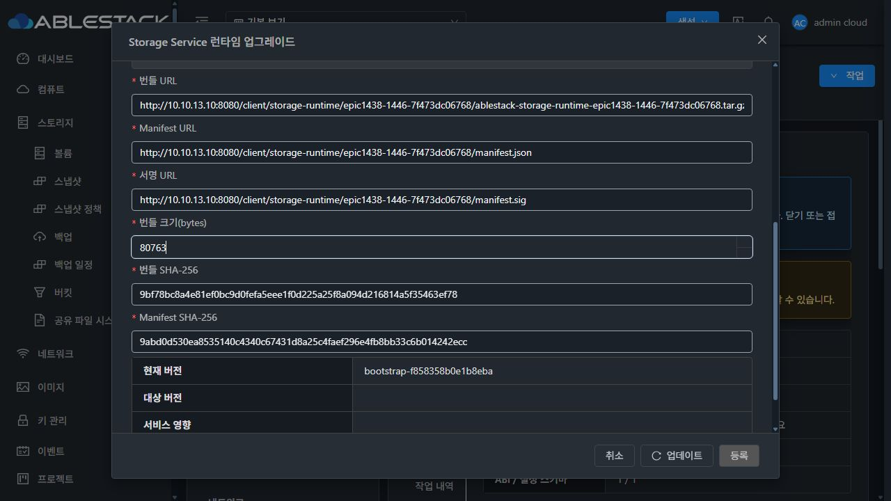
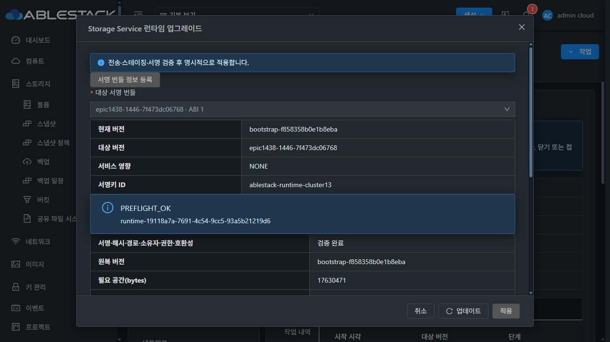
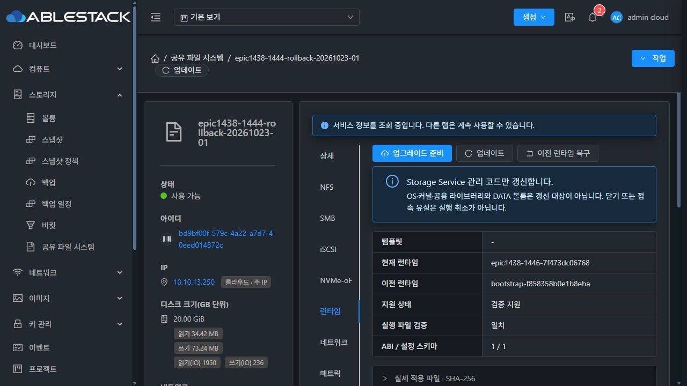
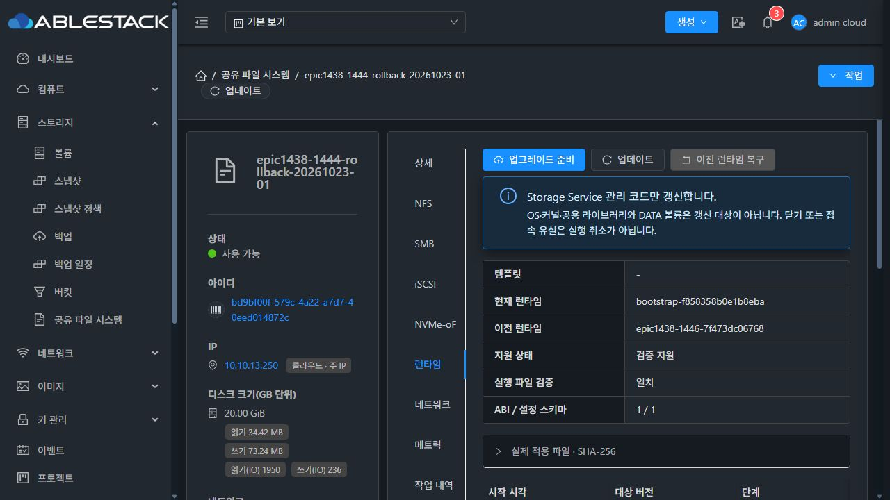
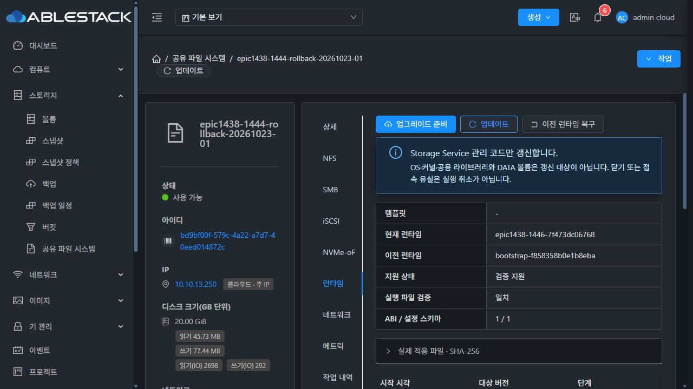
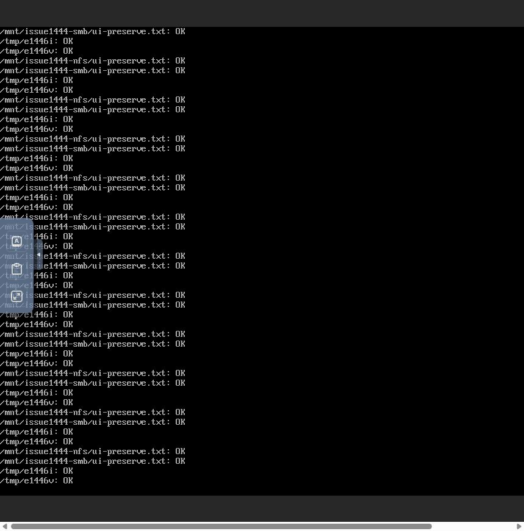
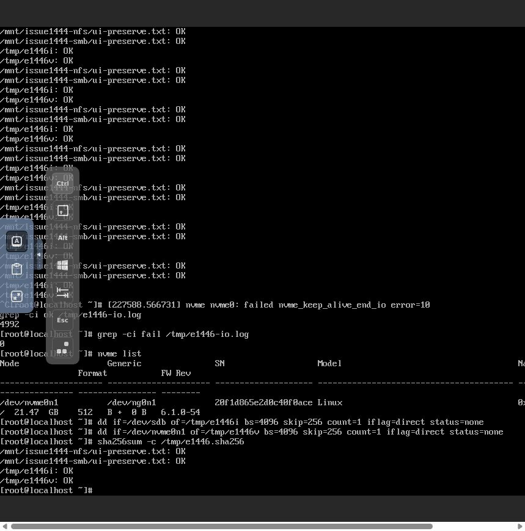
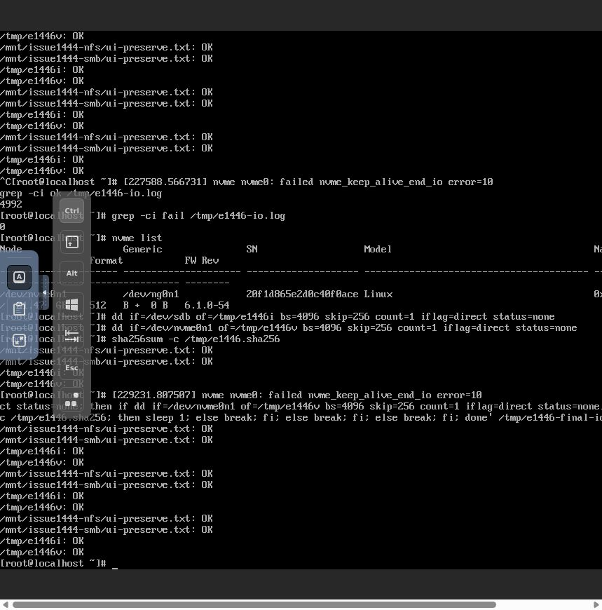
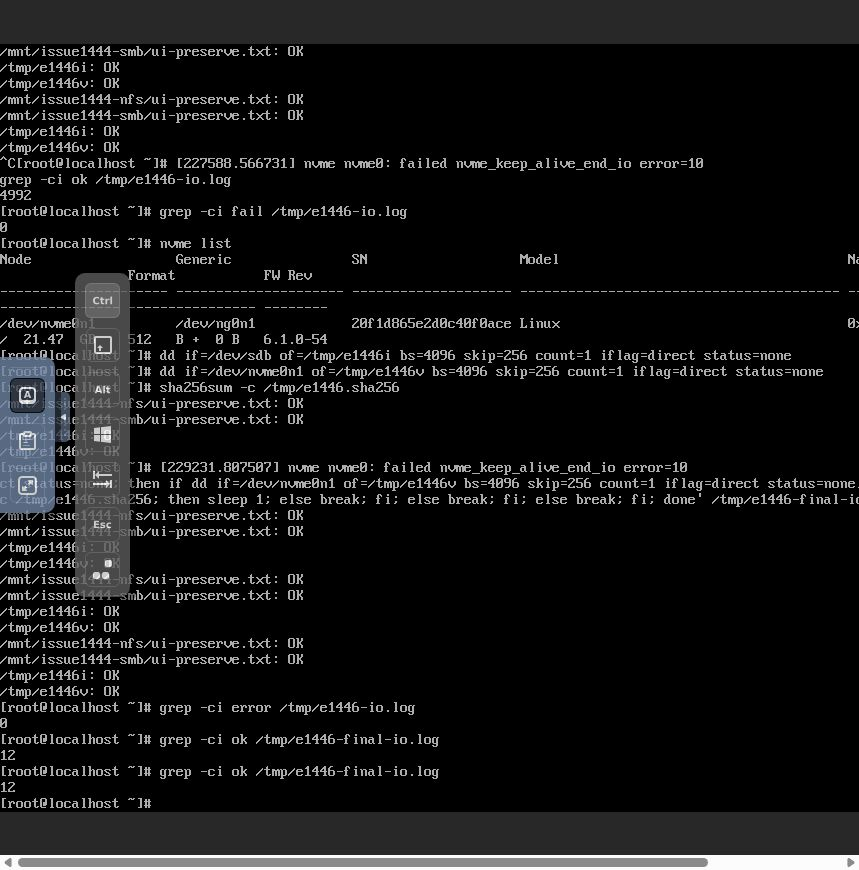

# #1446 최종 구현·13번 검증 보고 (2026-10-25)

## 결과와 범위

SystemVM을 교체하지 않는 Storage Service 런타임 업그레이드·수동 원복·재시작 지속성을 실제 Mold UI와 클라이언트 콘솔에서 통과했다. 제품 구현은 **7f473dc06768d431b7e6a797482f3458c4887b13**이다. 이후 커밋은 서명 거부 회귀와 이 검증 근거를 추가한다.

기존 register/list/preflight/upgrade/rollback API, DAO, 전송 및 링크 전환을 재사용했다. 관리 대상은 **진입점 3개와 보조 모듈 6개**다. OS·커널·공용 라이브러리·네트워크 부트스트랩·DATA 포맷을 갱신하지 않았다. 새 VM·디스크를 생성하지 않고 기존 SPARSE 시험 ROOT/DATA를 사용했다. MAC 변경·클론·DB 수동 상태 주입은 하지 않았다.

- SharedFS: bd9bf00f-579c-4a22-a7d7-40eed014872c
- instance: 3730ab80-bd6c-4e33-b2db-13b1a55ee691
- VM: 5d261ca7-7c62-34a0-bf9d-4a18c91464d0 / i-2-127-VM / ablecube13-2
- 서비스 IP: 10.10.13.250
- 클라이언트: 실제 noVNC의 epic1438-1443-client-20261022-01. 현재 세션 IP 10.10.254.195.
- 기본 템플릿: Europa-SystemVM-1443-observation-3214dfed5c93-20261023. 템플릿을 교체하지 않았다.

## 변경 내용

- 단일 payload 계약으로 builder와 verifier의 3+6 파일·크기·SHA·root 소유자·정확한 권한을 맞췄다. 각 실행은 같은 release의 helper/CLI를 사용한다.
- 활성화 직전과 확정 시 서명·해시·ABI/schema·등록 메타데이터를 다시 검사한다. ACTIVATED와 COMPLETE를 분리하고 실제 결과 확인 전에는 설정 writer 보호를 유지한다.
- 원복은 현재 작업의 target/이전 코드 무결성을 확인한다. 중복 원복·과거 작업 원복과 pointer 전환 후 중단을 구분하며, 실제 native version/origin으로 DB를 설정한다.
- 알려진 배포 기준의 실제 9개 hash를 검증해 기존 baseline을 기록했다. 오래된 bootstrap.json의 선언 hash를 실제 실행 파일의 증거로 대체하지 않았다.
- QGA 전송은 root 전용 scratch·NOFOLLOW·전체 파일 hash·원자적 발행을 사용한다. JSON 요청은 공용 /tmp 파일을 사용하지 않는다.
- 성공 후 수동 코드 원복은 현재 desired/data를 유지한다. 실패 원복은 기존 설정 before-image 엔진을 재사용한다. 서명·경로·권한·호환성 보호를 완화하지 않았다.
- 런타임을 별도 세로 탭으로 분리하고 기존 Mold 대화상자·스타일 토큰을 사용했다. 좌측 파란 주 버튼, 아이콘+업데이트, 고정 헤더/푸터와 본문 스크롤을 적용했다.
- CI는 stable signer를 요구하고 개발 호출부의 secret 전달을 연결했다. template 기본 runtime과 별도 bundle은 동일 payload/version을 사용하고 실제 checkout SHA를 기록한다. 이 보고서는 정식 GitHub Release 발행 또는 전체 저장소 CI 성공을 주장하지 않는다.

DB 구조 변경은 없다. 기존 storage_service_runtime_bundle, storage_service_runtime_upgrade 및 instance의 runtime pointer/state/verified-at 열을 사용한다. OBSERVATION_PENDING은 기존 state 문자열 열을 사용한다.

## 빌드·배포

| 대상 | 최종 결과 |
|---|---|
| 관리 서버 13.10 JAR | 775e269b5fa2dab878c9edf865a4a3523fc902bd0a796e390a6bd024dee15531 |
| 호스트 13.1/13.2/13.3 cloud-api | 804d71c1fc7d110c3bdbc8f16fc9015a74c847b323443c07d5e518864e5be21c |
| 호스트 3대 KVM plugin | e691ab39905c63f60cf5f48692c1241d9d2e83a58cbe0da0f6466032d817e349 |
| UI index | d6b87e080071768b531bd0e4cfa9077751f2e7aa001d0d978be53f129d170c94 |
| trusted updater module | 65618c2aa35db2ea8efb1cfb11dd5581ceac730c00f625074fcf9476234c3f40 |
| runtime bundle | epic1438-1446-7f473dc06768 |

Maven 관련 모듈 package/대상 회귀, UI lint/production build를 통과했다. Maven 오프라인 빌드에서 불필요한 외부 SystemVM checksum 다운로드는 download.plugin.skip으로 제외했다. 변경 class/resource만 기존 JAR에 반영하고 그 밖의 entry byte가 동일함을 검증했다. 호스트 3대 mold-agent와 관리 서버 mold를 재시작해 활성 상태를 확인했다. UI 운영자 config와 SystemVM 이미지 파일은 보존했다.

[최종 모듈 기록](evidence/module-build-final.json) · [UI 배포](evidence/ui-deployment-final.json) · [회귀 요약](evidence/test-summary.json)

## 정상 서명 경로

사용자가 서명 수단을 직접 준비해 진행하도록 지시한 뒤 **13번 전용 운영자 키**를 생성했다. 개인키는 Windows DPAPI CurrentUser와 사용자 전용 ACL로 보호된다. 평문 개인키 파일을 만들지 않고 복호화한 키를 메모리 memfd로 builder에 전달했다.

- key ID: ablestack-runtime-cluster13
- 공개키 SPKI SHA-256: 55b3263eb9c013daa291fb41832827748294c802c222a0934f8581740b947c35
- 관리 서버의 기존 설정 classpath: /etc/cloudstack/management/storage-runtime/trusted-keys/ablestack-runtime-cluster13.pem (root:root,0644)
- 신뢰 범위는 13번 관리 서버다. 이 키를 저장소의 전역 SystemVM 신뢰 목록이나 GitHub secret으로 배포하지 않았다.
- 서명 파일은 64 bytes, archive 80,763 bytes. archive SHA 9bf78bc8a4e81ef0bc9d0fefa5eee1f0d225a25f8a094d216814a5f35463ef78, manifest SHA 9abd0d530ea8535140c4340c67431d8a25c4faef296e4fb8bb33c6b014242ecc.
- 공개 산출물은 관리 서버의 기존 HTTP 정적 경로 /client/storage-runtime/epic1438-1446-7f473dc06768/ 에 두고 HTTP200과 byte/hash를 대조했다. 산출물 폴더에 개인키는 없다.

이 정상 운영자 서명 인수와 격리 fixture의 일시 서명키 시험을 구분한다. fixture 키는 라이브 trust에 추가하지 않았다.

[서명 메타데이터](evidence/signer-public-metadata.json) · [등록한 번들 메타데이터](evidence/normal-bundle-metadata.json)

## 실제 UI·API 인수

| 순서 | 실제 UI 동작 | 결과 |
|---|---|---|
| 1 | 런타임 탭 → 준비 → 기존 등록 API의 번들 정보 입력·등록 | 정상 서명 산출물 등록 |
| 2 | 다운로드·검증 | PREFLIGHT_READY / PREFLIGHT_OK. 9개 대상 hash 표시, 실행 코드는 baseline 유지 |
| 3 | 명시 확인 체크 → 적용 | COMPLETE, 현재 epic1438-1446-7f473dc06768 / 이전 bootstrap-f858358b0e1b8eba |
| 4 | 이전 런타임 복구 → 복구 | ROLLED_BACK, 기존 baseline으로 복귀 |
| 5 | 컴퓨트 > VM → 재시작 (강제 OFF) | 같은 VM의 새 boot ID c953b8e9-aef3-46db-901e-1b3653a7f8cc. 원복 버전 유지 |
| 6 | 동일 bundle 재준비 → 화면 닫기·새로고침·재진입 | 같은 runtime-4df53db0-db4e-4df0-bc95-ef86f2490668 유지, 새 준비 중복 없음 |
| 7 | 명시 확인 → 재적용 | COMPLETE |
| 8 | 컴퓨트 > VM → 재시작 (강제 OFF) | 새 boot ID 1221b5a9-63b6-42c9-a297-0a44d178c1f7. 확정된 최신 runtime 및 9개 실제 hash 유지 |

최초 boot ID는 ea6ed18a-f810-4a2e-abff-39a2b1099823이었다. 같은 VM UUID를 유지한 두 번의 실제 재부팅이다. 첫 작업 runtime-19118a7a-7691-4c54-9cc5-93a5b21219d6은 ROLLED_BACK, 둘째 작업은 COMPLETE다. API의 capability/listBundles/listUpgrades는 실제 UI에서 HTTP200으로 확인했다.

[최종 실제 API](evidence/runtime-api-final.json) · [적용 보존](evidence/activation-preservation.json) · [원복 보존](evidence/rollback-preservation.json) · [원복 재부팅](evidence/rollback-reboot-persistence.json) · [업그레이드 재부팅](evidence/upgrade-reboot-persistence.json)

## 클라이언트 I/O·접속·데이터·권한

실제 클라이언트 콘솔에서 iSCSI/NVMe는 offset1MiB의4KiB를 O_DIRECT로 읽고 NFS/SMB 원본 파일과 함께 매초 SHA를 대조했다. 온라인 적용·원복 구간 **4,992개 검사 OK, FAILED0, error0**이었다. NFS·Samba 프로세스 PID/InvocationID와 namespace UUID, owned 설정15개의 내용·권한·소유자가 유지됐다. 런타임 소유 collector만 새 코드로 재시작됐다.

재부팅 시험은 기존 TCP 연결의 무중단으로 판정하지 않았다. 재부팅 중 NVMe keep-alive의 일시 단절 메시지가 있었고, 이후 같은 namespace UUID로 자동 재접속해 실제 직접 읽기와 원본 SHA를 확인했다. 원복 버전 재부팅 후4개, 업그레이드 버전 재부팅 후3회×4개=12개 검사가 모두 OK였다.

| 프로토콜 | 실제 확인 |
|---|---|
| NFS | r1444n, 실제 UI ESTAB, 원본 SHA d4aa35f7d126e31d0e98c254513a80d8b8528b0b6544a44ec0de1af6234855ba, 서버 UID/GID65534:65534·0640 |
| SMB | r1444s, 로컬 사용자 epic1443·SMB3_00 ESTAB, 원본 SHA4db09637a676b95f7008b98c34be71219dbee588e38d7de6f174da82eb4fd350, 서버 UID/GID1001:1001·0660 |
| iSCSI | IQN r1444i·LUN0, UI의 초기자/엔드포인트 정확 매핑·ESTAB, 원본4KiB SHAd332e77b715bf506247a502afcccb683e42a44feca3386730176c88fc997ecc8 |
| NVMe-oF | NQN r1444v·namespace1, TCP ESTAB·명시적 호스트 ACL, 같은 UUID c16a7f1f-5e65-49c0-a1f7-ab1ae9902ced, 원본4KiB SHA6f8d94ea27fd3e27ba660aac444ed169ae50d0c8ff268558e9fabf397cf8877d |

기존 네 프로토콜 탭을 실제 UI로 다시 조회해 표·상태·세션을 확인했다. /etc/fstab은 부팅 reconcile에서 행/옵션 순서가 정규화됐지만 장치·UUID·mountpoint·옵션의 의미는 같았다. 이를 설정 손상으로 판정하지 않았다.

[최종 서버 측 데이터 권한](evidence/marker-permissions-final.json) · [I/O 요약](evidence/client-io-summary.json)

## 회귀와 확인 경계

- 게스트 관련 suite103건:100 PASS, configfs 환경 조건3 SKIP.
- 실제 SystemVM의 격리 updater14개 test method 통과. 정상 fixture 서명·적용/원복·확정·boot recovery·stale/중복 원복·원복 도중 중단·helper 폐쇄와 올바르게 서명된 ABI/schema/impact/path/owner/mode/누락/key/등록 메타데이터 오류9개 하위 사례를 확인했다.
- 실제 SystemVM 시험 파일로 전체 hash 불일치 시 기존 파일 보존, 정상 파일 원자 발행, symlink 및 기존 key-ID 충돌 거부를 확인했다.
- 실제 ApiResponseSerializer 결과를 사용하는 capability/operation/registration wire 및 mounted SFC 회귀를 추가했다. 관련 UI25 PASS·lint·production build 통과.
- module package와 대상 Java 회귀 통과. 전체 저장소 CI, 실제 CI Release 발행 및 네트워크 단절을 가한 라이브 자동 서비스 원복을 새로 인수했다고 확대하지 않는다. 실패 경로는 실제 설치 코드의 격리 회귀로, 운영 서비스는 정상 UI 적용·수동 원복·각각 재부팅으로 구분했다.
- 다크모드 실제 배경 rgb34,40,47 / 본문 rgb197,204,212를 확인했다. 공통 Mold 스타일과 VM의 정보 카드·세로 탭·버튼/대화상자 배치를 사용한다.
- 템플릿명 '-' 표기와 NVMe 세션의 hostNQN/정확 매핑 관측 제한은 기능 성공의 대체 결과로 쓰지 않았다. 실제 ACL·namespace UUID·직접 I/O를 대조했으며 표시 보완은 최종 UI 정리 #1468 기록 대상으로 남긴다.

## 시험 입력 교정·정리

noVNC 긴 키 입력의 특수문자/타이밍 차이로 시험 명령 일부가 잘못 전달됐다. 한 번의 dd 읽기 범위가 확대돼 **클라이언트 /tmp에만20GiB 읽기 복사본**이 생성됐다. 원본 LUN에 쓰지 않았으며 해당 임시 복사본 삭제와 /tmp 정리를 확인했다. 이후 짧은 입력·실행 전 확인·가상 modifier·표준 입력으로 시험 코드를 교정했다. 이 입력 실패를 제품 성공/실패로 계산하지 않았다.

SystemVM의 시험 소스·임시 before-image를 담은 전용 fixture 디렉터리5개를 정리했다. 제품 transaction journal과 재현 가능한 작은 클라이언트 검사 로그는 보존했다. 일반화·MAC 변경·OS 계정 파일 복구·다른 이슈의 자원 변경은 수행하지 않았다.
