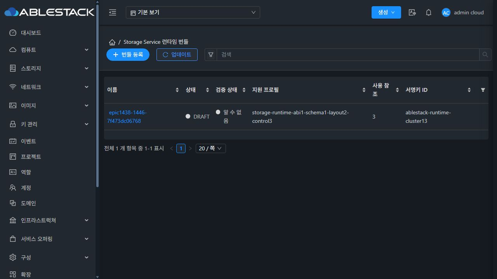
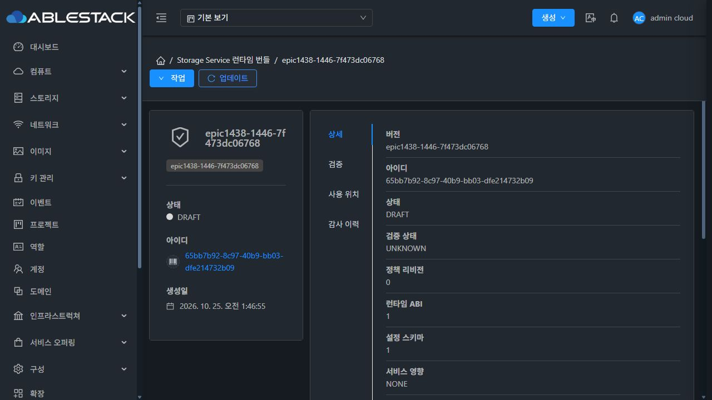
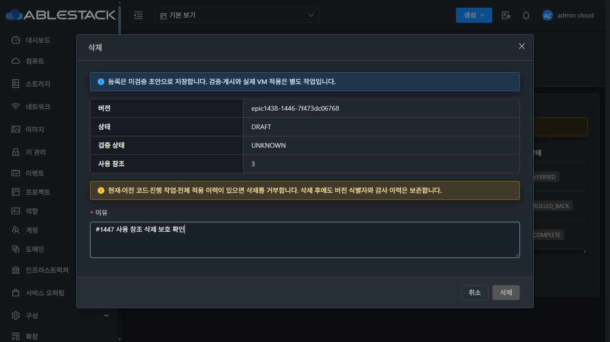
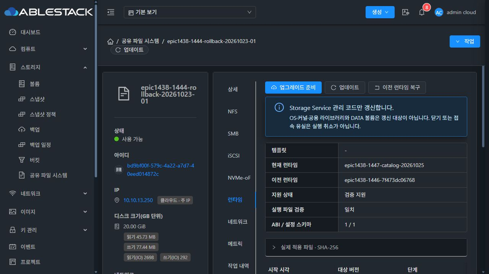
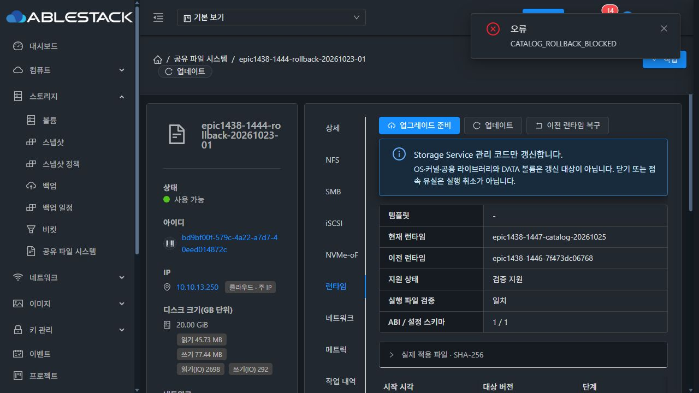
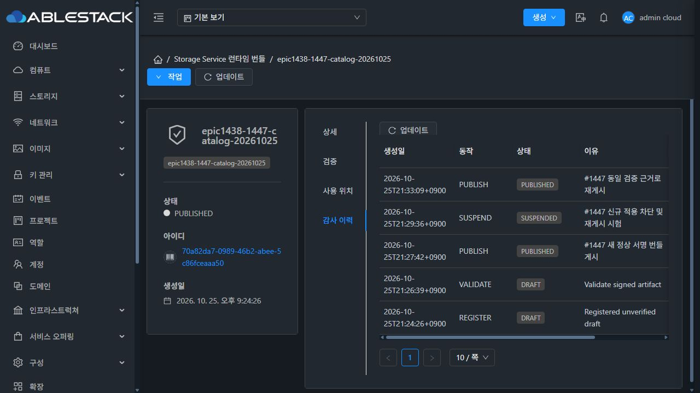
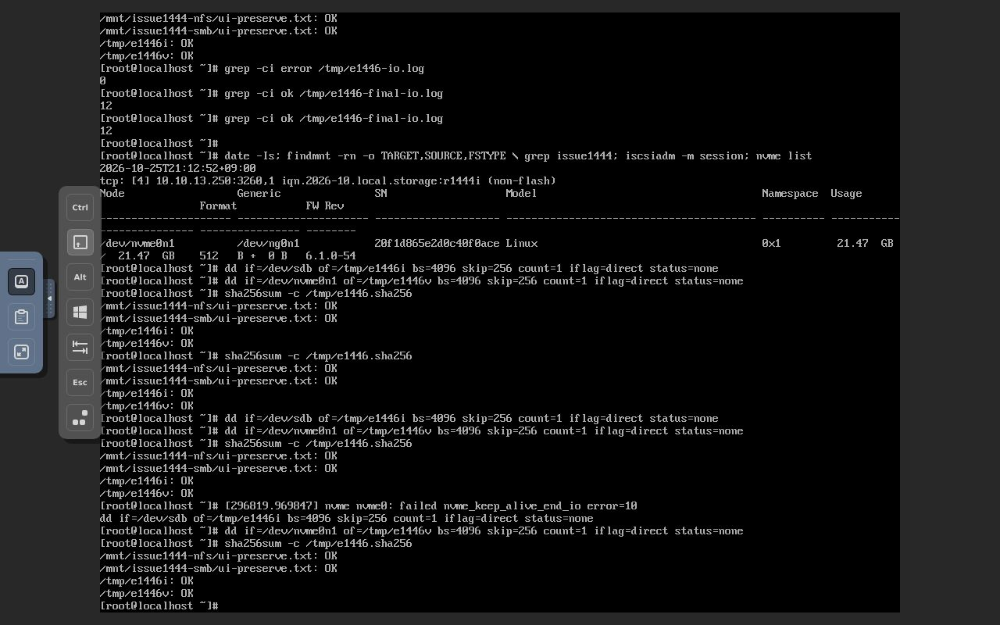
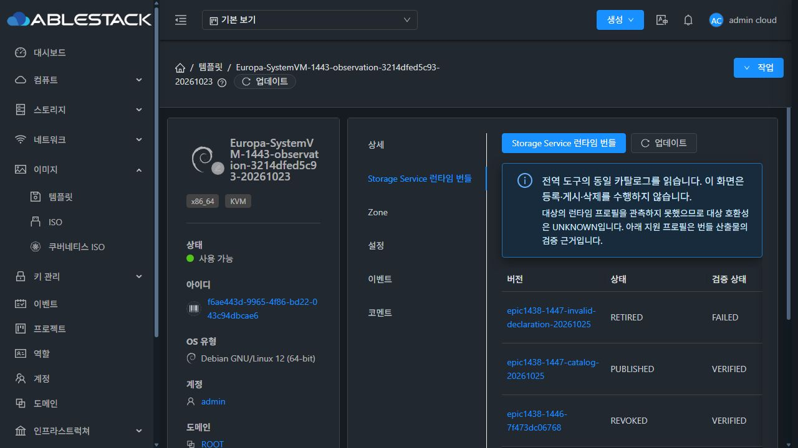
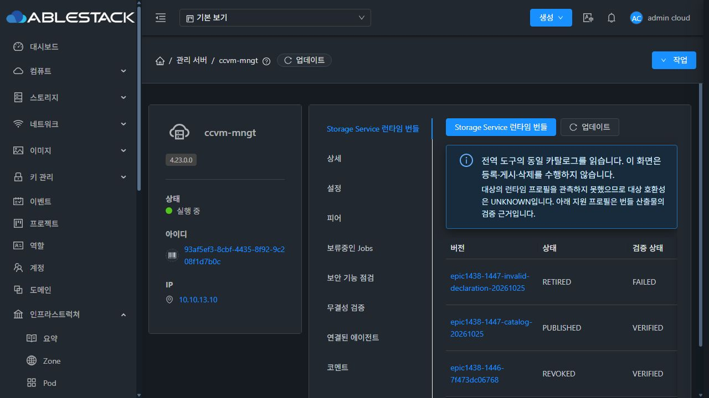
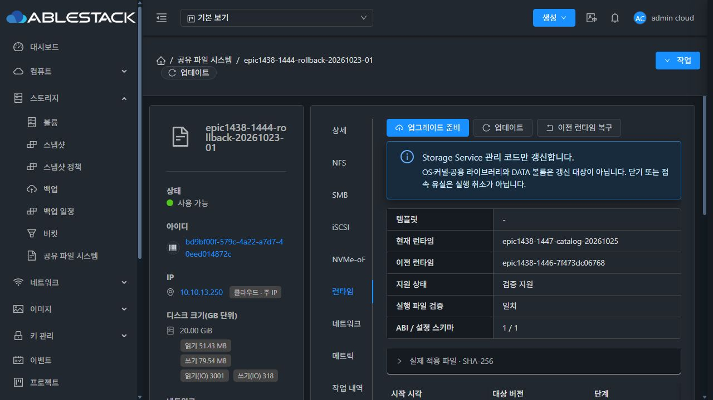

# #1447 전역 런타임 카탈로그 구현·인수 결과

구현 commit: 3ef819f59f9. Epic #1438의 기존 통합 Draft PR #1470에 반영한다. 새 기능/목업 PR은 만들지 않는다.

## 문제와 구현

기존 등록은 문법 확인 뒤 AVAILABLE로 저장해 전역 검증·게시·중지·철회와 사용 이력 관리가 없었다. 기존 #1446 전송·활성화·원복 엔진은 재사용하고 다음만 보완했다.

- Root Admin의 도구 > Storage Service 런타임 번들. 공통 AutogenView/ResourceView/InfoCard·세로 탭·MoldDialog/Actions, 한국어/영어와 라이트/다크.
- DRAFT/PUBLISHED/SUSPENDED/RETIRED/REVOKING/REVOKED/DELETED와 별도 검증 결과, CAS revision·requestid·동일 identity 재등록·감사/사용 관계·삭제 보호.
- 기존 공개키·native 파일 계약을 사용하는 비특권 비추출 worker. 등록된 해시/크기·Ed25519·경로/소유자/모드·3+6 폐쇄·ABI/schema/profile을 확인한다.
- 같은 카탈로그를 SharedFS 및 Template/ManagementServer가 소비한다. 관측이 없는 대상은 UNKNOWN이며 이미지 이름으로 호환/사용을 추정하지 않는다.
- native updater3의 영구 정책 파일과 목적지 검사. 일반 중지는 확인된 이전 코드 원복을 허용하고, 보안 철회는 적용/해당 코드로의 원복을 거부한다. 이미 실행 중인 코드를 일괄 교체하지 않고 정상 코드로 벗어나는 경로는 유지한다.
- 중복 jobid는 BaseResponse.setJobId()를 사용한다. 실제 직렬화와 실제 AutogenView 목록/상세 렌더·재조회 회귀를 추가했다. 주 액션 다음의 아이콘+업데이트를 복구하고 탭 도구 모음의 랩 보정 음수 마진을 스코프 스타일로 제한했다.

NFS/SMB/iSCSI/NVMe-oF의 프로토콜 엔진, DATA 포맷/권한 변경, STATIC/DHCP·MAC 정책·AD 기능은 수정하지 않았다.

## 빌드와 회귀

| 항목 | 결과 |
|---|---|
| API/schema/server 및 KVM 관련 모듈 | 빌드 통과 |
| 서버 | 15개 통과. 실제 ApiResponseSerializer의 단건/세 목록·상위 job 필드 및 API export 포함 |
| UI | 20개 통과. 실제 AutogenView 5 + 카탈로그 6 + 기존 SharedFS 런타임 9 |
| native | 기존 기능과 새 정책 보호 16개 통과 |
| 실제 SystemVM 사전 주입 | 독립 runtime/state/trust/entrypoints/lock에서 미게시 적용·철회 목적지 원복/부팅 복구·정책 reload·낮은 revision 거부 |
| 실제 관리 서버 worker | nobody(uid65534)에서 정상 서명9파일 비추출 검사·변조 서명 거부. 실제 API 실행 worker는 서비스 계정 uid985 |
| 실제 DAO | 연결별 TEMPORARY TABLE에서 검증 JSON300,012byte·감사 사유1,024자 저장/재조회 및 unique 요청 제약. 서비스 행 미변경 |
| UI lint/production build | 통과. 최종 간격 보정도 production build·13번 렌더 실측 |

운영 전체 CI나 저장소 전체 회귀가 통과했다고 확대 해석하지 않는다.

## 배포와 스키마

- 관리 서버10.10.13.10: 기존 실제 JAR에서 관련34항목만 교체, 그 밖의 항목 byte 동일. SHA256 8242b2273ff4a20273acebd30e34781db04453bb16c1a01fe7a90bedddb4166e.
- 호스트13.1/13.2/13.3: API enum 클래스1항목만 교체. cloud-api JAR SHA256 724c42ca6fe82051879172e8df80585f10b04689e30f3bd9abcdfe321aa2f259.
- UI: config.json·SystemVM·WEB-INF·외부 번들 디렉터리 보존. 최종 index SHA256 **8c072378498c56d48f5cac22c7d6368a3da7878864cfc4887fe19473c02f9f76**. 간격 보정 뒤 실제 toolbar와 alert의 간격은16px이며 겹침이 없다.
- 새 storage_service_runtime_bundle_validation/event 테이블. bundle.state_revision/validation_status/current_validation_id, upgrade.catalog_policy_json 열4개 추가. 새 설치·Europa/Diplo SQL에 재실행 가능한 migration을 포함한다.
- 기존 AVAILABLE1행은 DRAFT/UNKNOWN으로 이행했다. 현재/이전 런타임 pointer와 두 과거 적용 이력은 보존하고 Root Admin이 실제 UI에서 재검증·게시했다.

관리 서버/호스트의 기존 모듈 백업을 보존했다. 시험 스크립트·TEMPORARY TABLE·주입 임시 경로는 정리했다. 개인키/암호/API 비밀은 저장소·이슈·로그에 기록하지 않았다. 기존 Windows DPAPI CurrentUser 보호 서명 수단을 재사용했으며 개인키 평문 파일을 만들지 않았다.

## 실제 UI/API 인수

모든 등록·설정·적용·원복·VM 재시작은 Mold UI에서 실행했다. API 증거는 그 UI 요청/결과를 관찰한 것이다. SSH/QGA는 모듈/스키마 배포·기술 진단·격리 사전 시험에 사용했다.

1. 기존 번들65bb7b92-8c97-40b9-bb03-dfe214732b09를 UI에서 검증→게시. VERIFIED/COMPATIBLE receipt와 원래 jobid 정상 반환.
2. 새 정상 번들70a82da7-0989-46b2-abee-5c86fceaaa50: 등록은 DRAFT/UNVERIFIED → 검증 → 게시 → 일시 중지 → 동일 receipt로 재게시. 중지 상태는 실제 SharedFS 선택과 purpose=apply API에서 제외.
3. 같은 버전·두 해시 재등록은 같은 UUID·PUBLISHED/VERIFIED/revision 유지, 행 수 불변. 다른 해시는 RUNTIME_VERSION_CONFLICT로 거부.
4. 같은 SharedFS에서 새 정상 번들을 실제 준비·동의·적용하여 PREFLIGHT_READY→COMPLETE. 이전 번들을 SUSPENDED로 바꿔도 확인된 원복은 ROLLED_BACK 성공.
5. 현재 사용 중인 기존 번들을 REVOKED로 전환해 native 차단 정책을 확인. 철회된 현재 코드에서 정상 게시 코드로의 전환은 성공. 철회된 버전으로의 원복은 CATALOG_ROLLBACK_BLOCKED, 현재 정상 코드와 데이터 유지.
6. 참조3개인 번들은 사유를 입력해도 UI 삭제 제출 비활성. 서버 회귀는 전체 과거 적용 이력의 삭제 보호·tombstone identity 보존을 확인. 불필요한 영구 삭제는 하지 않았다.
7. 잘못된 버전 선언 e42254f8-e723-4d73-a2a9-59aa547d6fb8는 REGISTERED_METADATA_MISMATCH/FAILED/UNKNOWN, 게시 메뉴 미제공. 시험 완료 후 RETIRED로 전환.
8. 실제 VM 재시작 뒤 부팅 ID a13b90c2-997c-45cb-a3e4-33d3844ee750으로 변경. 현재 정상 코드와 native REVOKED/PUBLISHED 정책, 파일9개 해시/검증 상태 보존.
9. 관리 서버 재시작(MainPID3741791→3787624) 뒤 재로그인해 세 번들의 상태·사용 관계·검증 receipt 및 새 정상 번들의 감사5건 보존.
10. NFS/SMB 시험 파일을 실제 클라이언트 콘솔에서 읽고, iSCSI/NVMe-oF는 offset1MiB의4KiB를 direct I/O로 다시 읽은 뒤 네 hash 검사를 통과. NFS65534:65534/0640, SMB1001:1001/0660과 원래 데이터 SHA를 보존.
11. VM 표준 레이아웃·세로 탭·정보 전용 상세·고정 대화상자 header/footer·주 액션 좌측·아이콘+업데이트·다크/라이트·ko/en을 실제 화면에서 대조. Template/ManagementServer는 같은3행을 표시하고 미관측 대상 UNKNOWN 안내를 유지.

실환경은 SharedFS bd9bf00f-579c-4a22-a7d7-40eed014872c / instance3730ab80-bd6c-4e33-b2db-13b1a55ee691 / VM5d261ca7-7c62-34a0-bf9d-4a18c91464d0 / host13.2 / IP10.10.13.250이다. 새 VM/ROOT/DATA·THIN은 생성하지 않았고 기존 부착 디스크의 SPARSE 조건을 UI로 확인했다. MAC은 변경하지 않았다.

## 최종 상태와 제한

정상 실행 코드는 epic1438-1447-catalog-20261025(PUBLISHED/VERIFIED), 이전 코드는 보안 철회 시험에 따라 REVOKED다. 잘못된 선언 초안은 RETIRED/FAILED이며 서비스 적용 이력이 없다. 거부된 부정 시험은 제품 장애로 계산하지 않는다.

VM 재시작 동안 TCP 세션의 무중단을 보장하지 않는다. 재접속 뒤 실제 I/O·데이터 보존을 확인했다. 언어 전환 직후 공통 목록의 일부 기존 열 제목이 새로 로드하기 전까지 남는 표시 차이는 #1468의 최종 UI 정리 메모로 분류한다. 이번에 #1468 작업을 시작하거나 이슈 범위를 넓히지 않았다.

offline 대상 철회는 native 확인 전 REVOKING, 미관측/중단 검증은 UNKNOWN이다. 이 실환경 인수는 online 대상이며 offline 미확정 모델과 동시성은 회귀/격리 시험 범위를 구분한다. 코드·보호를 약화하거나 미관측을 성공 처리하지 않았다.

## 증거

- [회귀/실환경 요약](evidence/test-summary.json) · [UI 요청에서 관찰한 API](evidence/catalog-api-sequence-final.json) · [모듈 무결성](evidence/module-build-catalog.json)
- [실제 SystemVM 사전 주입](evidence/implemented-native-probe.json) · [비특권 관리 worker](evidence/implemented-management-probe.json) · [재부팅 후 정책·데이터/권한](evidence/post-vm-reboot-proof.json)
- [마지막 UI 배포](evidence/ui-spacing-deployment.json) · [실제16px 간격](evidence/spacing-final.json) · [SPARSE 목록](evidence/sparse-volumes-final.txt)

