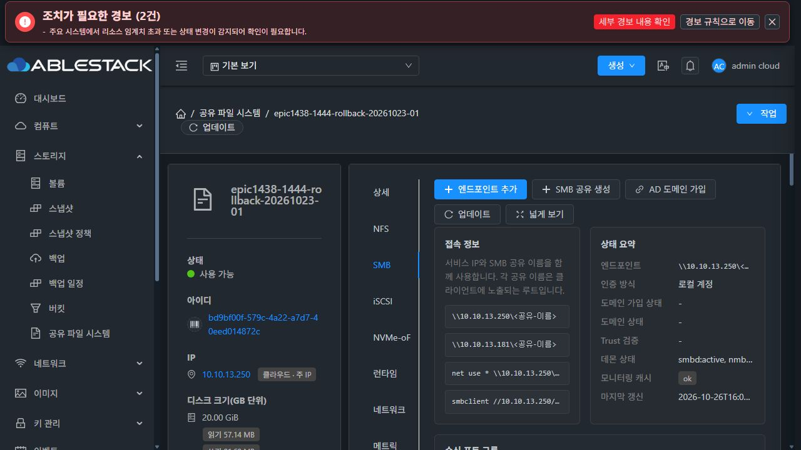
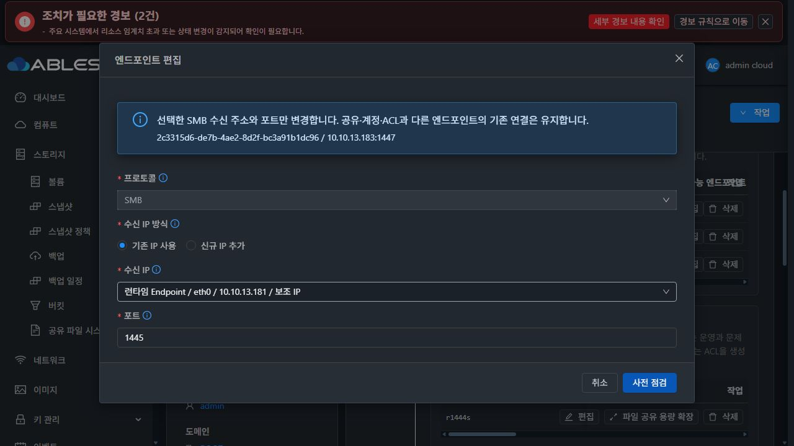
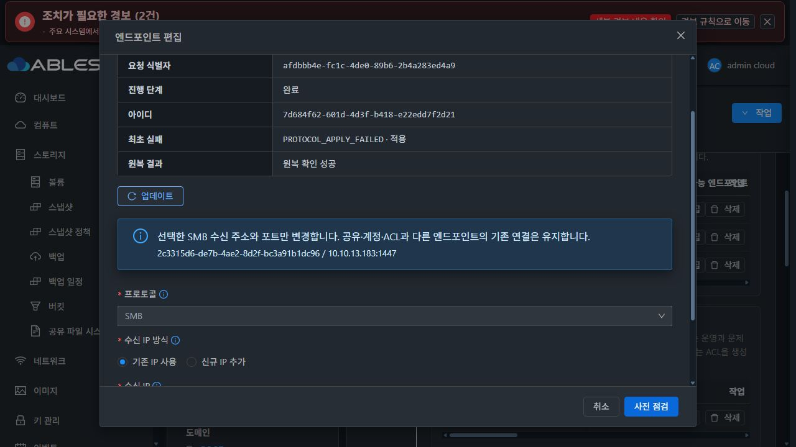
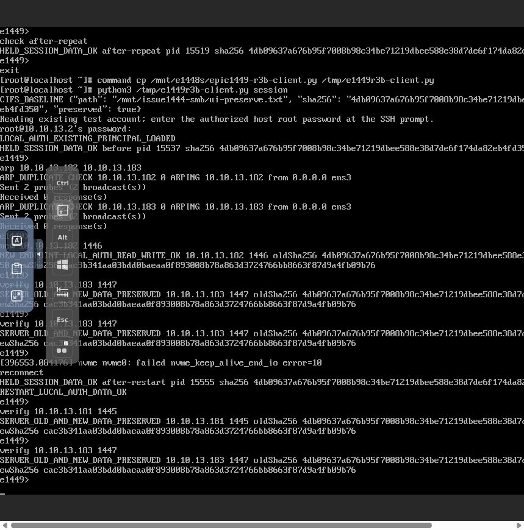
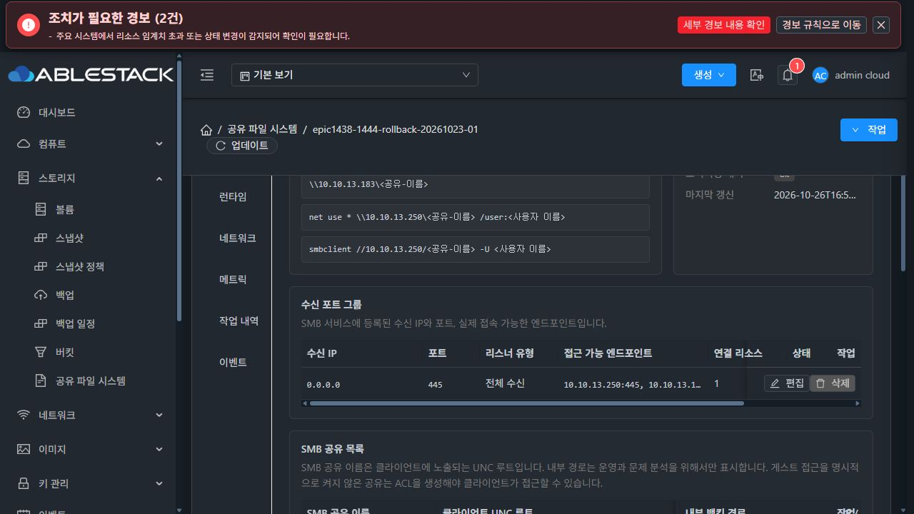
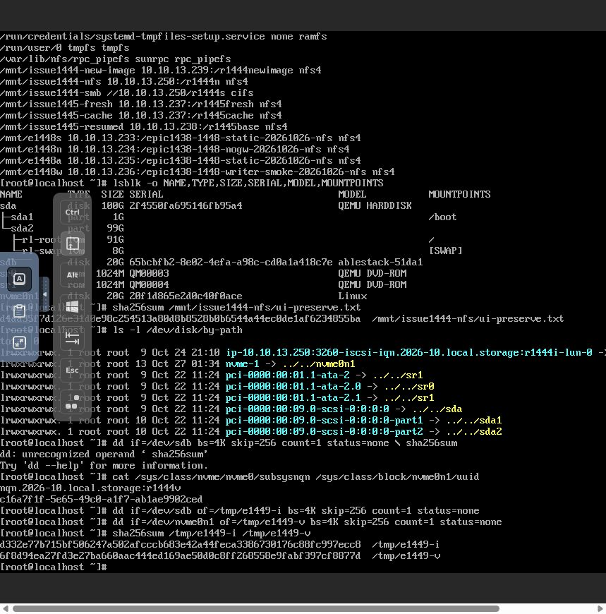
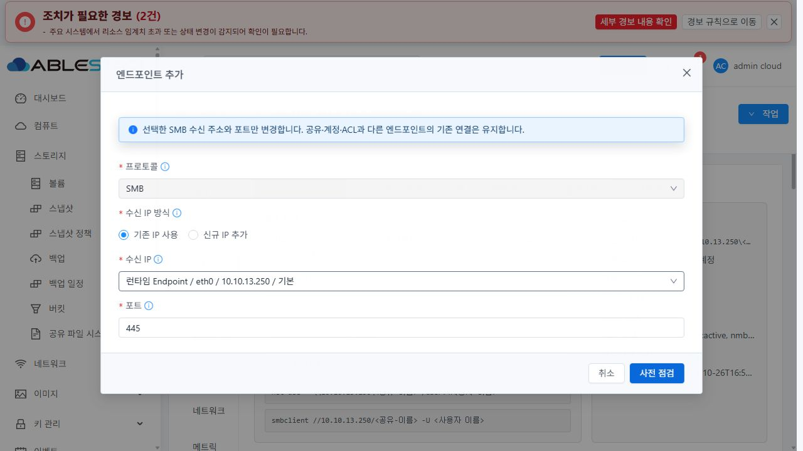
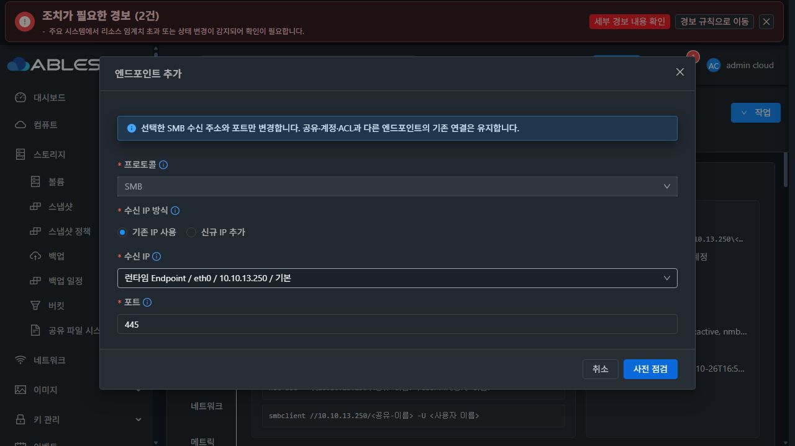

# #1449 SMB 다중 엔드포인트 최종 인수 (2026-10-27)

**PASS. 구현·모듈 빌드·13번 배포·API/실제 UI·클라이언트 검증을 완료했다. Epic #1438 전체의 완료나 PR 병합을 의미하지 않는다.**

## 수정 내용과 최신 결함

SMB를 반복 활성화할 때 기존 listener를 덮어쓰지 않고 endpoint UUID와 IP/port tuple로 추가·편집·삭제한다. 동일 tuple은 기존 UUID를 재사용한다. 후보 listener를 준비·검증한 뒤 확정하고, 실패하면 원래 listener·공유·계정·다른 세션을 보존한다. 삭제는 해당 listener만 정리하며 마지막 공유 접근 경로와 다른 프로토콜의 IP 소비자를 보호한다. 기존 transaction/revision/preflight/진단과 공통 UI를 재사용했다.

이번 마지막 결함은 **생성은 성공했으나 목록에서 covered SMB endpoint UUID가 사라지는 문제**였다. 실제 listStorageServiceProtocols()가 여러 프로토콜에 공통인 canonicalizeProtocolListeners()를 호출하면서 wildcard에 포함된 SMB 행을 합쳤다. DB의 두 UUID가 API/UI의 한 행으로 줄어 새 자원을 편집·삭제할 수 없었다. 배포 JAR의 실제 메서드로 입력2행→출력1행을 재현했다.

최소 수정은 SMB만 개별 자원으로 유지하는 조건과 주석이다. NFS/iSCSI/NVMe-oF의 기존 목록 정규화는 유지했다. UI에서 숨은 행을 임의 합성하지 않는다. 실제 서비스 메서드→DAO mock→DTO→ApiResponseSerializer와 그 응답을 사용하는 mounted SharedFSTab 회귀를 추가했다.

구현 중 앞선 제품 결함도 별도 시점의 중단·원인 분석 뒤 수정했다.

- systemd의 session leader에서 smbd -F가 다시 setsid해 EPERM으로 종료: --no-process-group을 추가하고 PID/PGID/CGroup/exe/config/socket의 소유 검증은 유지했다.
- active signed runtime이 canonical 경로의 이전 transaction helper를 잘못 사용: 기존 ABLESTACK_STORAGE_HELPER_ROOT 계약을 네 호출 지점에 적용했다.
- 최초 legacy→managed 이행 실패 전에는 manifest가 생성되지 않을 수 있음: 실제 before-image·unit/PID·config/socket 불변을 엄격히 검증해 원복 완료를 인정한다. 기존 managed manifest 유실에는 이 fallback을 적용하지 않는다.

기존 실패 작업 3a166e57-b1e6-47a6-bd4a-2d85313ef1c4는 SystemVM 콘솔과 Mold의 같은 작업 ‘복구 재개’로 ROLLED_BACK/SUCCEEDED를 확인했다. DB 강제 잠금 해제·실패 이력 삭제로 우회하지 않았다. 과거 실패 댓글은 이력으로 보존하고 이 결과와 구분한다.

## 코드·빌드·배포

| 구분 | 결과 |
|---|---|
| 구현 commit | 9a76774dd133a193e4bf0003712605597aae509f, 086d5603ba12718725f094c674a98d9a9a41e920 |
| 최신 목록 수정 | 631b46ac78131155a779deab1a6e5445204d8109 |
| 런타임 기준 갱신 | 59fb1a6c1f9779ce920ad5e672ae93200de8e12e, 2e24f2514d96a8a3b3d6ad90dbc172c0611abbc6 |
| Server 회귀·package | 30 tests, 실패0/오류0/skip0, 관련26 Maven 모듈 BUILD SUCCESS |
| UI 회귀 | 실제 API 서비스 직렬화 fixture 포함8 tests PASS, lint 오류0 |
| guest 회귀 | SMB profile/launch/legacy13 PASS, 기존 transaction11 PASS |
| 실제 SystemVM 사전 실증 | systemd·로컬 인증·동일 요청·bind 실패 원복·UUID 편집·서로 다른 profile의 SMB2/3 lock·개별 삭제·주소 소비자 보호·boot 재구성 PASS |
| 실제 실행 진입점 | signed release의 CLI→transaction→child 경로, health/inventory READY, 의도한 duplicate ROLLED_BACK/SUCCEEDED, 원래 config/PID 불변 |
| UI production module | 기존 기능 구현 시 빌드·13번 배포 완료. 최신 목록 후속 수정은 server만 배포하며 UI 제품 코드 변경 없음 |
| DB/host agent | 새 migration·agent 배포 없음 |

최신 관리 서버 배포는 현재 실행 JAR에 변경된 StorageServiceManagerImpl 관련 class2개만 반영했다. 그 외 JAR entry는 바이트가 같다. mold 재시작 후 API/UI 검증을 수행했고, SystemVM을 배포 과정에서 일괄 재시작하지 않았다. 원본 JAR와 배포 receipt는 관리 서버의 /var/tmp/epic1449-smb-r3-20261027에 보존했다.

| 배포 산출물 | 버전 또는 SHA-256 |
|---|---|
| 관리 서버 JAR | dd155223894579a2eb6e8c6a1f315a8faf4b4c9987715b0f261a9c4ef6f1be36 |
| UI index | bc9f9c6f94bf5d0efe2f4ff5ace4c298ab1cc355a90fadd60f7246e0b0189705 |
| 실제 적용 signed guest runtime | epic1438-1449-smb-r2-2e24f2514d96 |
| guest bundle archive | 92284a03cf28304a02121351b4b14603e174d844ebe95c8598002d5108c0864e |
| active transaction helper | 6f7efc80740dc7e311d7c5ef3f96fb9ebe3d1a27bfcbad8dabfdbd444bd0603a |

[최신 모듈 무결성](module-build.json) · [13번 배포 receipt](deployment.json) · [서버 회귀](server-tests.log) · [UI 회귀](ui-tests.log) · [guest 회귀](guest-tests.log) · [실제 SystemVM 실행 진입점](native-entrypoint.json) · [실제 native controller](native-controller.json)

Maven 기존 공통 checkstyle의 #1447 wildcard-import12건은 별도 기준선 제한이다. 관련 모듈은 -Dcheckstyle.skip=true -Drat.skip=true로 시험·패키징했다. UI lint는 통과했다. 저장소 전체 CI 통과를 주장하지 않는다.

## 실제 UI→API→클라이언트 인수

모든 endpoint 추가·편집·삭제·중복 사전 검사·의도한 실패·복구·VM 재시작은 실제 Mold UI에서 수행했다. API는 UI가 보낸 요청/응답의 대조용이며 숨은 API로 UI 단계를 대체하지 않았다. 실제 클라이언트 명령은 Mold의 NoVNC 콘솔에서 실행했다. SSH/QGA는 배포와 범위가 제한된 진단·시험 코드 전달에 사용했다.

대상 SharedFS bd9bf00f-579c-4a22-a7d7-40eed014872c / instance 3730ab80-bd6c-4e33-b2db-13b1a55ee691 / VM 5d261ca7-7c62-34a0-bf9d-4a18c91464d0, 주 IP10.10.13.250. 기존 ROOT/DATA는 SPARSE이며 SMB DATA는 XFS20GiB, UUID6b2a9fb6-fcbe-4f4d-aff8-4c531603a3ae다. 새 디스크·포맷0, MAC02:0d:00:cc:00:52 변경0이다. 시험 IP .182/.183은 클라이언트 ARP DAD에서 각각0응답을 확인한 뒤 사용했다.

| 실제 UI 단계 | API/native/클라이언트 결과 |
|---|---|
| wildcard 기본 endpoint에 .181:445 추가 | UUID00e0674a-0f49-497f-a67c-858c6ef25d7b를 별도 COVERED 행으로 유지. coveredBy 연결과 편집/삭제 표시 확인 |
| .181:445→.181:1445 편집 | 같은 UUID, COMMITTED. 새 포트의 로컬 인증·읽기/쓰기와 기존 연결 읽기 유지 |
| 같은 .181:1445 추가 요청 반복 | 기존 UUID 재사용, SMB2행 유지, runtime 중복 listener 없음 |
| .182:1446 추가 | UUID2c3315d6-de7b-4ae2-8d2f-bc3a91b1dc96, 새 로컬 인증·읽기/쓰기 성공 |
| .182:1446→.183:1447 편집 | 같은 UUID 유지, 새 주소·포트에서 기존/추가 파일 해시 일치 |
| 다른 UUID의 .181:1445로 편집 시도 | 사전 점검 BLOCKED/SMB_ENDPOINT_TUPLE_IN_USE, 적용 버튼 비활성화, 취소 |
| 사용 중 SSH 포트 .183:22로 편집 | 의도한 음성 시험. SMB_ENDPOINT_IN_USE, ROLLED_BACK/SUCCEEDED. 원래 .183:1447와 다른 정상 연결·파일 보존 |
| VM UI 재시작 | 새 boot ID, 같은 주 IP/MAC·세 endpoint UUID/port READY. 클라이언트 재접속 및 두 전용 포트의 기존/추가 데이터 일치 |
| .183:1447 삭제 | 해당 UUID/socket/unit만 제거. .181:1445 및 기본 공유 접속 유지 |
| .181:1445 삭제 | 해당 UUID/socket/unit만 제거. 원래 wildcard endpoint 하나 READY, 기본 .250:445 로컬 인증·데이터 유지 |
| 마지막 wildcard 삭제 보호 | 공유1개가 사용하는 마지막 경로의 삭제 버튼 비활성화. API 우회 삭제 없음 |

업데이트 버튼으로 작업 종료와 자원 목록을 갱신했다. 동일 apply의 재시도로 결과를 만든 것이 아니다. 작업들은 COMMITTED 또는 의도한 ROLLED_BACK/SUCCEEDED로 종료했고 revision은7→13이다. [실제 UI 네트워크 대조 기록](api-evidence.json) · [의도한 충돌 원복](controlled-conflict.json)

| 단계 | 작업 UUID |
|---|---|
| .181 포트 편집 | ba0dd8ba-1095-447d-9eef-8caaffc24bd7 |
| 같은 tuple 반복 | cbd271ce-8d67-40c2-8f21-608facfe48c2 |
| .182 추가 | f66e1552-7261-4ed2-85a4-8747ef1c3866 |
| .183으로 편집 | be2bb38b-2c2b-4df1-92b6-a460622b50ae |
| 충돌 포트 원복 | 7d684f62-601d-4d3f-b418-e22edd7f2d21 |
| 전용 endpoint 삭제1 | bbdc8d9f-15b6-44e9-ac16-f5bbef55810f |
| 전용 endpoint 삭제2 | ee1b2b2d-4044-45f5-9bb4-68f8733bf8c6 |

## 세션·데이터·다른 프로토콜 보존

온라인 endpoint 편집·멱등 반복·다른 endpoint 실패/삭제 중 기존 SMB 연결에서 원본 읽기를 유지했다. VM 재시작은 TCP 세션을 끊는 작업이므로 동일 TCP 세션 존속을 주장하지 않는다. 재시작 후 기존 CIFS의 재접속과 별도의 실제 로컬 인증 재접속, 원본/추가 데이터 보존을 확인했다. 원래 CIFS 세션과 새 smbclient 세션을 구분해 관찰했다.

boot ID f958c88e-2da3-43d5-bb21-ecd999470489→b06efb49-23d6-4097-a7d5-0bfe3d53424b. SMB 원본과 추가 파일은 모두 UID/GID1001:1001, mode0660을 유지했다.

| 데이터 | SHA-256 |
|---|---|
| SMB 원본 ui-preserve.txt, 24bytes | 4db09637a676b95f7008b98c34be71219dbee588e38d7de6f174da82eb4fd350 |
| SMB 추가 epic1449-ui-data.bin, 4124bytes | cac3b341aa03bdd0baeaa0f893008b78a863d3724766bb8663f87d9a4fb09b76 |
| 기존 NFS ui-preserve.txt | d4aa35f7d126e31d0e98c254513a80d8b8528b0b6544a44ec0de1af6234855ba |
| 기존 iSCSI 1MiB 위치4KiB | d332e77b715bf506247a502afcccb683e42a44feca3386730176c88fc997ecc8 |
| 기존 NVMe 1MiB 위치4KiB | 6f8d94ea27fd3e27ba660aac444ed169ae50d0c8ff268558e9fabf397cf8877d |

같은 .250에서 NFS2049·iSCSI3260·NVMe4420의 설정 ID/IP/port/연결 수는 SMB 작업 전후 API에서 같다. 실제 listening socket, LIO target/ACL/LUN과 NVMe namespace를 읽기 전용 확인했다. 최종 클라이언트 UI 콘솔에서 기존 NFS 마운트 파일과 iSCSI/NVMe 장치 표본을 다시 읽어 위 해시와 일치했다. iSCSI IQN/경로와 NVMe NQN/UUID c16a7f1f-5e65-49c0-a1f7-ab1ae9902ced를 확인한 뒤 읽었다. 다른 프로토콜의 전체 생성/삭제/쓰기/복원 시험을 새로 수행했다는 뜻은 아니다.

[재시작 무결성](restart-preservation.json) · [최종 native](final-native.json) · [다른 프로토콜 runtime](other-protocol-native.json)

## UI 표준·정리·남은 경계

관련 SMB 기능은 기존 SharedFS/VM 표준 ResourceLayout·세로 탭·공통 MoldDialog/AntD·색상 토큰을 사용했다. 좌측 primary 엔드포인트 추가, 아이콘+업데이트, 좌측 버튼 그룹 마지막 넓게 보기, 편집/삭제 대화상자와 라이트/다크 가독성을 실제 UI로 확인했다. theme은 원래 다크로 되돌렸고 전체 레이아웃 일괄 변경은 하지 않았다.

기능 판정에 영향 없는 다음 문구 차이는 #1468 최종 UI 대상이다. 이번 기능 검증 중단이나 별도 기능 이슈 분기로 처리하지 않는다.

- listener 전용 변경에도 generic preflight의 재시작/중단 안내가 남음.
- SMB_FINALIZING의 locale key가 잠시 그대로 표시됨.
- 성공한 COMMITTED의 NOT_NEEDED 원복 문구가 ‘변경 전 거부’로 읽힘.
- 같은 IP/다른 port의 generic UNC 문자열 중복과 좁은 화면 표의 가로 폭.

시험용 두 logical endpoint와 그 전용 socket/unit은 UI에서 제거했다. 남은 .181/.182/.183 주소는 원래 NFS/global SMB wildcard가 사용하므로 강제로 제거하지 않았다. 임시 코드 전달 파일·클라이언트 표본 파일은 정리했고 시험 인증 세션을 종료해 런타임 메모리 인증정보를 해제했다. 기존 서비스·데이터·계정과 배포 rollback 자료는 보존했다.

SMB 로컬 인증 범위다. AD·다른 과제의 권한/백업/복원·#1460 제한 NFS ACL·전체 저장소 CI·Epic 전체는 완료로 확대하지 않는다. #1468은 별도 착수 지시 전 HOLD다. #1449 완료 기록 후 닫으며 다음 제시 대상은 #1450 NFS squash/POSIX 기본값·가이드다. 다음 이슈 구현은 이번 작업에서 시작하지 않는다.
