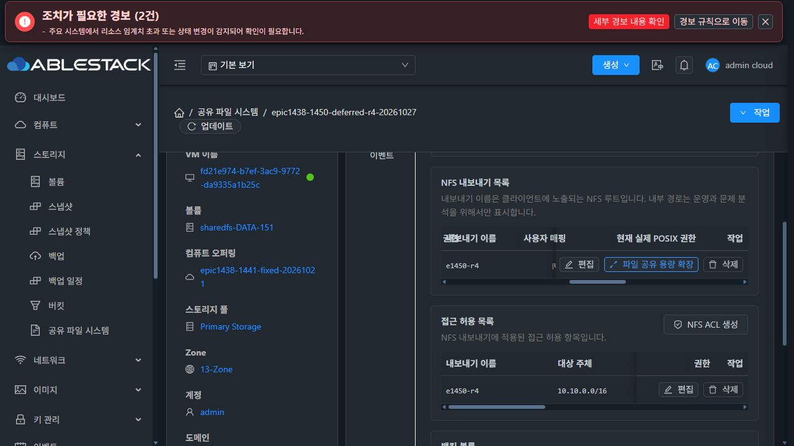
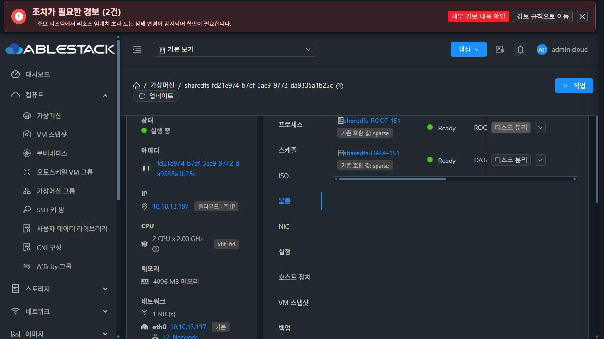
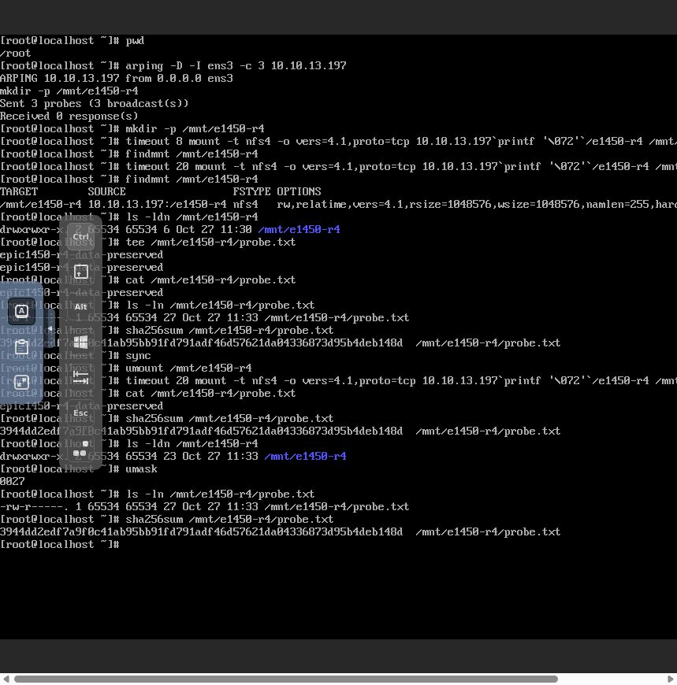

# #1450 NFS squash·POSIX 정책 최종 인수
2026-10-27 · Epic #1438 · **기능 인수 PASS**

초기 생성·편집에서 권장값, 저장 설정, 실제 권한, 명시 변경 의도를 분리했다. RO 전환이나 변경 없는 저장은 기존 owner/mode를 바꾸지 않는다. NFS 지연 생성은 ACL 게시를 기다리는 동안 원래 생성 transaction 안에서 root POSIX 적용·검증을 완료한다.

## 변경과 보호 조건

- UI 권장값은 초안이며 실제 stat과 별도로 표시한다. POSIX 변경 스위치와 preview를 거쳐 변경한 필드만 전송한다. 0값과 mode 정규화를 보존하고 재귀는 기본false다.
- server update는 생략된 POSIX 값을 채우지 않는다. 신규 디렉터리의 squash×RO/RW 기본값과 imported 초기 경로 보존을 구분한다. ACL의 정책 상속은 mapping override만 제거한다.
- guest는 target UUID·명시 key·현재 stat fingerprint 또는 동일 작업의 신규 디렉터리 영수증에 한정해 권한을 변경한다. 정상 렌더/boot가 저장 owner/mode를 무조건 재적용하지 않는다. transient intent는 canonical 저장에서 제거한다.
- intent 파라미터만 문자4096자로 명시했다. 전역255자와 서비스의 UTF-8 4096-byte 제한은 유지한다. 실제 dispatcher 회귀와 공개 API 거절 원인의 UI BLOCKED 전달을 보완했다.
- 초기 CreateSharedFS의 점검과 실제 생성은 같은 clean name/path/volume/POSIX 값을 사용한다. 영향 확인을 거절하면 적용하지 않고, 만료하면 재점검·재확인한다.
- 지연 생성의 posixOnly 단계는 해당 export1개의 root metadata만 다룬다. 원 생성 transaction의 신원·관측·영수증과 before-image/실패 원복을 재사용하며 적용 후 실제 stat을 검증한다. renderer·export alias·NFS 설정·프로세스를 바꾸지 않는다. ACL은 기존 순서로 별도 게시한다.
- 새 capability nfsDeferredPosixVersion1이 없는 guest는 지연 생성 준비 작업 전에 거부한다. 일반 생성·기존 편집의 capability 계약은 유지한다. metadata 전용 단계는 비재귀 root 초기화에 한정하며 일반 명시적 재귀 편집 엔진을 바꾸지 않았다.
- 기존 API/DB schema/포맷/네트워크/블록 프로토콜을 새로 만들지 않았다. #1468 전체 UI 정리는 HOLD다.

## 구현 전 실제 SystemVM 실증

활성 제품 코드를 바꾸기 전에 VM fcbb55c6-c422-3a0d-9cd5-4a9d94b8a643에 분리한 private candidate를 주입했다. 기존 DATA의 전용 비공유 시험 디렉터리만 사용했고 새 디스크/포맷/공유 게시0이다.

새 root 권한 적용·검증, 다른 ACL transaction의 보존, imported 경로·하위 파일 보존, 검증 실패 원복, stale stat/다른 작업 영수증 거부, 재개와 동일 요청 중복 방지를 실제 chmod/chown·journal로 확인했다. NFS 설정/desired 파일 hash·PID·활성 source는 시험 전후 동일했다. 제품 반영 후 최종 모듈로도 같은 실증을 통과했다. 시험 DATA 디렉터리와 guest/host private 주입 staging을 정리했다.

[구현 전 실증 receipt](evidence/r4-native-proof-receipt.json) · [최종 모듈 실제 SystemVM 회귀](evidence/r4-native-final-module-probe.json) · [정리 확인](evidence/r4-probe-cleanup.json)

## 커밋·빌드·배포

| 단계 | 근거 |
|---|---|
| 정책·명시 intent·관측·보호 | 1af85bd056dc38f4b37232e280bed4a400ada8c7 |
| 첫 runtime 기준 | a67726e86b5c640ba6f8613f2da0865dded2e327 |
| 실제 API 길이·UI 오류 전달 | 4d5bf7b458ea11383a03d94c1c8b7d54ccd4328f |
| 초기 UI 점검/생성 계약 | 1fbd4d56351959ebe2e9784f3e6ecd4d601043d3 |
| 지연 생성의 게시 없는 POSIX 적용·검증 | b076a8b5a1c893c0dd9bb3d3a27ac3fe8fed0736 |
| 최종 runtime 기준 | 270e702970d (sourceCommit=b076a8b5a1c) |

- R4 server 관련50시험 및 Maven26모듈 패키징 PASS. guest 관련19(신규 지연9+기존 POSIX10)와 기존35(초기4/transaction11/preflight7/SMB13) PASS.
- UI는 변경 없는 R3의4suite41시험·지정 lint·production build 결과를 사용했다. R3 회귀5건은 수정 전 실패/수정 후 통과했다. R4에는 UI source 변경이 없어 UI를 다시 빌드하지 않았고 실제 배포 UI에서 인수했다.
- R2 실제 API dispatch 시험은 DispatchTask→ParamProcessWorker.handle/processParameters를 호출한다. UI264자, 명시0, ASCII4096/4097, UTF-8 byte 초과, 전역255자 보존을 확인한다.
- Maven은 기존 common checkstyle wildcard-import12건 때문에 checkstyle/rat skip을 명시했다. 전체 저장소 CI 통과를 주장하지 않는다.
- 13번 management JAR SHA256: **978ce74bb62557ebb63a6d210669471ae9aae5ad99b505ab5c7eca0e375c2b12**. R4는 class4개(Manager 동반 class 포함)+baseline resource1개만 교체했다. 다른 entry는 byte 동일, host agent/DB migration/기존 guest 재시작0.
- UI index SHA256: **497ab6dd4e3637aa05a83a88124234209fa52056ca6bc3d2e6f71b5400eab15f**. config·SystemVM 폴더 보존, 실제 app.fc723dfc.js 로드 확인.
- 새 image SHA256: **4d91e34ab34fe10120f3568ddf62eb9a6063647620d2471c5b9c900aed4b5c74**. 현재 R2 이미지에서 transaction/profile2경로만 변경, **33,935경로 동일**, qemu-img/bzip2·payload9개 hash와 WSL 계정 파일 보존 PASS.
- guest transaction SHA256: **1031942cb73a5120899804fdc8c7b7fe263380c02b7b622f258b72070d86f2a6**, profile **ad822e06b5a87dbf31b9fd750a860ab8f82404586150a57076e182c934156982**.

[관리 모듈](evidence/r4-module-build.json) · [배포](evidence/r4-deployment-10.10.13.10.json) · [SystemVM 이미지](evidence/r4-guest-module-build.json)

## 새 VM·SPARSE DATA의 실제 UI 인수

자원 생성·설정·영향 확인은 실제 Mold UI, 클라이언트 조작은 실제 NoVNC 콘솔에서 했다. API는 그 요청/응답을 관찰·대조했다. SSH/QGA는 배포·코드 실증·읽기 전용 native 진단에 사용했으며 자원 준비를 대체하지 않았다.

| 자원 | 식별자 |
|---|---|
| SharedFS | 349a956e-1284-4dfd-a7b2-5badabdfb789 / epic1438-1450-deferred-r4-20261027 |
| instance | 41d52c20-68bd-49ba-b9c4-9d8285f6f586 |
| 새 VM | fd21e974-b7ef-3ac9-9772-da9335a1b25c / i-2-151-VM / host13.3 |
| 새 ROOT | 63a124b1-7a50-47c2-aedb-945a936c80e7 / SPARSE |
| 새 DATA | e6468b3c-785b-4808-b746-57bf514f8137 / SPARSE·XFS10GiB |
| UI 등록·READY template | dc9b8417-2ed3-4709-a880-75d9890014f8 / Europa-SystemVM-1450-deferred-posix-r4 |
| NFS export | 58815f10-d224-425e-931c-d9aedd1c6fe8 / e1450-r4 |
| ACL | c3add46e-7d2c-4fe7-affe-0a8c0f07db0e / CIDR10.10.0.0/16 |
| 서버 / 클라이언트 | 10.10.13.197 / 10.10.254.195 |

이전 실패 VM/DATA를 재사용하지 않았다. ROOT/DATA는 UI에서 모두 sparse 확인했다. IP는 실제 콘솔 ARP DAD3회 응답0 후 설정했으며 MAC은 Mold 정책을 유지했다. SYSTEM template은 AllZones/KVM/QCOW2/Debian12/x86_64와 **{SHA-256}** 체크섬으로 등록했다.

1. UI 생성→준비 완료→프로토콜 COMMITTED→POSIX 포함 사전 점검→영향 확인→NFS 생성 COMMITTED.
2. **ACL 승인 전** 실제 root65534:65534/0775, export alias 없음·desired exports0개를 확인했다. 제한시간을 둔 클라이언트 mount는 성립하지 않았고 findmnt도 비어 있었다. 게시 방지의 예상 부정조건이다.
3. ACL 점검·승인→COMMITTED→UI Ready·ESTAB 세션, 실제 NFSv4.1/RW 연결.
4. 클라이언트 tee로 파일 쓰기·cat 읽기·SHA 확인, sync→unmount→재mount 후 같은 내용/권한/hash 보존.
5. UI 변경 없는 export 편집→사전 점검·승인→COMMITTED. 실제 POST에 owneruid/ownergid/mode/recursivepermission **모두 없음**, guest fields={}이며 root·하위 파일·데이터 보존.

| 작업 | 최종 상태 |
|---|---|
| protocol fcded136-57dc-4c21-bacf-54de8ac16604 | COMMITTED |
| 원 생성 4c252f79-4295-49b1-81cc-aa20a8de77be | COMMITTED·posixOnly=true |
| ACL 837264c5-7a37-46a1-a69c-8a476da07db5 | COMMITTED |
| 미변경 편집 278bb004-18de-4ef0-9ba4-d741438e9694 | COMMITTED·POSIX 비제출 |

최종 directory **65534:65534/0775**, 파일 **65534:65534/0640**(실제 client umask0027), 27bytes.
파일 SHA256 **3944dd2edf7a9f0c41ab95bb91fd791adf46d57621da04336873d95b4deb148d**.
파일 ctime/mtime02:33:54Z는 미변경 편집 시작02:36:57Z보다 이전으로, 편집이 파일 metadata를 건드리지 않았음을 확인했다.

[실제 API 계약·작업](evidence/r4-api-acceptance-contract.json) · [ACL 전 게시 없음](evidence/r4-before-acl-publication.json) · [최종 native·client 대조](evidence/r4-native-final-acceptance.json) · [기존 원본 보존](evidence/r4-original-data-preserved.json)

## 선행 R2의 정책 행렬과 권한 보호 인수

R4에서 정책/기존 일반 renderer helper를 변경하지 않았다. 아래는 R2에서 실제 UI·API·클라이언트로 실행한 인수이며, R4에서 다시6조합을 모두 실행했다고 주장하지 않는다. R4는 새 지연 단계와 정상 편집·게시·재접속 회귀를 위와 같이 추가했다.

| 정책 | RW 신규 기본 root | 실제 클라이언트 | RO |
|---|---|---|---|
| root squash | 65534:65534/0775 | root 쓰기→65534, 숫자1001 읽기 성공·쓰기 EACCES | root/1001 쓰기 EROFS |
| no root squash | 0:0/0755 | root 쓰기→0, 숫자1001 읽기 성공·쓰기 EACCES | root/1001 쓰기 EROFS |
| all squash | 65534:65534/0775 | root/1001 모두65534로 읽기·쓰기 성공 | root/1001 쓰기 EROFS |

- 단순 RO 전환은 seed의 uid/gid/mode/hash를 유지했다. 거부 결과는 POSIX/RO 정책에 맞는 기대 결과다.
- 권장값 사용은 실제값과 분리한 초안으로 확인 후 취소했고 실제권한을 유지했다.
- 명시 UID1001/mode0770만 제출하고 GID·recursive는 생략, 하위 파일metadata/hash 보존.
- 일회성 VERIFYING 실패를 주입해 ROLLED_BACK/SUCCEEDED 및 최초 진단 보존, 실제 권한 원복·클라이언트 읽기 성공.
- 점검 뒤 클라이언트가 mode를 바꾼 stale stat은 적용 전에 IMPACT_ACK_REQUIRED/NOT_NEEDED로 거부했다. 원래 UID0 요청은 미적용이었다.
- 기존 r1444n 원본 파일은 마지막까지65534:65534/0640, SHA256 **d4aa35f7d126e31d0e98c254513a80d8b8528b0b6544a44ec0de1af6234855ba** 유지.
- UUID 볼륨 아래 상대 백킹 경로 export/e1450-r4와 숫자 identity0/1001/65534를 구분했다. 서비스 수준 NFSv4 ID mapping 모드는 별도 #1451 범위다.
- 관련 UI는 VM 표준 세로 탭·좌측 primary/업데이트/넓게보기 그룹 끝과 라이트/다크 가독성을 확인했다. 모달 header55px/footer65px 고정, body534px overflow:auto를 관측했다. R4 UI layout 변경0.

[R2 실제 클라이언트 행렬](evidence/r2-client-rw-ro-result.json) · [실패 원복](evidence/r2-rollback-native-integrity.json) · [stale-stat 보호](evidence/r2-stale-stat-protection.json)

## 증거와 제한

API trace에는 수집 공백이 있다. 전체 네트워크 trace라고 주장하지 않고, 보존한 실제 요청/응답·4개 terminal operation·UI/native/클라이언트 대조를 근거로 한다. 미변경 POST는 직전 UI의 buffered CDP event에서 회수했으며 새 적용을 반복하지 않았다.

NoVNC 제어키/Shift 입력과 파일 mode0644 가정의 시험 코드 실수는 스스로 교정했다. 실제 client umask0027과 최초 관측0640을 기준으로 비교했고 파일 ctime도 교차 확인했다. 검증 기준이나 제품 보호를 완화하지 않았다.

기존 중단·원인 기록은 #1450 댓글과 [R3 당시 기록](history-r3-stop.ko.md)에 시점 이력으로 보존한다. 현재 완료 판정은 본 문서와 R4 증거다. 전체 저장소 CI, SMB AD, 백업/복원, ID mapping #1451, 제한 ACL #1460, 전체 UI #1468 또는 Epic 전체 완료로 확대하지 않는다.
