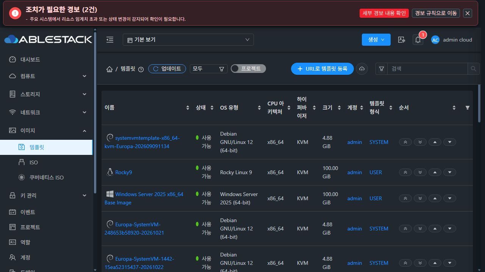
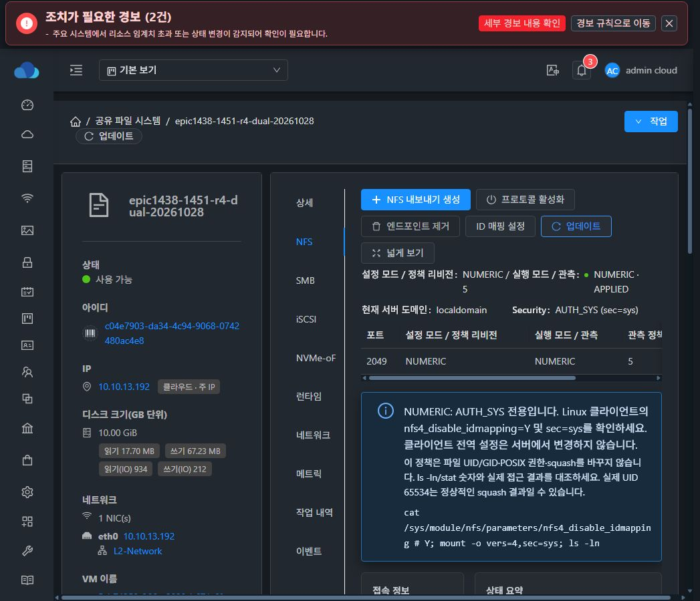
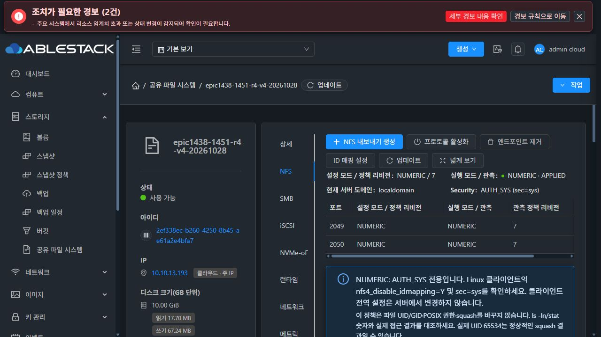
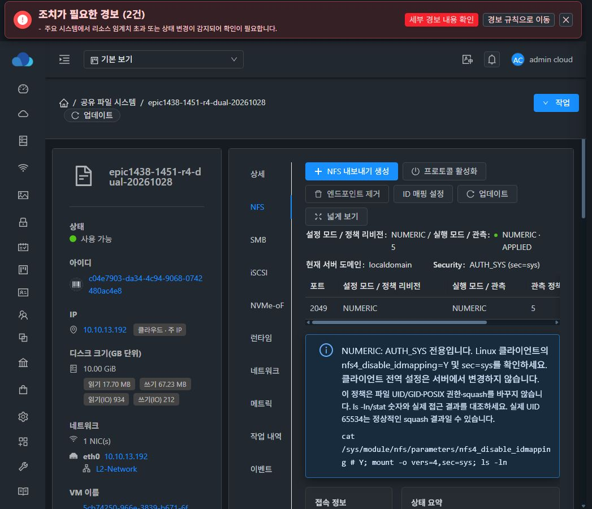

# #1451 NFSv4 ID 매핑 최종 인수·이미지 교정 완료
2026-10-28 · Epic #1438 · 요청 범위 검증 완료·종료 기준 충족 · Epic PR #1470 Draft/미병합

## 결과와 수정 범위

이전 시험 이미지의 실제 payload와 서명 manifest 불일치를 교정했다. **교정 이미지의 두 새 VM·새 SPARSE DATA에서 최초/반복 bootstrap, 실제 UI 생성·모드 변경·재시작, 두 실제 클라이언트의 V4_ONLY/DUAL 접속, 데이터/권한 및 관리 서버 재시작 후 이력 보존을 통과했다.**

R4 코드 **4d9adaa4b4b1be62d33bb5f6da534bbd130017a7**은 조립 이미지 검증기와 회귀 시험뿐이다. runtime_updater·NFS 엔진·Java/API·UI 제품 코드는 이번 교정에서 변경하지 않았다. 잘못된 서명/해시/권한을 수락하거나 기존 release를 무조건 덮어쓰는 방식은 사용하지 않았다.

- [조립 이미지 검증기](../../../tools/build/verify-storage-runtime-template.py)는 서명과 실제9파일 hash/bytes/owner/mode, ABI/schema/layout, 별도 baseline profile 동등성을 함께 확인한다. 읽기 전용이며 미부팅 이미지에 사용한다.
- [실제 payload 회귀](../../../systemvm/test/TestStorageRuntimeUpdater.py)에 최초·반복 bootstrap의 동일 current/integrity/confirmed, 오래된 서명 manifest+현재 payload의 사전 거부, 서명 변조 거부3개를 추가했다. **런타임 회귀19개 PASS**.
- 기존 UI 경합 수정f45310e6f00의39회귀·UI 빌드·실제 자동 원복과 R2의coordinator→DAO42회귀·26모듈 package·squash×RW/RO208UID는 각 단계의 근거를 유지한다. 이번에 모든 이전 시험을 재실행했다고 확대하지 않는다.
- 기존 다른 server 파일의 checkstyle18건은 별도다. 대상 검증 통과와 전체 저장소 CI 통과를 구분한다.

[런타임19회귀](evidence/runtime-regression.log) · [이전 UI 경합 해소·정확한 실패 원인](../sharedfs-1451-ui-observer-r3-20261028/README.ko.md) · [이전208UID·DAO 검증](../sharedfs-1451-resource-type-r2-20261028/README.ko.md)

[인수 결과 기계 요약](evidence/acceptance-summary.json)

## 1. 서명·이미지 빌드와 실제 SystemVM 사전 실증

기존 보호 키를 Windows DPAPI CurrentUser에서 메모리로만 복호화하고 memfd로 서명했다. 평문 개인키 파일·저장소/외부 전송0이며 기존 신뢰 키를 유지했다.

| 산출물 | 실제 값 |
|---|---|
| signed bundle version | epic1438-1451-idmap-4e6b7d88289-r4 |
| manifest SHA256 | 3c492eb6ab86342a34c6b250999279d75a716698bd18fcd910cb2d5ead229163 |
| signature SHA256 | 4ad7f0cdf63a9d067d754a1b77ac863933e3ed44e79ab3a1ecb46693061f653c |
| 새 QCOW2.bz2 SHA256 | 8417e0ba191eac7c01ab49790479ab396c8dfae4132c80ba2c170a54d9e84db5 |
| 압축 크기 | 498,378,060 bytes |

실제 기존 SystemVM의 격리 경로에서 새 서명 manifest와 설치 payload를 조립해 검증기를 실행했다. 최초 bootstrap과 반복2회가 같은 버전으로 성공했고, 활성 payload·desired state는 불변이었다. 격리 시험 경로는 삭제했다. 이는 실제 활성 서비스 복구나 새 VM 재시작 인수와 구분한다.

이미지 빌드는 기존 #1451 이미지에서 **runtime-default/manifest.json·manifest.sig 두 경로만 변경**했다. 실행 코드9개·별도 baseline profile 및 나머지33,935경로, WSL 계정 파일은 그대로였다. 마운트 루트/NBD 소유권 확인과 qemu-img check·bzip2 검사, 조립 이미지 서명·실제9파일 검증을 통과했다. payload source commit은4e6b7d88289이며 R4 검증 도구 commit과 구분한다.

[서명 manifest](evidence/signed-manifest.json) · [signature base64](evidence/manifest.sig.base64) · [번들 체크섬](evidence/signed-bundle-SHA256SUMS.txt) · [키 보호 metadata](evidence/signer-public-metadata.json) · [실제 SystemVM 최초/반복](evidence/native-bootstrap-probe.json) · [주입 정리](evidence/native-probe-cleanup.json) · [이미지 검증](evidence/assembled-image-verification.json) · [이미지 빌드/불변 경로](evidence/guest-module-build.json) · [실제 조립 script](evidence/build-corrected-image.py)

## 2. 13번 배포·실제 UI 생성·SPARSE

13.10의 기존 SystemVM 배포 경로에 새 이미지를 배치하고 해시를 확인했다. **실제 Mold UI에서** SYSTEM/AllZones/KVM/QCOW2/Debian12 x86_64/HVM/dynamic 템플릿을 SHA-256 명시값으로 등록했다. 새 템플릿 **97e5d8ff-4c4d-4524-9bb1-543020957f7c**의 Ready와 동일 해시를 확인했다.

각 서비스의 생성·포트/ACL/권한·매핑 변경·VM 재시작은 실제 Mold UI에서 수행했다. UI의 영향 확인과 기존 보호를 유지했다. 클라이언트는 이 이슈 착수 시 새로 만든2대를 사용했고, 사용자에게 연결을 요청한 noVNC 세션에서 로그인·준비·mount·실제 read/write를 수행했다. client QGA exec/file 비활성·SSH 인증 정책을 바꾸지 않았다.

| 새 시험 서비스 | IP / VM / DATA |
|---|---|
| V4_ONLY: 2ef338ec-b260-4250-8b45-ae61a2e4bfa7 | 10.10.13.193 / i-2-176-VM(13246a3e-76c3-3ed1-b869-dd39695a85aa), host13.1 / DATA78396639-cab6-46a8-9999-89f991abbd01 |
| DUAL: c04e7903-da34-4c94-9068-0742480ac4e8 | 10.10.13.192 / i-2-177-VM(5cb74250-966e-3839-b671-6f5dbde6d62f), host13.2 / DATA17f958c0-896d-442d-a933-643da72a205f |

두 VM 모두 실제 신규 템플릿97e5…를 사용했다. ROOT5,242,880,000bytes와 XFS DATA10GiB 모두 **API/UI의 sparse**를 확인했다. 두 client는8a93eeda-2421-43ed-9c60-a6d4f1c075c4/10.10.254.236와4fcfcf64-ef2a-42e7-8067-b31e0810b1cf/10.10.254.11이며 ROOT100GiB SPARSE다. MAC은 Mold 할당을 유지했고 사전 ARP 중복을 확인했다.

내보내기는 e1451, backing /export/e1451, ACL10.10.0.0/16·RootSquash/RW다. 다중 UID의 쓰기 시험용으로 **UI에서 명시 승인해 root mode만0777로 변경**하고 owner65534:65534·비재귀를 유지했다. 포트만 수정한 실제 요청에는 미변경 POSIX4필드가 없음을 확인했다. 권장값 자동 적용이나 client UID에 맞춘 파일 chown은 하지 않았다.

[실제 등록·Ready](evidence/template-registration.json) · [자원·ROOT/DATA SPARSE](evidence/resources.json) · [사전 IP 검사](evidence/arp-before-dual.json) · [미변경 POSIX 비제출](evidence/posix-non-submission.json)

## 3. 새 VM bootstrap·실제 UI·두 client·데이터

새 V4 VM의 최초 부팅 journal은 BOOTSTRAPPED 성공이고9파일 integrity가 verified다. 이 VM에서 활성 bootstrap을2회 반복해 동일 current/integrity/confirmed와 Ganesha PID·설정 불변을 확인했다. 새 DUAL의 최초 부팅도 같은 버전·9파일 무결성이 정상이다.

두 클라이언트에서 NAME_DOMAIN은 idmap N/localdomain, NUMERIC은 idmap Y·sec=sys로 준비했다. UID0/1/1001/65534의 실제 파일 생성·소유자 읽기·다른 UID의 거부·숫자 속성·0640·seed hash를 대조했다.

| 새 이미지의 접속 시험 단계 | V4_ONLY | DUAL |
|---|---:|---:|
| NAME_DOMAIN | 2client×2049/2050×4UID =16검사 | 2client×v3/v4×4UID =16검사 |
| NUMERIC 전환 후 | 16 | 16 |
| 실제 UI SystemVM 재시작 후 | 16 | 16 |
| 관리 서버 재시작 후 | 16 | 16 |

합계는 **32접속 profiles/128 UID 검사**이며 재시작 단계의 반복 검사를 포함한다. 원문의 wire 필드는 두 mount 시험 모두 NFSv4 GETATTR 대조값이다. NFSv3의 숫자 속성은 명시적 vers=3 mount의 stat와 실제 I/O로 판정했다. R2의 squash×RO/RW208UID 조합을 이번 새 이미지에서 전부 다시 실행했다는 뜻은 아니다. 실행 코드9개는 동일하고 새 이미지에서는 누락됐던 bootstrap·재시작·DUAL 인수를 추가로 완료했다.

- V4_ONLY는2049/2050 두 포트가 같은 NAME_DOMAIN/0→NUMERIC/7/APPLIED로 일치했다.
- DUAL은2049에서 NAME_DOMAIN/0→NUMERIC/5/APPLIED이며 v3/v4 접속이 모두 정상이다.
- NAME_DOMAIN에서 서버UID1=daemon, client NSS daemon=UID2이므로 v4 표시UID2가 관측된다. 실제 AUTH_SYS UID1의 read/write는 정상이고 서버 파일UID1/GID1은 유지된다. v3는 같은 파일을 숫자UID1로 표시한다. NUMERIC은 v3/v4 모두 숫자UID가 일치했다.
- 모드 전환 직전/직후 V421파일·DUAL13파일의 UID/GID/mode/hash가 정확히 동일했다.
- 실제 UI로 두 **새** VM을 정상 재시작했다. 부팅 ID는 각각5721062e…→f9e5652b…, cfc3927a…→98b3cc2c…로 바뀌었고 bootstrap과 boot reconcile의 Result=success를 확인했다.
- 재부팅 후 각각 NUMERIC/7·NUMERIC/5/APPLIED와 원래 IP로 복구했다. V445파일·DUAL29파일 metadata/hash가 전후 동일하며 실제 client2대가 재접속해 쓰고 읽었다.
- 최종 preparation journal의 formatCount는 둘 다1이고 같은 filesystem UUID가 마운트돼 있다. 중복 포맷은 없다.
- 새 이미지의 신뢰 hash/서명 검사를 우회하지 않았고 NFS 파일 owner나 권한을 매핑 모드가 자동 변경하지 않았다.

[V4 최초 부팅](evidence/fresh-v4-first-boot.json) · [실제 반복2회](evidence/fresh-v4-repeated-bootstrap.json) · [DUAL 최초 부팅](evidence/dual-first-boot.json) · [V4 재시작 요약](evidence/v4-reboot-summary.json) · [DUAL 재시작 요약](evidence/dual-reboot-summary.json) · [V4 실제64UID 원문](evidence/v4-final-client-profiles.json) · [DUAL 실제64UID 원문](evidence/dual-final-client-profiles.json) · [V4 포맷 이력](evidence/v4-format-ledger-final.json) · [DUAL 포맷 이력](evidence/dual-format-ledger-final.json)

## 4. 관리 서버 재시작·API/실제 UI 최종 대조

실행 중 작업0과 양 서비스의 완료 상태를 UI/API에서 확인한 뒤13.10 mold.service를 재시작했다. MainPID4167073→103411이며 관리 JAR07c64a803b17·UI index9e0b33bcaa98 해시는 그대로다. 재로그인한 실제 UI에서 조회한 작업7건/5건은 id/requestid/state/base·target revision/생성·갱신·완료 시각이 재시작 전후 정확히 동일했다.

두 SystemVM의 boot ID·정책·9파일 무결성은 그대로였고, 두 client의 V4 두 포트·DUAL v3/v4 접근이 정상이다. V4의 기준53파일은 전부 보존됐으며 시험 원문을 추가 복사한8개 evidence 파일만 늘었다. DUAL은 원문 추가 복사 전에 비교해37파일이 정확히 동일했다. 추가 evidence 파일을 제품의 데이터 변조로 판정하거나 기준 파일 손실을 허용한 것은 아니다.

[관리 서버 restart](evidence/management-restart.json) · [데이터·정책·VM boot 보존](evidence/management-preservation-summary.json) · [UI/API 작업12건 보존](evidence/history-preservation-summary.json) · [V4 최종 API](evidence/v4-final-scoped-wire.json) · [DUAL 최종 API](evidence/dual-final-scoped-wire.json)

## 5. 범위·완료 판정

- 실제 UI/API·client·데이터 인수까지 통과했으므로 #1451의 네 인수 항목을 완료로 판정한다.
- 기존 UI 관찰 경합은 R3의 실제 RUNNING→job2→새 ROLLED_BACK·자동 폼 해제/POST1/resume0 및 회귀로 해소됐다. 실패 원복·진단·squash×RO/RW 검증은 [R2](../sharedfs-1451-resource-type-r2-20261028/README.ko.md), [R3](../sharedfs-1451-ui-observer-r3-20261028/README.ko.md)의 시점별 근거를 명시적으로 이어 사용한다.
- R3의 이미지 조립 누락과 당시 실패는 이 기록으로 교정됐다. 새 VM176/177이 최종 인수 자원이며 이전 실패 시험 VM/이미지를 정상 복구 결과로 삼지 않는다. 기존 미완성 release의 자동 덮어쓰기/무결성 완화 코드는 추가하지 않았다.
- 제품 UI의 Breadcrumb/목록/상세/세로 탭/대화상자·다크 스타일은 이번 교정에서 변경하지 않았다. 실제 UI 증거는 기존 VM 표준을 사용하는 배포 화면이다. #1468 전면 UI 정리는 HOLD다.
- 자원 준비·변경·재시작은 실제 Mold UI, client 작업은 실제 noVNC, 배포와 SystemVM 사전 주입/진단만 SSH/QGA로 수행했다. 숨은 API/QGA로 UI의 준비 단계를 대신하지 않았다.
- 클라이언트 콘솔 URL 열기가 도구 정책에 차단된 단계는 사용자에게 직접 연결을 요청했고, 연결된 세션에서 이후 검증을 마쳤다. 정책이나 client 인증 보호를 우회하지 않았다.
- 장시간 CDP의 일부 주기 조회는 버퍼에서 만료됐다. API 수집 범위와 실제 UI·새 boot ID·native 검증·client 원문으로 확인한 최종 결과를 구분하며 모든 poll 원문 보존을 주장하지 않는다.
- 이슈 분기0·새 PR0. 기존 Epic PR #1470에 통합하고 완료 기록 후 #1451을 닫는다. 전체 Epic 완료·PR 병합을 의미하지 않는다.
