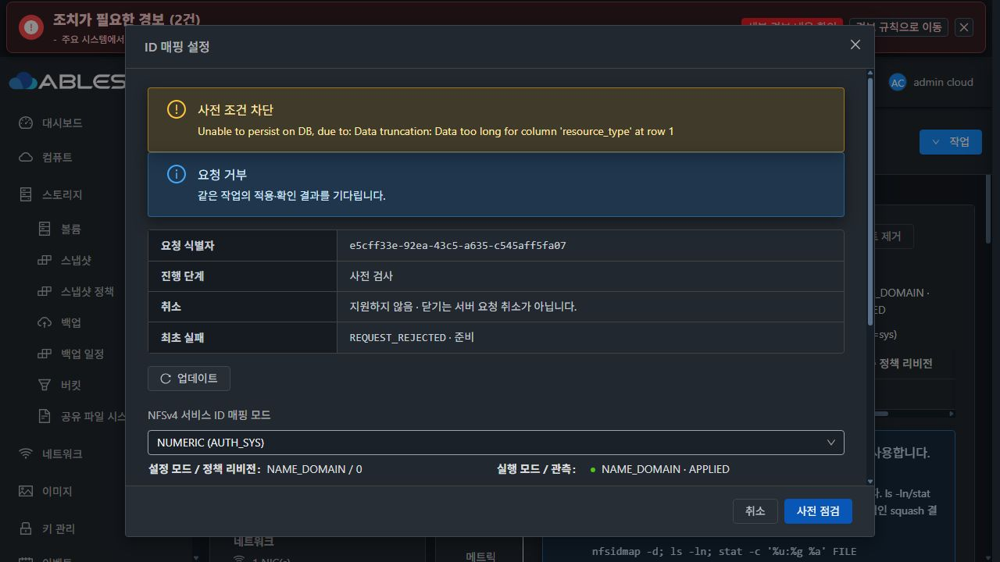
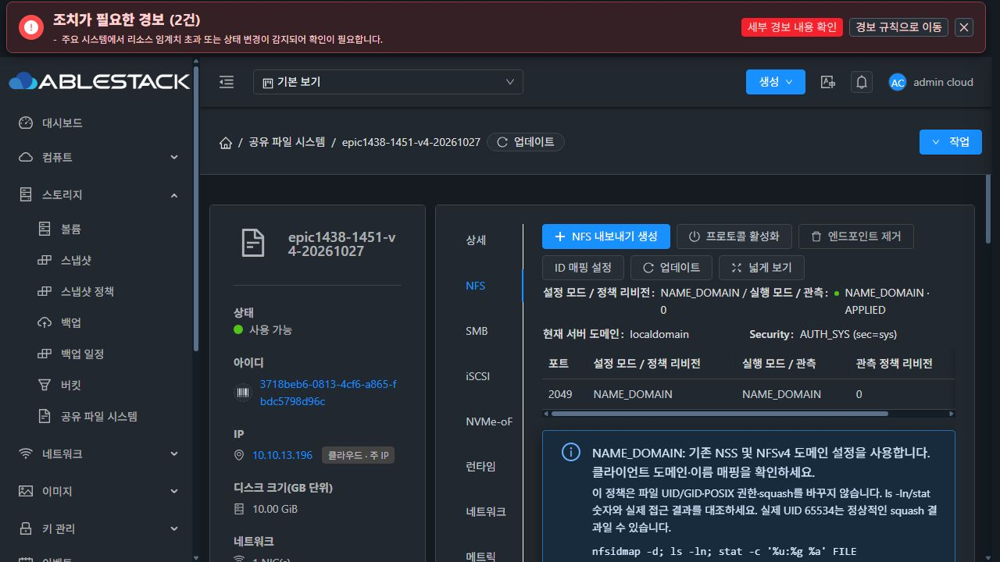

# #1451 구현·배포 후 제품 오류 중단 보고
2026-10-27 · Epic #1438 · **OPEN / NUMERIC 적용 검증 중단 / 완료 판정 아님**

## 현재 결론과 정확한 실패 원인
실제 UI의 새 NFS 서비스 생성·ACL과 기본 NAME_DOMAIN/0 관측은 통과했다. 이후 첫 NUMERIC 변경은 사전 점검 READY 후 **작업 기록 INSERT에서 실패**했다. 요청을 재시도하지 않았고 포트 추가·두 클라이언트 기능 시험·재시작·실패 원복·DUAL 인수도 시작하지 않았다.

Coordinator는 새 명령의 Java simple name UpdateStorageNfsIdentityMappingCmd **34자**를 기존 storage_service_configuration_operation.resource_type **VARCHAR(32)**에 그대로 저장한다. 실제 배포 DB에서도 열 길이32를 확인했다. guest 적용이나 Ganesha 재시작 이전에 DB가 길이 초과를 거부한 것이다.

- 시각14:53:24+09:00, request e5cff33e-92ea-43c5-a635-c545aff5fa07, async job faf25579-ee91-4502-bd3b-596a969079f4.
- API jobstatus2 / error530: Data too long for column 'resource_type' at row 1.
- StorageServiceConfigurationCoordinator.execute() L90 setResourceType(cmd.getClass().getSimpleName()) → L94 operations.persist(value). L95 이후의 active 예약·guest 처리에는 도달하지 못했다.
- 원래 DDL은 EuropaStorageConfigurationUpgrade.java L34의 resource_type VARCHAR(32). **기존 저장 계약에 새 명령을 맞추지 못한 구현 결함**이다.
- 기존 NFS export update 명령은25자다. 기본 생성/ACL·native 시험의 성공이 이 새 명령의 INSERT 성공을 보장하지 않는다.

[실제 UI 요청·사전 점검·실패 응답](evidence/product-error-ui-api.json)

## 영향 확인 — 읽기 전용
배포 DB를 SELECT로 확인했고 SystemVM도 QGA로 읽기만 했다. 암호·관리 키는 메모리에서만 사용했으며 보고서/파일에 기록하지 않았다.

| 항목 | 확인 결과 |
|---|---|
| 실제 배포 DB 열 | varchar(32) |
| 실패 request의 operation 행 | 0개 |
| configuration_revision | 3 유지 |
| active_configuration_operation_id | NULL |
| 저장 정책 | NAME_DOMAIN / policy revision0 |
| 실행 정책 | NAME_DOMAIN / APPLIED / port2049 / revision0 |
| 실행 receipt | PID5582·start ticks31351, 생성14:50:23로 실패 요청 이전 |
| 공유 root | 65534:65534 / 0775, 내부 항목0개 |
| runtime graph | 기존3entrypoint+6helper 모두 profile SHA 일치 |

실패한 NUMERIC 요청으로 NFS 저장·실행 정책이 바뀌지 않았다. 새 서비스에는 클라이언트 시험 파일을 아직 만들지 않았으므로 데이터 보존 인수가 통과했다고 주장하지 않는다. native 격리 시험의 보존 결과와 구분한다.

[배포 DB 확인](evidence/deployed-db-after-error.json) · [SystemVM 상태·9파일 무결성](evidence/guest-after-error.json)

## 구현·빌드·배포한 범위
- 구현5f7ad39f4e0c7a5850ef5f88114e56333b7475cc, 관측 실패 격리e281c0c931ab1612981a7d86450270c125f5c42d, runtime 기준선8e02bae817f00f0ef0aa53fdfba3dc3d3c5fb73f, UI 위치·실제 탭 회귀f4b9e4b05fbd0f4c07320b9dd0b44ec469a60a4b.
- 서비스 전체 NAME_DOMAIN/NUMERIC·정책 revision, 기존 protocol.config_json2필드, 새 read/update API와 기존 transaction/preflight/ack/원복 연결.
- Ganesha flags2개·포트별 실제 PID/boot/start/정책 signature receipt. 설정 파일만 바뀐 상태를 적용 완료로 표시하지 않는다. 선택 관측 실패가 기존 transaction capability를 막지 않는다.
- VM 표준 공통 dialog·좌측 버튼 그룹·정책/실행 분리·포트 관측·client 안내를 NFS 탭에 추가했다. 실제 다크 UI에서 표시 확인. 검토 중 상세 탭에 들어간 표시 위치를 NFS 탭으로 조정하고 렌더링 회귀를 추가했다.
- 기존 wizard/POSIX/squash/ACL·볼륨/포맷·다른 프로토콜 기능은 유지했다. #1468 전체 UI 정리는 시작하지 않았다. ROOT/DATA는 SPARSE, MAC은 Mold 할당을 유지했다.

| 배포 항목 | 결과 |
|---|---|
| management JAR | SHA665e97180fbc424669b032152e5f27a05afab7f136404e7f66b0e49ee68b98ed,13entry 변경·나머지 byte 동일·mold 재시작 확인 |
| UI 최종 index | SHA761f2dc709965eaf70a89088a39f6de9b31488aa71e95a0db8510a50c5ac8f36, operator config/SystemVM 경로 보존 |
| 압축 SystemVM 이미지 | SHA0f27d55427f1e2851578572076c04de685278dda4ee3e8b6ccce83b9ceb71371,498361067bytes |
| 이미지 변경 | storagectl·configuration_transaction.py·runtime-baseline-profile.json3경로,나머지33934경로 동일 |
| 이미지 보호 | qemu-img/bzip2/payload hash PASS, WSL passwd/group/shadow/gshadow byte 불변 |
| DB/host agent | 신규 migration0 / host jar 배포0 |

[management 모듈](evidence/module-build.json) · [배포](evidence/deployment-10.10.13.10.json) · [UI](evidence/ui-deployment-final.json) · [이미지](evidence/guest-module-build.json)

## 실제 UI로 만든 시험 자원과 기본 생성
- Template001babbd-3064-4806-9b99-58819da17eb2, Europa-SystemVM-1451-nfs-idmapping-20261027. UI에서 SYSTEM/AllZones/KVM/QCOW2/Debian12/x86_64/HVM/dynamic·SHA-256 지정 후 사용 가능 확인.
- SharedFS3718beb6-0813-4cf6-a865-fbdc5798d96c, instance5f3fe58b-8458-4eed-8e92-2af6962da09c.
- 새 VM936fd57c-386a-384d-be07-368844b41b61 / i-2-174-VM /13.3 /10.10.13.196.
- 새 DATAda0a1791-af5a-4f9d-9a3a-b72b96a934d5, SPARSE/XFS10GiB. UI template 링크와 guest profile·source/hash 대조.
- 초기 enable→deferred CREATE→ACL 각각 COMMITTED, 전역 revision3. e1451 /export/e1451, CIDR10.10.0.0/16, RootSquash/RW. NAME_DOMAIN/0/2049 APPLIED 확인.
- 새 client1: 8a93eeda-2421-43ed-9c60-a6d4f1c075c4 /i-2-172-VM /13.3 /10.10.254.236. ROOT3d49b564-6ced-4fb4-b17a-636dd4f09608 SPARSE 확인.
- 새 client2: 4fcfcf64-ef2a-42e7-8067-b31e0810b1cf /i-2-173-VM /13.3 /10.10.254.11. 같은 SPARSE offering으로 생성. 기존 client 재사용0.
- 두 NoVNC 콘솔에서 nfs-utils 설치·client1 kernel idmap Y/client2 N·localdomain/NSS uid1=bin 준비. 전용 verifier는 콘솔에서 내려받았지만 제품 오류 후 기능 probe는 실행하지 않았다.
- nfs-utils 누락·NoVNC Shift 입력·만료된 점검 확인은 시험 준비 문제로 스스로 교정했다. 제품 결함으로 분류하지 않았다.

[초기 UI/API](evidence/initial-nfs-ui-operations.json) · [새 두 client](images/new-clients-ui.png) · [SPARSE ROOT](images/client1-root-sparse.png) · [template](images/systemvm-template-ready.png)

## 통과한 시험과 검증 누락
- Java36 PASS: 실제 serializer/상위jobid·정책/enum/preflight·기존 POSIX/구성/dispatch.
- 전용 loopback MariaDB 실제 DAO3 PASS: protocol JSON/포트/UUID 보존과 기존 snapshot/진단. **새 명령의 resource_type을 coordinator→operation INSERT에 넣는 경로는 시험하지 않았다.**
- guest NFS33 PASS. 기존 구성22 중18 PASS/4skip.
- 실제 설치 Ganesha4.3 private 주입: NAME_DOMAIN 이름@도메인→NUMERIC 숫자→원복, SIGHUP 변경 DRIFT·process receipt APPLIED, UID1 읽기/UID1001 기대 거부, owner1:1/0640/hash 보존·기존 서비스 불변.
- UI 실제 API fixture 기반3suite29 PASS, 표시 위치 변경 후 대상suite6 PASS, scope lint/production build PASS. 모든 시험을 한 번에 다시 실행한 결과로 표현하지 않는다.
- Maven26모듈 package PASS. 기존 공통 checkstyle/rat skip 명시, 전체 저장소 CI 통과 주장 없음.

**제가 새 명령의 작업 기록 INSERT를 실제 DAO 경로로 시험하지 않은 검증 누락이다.** protocol JSON·serializer 시험을 이 경로의 검증으로 간주한 것이 부족했다. native 성공으로 management SQL 성공을 대체할 수 없다.

[시험 범위](evidence/checks.json) · [native 결과](evidence/native-implementation-result.json)

## 최소 영향 수정 방향 — 아직 구현하지 않음
1. 새 명령만 Java 클래스 이름과 분리한 **32자 이내 명시 작업 유형**(예: NfsIdentityMapping18자)을 사용한다. 기존 명령의 resource_type, SMB resume exact-match, 요청 hash/revision/원복 계약은 유지한다. 임의 문자열 절단이나 SQL strict mode 완화는 하지 않는다.
2. 실제 command→coordinator VO→기존 MariaDB operation DAO 저장·재조회 시험을 추가한다. resource_type/requestid/revision/active 예약과 동일 요청 관찰을 확인한다. 현재 실패34자 경로를 고정하고 등록된 configuration command의 저장 길이도 확인한다.
3. 수정 배포 후 실제 UI 점검→NUMERIC 요청→operation 생성/COMMITTED→GET·포트 관측부터 확인한다. 실패 행/활성 예약이 없으므로 임의 DB 수선·guest 강제 원복은 필요하지 않다.
4. 통과 뒤 두 새 client의 두 모드·squash×RO/RW·port2050/별칭·별도DUAL·VM/관리 서버 재시작·실패 원복·데이터/권한 인수를 재개한다.

오류 이후 위 제품 수정이나 기능 재시험은 시작하지 않았다. #1451 OPEN, Epic PR Draft/미병합, 시험 자원·오류 증거 보존 상태로 다음 지시를 기다린다.
