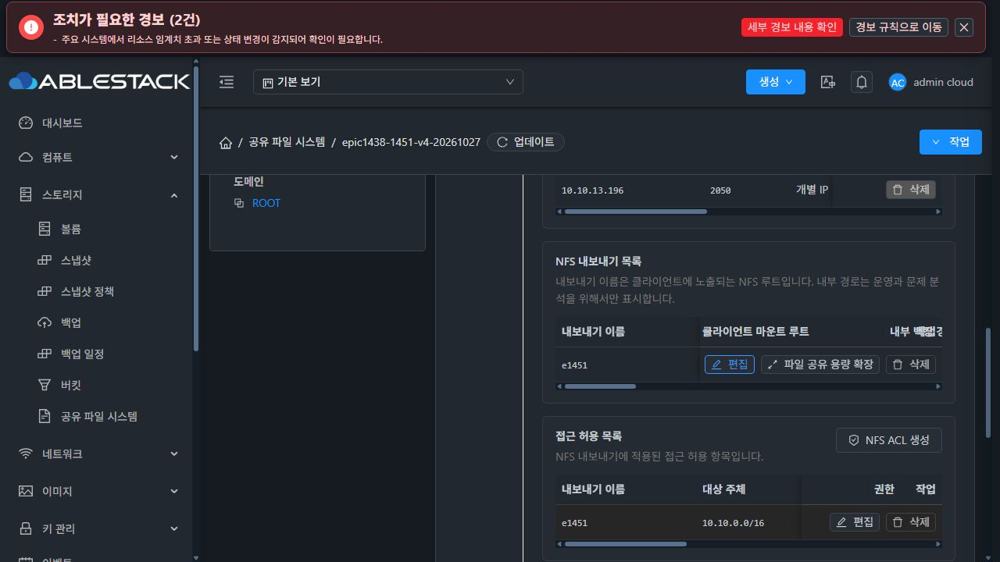
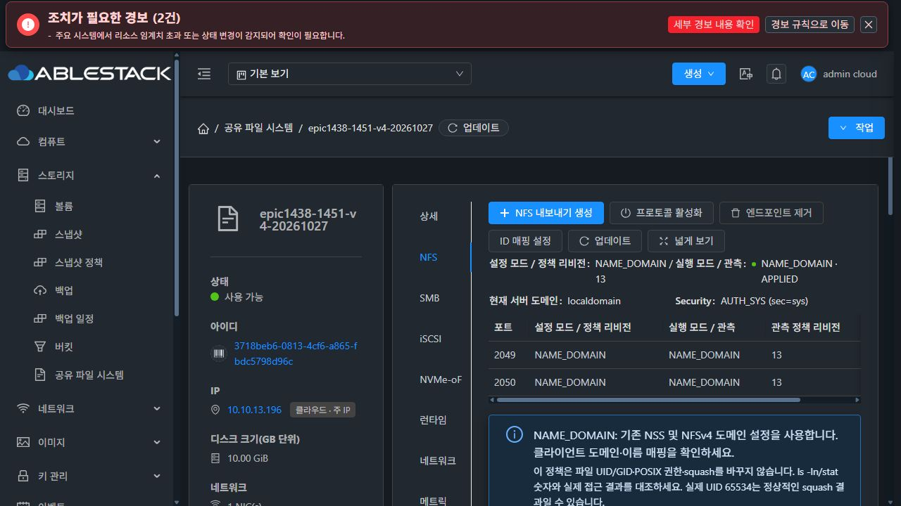
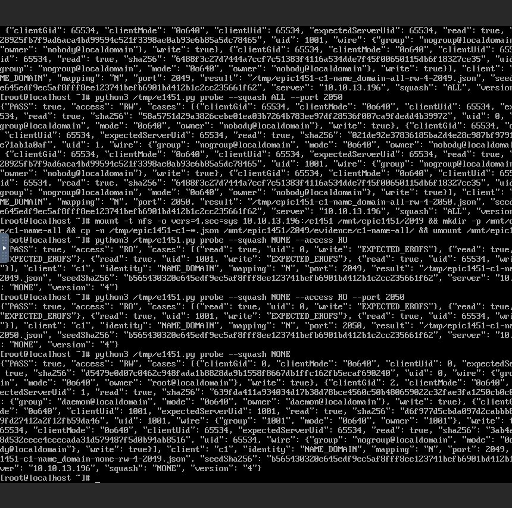
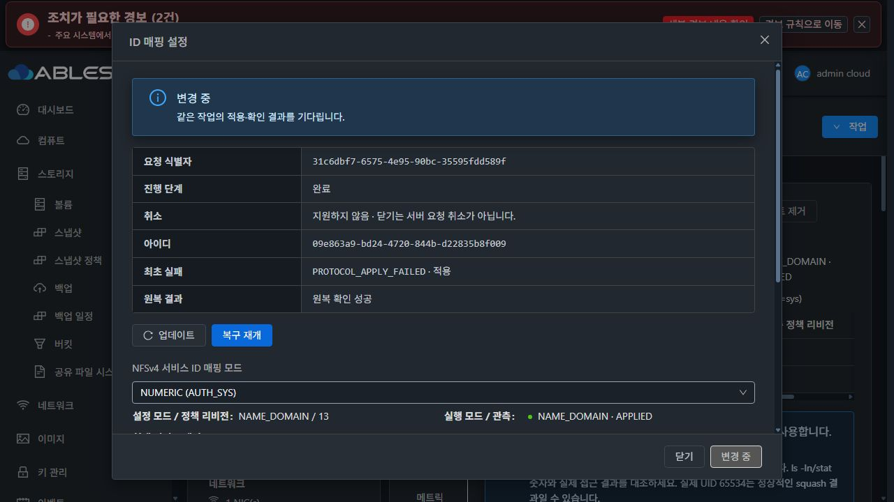
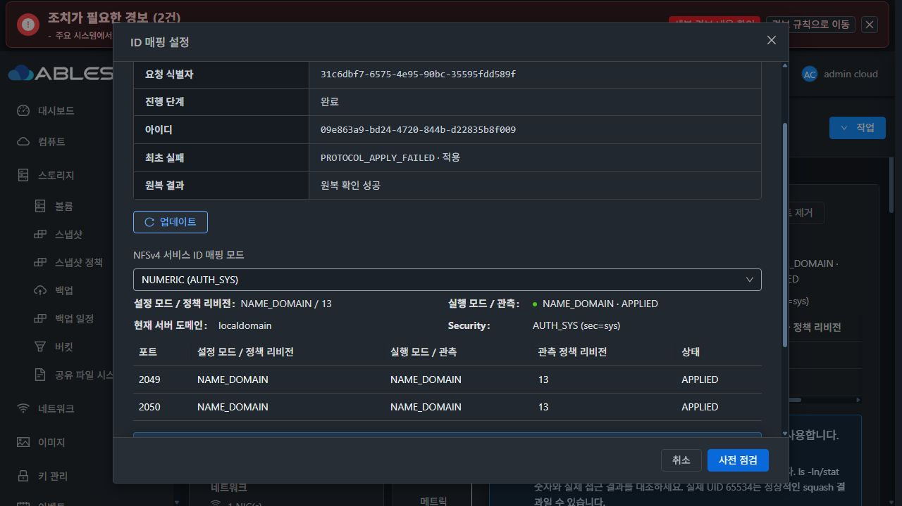

# #1451 작업 유형 수정·실환경 검증 / UI 관찰 경합 중단
2026-10-28 · Epic #1438 · **OPEN / 제품 UI 결함 확인 후 중단**

## 현재 판정
요청한 작업 유형 길이 수정, 실제 coordinator→DAO 회귀, 모듈 빌드·13번 배포는 완료했다. 두 ID 모드의 squash×RW/RO·두 포트·두 새 클라이언트192개 UID 조합과 별칭16개 조합을 통과했다. 의도적으로 주입한 두 번째 포트 실패에서 backend 원복·최초 진단·파일241개 보존도 확인했다.

이 음성 시험에서 **UI가 오래된 RUNNING 응답을 최종 상태로 반환하고 자동 관찰을 종료하는 결함**이 확인됐다. 폼이 잠기고 불필요한 복구 재개가 남는다. 읽기 전용 업데이트 후에야 ROLLED_BACK으로 전환됐다. 오류 이후 추가 기능 시험·UI 수정·재시도는 하지 않았다. 재시작과 새 DUAL 인수는 미진행이며 이슈를 닫지 않는다.

## 1. 수정·회귀·배포
- 제품 수정6c5af7b03ba5c0dd76891ac6a2afafa42ec1444b. 새 UpdateStorageNfsIdentityMappingCmd에만 고정 resource_type NfsIdentityMapping18자를 사용한다. 기존 명령 값·SMB resume exact-match·공개 API/hash/revision 계약은 유지했다.
- 실제 명령→coordinator→기존 instance/operation DAO→strict MariaDB INSERT/재조회 회귀3개 추가. 원34자 INSERT 거부를 재현하고18자 저장, active 예약/해제, 동일 request 재관찰·다른 target 충돌, 기존 SMB 타입을 확인했다.
- 관련 Java42시험 PASS/실패0/skip0.26모듈 package PASS, 테스트 import 정리 후42회귀 재실행 PASS.
- management JAR SHA07c64a803b1702ebd22b652bcea2468351e38a89f81eff36e8ba47600972e9a4. Coordinator.class1개만 교체, 나머지 entry byte 동일. 배포 class SHA2520b0bc5f122bfa12e14a7bf8f84a29384cf27e178129ead94cbef0f8cc7c96와 최종 컴파일 결과 일치.
- DDL/guest 제품 파일/UI 제품 파일/host agent 변경0. UI는 기존 index761f2dc70996, guest는 기존9파일 profile을 유지했다.
- 정적검사에서 이 이슈의 테스트 import를 명시적으로 정리했다. 현재 server 모듈에는 다른 기존 파일의 checkstyle18건이 남아 전체 검사는 실패한다. 본 이슈 파일 오류0이며 전체 CI 통과를 주장하지 않는다. 기능 빌드는 checkstyle/rat skip을 명시했다.

[빌드 항목·해시](evidence/module-build.json) · [배포](evidence/deployment-10.10.13.10.json) · [42회귀](evidence/maven-summary.txt) · [기존 정적검사18건](evidence/checkstyle-existing-errors.txt)

## 2. 실제 UI·새 클라이언트 검증
이번 이슈에서 새로 생성한 SharedFS3718beb6-0813-4cf6-a865-fbdc5798d96c, instance5f3fe58b-8458-4eed-8e92-2af6962da09c, VM936fd57c-386a-384d-be07-368844b41b61(i-2-174-VM/13.3), 새 SPARSE XFS10GiB DATAda0a1791-af5a-4f9d-9a3a-b72b96a934d5를 사용했다.

새 client1/2는8a93eeda-2421-43ed-9c60-a6d4f1c075c4(i-2-172-VM/10.10.254.236),4fcfcf64-ef2a-42e7-8067-b31e0810b1cf(i-2-173-VM/10.10.254.11)다. SPARSE offering으로 생성했고 기존 client를 재사용하지 않았다. MAC은 Mold 할당을 유지했다.

- UI 점검→승인→NUMERIC 변경 COMMITTED, 정책revision4/APPLIED 확인. 이전34자 저장 결함은 이 단계에서 해소됐다.
- UI로2050 추가→기존 정책revision4 상속→공유를2049/2050에 노출. 포트 변경 POST에 미변경 POSIX 필드 없음 확인.
- 시험 root0777은 시작 전에 UI에서 명시적으로 점검·승인했고 owner65534:65534는 유지했다. 이후 ACL의 ROOT/NONE/ALL mapping과 RW/RO로 조합을 시험했다.
- NUMERIC은 두 client의 kernel idmap Y, NAME_DOMAIN은 N/localdomain으로 설정했다. 모든 client 명령은 실제 NoVNC 콘솔에서 실행했다.
- 2ID모드×3squash×2권한×2client×2port×4UID(0/1/1001/65534)=192개 조합 PASS. RW의 실제 파일 생성/읽기, 다른 UID의 POSIX 허용·거부, RO의 기대EROFS, 숫자/이름 속성·UID/GID·mode·seed 해시를 확인했다.
- NAME_DOMAIN/정책revision13으로 UI 전환 후 파일61개의 UID/GID/mode/SHA-256이 전환 전과 정확히 동일했다.
- NAME_DOMAIN에서 서버UID1=daemon, client NSS의 daemon=UID2라 표시UID2가 된다. 실제 파일은 UID1/GID1/0640이고 AUTH_SYS UID1의 읽기·쓰기는 정상이다. NUMERIC에서는 wire와 client표시가1로 일치한다. 실제UID65534의 nobody와 매핑 불일치를 구분했다.
- ARP중복0 확인 후 UI로 별칭13.194:2050 추가. 주IP13.196 유지, 두 포트의 NAME_DOMAIN/13 일치, 두 client×두 alias포트×4UID=16개 추가 조합 PASS.
- V4_ONLY는 포트 그룹별로 모든 서비스IP를 노출하는 기존 의미를 유지한다. alias 추가 후 실제 Ganesha는 wildcard2049/2050 두 unit이며 실제 실행 unit을 확인해 음성 시험 대상을 정했다.

[192조합 요약](evidence/full-matrix-summary.json) · [52profile/208UID 원문](evidence/client-profiles-with-alias.json) · [파일 보존 manifest](evidence/data-preservation.json)

## 3. 두 번째 포트 실패 주입·backend 원복
실행 unit을 확인한 뒤 /run의 일회성 ExecStartPre만 사용했다. NUMERIC 후보의2050 기동을 한 번 exit17로 거부하고 armed를 소비하므로 이전 NAME_DOMAIN 재적용은 허용된다. 신뢰 payload9파일은 편집하지 않았다.

- UI request31c6dbf7-6575-4e95-90bc-35595fdd589f, operation09e863a9-bd24-4720-844b-d22835b8f009, jobdbf8694f-e039-4eb5-a2ae-789420132f05.
- 기대 주입E1451_SECOND_PORT_ONCE가 발동했고 최초PROTOCOL_APPLY_FAILED/APPLYING 진단 보존.
- backend 최종ROLLED_BACK/COMPLETED, rollback SUCCEEDED. instance revision19/보호false 유지, target20은 commit되지 않았다.
- 실제2049/2050 모두NAME_DOMAIN/정책revision13/APPLIED로 복구. 주IP13.196·별칭13.194 유지.
- 파일241개의 UID/GID/mode/SHA-256이 원복 전후 정확히 동일했다. 신뢰9파일의 profile hash 모두 일치.
- transient drop-in·시험 script/armed/fired 경로를 정리하고 daemon-reload, 시험 hook 제거를 확인했다. 자원·데이터·진단은 보존했다.

[실제 주입/대상](evidence/rollback-fixture-armed.json) · [native 원복·정리·9파일/주소](evidence/rollback-native-cleanup.json) · [241파일 보존](evidence/rollback-data-summary.json) · [주입 소스](evidence/setup-rollback-guest.py)

## 4. 발견한 제품 UI 결함과 정확한 원인
예상한 protocol failure와 backend 원복은 성공했다. 별도의 UI 완료 전이 결함 때문에 중단했다.

| UI가 받은 순서 | 실제 값 |
|---|---|
| 기존 목록 응답 | state RUNNING / phase COMPLETED / canresume true / nested guest state ROLLED_BACK / SQL updated00:29:47 |
| 이후 job 응답 | jobstatus2 / completed00:29:51 / ended as ROLLED_BACK |
| UI 관찰 결과 | 앞선RUNNING 응답을 그대로 반환, 자동 조회 종료 |
| 실제 화면 영향 | 변경 중·폼 잠금·복구 재개 유지, 원복 확인 성공과 모순 |
| 수동 읽기 전용 업데이트 | 같은 operation ROLLED_BACK / completed00:29:51 / canresume false, 폼 해제 |

원인은 ui/src/utils/storageConfigOperation.js L62다. job이1/2이고 last.canresume이면 이전 목록 응답을 반환하며, job 완료 후 최신 작업 상태를 조회하지 않는다. SharedFSTab.vue L5824~5843은 이 비종료 결과를 configurationOperation/result에 보존하고 종료 상태 보호 갱신을 건너뛴다.

실제 응답 fixture와 현재 원본 함수로 수행한 독립 분석도 목록1회→job1회만 호출하고 RUNNING을 반환하며, 준비된 최종ROLLED_BACK 조회를 생략하는 것을 재현했다. 분석은 cluster mutation0이며 제품 코드는 수정하지 않았다. 이 재현은 본 실패 원복 경합1건에 한정하며 다른 이슈의 검증 결과가 모두 실패했다고 확대하지 않는다.

[실제 직렬화 응답](evidence/rollback-race-actual-wire.json) · [원본 함수 분석 결과](evidence/observer-race-proof.json) · [분석 코드](evidence/observer-race-analysis.cjs)

## 5. 최소 영향 개선 방향 — 미구현
1. 종료 job과 canresume의 조합을 받으면 동일 instance/request의 operation을 최소1회 새로 읽어 그 결과를 사용한다. 이전 snapshot이나 nested guest state, errortext만으로 SQL 최종 상태를 추정하지 않는다.
2. 최신COMMITTED/ROLLED_BACK이면 현재 종료/보호 해제 경로를 사용한다. 새로 읽은 상태도 비종료·복구 가능이면 기존 보호와 수동 복구 경로를 유지한다. 재POST/강제확정/자동원복은 하지 않는다.
3. 실제 fixture의 RUNNING+canresume→job2→최신ROLLED_BACK 및 job1→최신COMMITTED 경합 회귀를 추가하고 실제 mounted SFC의 폼 잠금 해제·request 재사용/중복POST0·입력 보존을 확인한다.
4. backend/DDL/guest/권한 보호를 바꿀 근거는 현재 없다. UI 보완 후 같은 UI 흐름으로 원복 완료를 확인한 다음 재시작·새 DUAL 인수를 재개한다.

## 남은 상태와 제한
- #1451 OPEN / Epic PR #1470 Draft·미병합. UI 결함 보완은 시작하지 않았다.
- VM·관리 서버 재시작 인수, 새 DUAL 서비스의 v3/v4 대조는 미진행.13.195는 ARP확인만 했으며 DUAL 자원은 생성하지 않았다.
- 시험 source/runtime·양 client·DATA·정상 NAME_DOMAIN/13은 보존했다. 별칭은 실제 운영 가능한 시험 구성으로 유지했다. #1468 전체 UI 정리는 HOLD다.
- client QGA의 exec/file 비활성 설정은 유지했다. 원문은 콘솔에서 NFS로 복사하고 SystemVM에서 읽기만 해 회수했다. 별도 수집 포트의 접속 실패와 SSH 인증 실패는 시험 도구 경로 문제로 정리했으며 제품 오류로 분류하지 않았다.
- CDP 일부 과거 이벤트는 buffer에서 만료됐다. 전체208조합은 client 원문52profile과 콘솔·native manifest로 확인하며 모든 이전 요청의 CDP 전체 보존을 주장하지 않는다. 이번 UI 경합의 실제 전이 fixture는 별도로 완전히 보존했다.
