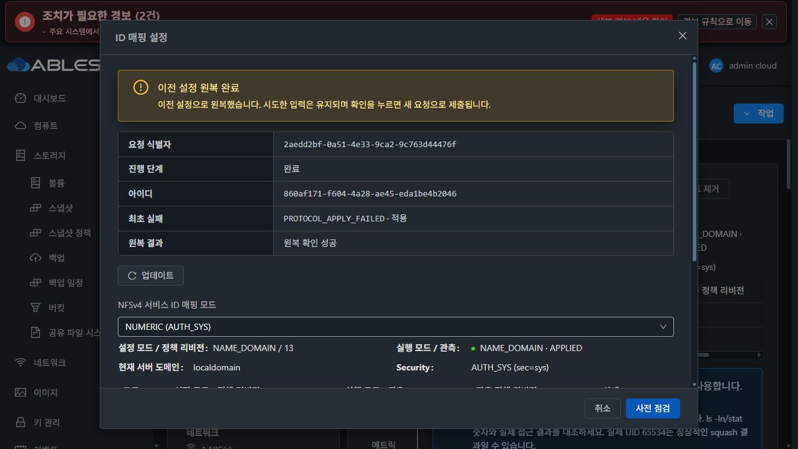
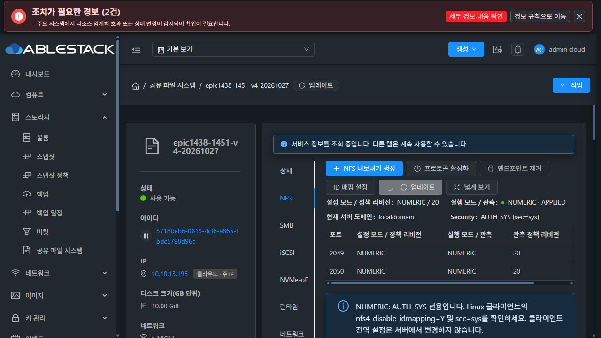
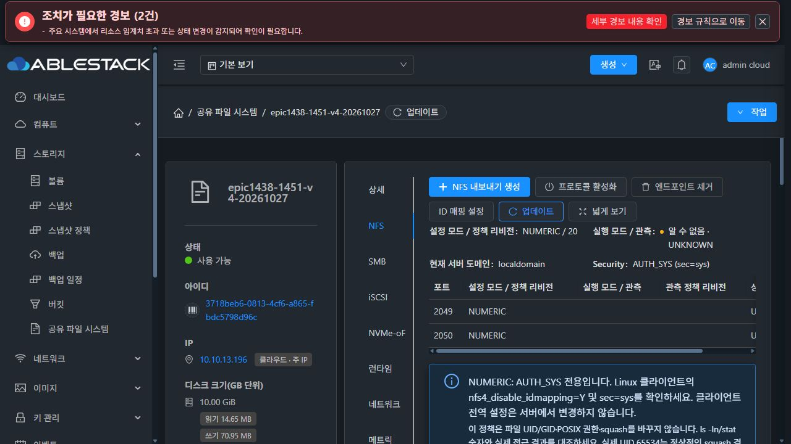
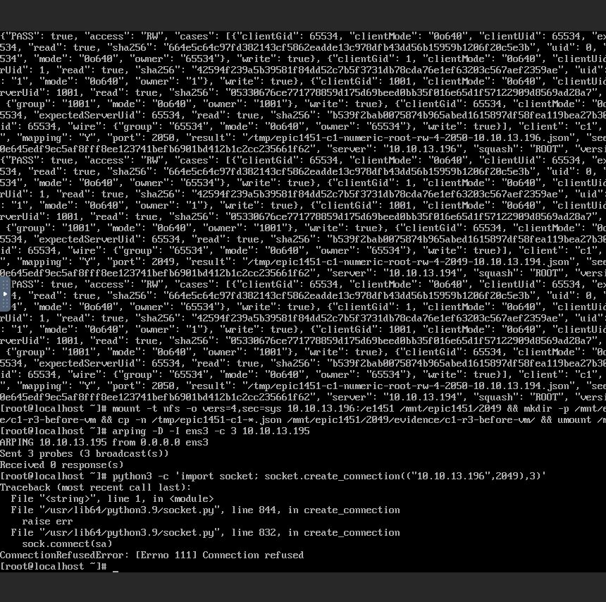

# #1451 UI 관찰 경합 수정·13번 배포 / 재시작 인수 중단
2026-10-28 · Epic #1438 · #1451 OPEN · Epic PR #1470 Draft 유지

## 현재 판정

요청한 UI 경합 수정·회귀·UI 모듈 빌드·배포와 해당 오류의 실제 UI 재현/해소는 완료했다. 같은 RUNNING/canresume 응답 뒤 job2가 도착하는 경합에서 UI가 새 ROLLED_BACK을 읽고 자동으로 폼을 해제했다. 정상 NUMERIC 전환과 두 새 client의 주 IP/별칭·두 포트32UID도 통과했다.

이후 UI로 SystemVM을 재시작하자 runtime bootstrap이 실패해 NFS 부팅 복구가 실행되지 않았다. 실제 두 포트가 닫혔으므로 단순 표시 차이가 아니다. 진단 후 후속 검증을 중단했다. **이슈를 닫지 않으며 관리 서버 재시작·새 DUAL 대조는 미완료다.**

최초 원인은 **이전 시험용 SystemVM 이미지 조립에서 서명 manifest를 갱신하지 않은 실수**다. 새 실행 payload 및 별도의 runtime-baseline-profile.json을 일치시켰지만, 이미지에 남은 runtime-default/manifest.json은 #1448 시점의 파일 해시다. 이전 9파일 비교 성공은 저장소/별도 profile과의 일치를 뜻했으며, 서명 manifest와의 일치까지 검증한 결과가 아니었다. 이를 구분해 정정한다.

## 1. 최소 UI 수정과 회귀

제품 코드 commit **f45310e6f00185e9b51759076dc84f5f3430c938**.

- storageConfigOperation.js의 기존 종료 job + canresume 조기 반환만 보완했다. 같은 instance/request/operation을 다시 GET으로 조회해 최신 상태를 사용한다.
- 최신 COMMITTED/ROLLED_BACK은 기존 종료·보호 갱신 경로로 처리한다. 확인된 RECOVERY_REQUIRED/canresume은 기존 수동 복구 경로를 유지한다.
- 작업/인스턴스 불일치·행 누락·조회 실패는 보호 관찰을 유지한다. 조회 도중 화면 scope가 바뀌면 결과를 버린다.
- POST 재전송·자동 resume·guest/DB/API 수정 없음. 기존 미응답 POST와 원 job 없는 재진입 관찰은 유지한다.
- 실제 이전 실패 응답 fixture의 경합, 성공 변형, scope 변경, 조회 실패/누락/다른 행, 계속 관찰, 실제 mounted SharedFSTab 잠금 해제·입력·진단 보존 회귀를 추가했다.
- 기존 최초 생성→COMMITTED→ACL, 서버 보호/모달 재진입·수동 복구, NFS ID 설정 계약을 포함한 **6 suites/39 tests PASS**, 변경 파일 ESLint PASS. 수정 전에는10개 실패로 기존 조기 반환을 재현했다.
- 시각 컴포넌트·Breadcrumb·목록·세로 탭·대화상자/스타일 소스 변경0. 기존 VM 표준/다크모드 스타일과 보호를 유지한다. #1468 전체 UI 정리는 시작하지 않았다.

[실제 응답 fixture 회귀](../../../ui/tests/unit/storageConfigOperationRace.spec.js) · [mounted SFC 회귀](../../../ui/tests/unit/views/storage/SharedFSConfigurationRace.spec.js) · [39회귀](evidence/regression-final.log) · [lint](evidence/lint-final.log)

## 2. 빌드·13번 배포

- UI production build PASS. Node20/webpack4의 기존 OpenSSL 호환 옵션을 사용했다.
- UI archive SHA256 **20f873fbc2ddc4d0e374b94611ab049380a9ddde63d1a0d68a64ccd369b0a505**.
- 새 index SHA256 **9e0b33bcaa9858142d31d4ee199d8b1f82ff3be71338c65dbaeb448b655e88a3**.
- 관리 서버13.10의 웹 파일6개만 반영했고 index는 마지막에 교체했다. 변경 전 파일은 전용 경로에 보존했다. 운영 config.json·systemvm 디렉터리 불변을 검증했다.
- Management JAR **07c64a803b1702ebd22b652bcea2468351e38a89f81eff36e8ba47600972e9a4** 유지. 이번 UI 수정 때문에 backend·guest·DDL·host agent를 변경하지 않았다.
- 기존 다른 파일의 checkstyle18건은 남는다. 이번에 전체 Java/CI를 재실행하거나 통과했다고 주장하지 않는다.

[모듈 빌드](evidence/module-build.json) · [배포 receipt](evidence/ui-deployment.json) · [빌드 요약](evidence/ui-build-summary.txt)

## 3. 실제 UI 경합·실패 원복·정상 변경

이전과 같은 #1451 전용 새 VM/새 DATA/새 client2대를 이어 사용했다. 이 과제 이전 client를 재사용하지 않았다. DATA는 SPARSE XFS10GiB, client ROOT는 SPARSE100GiB이고 MAC은 Mold 할당을 유지했다.

두 번째 실제 Ganesha unit 0.0.0.0_2050에만 /run의 일회성 ExecStartPre를 주입했다. NUMERIC 후보를 exit17로 한 번 실패시키고 NAME_DOMAIN 원복을 허용한다. 신뢰 payload는 편집하지 않았다.

| 항목 | 실제 결과 |
|---|---|
| UI request | 2aedd2bf-0a51-4e33-9ca2-9c763d44476f |
| operation / job | 860af171-f604-4a28-ae45-eda1be4b2046 / 1567561a-41a6-48fa-a09b-83c65e256d5f |
| 관찰 순서 | RUNNING/canresume=true → jobstatus2 → 같은 작업 새 GET → ROLLED_BACK/canresume=false |
| 실제 UI | 수동 업데이트 없이 원복 완료·완료 단계·최초 진단 표시, NUMERIC draft와 활성 입력/사전 점검 유지 |
| 중복 방지 | 해당 변경 POST1 / resume POST0 |
| backend·데이터 | NAME_DOMAIN/13·instance revision19 유지, 최초 PROTOCOL_APPLY_FAILED와 rollback SUCCEEDED 보존,241파일 metadata/hash 동일 |
| fixture 정리 | transient drop-in·script·armed/fired 정리, payload9파일 원본과 일치 |

[정확한 새 경합 응답](evidence/ui-race-fixed-actual-wire.json) · [원복·무결성 요약](evidence/rollback-summary.json) · [fixture 정리](evidence/fault-cleaned.json)

정상 NUMERIC 전환 request268438e6-975c-48e0-b477-736f73f28274는 COMMITTED/정책20으로 완료했다. 두 포트의 실제 UI 관측은 NUMERIC/20/APPLIED였다. 두 client를 콘솔에서 idmap Y로 설정하고 주IP13.196·별칭13.194×2049/2050×UID0/1/1001/65534를 시험했다. **8profiles/32UID의 실제 mount/read/write·숫자 owner/group·0640·seed SHA가 모두 통과**했다. 콘솔에서 원문을 NFS로 보존하고 SystemVM에서 읽기로 회수했다.

[실제 client 원문8개](evidence/client-cases-before-reboot-decoded.json) · [API 대조](evidence/service-scoped-wire.json)

이 결과는 이전 R2의52profiles/208UID에 이어 수행한 이번 재시작 전 추가 검증이다. 재시작 후 접속 성공으로 확대하지 않는다.

## 4. 재시작 실패의 정확한 하위 원인

UI의 rebootVirtualMachine job4bb68488-109b-4a7e-bc23-070e8768d73e는 성공했다. native boot ID도 7d774d10-59a7-460c-a730-b6a71557f39e → 00a54f86-acf3-4400-a5bc-8bd18992cb1b로 바뀌었다. 주IP13.196·별칭13.194는 그대로다.

실패 경로는 다음과 같다.

1. runtime_updater.py bootstrap L245~257은 이미지의 runtime-default/manifest.json을 읽고 서명을 확인한다. 현재 manifest 버전은 **epic1438-1448-network-7a9630a08a2**다. 동일 bootstrap trust 경로로 서명 자체의 유효성도 읽기 전용 검증으로 확인했다.
2. L260~280에서 그 버전 이름의 release 디렉터리를 생성하고 현재 실행 파일9개를 복사한다.
3. L282→verify_release L612~613에서 서명 manifest와 실제 파일 해시가 달라 **RELEASE_HASH_MISMATCH**로 실패한다. 실제 다른 파일은 storagectl, configuration_preflight.py, configuration_transaction.py의3개다.
4. current 링크·integrity.json을 기록하는 L284~286 전에 종료돼 미완성 release만 남는다. 최초 부팅 journal에도 이미 이 해시 실패가 기록돼 있다.
5. 이후 bootstrap은 current가 없으므로 같은 버전의 release를 다시 생성하려고 한다. L260의 exist_ok=False 때문에 **FileExistsError/INTERNAL_ERROR**가 발생한다. 재부팅에서 보인 File exists는 이차 증상이다.
6. ablestack-storage-reconcile.service의 Requires=runtime-bootstrap이 실패해 boot reconcile은 dependency failure로 실행되지 않는다. NFS Ganesha unit/2049·2050 listener0, 실제 client1:2049·client2:2050 모두 ConnectionRefused. UI 관측도 UNKNOWN/degraded다.

최초 생성/설정이 작동했던 이유는 관리 요청 경로가 LibvirtStorageServiceHostCommandWrapper L213에서 일반 파일 /usr/local/bin/ablestack-storagectl을 직접 호출하기 때문이다. 이 경로는 부팅 service의 Requires 성공을 요구하지 않는다. 따라서 즉시 적용은 작동했지만 재부팅 자동 복구에서 이미지 불일치가 드러났다.

이전 image builder의 changes는 실행 파일2개와 별도 runtime-baseline-profile.json만 갱신했고, runtime-default의 서명 manifest/signature를 함께 생성하지 않았다. 해당 실제 조립 script도 증거로 보존한다. 이번 UI 배포는 이 기존 이미지를 변경하지 않았다. NFS squash/ID 매핑 또는 MAC·IP를 원인으로 보지 않는다.

[최초 부팅/재부팅 journal·3파일 비교](evidence/runtime-baseline-verification-decoded.json) · [서명 검증](evidence/runtime-signature-readonly.json) · [미완성 release 구조](evidence/runtime-release-layout-decoded.json) · [dependency/listener](evidence/reboot-reconcile-failure-decoded.json) · [실제 이전 image builder](evidence/prior-image-builder.py) · [UI 재시작 API](evidence/vm-scoped-wire.json)

## 5. 영향과 보존·미완료

- 재시작한 전용 SharedFS3718beb6-0813-4cf6-a865-fbdc5798d96c/VM936fd57c-386a-384d-be07-368844b41b61은 실행 중이나 NFS 접속은 불가능하다. 보호를 우회해 수동 적용/기동하거나 재부팅을 반복하지 않았다.
- 데이터·설정·정책20·IP는 남아 있다. **재시작 전후301파일의 UID/GID/mode/SHA256이 정확히 동일**하다. 이는 데이터 보존 결과이며 서비스 정상 복구 결과는 아니다.
- 별도 DUAL 서비스ba51d26c-c82e-48ee-b57d-5d43147507a6/VM0c69f62a-2186-3e35-b379-d129399f0a3c/DATA5c1d3614-7e18-484b-b25c-01417c7512c5를 실제 UI로 새로 생성했다. STATIC13.195/16·SPARSE XFS10GiB다. source VM 재시작 중 병행한 생성은 VM/DATA와 NFS 프로토콜 활성화까지 진행됐다. 제품 실패 확인 뒤 export/ACL 영향 승인은 하지 않았고 취소·새로고침으로 후속 제출을 중단했다. 취소의 CONFIGURATION_IMPACT_NOT_ACKNOWLEDGED 알림을 별도 제품 오류로 세지 않는다.
- 새 DUAL의 모드 변경/v3·v4 client 대조와 관리 서버 재시작 시험은 수행하지 않았다.
- client QGA exec/file 비활성·SSH 인증 설정·MAC을 유지했다. 이번 UI 수정 범위를 넘어 제품 코드를 고치거나 별도 이슈를 만들지 않았다.
- 일부 장시간 CDP buffer 구간은 만료됐다. 핵심 경합 RUNNING→job2→ROLLED_BACK 및 실제 mutation은 완전히 보존했다. 모든 백그라운드 조회를 빠짐없이 수집했다고 주장하지 않는다.

[재시작301파일 보존](evidence/reboot-data-summary.json) · [전/후 원문](evidence/data-before-vm-reboot.json) · [후 원문](evidence/data-after-vm-reboot.json) · [생성 DUAL 식별/프로비저닝](evidence/dual-owned-resource.json)

## 6. 다음 최소 개선 방향 — 아직 미구현

1. 실제9파일과 동일한 hash/size/mode의 고유 버전 manifest를 생성·보호된 기존 키로 서명하고, runtime-default와 별도 baseline profile을 하나의 산출물로 조립한다. 기존 서명/파일 무결성 보호는 유지한다.
2. 이미지 빌드 인수에 서명 검증 + 실제9파일 verify_release + 깨끗한 첫 bootstrap + 두 번째 bootstrap의 동일 결과 + 실제 새 VM 재부팅/reconcile 성공을 포함한다. 별도 profile9/9 비교만으로 배포 가능 판정을 내리지 않는다.
3. 미완성 release가 남은 경우에는 current/confirmed가 참조하지 않는 해당 실패 단계만 안전하게 다루고 최초 해시 오류를 보존하는 경로를 검토한다. 무조건 exist_ok=True/덮어쓰기/서명 우회로 해결하지 않는다.
4. 교정된 새 이미지·새 전용 VM/DATA에서 UI 첫 생성/재시작과 두 client의 기존 인수를 다시 확인한 뒤 관리 서버 재시작·새 DUAL 대조를 마친다. 모두 통과한 뒤 #1451을 닫는다.

현재는 오류 분석·기록 후 중단 상태다. #1451 OPEN, PR #1470 Draft/미병합, #1468 HOLD를 유지한다.
