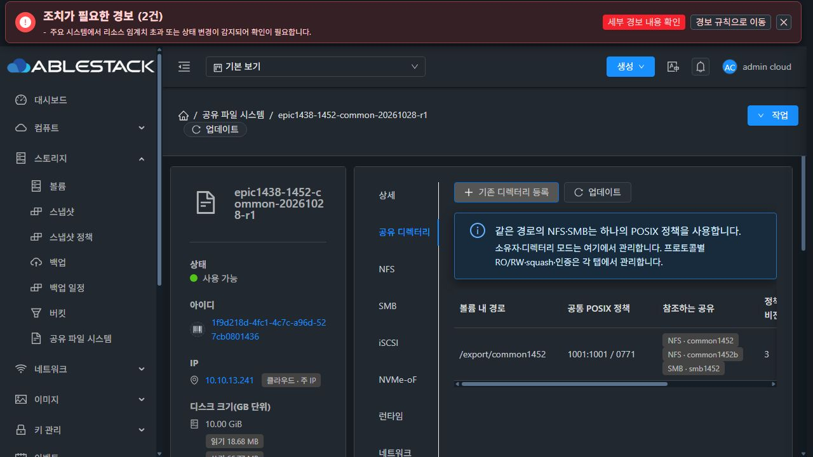
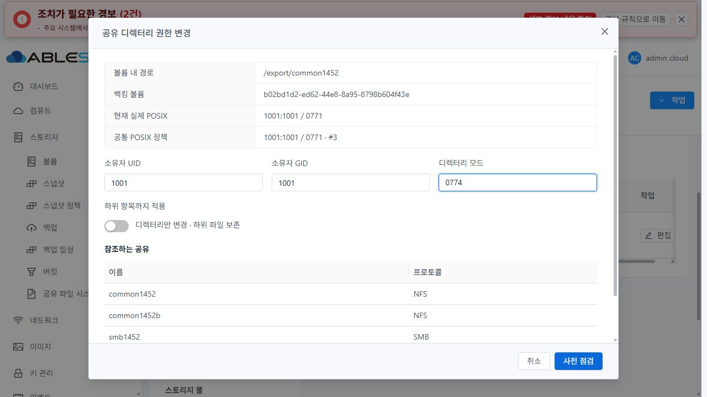
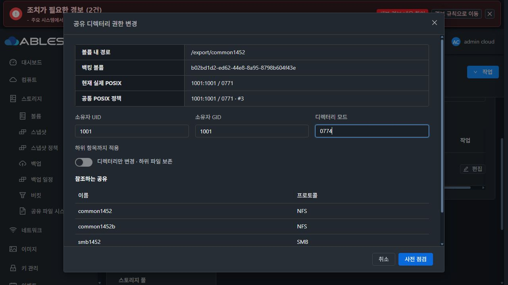
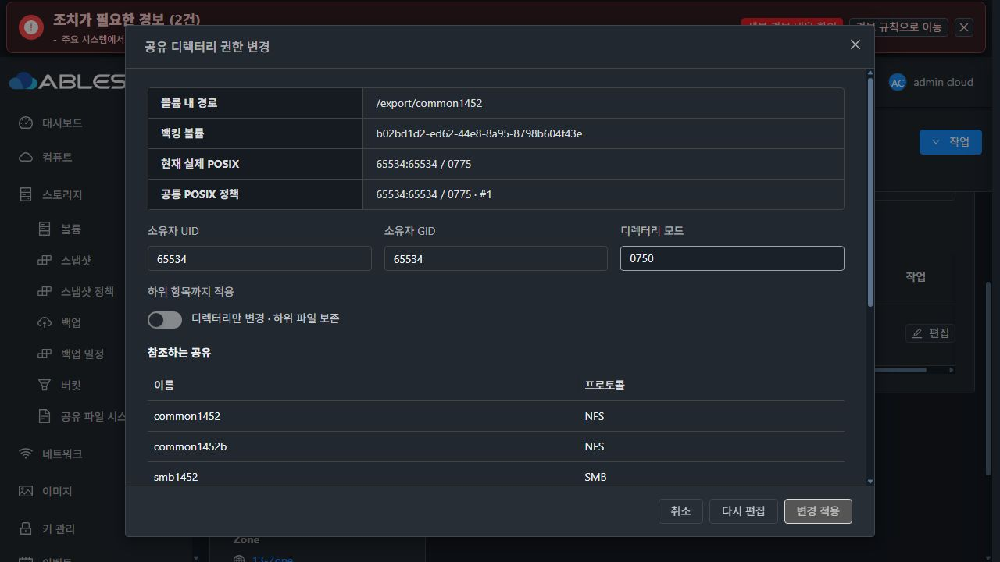
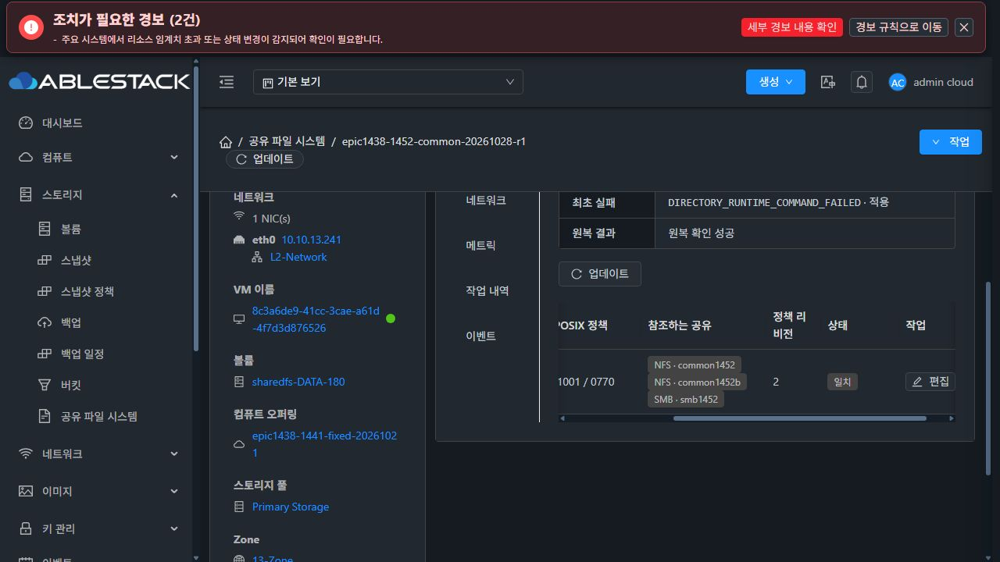
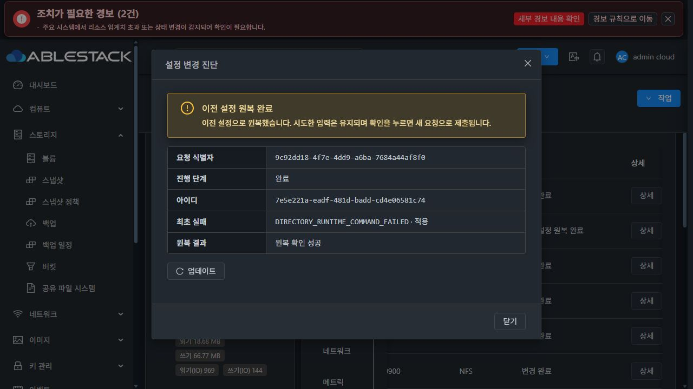
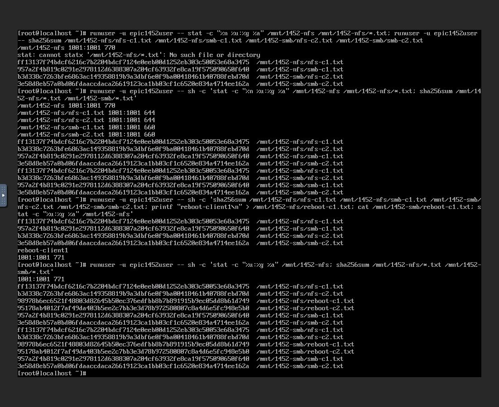
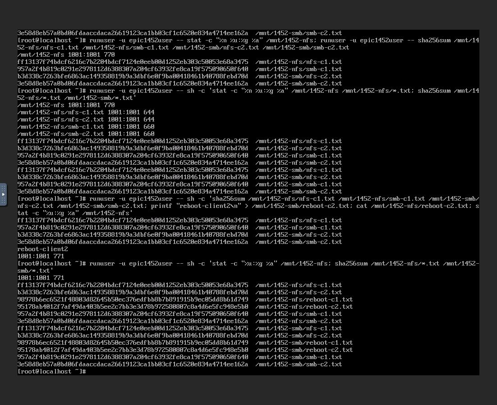

# #1452 구현 및 13번 인수 완료

2026-10-28. 이 기록은 #1452 범위의 구현·실제 배포·인수 결과다. 기존 Epic 전체나 다른 프로토콜/AD/백업 과제의 완료를 의미하지 않는다.

## 결과와 수정 내용

NFS의 논리 경로 `/export/common1452`, `/export/common1452b`와 SMB 공유 `smb1452`가 같은 SPARSE DATA 디렉터리를 사용하고, 하나의 공통 POSIX 정책으로 소유자·모드·revision을 관리한다. 초기 등록은 현재 실제 값을 채택하고 파일·권한을 변경하지 않는다. 이후 명시적 공통 변경과 각 프로토콜의 접근 정책 편집을 분리했다.

이전 중단 원인은 `Path.resolve()` 문자열 비교가 bind mount를 실제 DATA 경로로 해석하지 못한 것이었다. 다음과 같이 수정했다.

1. 관리 볼륨은 `findmnt -J -M`, export 별칭은 `findmnt -J -T`로 TARGET·FSROOT·UUID를 관측한다.
2. alias FSROOT와 볼륨 FSROOT의 상대 위치 및 별칭 아래 suffix로 볼륨 내 물리 경로를 만든다.
3. 볼륨 경계·filesystem UUID와 실제 device/inode를 대조한다. 다른 디렉터리/파일시스템·symlink·재연결은 자동 허용하지 않는다.
4. 이 topology를 preflight fingerprint에 포함하고 영향받는 실제 NFS unit의 PID·config·listen 포트를 검증한다. 권한 적용/원복 후 그 unit만 갱신해 Ganesha 속성 캐시도 일치시킨다.

실환경에서 두 bind 별칭은 UUID `538f925e-5da8-4ba0-9a69-d8a85b1cb9c5`, device2064/inode8388736으로 같은 물리 디렉터리에 매핑됐다. 실제 관측의 unit 목록은 2049와 2050을 모두 포함했다. SMB는 검증된 물리 backingPath를 사용하며 논리 공유 경로 자체를 별도 bind mount로 만들지 않는다.

기존 instance writer·preflight/ACK·shadow plan·guest journal·SQL commit/recovery를 재사용했다. 신원 검증, 중복 포맷 방지, ACL mask 자동 확대 금지, bounded recursive before-image, 미변경 POSIX 비제출과 원복 보호를 유지한다.

## 소스와 빌드

- 구현 commit: `79e9433fc955abc6241efdbd40afde5fdf286b52`.
- 로컬 Europa를 upstream `37bceae693041b9c79cc52084053b050b577029d`로 먼저 갱신하고 Epic 브랜치 `epic/1438-sharedfs`를 merge 구조를 보존해 rebase했다. base/upstream 차이 `0 0`. 기존 작업의 백업 tag/stash는 private 준비 경로에 보존했다.
- API·실제 coordinator→DAO 저장/재조회 22개, UI 5 suite/46개와 scoped lint·production build, runtime updater 20개, POSIX unit11개 통과.
- 실제 SPARSE XFS SystemVM 주입 회귀 6개: 실제 bind와 두 NFS 포트·SMB 교차 I/O, 다른 디렉터리/FS 제외, alias 재연결 거부, 중복/재개, peer 실패 원복, 기존 2049/2050 읽기 전용 관측. 기존 서비스의 61파일·설정·payload·운영 PID 보존, 임시 자원 정리 확인.
- 실제 SystemVM의 격리된 경로에서 서명 payload의 최초/반복 bootstrap·기존 설치 코드와 desired-state 보존도 확인했다.
- `mvn -pl client -am -DskipTests -Dcheckstyle.skip=true -Drat.skip=true -Dlicense.skip=true package`: 151모듈 빌드 성공. 관련 시험은 위 별도 실행이다. 기존 JAXB/JDK17 코드 생성 문제는 JVM 속성 `-Dcom.sun.xml.bind.v2.bytecode.ClassTailor.noOptimize=true`로 해결했으며 관련 없는 소스/의존성은 수정하지 않았다.
- checkstyle/rat/license는 위 명령에서 skip했다. 전체 저장소 CI 통과를 주장하지 않는다.

[회귀 요약](predeployment-checks.json) · [실제 bind 회귀](native-bind-result.json) · [서명 bootstrap](signed-bootstrap-probe.json) · [빌드/배포 영수증](build-and-deployment.json)

## 13번 배포와 스키마

| 항목 | 배포 결과 |
|---|---|
| 관리 서버 | 10.10.13.10 · 전체 의존성과 정렬한 cloudstack-4.23.0.0.jar |
| 관리 JAR SHA-256 | `39cd997647853bab1f686d6745eafa680f6e5a03e5acf56df80c11bd942be46c` |
| UI index SHA-256 | `277495a21b6ccdd6c7d284d9d04295e8d437b6e6a720241baf71a1826ad1b128` |
| SYSTEM 템플릿 | `Europa-SystemVM-1452-posix-20261028-r1` / `8754cfc3-811c-4309-95ec-c8aaf66854c8` |
| 이미지 SHA-256 | `fe1f7582726a764c77ab25111f85c017407ed32ac2dfa5c41b7cd387890805b1` |
| 런타임 | `epic1438-1452-posix-79e9433fc955-r1` · 정상 서명10파일 |
| 되돌림 자료 | `/var/tmp/epic1438-1452-79e9433fc955` |

UI에서 SYSTEM 템플릿 등록→Ready·checksum을 확인하고 실제 새 VM의 템플릿 UUID를 대조했다. 기존 보호 키를 DPAPI로 열어 메모리에서만 서명했으며 개인키 원문은 파일/이슈에 기록하지 않았다. 이미지 변경 8경로, 다른33,929경로·호스트 계정 파일·네트워크/bootstrap 기존 파일 보존, qemu-img check 통과. 관리 JAR·교체 UI 파일은 되돌림 자료에 보존하고 operator config·기존 hashed UI assets·systemvm/storage-runtime 파일을 유지했다. host agent는 변경하지 않았다.

전용 idempotent DDL [schema-sharedfs-1452-directory-policy.sql](../../../engine/schema/src/main/resources/META-INF/db/schema-sharedfs-1452-directory-policy.sql)을 적용했다. 새 표 `storage_directory_policy`는 14열이다.

`id, uuid, instance_id, volume_id, canonical_path, canonical_hash, owner_uid, owner_gid, mode, revision, last_recursive, metadata_json(MEDIUMTEXT), created, updated`

unique UUID, unique(instance_id,volume_id,canonical_hash)를 사용한다. 기존 공유는 config_json.directoryPolicyUuid로 참조하며 기존 표/데이터를 일괄 변경하지 않는다. [이미지 조립 검증](assembled-image-verification.json) · [이미지 무결성](guest-module-build.json).

## 실제 UI와 클라이언트 자원

모든 서비스/VM 생성과 NFS·SMB·ACL·공통 권한 변경은 실제 Mold UI에서 실행했다. API는 그 UI 요청/응답 대조에 사용했다. 클라이언트 구성/접속/파일 시험은 각각의 실제 noVNC 콘솔에서 실행했다. QGA는 승인된 SystemVM 주입 시험과 읽기 전용 신원/파일 관측에 사용했다.

| 자원 | UUID / IP |
|---|---|
| SharedFS | `1f9d218d-4fc1-4c7c-a96d-527cb0801436` / 10.10.13.241 |
| 새 SystemVM | `8c3a6de9-41cc-3cae-a61d-4f7d3d876526` · i-2-180-VM |
| DATA | `b02bd1d2-ed62-44e8-8a95-8798b604f43e` · XFS10GiB/SPARSE |
| 새 클라이언트1 | `f5b615ef-6fac-4667-973d-7f58f0cab7f7` / 10.10.13.242 |
| 새 클라이언트2 | `1a761e54-2c17-4b87-ace5-8bda0cac4899` / 10.10.13.243 |
| 공통 정책 | `32d0171b-1a93-31e2-b0be-8c0c926c7ee9` |

세 IP는 생성 전에 ARP DAD로 중복을 검사했다. SystemVM의 ROOT/DATA와 두 Rocky9 클라이언트의 ROOT100GiB를 UI에서 **모두 SPARSE**로 확인했다. MAC을 지정하거나 변경하지 않았다.

## 인수 결과

| 실행한 검증 | 확인한 결과 |
|---|---|
| 새 서비스의 기본 NFS 생성→ACL→클라이언트 연결 | 기본 흐름 성공. 신규 포맷1회 |
| 실제 값으로 공통 정책 등록 | 65534:65534/0775 그대로 채택, 정책revision1 |
| SMB 로컬 인증과 NFS 두 별칭/두 포트 연결 | common1452(2049), common1452b(2049/2050), smb1452(445)가 하나의 물리 경로 참조 |
| 두 새 클라이언트의 NFS↔SMB 교차 쓰기/읽기 | 네 seed파일 해시·owner/mode 일치 |
| SMB RW와 충돌하는0750 | DIRECTORY_ACL_MASK_CONFLICT로 적용 전 차단, 자동 mask 확대 없음 |
| 공통 owner/mode1001:1001/0770 변경 | 실제2049/2050 갱신 후 양 클라이언트에서 같은 값, child 파일 권한·해시 보존, revision2 |
| 단발성2050 unit 갱신 실패 주입 | 실제 권한 변경 뒤 실패→ROLLED_BACK/SUCCEEDED, 기존0770·ACL·revision2·파일/접속 원복 |
| 같은revision의 두 UI 창 동시 변경 | 첫 요청0771만 COMMITTED/revision3. 두 번째0773은 실행 중 writer 보호로 변경 전 거부 |
| 실제 UI SystemVM 재시작 | boot ID 변경, 원래13.241 재접속, 두 포트·SMB 인증·공통1001:1001/0771/revision3 보존 |
| 재시작 후 교차 쓰기 | NFS에서 새 파일 생성→SMB 읽기, SMB에서 새 파일 생성→NFS 읽기 성공 |
| 관리서버 재시작→UI 재로그인 | 성공/원복 이력과 원복의 최초 실패 원인·SUCCEEDED 보존 |
| NFS·SMB 미변경 POSIX 편집 | 실제 POST에 owneruid/ownergid/mode/directorymode/recursivepermission 없음. 두 작업 정상 완료, root·ACL·registry·여섯 파일 완전 보존 |
| 기존 보호 | 다른 경로/FS/신원 교체·중복·stale/재귀 상한·서명 보호 회귀 유지. 기존 서비스/사용자 자원/MAC 변경 없음 |

실패 주입은 전용2050 서비스의 **한 번만 실패하는 runtime ExecStartPre**로 수행했다. 실제 payload/서명 보호는 변경하지 않았다. UI 원복 완료를 확인한 뒤 marker/drop-in을 제거했고 active service를 확인했다. 의도한 장애 주입/충돌·동시 요청 거부를 미예상 제품 오류로 분류하지 않는다. 예기치 않은 제품 오류는 이번 최종 인수에서 발견하지 않았다.

NFS RootSquash의 익명 UID65534는 SMB 파일의1001:1001/0660을 읽을 수 없는 것이 정상이다. 시험은 인증된 동일 숫자 UID1001로 실행했다. 콘솔의 초기 root 조회 거부와 runuser 전에 glob이 전개된 시험 명령은 수정해 재검증했으며 보호를 완화하지 않았다.

[UI API 관측](ui-api-observations.json) · [동시 요청의 두 번째 UI](concurrent-second-ui.json) · [실제 비제출 파라미터](unchanged-posix-requests.json) · [원복 주입](live-fault-injection.json) · [주입 제거](live-fault-cleanup.json)

[원본 파일 baseline](live-baseline.json)과 [최종 실제 상태](live-final.json)의 네 seed파일은 hash·UID/GID·mode·inode가 전부 동일하다. 새 재시작 확인파일2개를 더한 여섯 파일도 마지막 NFS/SMB 편집 전후 동일하다. 정책 registry는 마지막 공통 변경의 operation UUID/revision3를 유지하며 일반 편집/부팅 후에도 실제 권한과 registry가 일치했다.

## 실제 UI 스타일

새 탭/폼은 기존 Breadcrumb·ResourceLayout·MoldDialog/MoldDialogActions와 세로 탭을 사용하고 정보 전용 상세 탭에 작업을 추가하지 않았다. 중복 탭 제목 없음, 좌측 toolbar/primary, Reload+업데이트, 기존 NFS/SMB 넓게 보기 버튼은 좌측 버튼 묶음 마지막에 유지한다.

실제 대화상자 header y33~88, body y88~622, footer y622~687. 본문 scrollTop0→89에서도 header/footer 위치 동일, body overflow:auto. 버튼 gap8px. 라이트/다크 모두 확인했다. 다크의 활성 primary 흰 글자 대비5.19:1, 본문 글자 대비13.35:1. [DOM 실측](ui-review.json).

기존 작업 패널의 NOT_NEEDED 번역이 성공 작업에서도 “변경 전 거부 · 원복 불필요”로 보이는 점과 기존 탭의 구분 문자 표시는 기능·판정·권한에 영향 없는 표시 항목으로 기록한다. 사용자 지시에 따라 #1468 최종 UI 정리에서 다루며 이 과제에서 전면 UI 정리를 시작하지 않았다.

## 완료 범위

#1452의 세 인수 기준을 충족한다. 시험 자원은 결과 재확인을 위해 실행 상태로 남겼으며 주입한 임시 native 자원과 실패 장치는 제거했다. 서명 이미지·배포 전 백업은 유지한다. Epic PR #1470에 코드/증거를 반영하고 완료 기록 후 이슈를 닫는다. 다음 순서는 #1453 “부모 UID/GID 상속을 위한 inherit owner 및 setgid 정책 지원”이며 별도 지시 전 구현을 시작하지 않는다.
