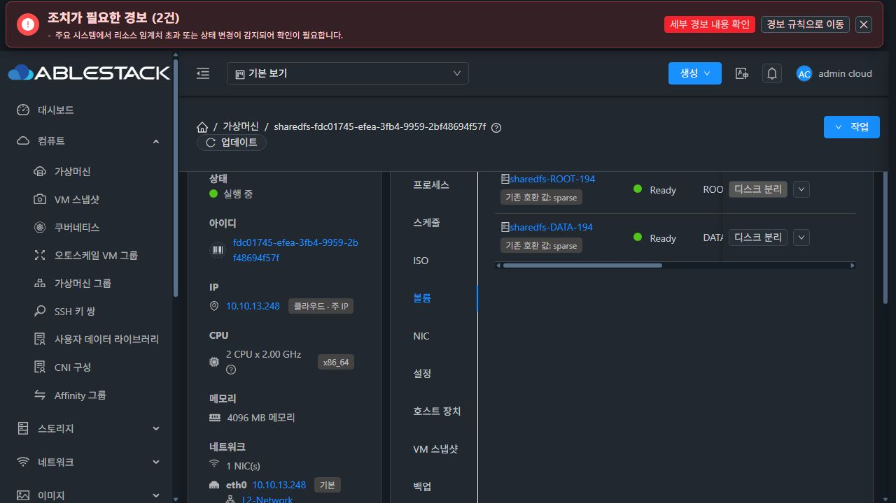
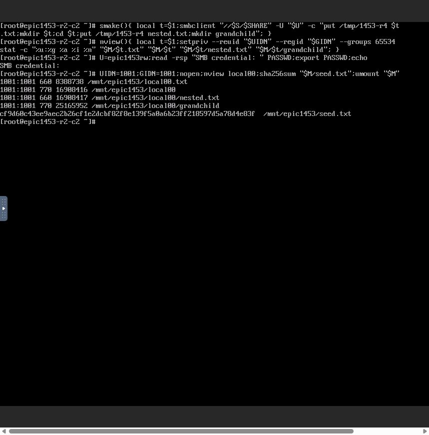
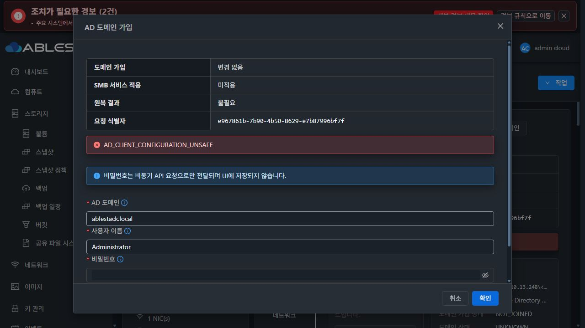

# #1453 R4 — 관리 SMB/AD 단계 분리 반영, 최초 가입 사전 검사 오류로 중단

**2026-10-30 KST / #1453 OPEN / PR #1470 Draft / 전체 인수 미완료.**
요청한 관리 리스너 사용 시 기본 smbd 별도 기동 방지, 가입/서비스 적용 UI 단계 분리와 진단·원복 처리를 구현하고 13번에 배포했다. 새 SPARSE VM의 실제 UI AD 최초 가입에서 **AD_CLIENT_CONFIGURATION_UNSAFE**를 확인했다. 재가입·추가 적용·추가 인수 시험은 중단했고 읽기 전용 원인·보존 진단만 수행했다. 이 문서는 정상 가입·원복·재시작 인수를 통과한 것으로 표시하지 않는다.

## 구현과 사전 시험

제품 commit **3f4547264620f7a2ed72c82885f8078d3685ca72**. fetch 후 local/upstream Europa **31c147ca747f7a4ffc0380818bcd44887558a0c7**, 차이 0/0을 확인했다. origin Epic 브랜치를 통해 기존 통합 PR #1470에 반영했다. 신규 DDL·host agent 변경·별도 이슈/PR는 없다.

- AD membership은 private smb.conf를 사용하고, 관리 리스너 또는 membership-only 경로에서 기본 smbd/nmbd/winbind를 별도 기동하지 않는다. 기존 직접 legacy 경로는 유지한다.
- 같은 guest configuration lock 안에서 membership과 기존 RuntimeAdapter의 SMB snapshot/apply/verify/restore를 연결했다. DB reservation은 짧은 트랜잭션으로만 유지한다. 일반 구성·런타임 업데이트가 실행 중 또는 복구 미완료인 AD 작업과 겹치지 않도록 보호한다.
- 가입된 trust와 서비스 적용 결과를 분리한다. 서비스 적용 실패 시 기존 SMB 상태를 원복하고 정확한 child stdout 실패 코드와 원복 결과를 보존한다. 조기 성공 처리·무조건 재가입을 피하고, 정상 재가입의 기존 동작은 유지한다.
- UI는 실제 같은 jobid의 도메인 가입·SMB 서비스 적용·원복을 표시한다. 두 단계 완료 전에 모달을 성공으로 닫지 않고 비밀번호를 전송 직후 지운다. 실패 코드와 요청 식별자를 유지한다.
- protected baseline updater는 6으로 올리고 AD transaction capability를 별도로 확인한다. 기존 상속 보호의 minimum5 호환은 유지한다. 실제 payload 10파일로 profile/manifest를 다시 생성·서명했다.
- UI는 기존 MoldDialog/MoldDialogActions와 표준 폼을 사용했다. 전체 Breadcrumb/세로 탭 구조나 다른 프로토콜 UI를 다시 만들지 않았다. 실제 다크 모달에서 헤더·푸터 고정, 본문 스크롤과 단계별 글자/오류 안내를 확인했다. 성공 흐름과 최종 light/dark 인수는 미완료다.

구현 전 실제 R3 SystemVM의 private namespace에서 candidate 전체 member CLI를 실행해 기존 trust 확인과 global SMB 설정/기본 service PID 불변을 확인했다. 최종 후보도 같은 방식으로 확인했다. 실제 기존 wildcard 리스너의 충돌을 멤버십 쓰기 전에 차단하는 검사도 통과했다. **이 대상은 이미 AD 가입을 시도해 krb5.conf가 생긴 VM이었으므로 새 VM의 최초 가입 상태를 검증하지 못했다. 이 사전 검증 누락이 아래 결함을 놓친 이유다.**

정상 서명 번들을 실제 정상 R2 SystemVM의 private mount namespace에서 최초 bootstrap→활성 symlink CLI capability→inherit owner true preflight READY→반복 bootstrap 2회로 확인했다. updater6/AD capability1/기존 보호1, productionUnchanged와 임시 파일 제거를 확인했다. 이는 읽기 전용 기능·호환 계약 시험이며 실제 AD 가입 성공을 대신하지 않는다.

## 빌드와 13번 배포

| 항목 | 결과 |
|---|---|
| backend API/직렬화/실제 coordinator→SQL DAO | 30시험 PASS |
| guest transaction/parent 보호 회귀 | 49시험 PASS |
| 실제 Vue 컴포넌트·요청/오류 계약 | 69시험 / 7 suites PASS |
| 변경 UI lint | PASS |
| management client -am package / UI production build | PASS / PASS |
| signed SystemVM | 서명·10파일 profile/hash 일치, qemu-img/bzip2 PASS |
| 나머지 image 경로·WSL 계정 | 33,929경로·계정 파일 보존 |
| 관리 JAR SHA256 | 460ad6bf8e4540f842946be91490d130888bae41c03c27233451f0228f826ff7 |
| UI index SHA256 | c37069d7fdd460ae2719ec49a549a35094f20fcc6f618eaf2f9120b25a176a48 |
| image SHA256 / bytes | a88455c0a97a55ca0cff1c543b0513186d89b20cf971bd6a9105633bd8b00b2d / 498292284 |
| runtime version | 1453.ad.3f4547264620.r4 |
| 배포 후 재확인 | 위 JAR/index 동일, mold active, HTTP200 |
| 배포 백업 | /var/tmp/epic1438-1453-ad-3f4547264620-r4 |

UI 9파일과 관리 JAR만 교체했다. config.json·외부 JAR·기존 systemvm 게시 자산을 보존했다. 이미지 서명키는 기존 DPAPI 보호 키를 memfd에서만 사용했다.

[빌드](evidence/build-artifacts.json) · [배포](evidence/deployment.json) · [실제 signed bootstrap/활성 CLI](evidence/signed-bootstrap-active-cli.json) · [구현 전 candidate member](evidence/preimplementation-member.json)

## 새 자원과 실제 UI·두 클라이언트

- SYSTEM template **35e94228-f5c9-4add-900c-64a476cb3069**, Europa-SystemVM-1453-AD-20261030-r4. 실제 UI에서 Cross-zone SYSTEM 등록 후 사용 가능 확인.
- SharedFS **103e9ee0-d7d1-4d0b-9e76-79056d0a006c**, instance **4cc8fd3c-19c5-4f05-960c-82d40abdc802**.
- 새 VM **fdc01745-efea-3fb4-9959-2bf48694f57f / i-2-194-VM / ablecube13-2 / 10.10.13.248**.
- 새 ROOT4.88GiB와 DATA10GiB 모두 실제 VM 볼륨 UI의 SPARSE. DATA **017acda1-a5eb-4b28-bbd5-50404955afb1**, XFS UUID **2858550d-5e16-42eb-8c76-57a751e22096**. 생성 전 DAD에서 ARP 응답0. MAC 임의 변경 없음.
- 이 #1453 시험용 실제 Linux client1 **aaa3c43c-4f32-48f2-bdd5-e3930f908a07 /10.10.254.224**, client2 **e6744029-299e-4585-981b-65e312d9e752 /10.10.254.223**. 두 ROOT100GiB SPARSE. 실제 Mold VM 작업→콘솔 보기로 접속하고 콘솔 입력으로만 클라이언트 I/O를 실행했다.
- 시험 AD **eed7f477-e439-4d8a-a932-3642aac0359e /10.10.13.247 /ablestack.local**은 기존 #1453 전용 서버다. 새 서비스 IP의 필요한 AD OS 방화벽 허용만 추가했다.
- Mold UI로 NFS 초기 공유/ACL→NUMERIC ID mapping→SMB 10.10.13.248:445 관리 리스너→기존 부모 실제값 ADOPT→공통 정책 참조 SMB 공유→로컬 RW/RO ACL을 수행했다. 숨은 API/QGA로 자원이나 공유를 준비하지 않았다. SystemVM 주입·읽기 전용 진단과 AD OS 준비에만 승인된 QGA를 사용했다.

실제 부모 **/export/common1453r4 /65534:65534/0775/inode8388736**, policy **cdec93fb-7d49-302a-bb2a-e87795059732**, SMB share **5e072681-d033-49cd-8de5-a2d25806a3d2**.

실제 client1 NFS mount와 seed 쓰기·unmount 성공, nfs4_disable_idmapping=Y. 실제 로컬 RW UID/GID1001:1001, RO1002:1002를 NSS로 확인했다. client1 SMB에서 OFF/OFF 파일·dir·nested·grandchild 생성 후 client2 NFS에서 숫자 stat로 **파일1001:1001/0660, dir1001:1001/0770** 확인, seed hash 동일. 두 클라이언트 모두 unmount 상태로 AD 가입을 시작했다.

R3의 로컬 네 조합 성공은 R3 보고서에 별도 보존되어 있다. 이번 R4 새 서비스에서 재확인한 것은 OFF/OFF와 기본 교차 I/O이며, 나머지 조합 및 AD 인수로 확대하지 않는다.




[실제 UI 요청/응답·AD job 원문](evidence/ui-request-results.json) · [새 활성 CLI](evidence/new-vm-capability.json)

## 최초 제품 오류의 정확한 원인

**2026-10-30 15:19:32~15:19:34 KST**, UI joinStorageServiceToAdDomain job **797c59bb-0c73-4c41-9e44-8e255fc38e82**, operation **e967861b-7b90-4b50-8629-e7b87996bf7f**.

실제 최종 API:
```json
{"jobstatus":2,"jobresultcode":530,"jobresult":{"errorcode":530,"errortext":"AD_CLIENT_CONFIGURATION_UNSAFE; membership=UNCHANGED; rollback=NOT_NEEDED"}}
```

1. 새 SystemVM에는 **/etc/resolv.conf는 root:root0644 regular**, **/etc/krb5.conf는 아직 없다**.
2. 이번에 추가한 configuration_transaction.py **AdDomainJoin.run:1906~1909**가 두 파일 모두 is_file()이어야 한다고 가정했다. 존재하지 않는 정상 초기 Kerberos 구성을 symlink 등 위험 상태와 같은 AD_CLIENT_CONFIGURATION_UNSAFE로 거부했다.
3. 원래 전체 CLI의 smb_domain_join은 **ablestack-storagectl:5271~5274**에서 krb5.conf를 생성한다. 새 guard가 **member() 호출(1914행) 전**에 실행되어 이 정상 생성 경로에 도달하지 못했다.
4. 새 회귀의 setUp도 두 파일을 항상 먼저 생성했다(test_ad_domain_transaction.py:26~27). 기존 가입 VM 주입 시험과 이 fixture가 같은 잘못된 전제를 공유했다. **신규 VM의 최초 가입을 사전 시험에 포함하지 않은 검증 누락이다.**
5. 따라서 현재 실패는 membership/SMB 적용 전 사전 거부다. 실제 AD 가입·서비스 적용 원복의 성공/실패를 판단할 단계까지 도달하지 않았다. 새 기본 smbd 방지와 rollback의 전체 AD 실환경 인수도 아직 완료되지 않았다.

UI는 실패 후 모달을 유지하고 **가입 변경 없음 / 서비스 미적용 / 원복 불필요 / 요청 식별자 / 정확한 실패 코드**를 보였다. 비밀번호는 비워졌다. 성공으로 모달을 닫거나 JOINED 완료로 표시하지 않았다.



## 오류 후 현재 영향과 보존

읽기 전용 진단만 추가했다.

- 기본 smbd.service는 **inactive /MainPID0**. 관리 smbd의 **PID13722 /10.10.13.248:445**는 가입 전과 동일하다. 0.0.0.0:445 별도 smbd 점유 없음.
- /etc/krb5.conf는 여전히 없으며 실제 membership은 NOT_JOINED다. guest AD status.json은 아직 생성되지 않아 정상 show 응답은 {}다. 서버에는 REJECTED/UNCHANGED/NOT_APPLIED 진단이 저장된다.
- 서버가 보관한 AD 대상 설정의 표시와 실제 가입 완료는 구분해야 한다. 현재 상단 인증 방식은 AD 대상을 표시하지만 join state는 NOT_JOINED다. 이 표시로 가입 성공을 주장하지 않는다.
- 기본 부모/seed 두 항목의 UID/GID/mode/device/inode/hash는 가입 전 native snapshot과 같다. client2에서 가입 전에 확인한 SMB 새 객체 네 항목의 UID/GID/mode/inode도 오류 후와 같다.
- 알려진 데이터3파일 SHA256 모두 **cf9d60c43ee9aec2b26cf1e2dcbf82f8e139f5a0a6b23ff218597d5a78d4e83f**. 재귀 권한 변경·포맷·MAC 변경 없음.
- 새 제품 오류 뒤 클라이언트 쓰기·재가입·서비스 재적용·재시작을 수행하지 않았다. 기존 R3 실패 VM도 복구되었다고 표시하지 않는다. 자원과 진단을 다음 지시를 위해 보존했다.

[정확한 파일/서비스 진단](evidence/ad-failure-diagnosis.json) · [보존 대조](evidence/preservation-check.json) · [오류 후 숫자 metadata/hash](evidence/after-ad-failure-state.json)

## 다음 최소 개선안 — 이번에는 미구현·미재시도

1. **UI 흐름 유지:** 사용자는 같은 가입 폼을 사용한다. krb5.conf를 수동 생성하도록 요구하거나 QGA 우회 가입으로 인수를 대신하지 않는다. 실패는 현재 단계/코드와 원복 결과를 계속 유지한다.
2. **guest snapshot에 부재 상태 저장:** 고정 허용 경로인 /etc/krb5.conf의 최초 부재를 정상으로 취급하고 exists=false를 기록한다. 기존 regular file은 원래 bytes/mode를 보존한다. symlink·비정상 파일·안전하지 않은 부모는 계속 거부한다. resolv.conf 등 모든 누락을 무조건 허용하는 방식으로 보호를 완화하지 않는다.
3. **정상 기존 생성 경로 재사용:** 파일 생성은 기존 member helper가 수행한다. 가입 전 확정 실패 시 원래 존재한 파일만 복구하고, 원래 없던 krb5.conf는 이 작업이 생성한 안전한 regular file임을 확인한 뒤 원래 부재로 돌린다. 가입 결과가 불명확한 경우 기존 RECOVERY_REQUIRED 보호와 trust 보존을 유지한다.
4. **사전 실증의 대상을 교정:** 구현 전 새 템플릿의 최초 부팅 상태에서 krb5.conf 없음→생성, 고의 가입 전 실패→부재 원복, 기존 regular 보존, symlink 거부를 실제 SystemVM 후보 주입으로 먼저 확인한다. 이미 가입된 VM만으로 판정하지 않는다.
5. **회귀와 실제 UI 재개:** 위 초기 상태를 실제 CLI bootstrap/transaction 회귀에 넣고, UI의 최초 가입→두 단계 완료→기본 smbd inactive/관리445 단독→AD RW/RO 사용자의 새 객체/NFS 숫자 대조로 연결한다. 이후 부모별 독립성·충돌/동시 변경·실패 원복·재시작·권한/데이터 보존과 최종 UI 검토를 완료해야 닫는다.

새로운 제품 수정이나 AD 재시도는 시작하지 않았다. **#1453 OPEN·PR1470 Draft로 기록한 뒤 다음 명령을 기다린다.**
