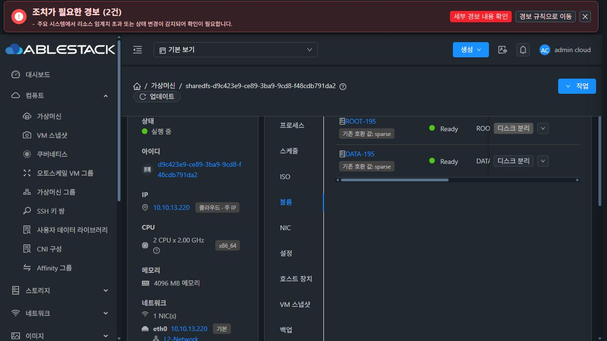
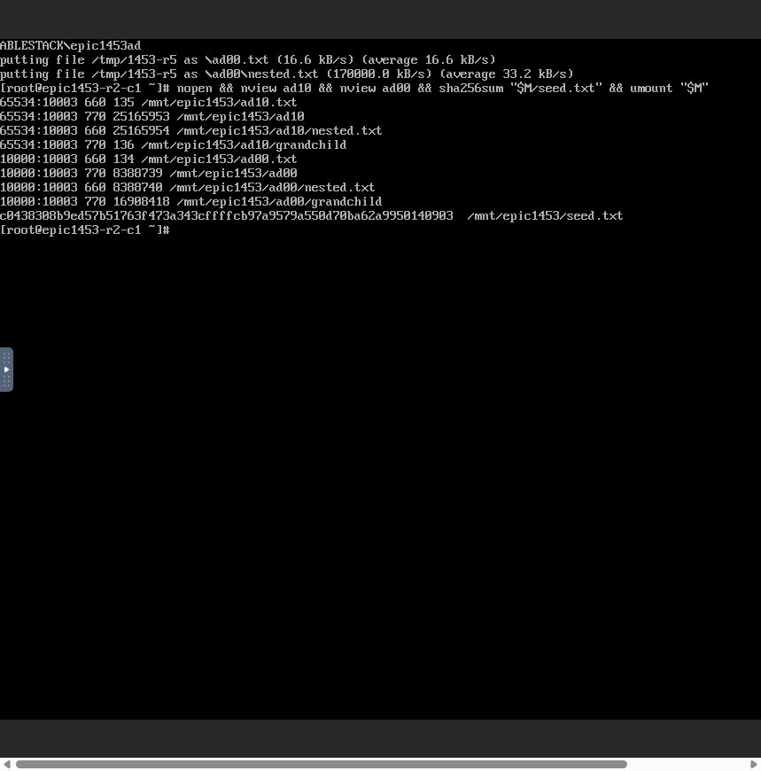
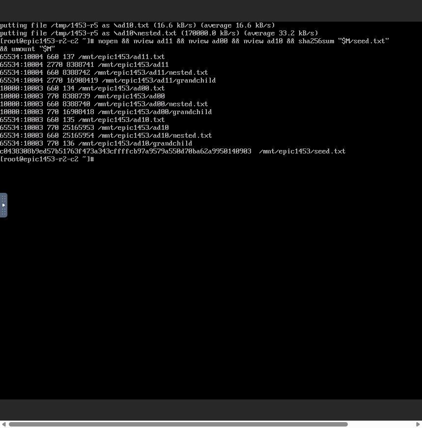
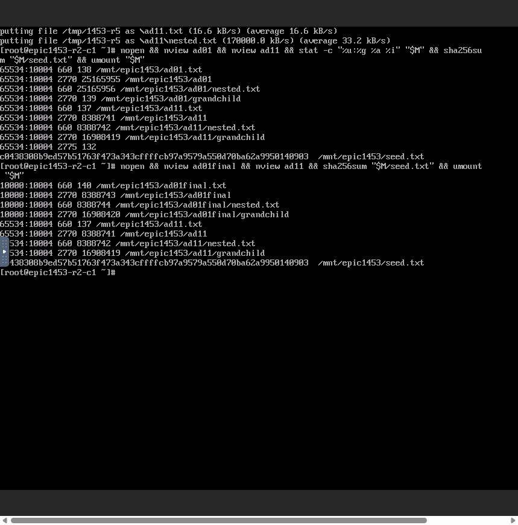
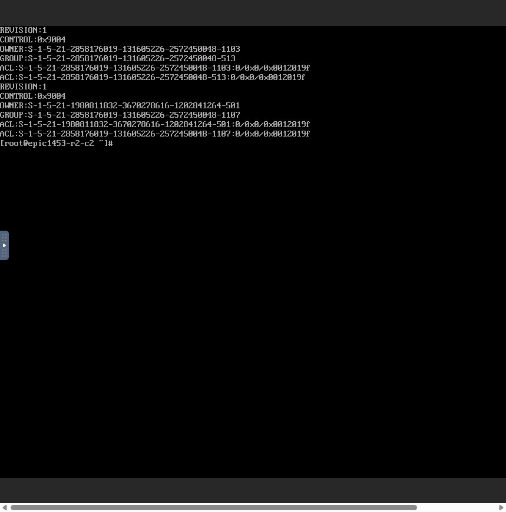
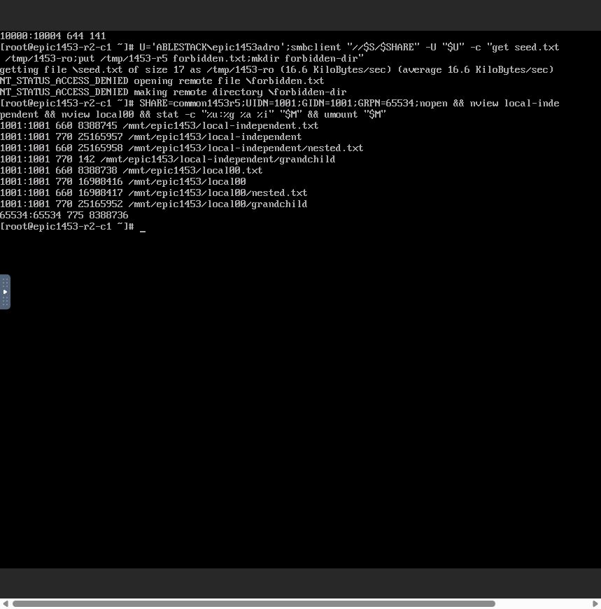
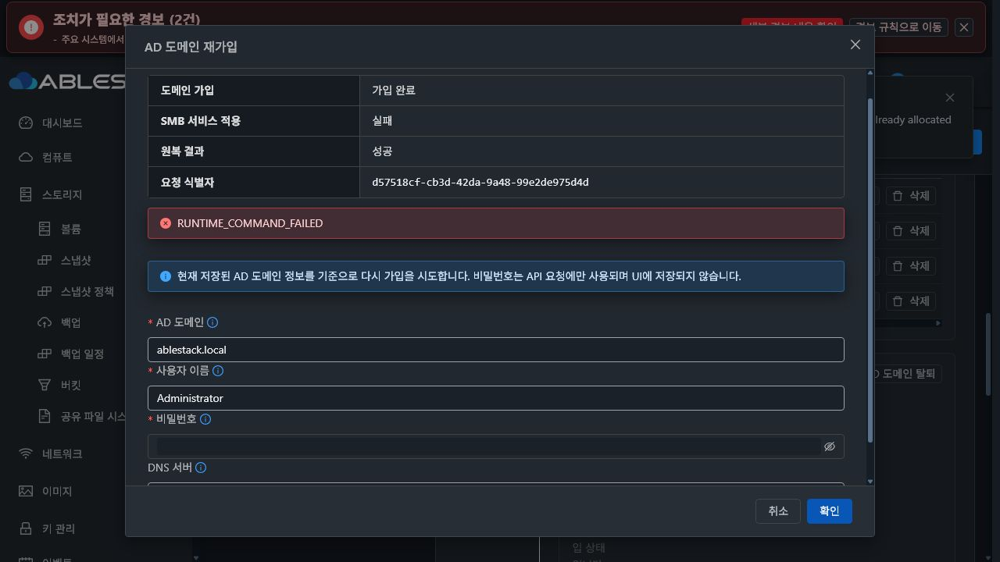
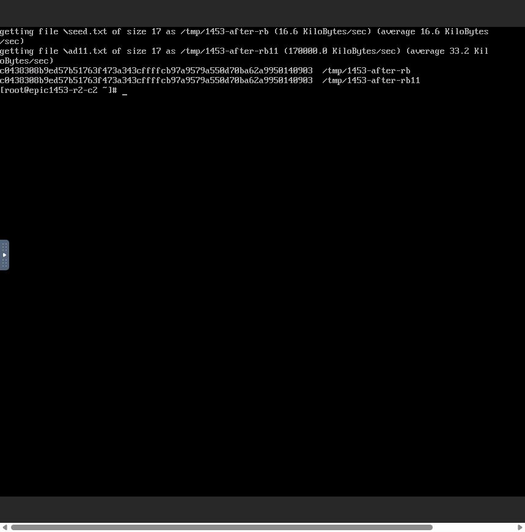
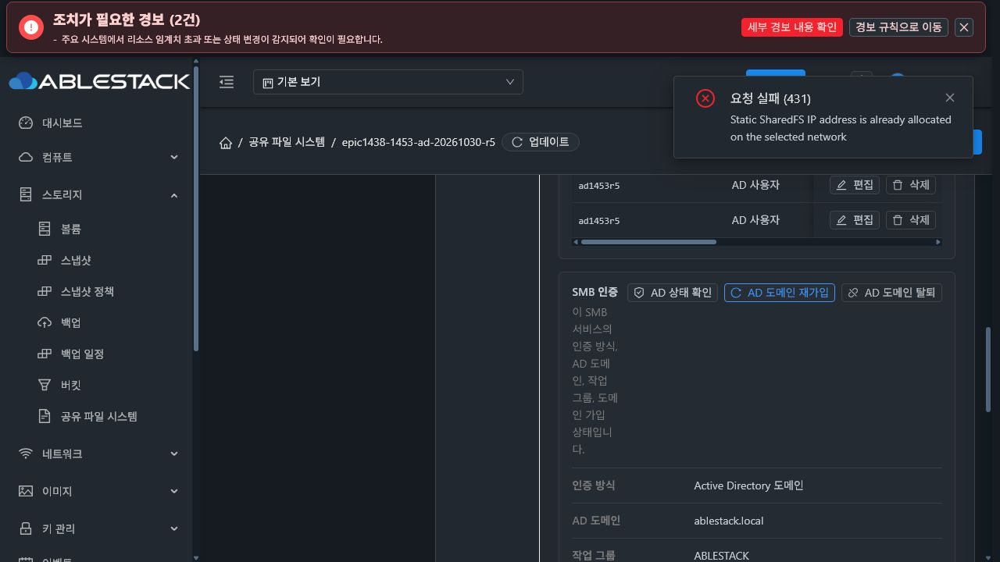
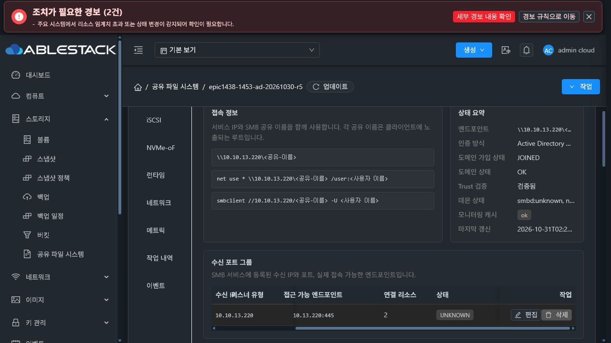

# #1453 R5 — 파일 부재 복구 수정·AD 상속/원복 인수, 콜드 부팅 실패로 중단

**2026-10-31 / #1453 OPEN / Epic #1438 / PR #1470 Draft / 전체 인수 미완료.**

승인받은 Kerberos 설정 파일의 부재 스냅샷·정상 생성·실패 시 부재 복구를 구현하고 13번에 배포했다. 새 SPARSE VM에서 실제 UI 최초 AD 가입, 두 클라이언트의 AD 상속 네 조합·접근 차단·데이터 보존, 의도한 실패의 서비스 원복과 가입을 재사용한 재적용을 통과했다. 이후 실제 UI VM 재부팅에서 **AD NSS 조회보다 Winbind 시작이 늦는 기동 순서 결함**을 확인했다. 추가 기능 시험·수동 서비스 시작·재가입·수정 재시도는 중단했다.

이 문서의 성공은 아래에 명시한 범위다. 재부팅 후 SMB 서비스 복원과 최종 인수·이슈 종료는 완료하지 않았다. 10월30일 빌드·배포/초기 가입 뒤 10월31일 남은 인수를 진행했다.

## 1. 이번 제품 변경과 구현 전 실제 SystemVM 실증

제품 **7970009e5535168e371b2eaa14ac1e18b2c4d0fd**, 기준 Europa **31c147ca747f7a4ffc0380818bcd44887558a0c7**. 시작 시 fetch 후 local/upstream 차이0/0을 확인했고 origin Epic 브랜치로 반영했다.

수정 파일은 guest transaction·baseline profile·guest 회귀 시험3개다. Java/API·UI 제품 소스와 DB schema는 이번에 변경하지 않았다.

- 고정 허용 경로 **/etc/krb5.conf의 최초 부재만** 정상 상태로 허용한다. 필수 resolv.conf의 누락을 함께 허용하지 않는다.
- 작업별 보호된 **client-before.json**에 exists=false 또는 기존 bytes/mode/uid/gid를 기록한다. 저장은 root0600·보호된 작업 경로를 사용한다.
- 기존 가입 helper가 정상 Kerberos 파일 생성을 담당한다. 확정적인 가입 전 실패는 원래 없던 안전한 새 regular 파일을 제거하고, 기존 파일은 내용·권한·소유자를 복구한다.
- dir-fd/O_NOFOLLOW·regular/root 소유·단일 hardlink·안전한 권한·크기 제한·이름/inode 대조를 유지한다. symlink/hardlink/FIFO/위험한 권한을 정상 파일 부재로 취급하지 않는다.
- 복구 실패는 RECOVERY_REQUIRED/rollback FAILED로 보호한다. 가입 결과가 불확실한 경우와 이미 가입된 trust의 임의 삭제·재가입을 방지하는 기존 분기는 유지한다.

제품 소스를 바꾸기 전에 실제 R4 SystemVM의 **krb5.conf가 없는 최초 가입 상태**를 private mount namespace로 복사해 후보를 주입했다. 실제 전체 member CLI와 실제 KDC를 사용했고, 존재하지 않는 시험 주체로 의도한 가입 전 KINIT 실패를 발생시켰다. operator 비밀번호를 사용하거나 파일에 저장하지 않았다.

- 부재→실제 helper의 Kerberos 생성→확정 실패→원래 부재/DNS bytes 복구 PASS.
- 기존 파일의 bytes/0600/inode 보존과 symlink 거부 PASS.
- 원래 계정/설정/desired state와 실제445 리스너 PID 불변, 임시 자원 제거.
- 검증 후보와 실제 반영 제품 source SHA256 **00362bf65e31ebc3beb171cbfc075add109f1eeabadd8884207f37281c97ea16** 동일.
- guest/일반 transaction/기존 상속·entrypoint·runtime **66시험 PASS**.
- 실제 정상 서명 최초 bootstrap→활성 CLI→상속 true preflight READY→반복 bootstrap2회 PASS. 이 검사는 cold OS 부팅 인수를 대체하지 않는다.

[사전 실증 결과](evidence/native-preimplementation-result.json) · [실제 CLI 시험 코드](evidence/native-preimplementation-inner.py) · [후보/제품 일치](evidence/candidate-source-identity.json) · [66시험](evidence/guest-test-result.json) · [서명 bootstrap/활성 CLI](evidence/native-signed-bootstrap-result.json)

## 2. 모듈 빌드와 13번 배포

| 항목 | 결과 |
|---|---|
| 관리 client -am package | PASS; 갱신 baseline profile 포함 |
| signed guest image | 서명/profile/10 payload hash 일치, qemu-img/bzip2 검사 PASS |
| 나머지 guest 경로 / WSL 계정 파일 | 33,929경로 / 계정 파일 보존 |
| 관리 JAR SHA256 | b17ed65a6728cbe3719ad89d3fcb126384c14d94d260330df0a870e9019fac31 |
| UI index SHA256 | c37069d7fdd460ae2719ec49a549a35094f20fcc6f618eaf2f9120b25a176a48 |
| image SHA256 / 크기 | da07c476f22fad2d7cbb495de3a4015d2a727dfb277628a82b7bfe4367b233fc /498434736bytes |
| runtime / baseline updater | 1453.ad.7970009e5535.r5 /6 |
| 배포 백업 | /var/tmp/epic1438-1453-ad-7970009e5535-r5 |
| 관리 서버 최종 읽기 확인 | 위 JAR/index 유지, mold active, HTTP200 |

이번에는 변경된 관리 resource와 guest 모듈만 빌드·배포했다. UI c370 배포본을 유지했다. R4의 backend30·UI69/lint 결과는 동일 소스의 이전 회귀 기준이며 **이번 R5에서 재실행한 것으로 합산하지 않는다**. 신규 DDL/host-agent 배포는 없다.

[관리 산출물](evidence/management-build-artifact.json) · [guest 산출물](evidence/guest-module-build.json) · [배포 영수증](evidence/deployment-result.json)

## 3. 실제 UI 자원·시험 identity

- SYSTEM template **01ba45ea-5399-43ab-a557-5a6408cfacfd**, Europa-SystemVM-1453-AD-20261030-r5. UI 등록·다운로드 완료/checksum 확인.
- SharedFS **3f0056db-4dfe-4f13-908d-b809dd565d34**, instance **c1eca707-a554-4c42-85cd-1e9e9744d804**.
- 새 VM **d9c423e9-ce89-3ba9-9cd8-f48cdb791da2 /i-2-195-VM /ablecube13-2 /10.10.13.220**.
- 새 ROOT4.88GiB **42dcf2e2-c14f-448a-a886-6234f1c239c5**, 새 XFS DATA10GiB **e070a0aa-dbf5-48c0-83e0-09f874446277**, 실제 UI에서 모두 SPARSE. XFS UUID **9c8ddfe9-3e23-46f0-9476-5c794b004841**.
- client1 **aaa3c43c-4f32-48f2-bdd5-e3930f908a07 /10.10.254.224**, client2 **e6744029-299e-4585-981b-65e312d9e752 /10.10.254.223**. 이 #1453용 ROOT100GiB SPARSE Linux 클라이언트 두 대의 실제 noVNC 콘솔로 I/O했다.
- 시험 AD DC **eed7f477-e439-4d8a-a932-3642aac0359e /10.10.13.247 /ablestack.local**. AD OS 준비와 시험 그룹은 승인된 QGA로 처리했다. Mold 자원/서비스/ACL/정책 생성·변경·재부팅은 모두 실제 UI로 수행했다.
- 로컬 RW UID/GID1001:1001, RO1002:1002. AD RW UID10000, RO10001, primary GID10003(domain users), 시험 그룹 GID10004(epic1453writers)를 실제 NSS로 확인했다.
- AD 부모의 선택적 POSIX 쓰기 권한을 위해 두 AD 시험 사용자를 시험 writers 그룹에 넣었다. parent0775에서 이 그룹으로 접근한다. AD RO 쓰기는 별도 SMB ACL에서 거부한다.
- 원래 로컬 부모 **/export/common1453r5 /65534:65534/0775/inode8388736**와 AD 부모 **/export/ad1453r5 /65534:10004/2775/inode132**를 같은 기존 DATA에 UI로 만들고 실제값 ADOPT했다. 서로 다른 부모의 정책을 독립적으로 검사했다.
- 생성 입력의249는 정지 VM에 예약되어 정상 보호로 거부됐다. UI60개 L2 VM 목록과 물리 ARP를 대조해220을 선택했다. 원래 예약 VM·MAC은 변경하지 않았다. 준비 중 추가했다가 사용하지 않은 AD249/251 소스 허용6개는 제거했다.

[실제 identity/가입](evidence/ad-identity-check.json) · [시험 그룹](evidence/ad-test-group.json) · [입력/시험 절차 교정](evidence/input-preparation-corrections.json) · [불필요한 AD 허용 정리](evidence/cleanup-unused-ad-sources.json)

## 4. 재부팅 전 실제 API·UI·두 클라이언트 인수

| 시험 | 확인 결과 |
|---|---|
| 새 NFS/ACL·NUMERIC·관리 SMB445·공통 정책·로컬 ACL | UI 정상 적용; 미변경 POSIX/재귀 필드 비제출 |
| 최초 AD 가입 | cb4173c5-e29a-4c15-a289-a2848cc50540 job1; JOINED/VERIFIED/COMMITTED |
| 기본 smbd 별도 기동 방지 | inactive; managed10.10.13.220:445 단독 수신; 실제 trust 검증 |
| AD inherit owner×setgid | 아래 네 조합 PASS |
| Windows owner SID | 생성자 AD SID와 부모 SID 상속을 실제 smbcacls로 대조 |
| NFS→AD SMB 교차 I/O | UID10000 유지/GID10004 상속, 같은 데이터hash |
| AD RO·미인가 주체 | RO read PASS, put/mkdir ACCESS_DENIED; 미인가 Administrator tree connect 거부 |
| AD 가입 후 로컬 인증 | 명시적 서버 로컬 계정 RW/RO 유지 |
| 부모별 독립성 | AD2775와 로컬0775 유지; 로컬 새 객체1001:1001/0770 |
| 고정 identity 충돌 | 의도적 no-reload 설정 주입; UI preflight BLOCKED/SMB_PARENT_IDENTITY_CONFLICT; 적용 disabled |
| 차단 진단 유지 |30초 이후에도 원인/차단 유지; 권한 우회 없음 |
| 동시 변경 | 두 UI revision18; 첫 작업 반영, 두 번째 job37ac084e... error530 보호 거부 |
| 서비스 적용 실패 원복 | 아래의 의도적 fault에서 JOINED 유지/ROLLED_BACK/SUCCEEDED |
| 원복 후 접속 | 재적용 전에 두 client NFS·AD SMB reconnect/read PASS |
| 서비스 재적용 |78ab129e-2388-40fa-bd30-cef6a04849bf job1; 실제 reusedMembership=true |

### AD 네 조합의 실제 숫자 결과

공통 parent UID65534/GID10004, AD 생성자 UID10000/primary GID10003이다. 파일0660, 기본 dir0770을 사용했다.

| inherit owner | setgid | 생성 client / 유효 시험명 | 새 파일 UID:GID | dir/grandchild UID:GID /mode |
|---|---|---|---|---|
|off|off|client1 /ad00|10000:10003|10000:10003 /0770|
|on|off|client2 /ad10|65534:10003|65534:10003 /0770|
|on|on|client1 /ad11|65534:10004|65534:10004 /2770|
|off|on|client2 /ad01final|10000:10004|10000:10004 /2770|

각 파일·dir·nested·grandchild를 SMB로 만들고 반대 client의 NFS 숫자 stat로 대조했다. 기존 ad00/ad10은 부모 setgid를 켜도 UID/GID와0770/inode를 유지했다. inheritowner 변경은 true/명시false만 추가하고, setgid 변경은 mode2775/expectedpolicyrevision만 제출했다. UID/GID·recursive 등 미변경 POSIX 필드를 제출하지 않았다.

AD00 Windows owner는 **AD SID ...-1103**였고 AD11 owner는 **부모와 같은 서버 Guest SID ...-501**이었다. 실제 parent UID65534의 Windows owner를 상속한 결과이며 로그인 주체/공유 ACL을 Guest로 바꾸지 않는다. guestok=false·AD RO/미인가 거부를 별도로 확인했다.

NFS 쓰기는 UID10000을 유지하고 parent GID10004를 상속했다. 실제 SMB 역방향 읽기 hash가 같았다. 로컬 부모는0775/inode8388736을 유지했고 AD 가입 뒤에도 로컬 RW 새 객체1001:1001/0770, 로컬 RO 쓰기 거부를 확인했다.

**시험 절차 교정:** 최초 ad01은 공개 비동기 요청 접수 직후 세션을 열어 관리 프로파일의 최종 기록보다 약0.72초 먼저 생성됐다. 유효 인수에서 제외했다. 제품 코드를 다시 바꾸거나 같은 설정을 재적용하지 않고, 실제 UI 완료·최종 no 설정 뒤 새 세션/ad01final로 기대값을 확인했다. 초기 ad01도 삭제/권한 보정하지 않았으며 이후 보존 대조에 포함했다. smbcacls의 잘못된 root 파일명 '.'은 빈 root 이름으로 교정했다.

[실제 UI 요청/응답·async job 원문](evidence/ui-request-results.json) · [시점 대조](evidence/off-on-readonly-diagnosis.json) · [최종 프로파일 no 관측](evidence/off-on-profiles-readonly.json)

## 5. 의도한 실패와 실제 원복

이는 새 제품 오류가 아닌 계획된 검증 실패다. protected runtime10파일은 수정하지 않았다. /usr/bin/wbinfo 위에 임시 one-shot bind shim을 올렸고, **AD transaction의 직접 자식 최종 -t 호출 한 번만** 실패시켰다. 다른 호출은 원래 vendor ELF로 전달되는지 먼저 확인했다.

- UI job **2755b709-c4e1-40e5-b4ef-dcb939ce5c9b**,10월31일10:53:09~16 KST.
- 실제 SMB 적용·검증 뒤 RUNTIME_COMMAND_FAILED 발생. API는 **membership=JOINED; rollback=SUCCEEDED**, UI는 가입 완료/서비스 실패/원복 성공·요청 식별자를 유지했다.
- fault는 정확히 한 번 소비됐고 bind/임시 파일을 제거했다. vendor wbinfo SHA256 **263631dd3c09ead449fde6be4ce064498db9a4f37ca6b1fe830454d68b0bf63f** 복구·trust 검증 PASS.
- 재적용 전에 실제 client1 NFS와 client2 AD SMB로 접속·기존 데이터 읽기를 확인했다.
- **33개 객체의 UID/GID/mode/ACL/inode 및17파일hash·XFS UUID 동일**. 기본 smbd inactive.
- UI의 **SMB 서비스 재적용**을 실행했다. job **78ab129e-2388-40fa-bd30-cef6a04849bf**, native operation **9f58f9e1-06f1-4db1-8a97-479bcfe069e3**, JOINED/VERIFIED/COMMITTED, **reusedMembership=true**. 가입을 반복하지 않고 정상 trust를 재사용했다.

[hook 준비](evidence/arm-post-apply-fault.json) · [제거/원본 확인](evidence/disarm-post-apply-fault.json) · [원복 보존](evidence/rollback-preservation-result.json) · [실제 가입 재사용](evidence/after-service-reapply-identity.json)

## 6. 최초 새로운 제품 오류 — AD ACL 콜드 부팅 순서

실제 VM UI에서 강제 옵션 없이 rebootVirtualMachine을 한 번 실행했다. **c088335c-ea8a-4aa7-af13-adbcb394c3ef** job1,10월31일11:01:25~26 KST. boot ID 변경으로 실제 재부팅을 확인했다. 이후 수동 서비스 시작·재가입·reconcile 실행·수정 재시험을 하지 않았다.

### 관측된 순서

1. **11:01:32** signed runtime bootstrap 성공, 실제10파일 hash 검증 성공.
2. 네트워크는 STATIC13.220/16·원래MAC·NETWORK_READY, NFS 두 export의 실제 v4 probe 성공/NUMERIC APPLIED.
3. SMB 재적용은 **DIRECTORY_PRINCIPAL_UNAVAILABLE**로 실패했다.
4. boot script가 같은 순서로 자동12회 재시도하며 정상 NFS도 매번 재시작했다. **11:03:02** ablestack-storage-reconcile.service exit1/failed.
5. 실제 Winbind/nmbd/smbd는 disabled/inactive, managed445 미기동. UI 수신 엔드포인트 UNKNOWN. 원래 AD trust는 **net ads testjoin: Join is OK**로 유지됐다.

### 정확한 하위 원인과 코드

- boot reconcile은 저장 NFS 다음 SMB를 재적용한다.
- **ablestack-storagectl:5075**의 Python 단계에서 DirectoryPolicies.apply_acl_batch를 호출한다.
- **shared_directory_policy.py:573→269**에서 실제 AD_USER의 pwd.getpwnam을 실행한다. Winbind가 꺼져 있어 정상 AD 이름의 NSS 조회가 실패하고 **275행 DIRECTORY_PRINCIPAL_UNAVAILABLE**로 종료된다.
- **Winbind 시작/restart는 storagectl:5102**로, 이 Python 단계 뒤에 있다. 앞 단계가 종료되어 실행되지 않는다.
- 관리 listener/membership-only의 가입 경로는 **5329행에서 반환**하여 기본 smbd 및 그와 묶여 있던 enable/start Winbind를 건너뛴다. default smbd 방지는 유지됐지만 AD resolver의 선행 의존성을 별도로 보완하지 못했다.
- 로컬 사용자는 passwd로 해석돼 정상이고, 가입 직후는 기존 Winbind 프로세스가 실행 중이어서 AD ACL이 통과했다. 콜드 부팅은 그 프로세스가 없어 순서 문제가 드러난다.
- 실제 저장 principal의 backslash는1개다. 로컬 getent는0, AD getent는2, Winbind inactive, net ads testjoin은0으로 입력/가입/transport와 AD NSS 미기동을 구분했다.

이는 R5 파일 부재 snapshot의 재발이 아니다. 이전 기본 smbd 방지 흐름의 부팅 의존성을 인수하지 못한 결함이다. **warm 가입/변경 성공으로 cold 부팅 성공을 대신할 수 없으며 이번 재부팅 인수는 실패다.**

[SMB apply5075/5102](../../../systemvm/debian/usr/local/bin/ablestack-storagectl#L5075) · [실제 요구 identity 해석269행](../../../systemvm/debian/usr/local/lib/ablestack-storage/shared_directory_policy.py#L269) · [부팅 script](../../../systemvm/debian/usr/local/bin/ablestack-storage-boot-reconcile)

상단 AD 가입/서비스 적용 완료는 **최근 완료한 job78ab129e의 결과**다. 재부팅 뒤의 현재 실행 상태를 뜻하지 않는다. 같은 화면의 smbd unknown/Winbind inactive/445 UNKNOWN과 실제 failed unit을 함께 판정했다. 과거 작업 완료 표시로 재부팅 인수를 성공 처리하지 않았다.

[현재 unit/주소/장치 진단](evidence/reboot-readonly-diagnosis.json) · [실제 boot 로그·traceback](evidence/boot-reconcile-log.json) · [정상 입력/NSS 대조](evidence/principal-lookup-readonly.json)

## 7. 현재 영향·미완료와 다음 최소 개선안

**보존 확인:** 재부팅 뒤33객체·17파일의 UID/GID/mode/숫자 POSIX ACL/inode/hash, XFS UUID, IP13.220과 MAC 모두 재부팅 전과 동일하다. 실제 runtime10파일과 vendor wbinfo도 원본과 일치한다. 부팅 후 fault shim이 남거나 payload가 손상된 상태가 아니다. NFS 실행/두 export probe는 정상이며 SMB는 복원되지 않았다.

cloud-init/networking도 같은 부팅에 failed로 관측됐다. 현재 STATIC NETWORK_READY·원래 IP/MAC·AD trust·NFS probe가 성공한 증거와 분리해 기록한다. 이 동반 관측을 추가 과제로 확장하거나 원인으로 단정하지 않았다.

[재부팅 보존 결과](evidence/reboot-preservation-result.json) · [실제 전체 데이터](evidence/after-reboot-data.json)

다음 수정안은 **아직 구현/기동 재시도하지 않았다**.

1. AD에 가입되어 AD ACL identity 해석이 필요한 SMB 경로에서, 저장 ADS 설정/realm을 확인한 뒤 **Winbind를 ACL/NSS 조회보다 먼저 준비**한다.
2. 기본 smbd를 enable/start하는 방식으로 되돌리지 않는다. 기존 관리 listener의 소유권/445 충돌 보호와 membership/service 단계 구분을 유지한다.
3. resolver/trust 준비 실패는 ACL 변경 전에 명확한 코드로 중단한다. 계정 존재 검사를 생략하거나 AD 사용자를 가짜 로컬 계정으로 만들지 않는다.
4. 구현 전 실제 Winbind가 꺼진 cold 상태에서 후보 순서→AD NSS 조회→기존 apply/verify를 SystemVM에 주입해 검증한다. local/AD, LOCAL_USER와 AD_USER/GROUP, 혼합 ACL·공통 POSIX·실패 원복을 구분한다.
5. UI는 최근 AD job 결과와 현재 실행 관측을 분리한다. 실제 SMB 탭의 Winbind inactive/445 UNKNOWN을 현재 서비스 미기동 안내로 연결하고, 필요하면 기존 상태 조회의 안전한 기동 오류 코드만 보완한다. 실제 API 응답 fixture로 과거 완료가 현재 기동 성공을 대신하지 않는지 검증한다. 기존 VM 표준 컴포넌트/다크모드 배치를 유지한다.
6. 모듈/서명 이미지 반영 후 실제 UI VM 재부팅→현재 SMB445 READY·현재 trust→두 client 접속·새 상속/기존 데이터·권한 보존을 완료한다. 이후 최종 구성의 관리 서버 재시작·UI 재접속/기록 보존과 최종 시각 인수를 마쳐야 닫는다.

현재 시험 VM의 SMB 실패 상태는 원인 검토를 위해 그대로 보존했다. 클라이언트의 runtime 인증 환경을 지우고 로그아웃했으며 시험 주입은 모두 제거했다. 관리 서버의 전송 임시 복사본만 정리했고 배포 백업/게시 이미지/실행 자원은 유지했다. 새 이슈/별도 PR/다음 이슈 개발은 만들지 않았다. **#1453 OPEN·PR1470 Draft·#1468 HOLD로 기록한 뒤 다음 명령을 기다린다.**
