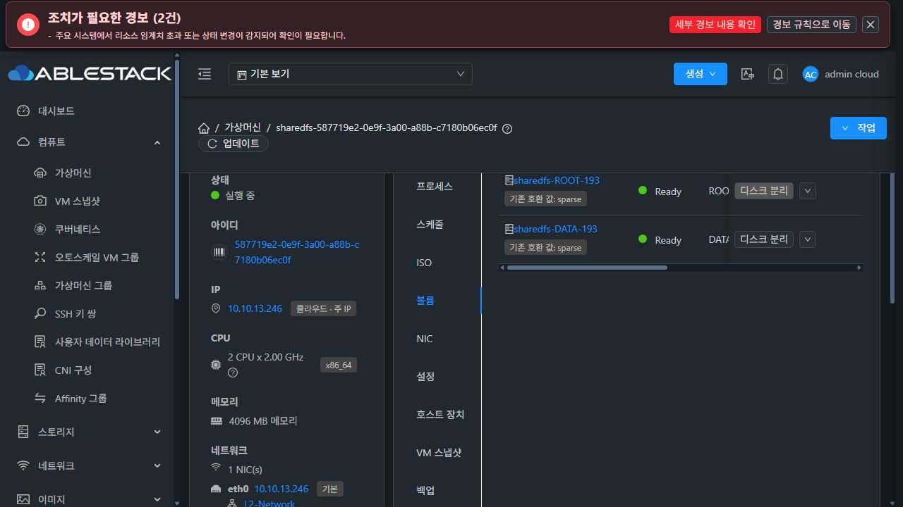
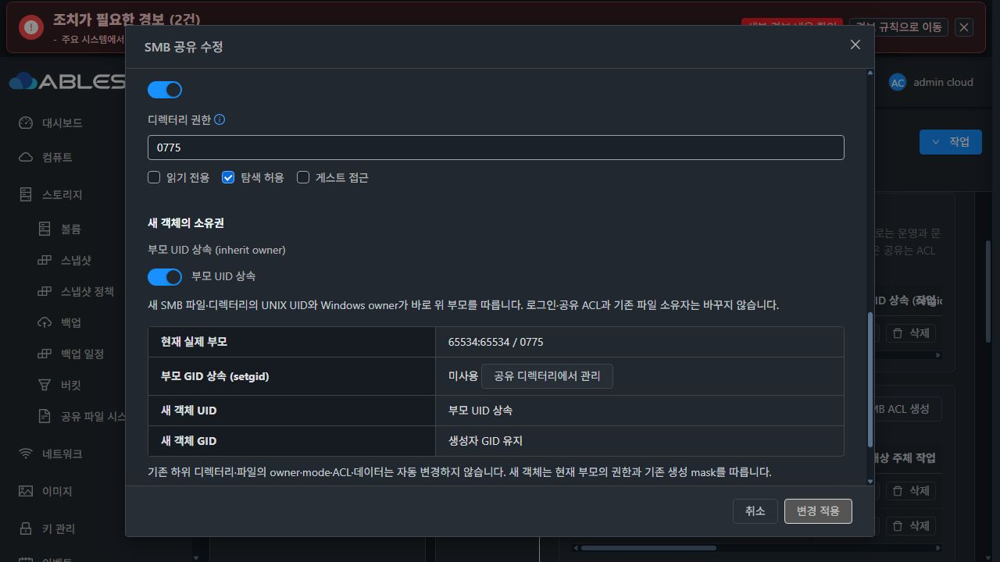
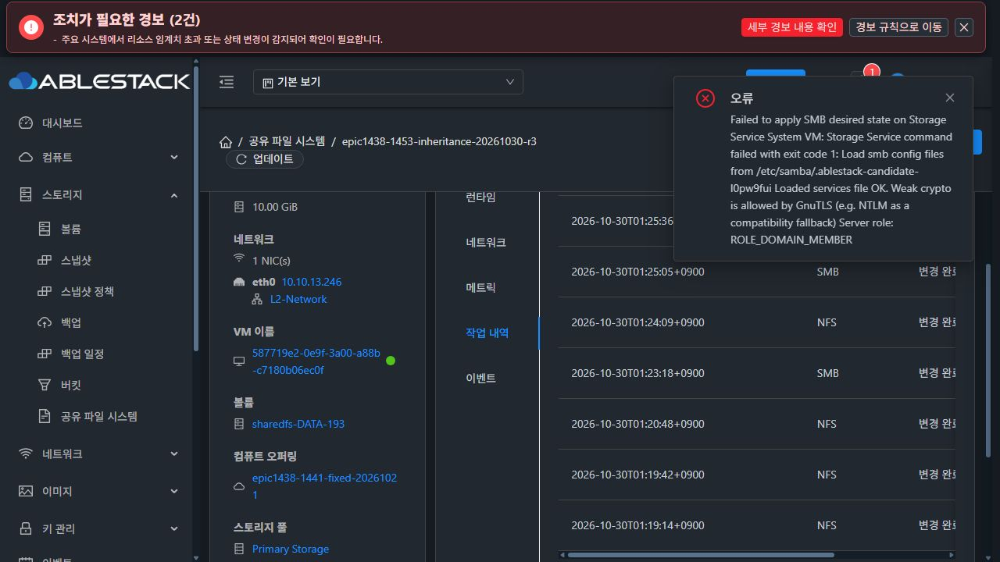
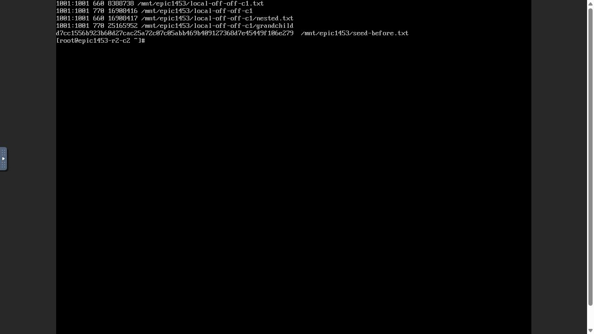
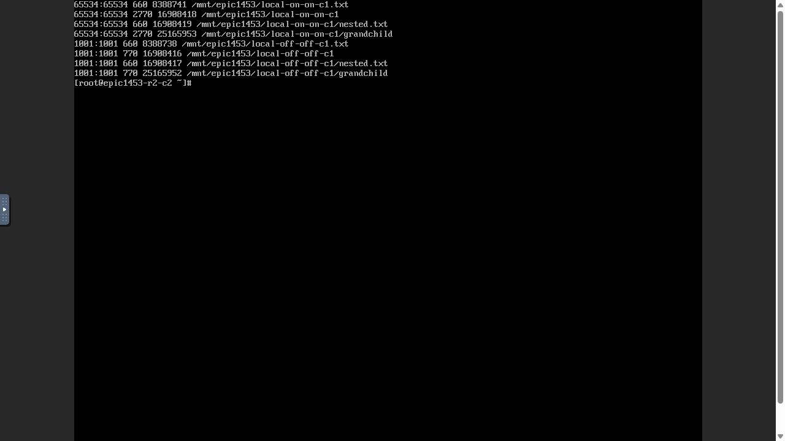
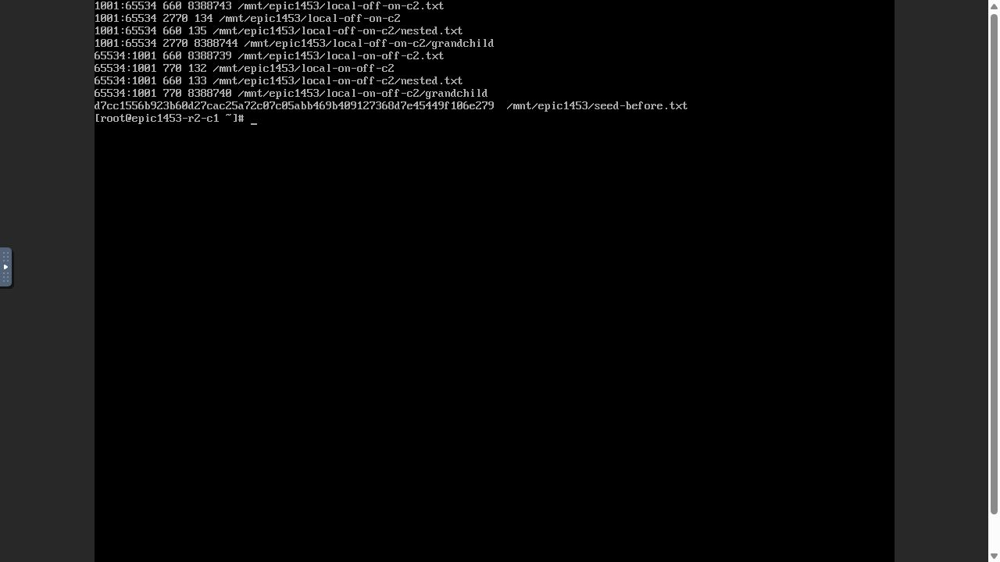
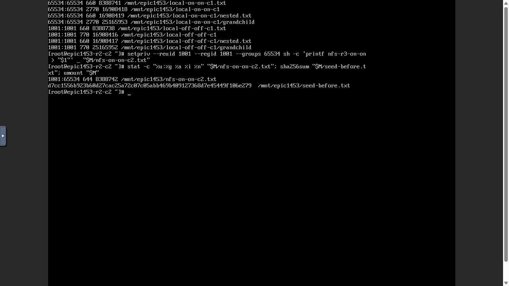
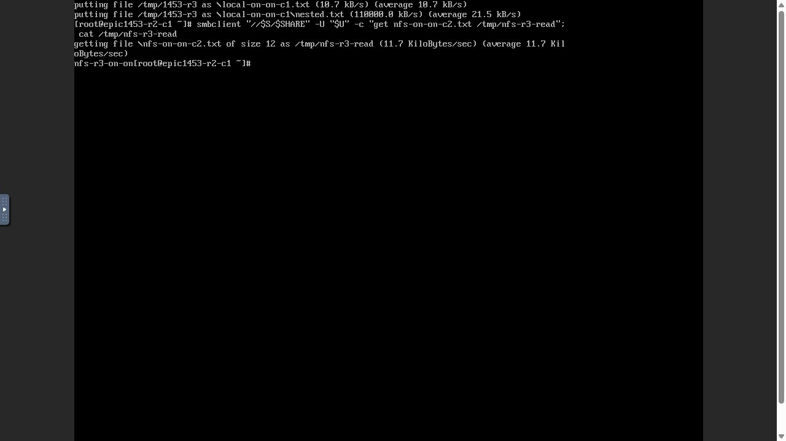
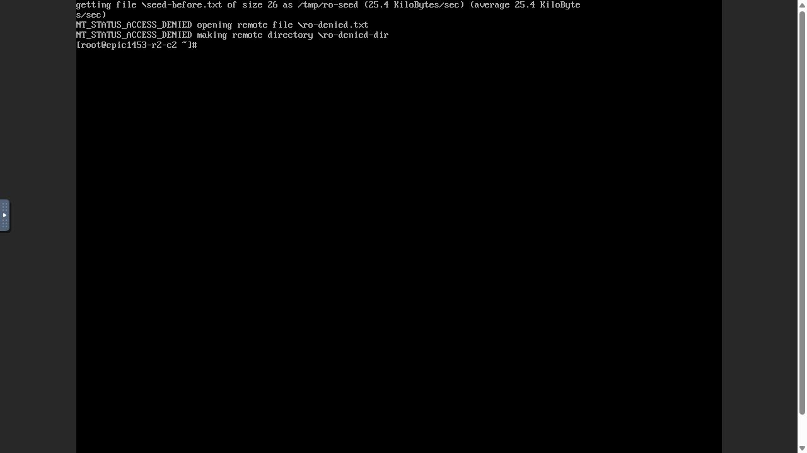
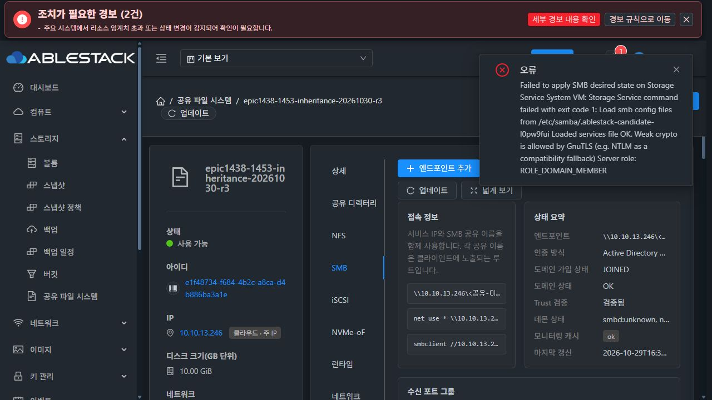

# #1453 R3 — baseline 조회·실패 안내 수정과 실환경 인수 중단

**2026-10-30 KST / #1453 OPEN / 전체 인수 미완료.** 요청한 baseline 조회·실패 안내 보존·bootstrap 후 활성 CLI 회귀를 구현·배포하고 실제 로컬 인증 네 조합까지 통과했다. 이후 실제 UI의 AD 가입 후 SMB 재적용에서 별도의 제품 결함을 확인해 추가 적용·재시험을 중단했다. 이 보고서는 로컬 성공을 AD/재시작/전체 이슈 완료로 표시하지 않는다.

## 1. 이번 수정과 구현 전 SystemVM 실증

제품 commit **e6bf899c47747a875ba36ec34889c5eb755096c1**. local Europa/upstream은 **31c147ca747f7a4ffc0380818bcd44887558a0c7**, fetch 후 차이0/0을 확인했다.

- `shared_directory_policy.py:inheritance_protection_version`의 기본 조회를 보호된 `/usr/local/lib/ablestack-storage/runtime_updater.py`로 변경했다. updater는 시스템 baseline에 있고 signed release에는 없다. regular file·소유자·권한·크기·AST version 검사, 누락/불안전 시0을 반환하는 보호는 유지했다. 외부 env나 bundle 내 updater로 우회하지 않았다.
- SharedFSTab·setgid·공통 POSIX 폼은 **READY 승인만 만료**시킨다. UNKNOWN/BLOCKED 안내는 편집·새 점검까지 보존하며 적용은 계속 차단한다. UI markup/style·인증/AD join·일반 renderer/원복/포맷/네트워크는 이번 수정에서 바꾸지 않았다.
- runtime baseline profile은 실제10파일로 재생성했다. 신규 DDL은 없다.
- 제품 소스를 바꾸기 전에 실제 R2 SystemVM의 private mount namespace에서 후보 helper만 주입했다. **원래 활성 release/CLI 경로**를 유지했다. protection0→1, inheritowner true preflight READY, 구버전/쓰기 가능한/누락 baseline 차단을 확인했다. 실제 설정/계정/기존 데이터·설치본 불변, 임시 파일 제거.
- 실제 실패 API 응답을 UI fixture로 사용해 UNKNOWN/BLOCKED 진단이60초 이후에도 유지되고 적용 불가, 편집 시 무효화, READY 승인/ACK의 정상 만료를 검증했다.
- 새 native 회귀는 정상 서명 최초 bootstrap→활성 symlink CLI capability1→true preflight READY를 연결하고 반복 bootstrap2회에도 동일하게 확인한다. release에 updater가 없음을 검증하며 기존 active-feature downgrade guard도 통과했다. 이는 **읽기 전용 capability/preflight 회귀**다. 실제 설정 반영은 아래 UI 인수에서 확인했다.

[구현 전 활성 CLI 주입](evidence/preimplementation-systemvm.json) · [정상 서명 bootstrap→활성 CLI 회귀](evidence/signed-bootstrap-active-cli.json) · [native 회귀 코드](../../../systemvm/test/native_smb_inheritance_bootstrap.py)

## 2. 빌드·13번 배포

| 항목 | 결과 |
|---|---|
| UI focused / lint |62시험/6 suites PASS, 변경 UI lint PASS |
| guest focused |39시험 PASS |
| 관리 모듈 package / UI production build |PASS / PASS |
| signed image |10파일 manifest/profile/signature 일치, qemu-img/bzip2 PASS, 나머지33,929 guest 경로·WSL 계정 보존 |
| 관리 JAR SHA256 |d62c7cf890e277b05a14e716be36f2847b5219a9977f8b040c99693ab234bdf2 |
| UI index SHA256 |de8259f2fbb6b6b004597a3be3536f46d8e404bd2a9cb5ee9add77bee605097a |
| image SHA256 / 크기 |11d3e34cf1841c4e90ad52d6c3bbe05776effeddcc8f328ab0b31e497f3417d3 /498330538bytes |
| runtime |epic1438-1453-inherit-e6bf899c4774-r3 |
| 배포 확인 |mold.service active / HTTP200 / 실제 UI 재로그인 |
| 보존/백업 |config·외부plugins·기존 systemvm assets 보존, /var/tmp/epic1438-1453-baseline-e6bf899c4774-r3 |

관리 모듈은 갱신한 baseline resource를 포함한다. KVM host agent/AD join 코드는 변경·배포하지 않았다. 전송용 /tmp 복사본만 정리했고 게시 이미지·현재 배포 백업은 보존했다.

[빌드 산출물](evidence/build-artifacts.json) · [새 VM의 실제 baseline/활성 CLI capability1](evidence/new-vm-protection.json)

## 3. 실제 UI와 새 SPARSE 자원

- SYSTEM template **996873e8-06eb-4576-a621-1938caa47571**, Europa-SystemVM-1453-inheritance-20261030-r3, Ready/checksum 일치.
- SharedFS **e1f48734-f684-4b2c-a8ca-d4b886ba3a1e**, instance **dece7b8e-e5d0-4eae-b4cf-5ec0fdf0244d**, IP **10.10.13.246**. 생성 전 중복 IP ARP 응답0, MAC 임의 변경 없음.
- VM **587719e2-0e9f-3a00-a88b-c7180b06ec0f**, i-2-193-VM, host13.3. **새 ROOT4.88GiB / 새 XFS DATA10GiB 모두 실제 UI SPARSE**. DATA **9b653835-206e-4101-b62d-1fabde17b589**, FSUUID f95853ae-d5e1-4628-8273-af7cbe23bab9.
- 이 #1453 시험을 위해 생성한 실제 client1 **aaa3c43c-4f32-48f2-bdd5-e3930f908a07**/10.10.254.224, client2 **e6744029-299e-4585-981b-65e312d9e752**/10.10.254.223, 각 ROOT100GiB SPARSE. 새 서비스에 연결했고 실제 noVNC 콘솔로만 파일 I/O를 실행했다.
- 독립 AD DC **eed7f477-e439-4d8a-a932-3642aac0359e**, **10.10.13.247 / ad1453.ablestack.local**, realm ABLESTACK.LOCAL. 승인된 QGA OS 구성으로 준비한 서버이며 일반 Mold 자원 생성·서비스 구성·작업 상태는 UI로 수행했다.

UI/API/NFS·SMB 기본 구성, 실제값 ADOPT, 로컬 RW/RO ACL, inheritowner on/off와 setgid mode-only 변경까지 **11작업 모두 COMMITTED/COMPLETED**. AD 가입은 이후 별도 async job으로 실패했다. 같은 작업 이력에 없는 AD 실패를 성공으로 합산하지 않는다.

새 UI에서 이전 R2 VM의 알려진 보호 부족 응답을 의도적으로 한 번 조회했다. 시간이 지나도 한국어 원인 안내·UNKNOWN report가 유지되고 변경 적용 버튼은 disabled였다. 새 이미지 VM에서는 baseline5/실제 활성 CLI capability protection1과 정상 상속 적용을 확인했다. 이 두 시험을 구분한다.

[UI 실제 요청/응답](evidence/ui-request-results.json) · [완료 이력 API](evidence/configuration-ui-history.json) · [실제 로컬 NSS](evidence/local-nss.json)

## 4. 실제 로컬 인증 상속·NFS 교차 인수

공통 부모 `/export/common1453r3`: UID65534/GID65534, 최초0775, inode8388736. 정책 **63b56007-e2ce-3050-a70e-b1ab488dbf88**. 로컬 RW UID/GID **1001:1001**, RO **1002:1002**를 실제 NSS에서 확인했다.

| inherit owner | setgid | 생성 client | 새 파일 UID:GID / mode | 새 dir·grandchild UID:GID / mode |
|---|---|---|---|---|
|off|off|client1|1001:1001 /0660|1001:1001 /0770|
|on|off|client2|65534:1001 /0660|65534:1001 /0770|
|on|on|client1|65534:65534 /0660|65534:65534 /2770|
|off|on|client2|1001:65534 /0660|1001:65534 /2770|

각 조합에서 파일·dir·nested 파일·grandchild를 실제 SMB로 만들고 반대 client에서 NFS 숫자 stat로 대조했다. 총16개 새 객체다.

- inheritowner 변경 실제 POST는 true/명시false만 전달하고 미변경 POSIX owner/mode/recursive 필드는 제출하지 않았다.
- setgid 실제 POST는 mode2775/expectedpolicyrevision과 기존 작업 보호 값만 전달했다. UID/GID/inode/recursive를 제출하지 않았다.
- ON/ON 변경 후에도 기존 OFF/OFF 파일1001:1001/0660, dir0770·inode 그대로였고 기존 ON/OFF dir도0770을 유지했다. 재귀 chmod/chown 없음.
- NFS AUTH_SYS/NUMERIC로 UID1001/primaryGID1001/supplementaryGID65534의 실제 쓰기는 **UID1001 유지/GID65534 상속**. SMB에서 같은 NFS 파일을 다시 읽었다.
- RO 사용자는 seed 읽기 성공, 파일 쓰기·mkdir는 각각 **NT_STATUS_ACCESS_DENIED**. seed SHA256 **d7cc1556b923b60d27cac25a72c07c05abb469b409127368d7e45449f106e279**, UID/GID65534:65534/mode0644/inode8388737.
- 이후 AD 오류 뒤의 읽기 전용 진단에서도 seed와 네 조합의 기존 파일·nested 파일 **총10파일의 hash/UID/GID/mode/inode** 및 부모65534:65534/2775/inode8388736 보존을 확인했다. 실제 AD 사용자 접근·오류 후 클라이언트 재접속 성공으로 대체하지 않는다.

## 5. 최초 새 제품 오류 — AD 가입 뒤 관리 SMB 리스너 복원 충돌

**2026-10-30 01:34:30~01:34:35 KST**. 실제 UI의 AD 가입 `joinStorageServiceToAdDomain`, job **21fde2b5-10f9-4c95-8e6a-7495cdd6cb5e**, **jobstatus2 / errorcode530**. 이 오류 이후 AD 재가입·구성 재적용·재시작·다른 검증을 실행하지 않았다.

사전 SystemVM에서 DC DNS 해석과53/88/389/445/464 연결을 확인했다. 오류 후 `net ads testjoin`은 **Join is OK**, `wbinfo -t`는 trust secret 검증 성공. 실제 NetBIOS STORDECE7B8EE5도 일치했다. 도메인 가입 자체·DNS/포트/MAC/SID 문제로 추정하지 않는다.

### 정확한 코드와 실제 실패 조건

1. `StorageServiceManagerImpl.joinStorageServiceToAdDomain`은 applyAdJoin 성공 뒤 **JOINED/OK를 먼저 DB에 저장**한다(1544~1546행).
2. guest `smb_domain_join()`은 관리 endpoint manifest의 존재/소유 상태를 구분하지 않고 기본 **smbd.service를 enable/start/restart**한다(5302·5305행). 기존 관리 profile과 별개인 legacy 데몬이다.
3. journal에서 **01:34:32/33 KST 기본 smbd.service 시작·재시작 →01:34:35 관리 profile 정지** 순서를 확인했다.
4. 이어 manager1547행의 `applySmbDesiredState()`가 전역 SMB config를 갱신하고 `SmbListenerProfiles.refresh()`가 관리 리스너를 재생성한다.
5. 실제 기본 smbd PID **24545**가 **0.0.0.0:445**(및139)를 점유했다. 관리 endpoint는 **10.10.13.246:445**, managedPid=null/rawPid0/ready=false다.
6. `SmbListenerProfiles.start()`의595~598행은 wildcard와 개별 IP의 같은 포트를 겹침으로 판단해 **SMB_ENDPOINT_IN_USE**로 거부한다. 이 보호는 올바르므로 완화하면 안 된다.
7. 실제 설치 클래스에서 설정/서비스 쓰기 함수를 차단한 진단 실행으로 동일 guard의 **SMB_ENDPOINT_IN_USE**를 재현했고 config·manifest 해시 불변을 확인했다. 서비스 재시도/실제 start를 실행한 것이 아니다.

이것은 **기존 AD 가입 helper가 legacy smbd를 직접 기동하는 경로와 관리 endpoint 복원 경로의 통합 결함**이다. 이번 R3 baseline/UI timer 수정은 AD join·profile 코드를 바꾸지 않았다. 앞선 로컬 상속 성공과 AD 전환 실패는 서로 다른 실행 경로다.

### UI/API가 충분한 원인을 보여주지 못한 이유

- backend의 catch는 applyAdJoin 실패만 처리하고 **후속 applySmbDesiredState는 catch 밖**이다. 따라서 API job은 실패했어도 domain status는 **JOINED / healthstate OK**로 남는다. 이는 성공한 도메인 단계의 값이며 전체 SMB 적용 성공을 뜻하지 않는다. 실제 UI/API에는 후속 SMB 적용 실패를 구분하는 상태가 없다.
- KVM `LibvirtStorageServiceHostCommandWrapper.waitForGuestCommand`는 실패 details에 **stderr만** 넣는다(183~184행). guest listener의 구조화된 실패 code는 stdout에 출력된다. manager는 result.details만 예외에 넣어 API에는 testparm의 **ROLE_DOMAIN_MEMBER 안내**만 노출됐다. testparm은 정상 파싱했고 그 문구가 원인이 아니다.
- 현재 saved SMB desired-state에는 identityDomain이 **없고**(이전 local payload) 실제 /etc/samba/smb.conf는 ADS다. 실패 후 payload 저장까지 끝나지 않았으므로 재부팅으로 정상화됐다고 가정하지 않는다.
- 관리 endpoint는 정상 복원되지 않았고 기본 legacy smbd만 active다. Ganesha 프로세스는 기존2049 config로 남았다. 오류 후 신규 클라이언트 접근은 중단 지시에 따라 시험하지 않았다.

[실제 실패 API job](evidence/ad-join-api-job.json) · [UI/domain API의 부분 성공 상태](evidence/ad-domain-ui-api-status.json) · [실제 port/데몬/trust/데이터 관측](evidence/ad-failure-diagnosis.json) · [시간순 unit journal](evidence/ad-failure-unit-timeline.json) · [쓰기를 막은 실제 guard 재현](evidence/ad-listener-guard.json) · [saved desired-state](evidence/postfailure-desired.json)

## 6. 다음 최소 개선 방향 — 아직 구현·복구하지 않음

**UI의 가입→서비스 적용 흐름을 기준으로 고친다.**

1. AD dialog는 도메인 가입과 SMB endpoint/기존 공유 재적용을 두 단계로 보여주고 전체 검증 전 완료로 닫지 않는다. membership JOINED와 서비스 적용 실패를 구분하고 같은 async job의 정확한 code·진단을 유지한다. 자동 재가입을 유도하지 않는다. VM 표준 MoldDialog/작업 표시와 라이트·다크 스타일을 재사용한다.
2. 관리 profile이 있는 AD join은 기본 smbd.service를 별도로 켜지 않고 기존 관리 리스너의 소유권/설정 경로를 유지한다. 관리 profile이 없는 기존 legacy 동작은 보존한다. 외부/소유 불명 프로세스를 임의 종료하거나 중복 포트 guard를 완화하지 않는다.
3. manager는 AD trust 성공과 후속 SMB 적용 성공/실패를 각각 기록한다. 성공한 membership/trust 상태는 유지하고 별도의 SMB substep 실패를 기존 config/작업 진단에 기록한다. 기존 before-image/원복 기구로 config·managed profile 상태를 보존하도록 연결한다. 실패 code를 stdout JSON에서 제한·비밀 제거 후 UI까지 전달한다.
4. 현재 시험 자원의 정상 AD trust는 보존하고 **실패한 SMB 복원 단계만** 복구해야 한다. join이 만든 legacy 데몬임을 실제 이전 상태/현재 PID·config 소유권으로 검증하고 관리 profile을 되돌린다. 임의 전체 재가입·재부팅·재포맷으로 대체하지 않는다.
5. 구현 전에 실제 SystemVM private 주입으로 managed 단일 endpoint에서 join→재적용이 legacy wildcard를 만들지 않고 동일 IP/port를 복구함을 확인한다. 기존 local/legacy 경로와 실패 원복, 실제 UI job 응답·단계 표시를 포함한 회귀를 추가한 뒤 같은 두 client의 AD 인수로 돌아간다.

새 AD 기능·API 분기/다른 이슈 생성·전체 서비스 재작성은 제안하지 않는다. 이 계획의 상세 구현은 다음 지시 전에 시작하지 않는다.

## 7. 현재 미완료와 정리

- AD 사용자 상속 조합·Windows owner/SID, 미인가 AD 사용자 거부, 서로 다른 부모의 독립성, force identity 충돌·동시 변경·이번 배포의 실패 원복, VM/관리 재시작 인수 및 최종 라이트/다크 전체 시각 인수는 미완료다.
- #1453 인수4항목 미체크 / Epic PR #1470 Draft / 다음 이슈 착수 없음.
- 서비스/AD DC·디스크·기준 데이터·오류 상태는 보존했다. 클라이언트 NFS unmount 완료, 메모리 credential 변수 unset/콘솔 logout. 제품 오류 뒤 추가 복구·재시험하지 않았다.
- R2는 보호 부족 안내 음성 시험에만 사용했다. R3 설정/파일 생성은 새 VM·새 SPARSE DATA를 사용했다. THIN 생성·MAC 변경·기존 데이터 재포맷 없음.
