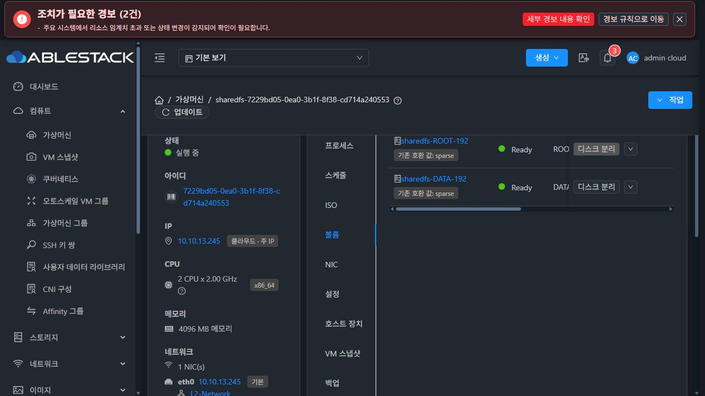
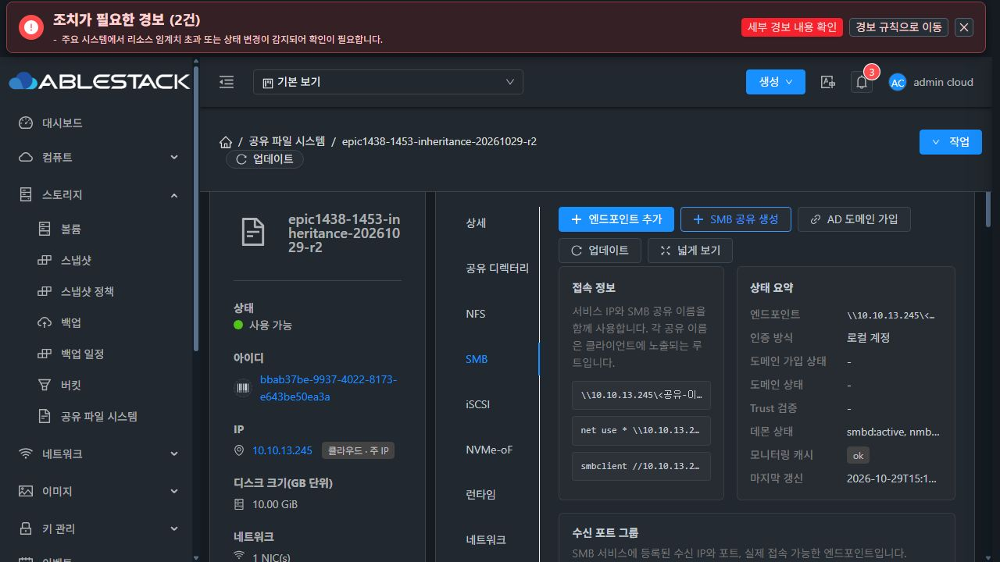
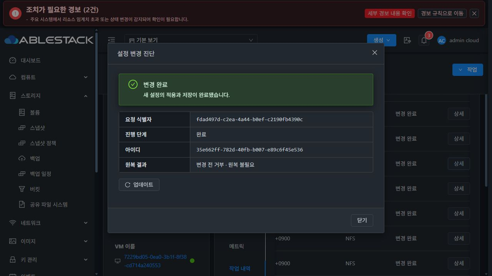
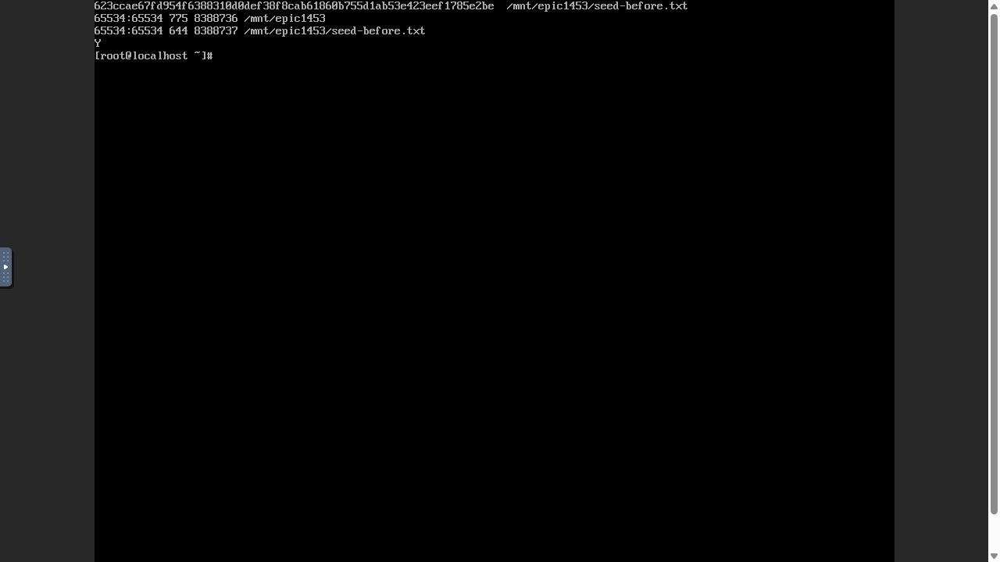
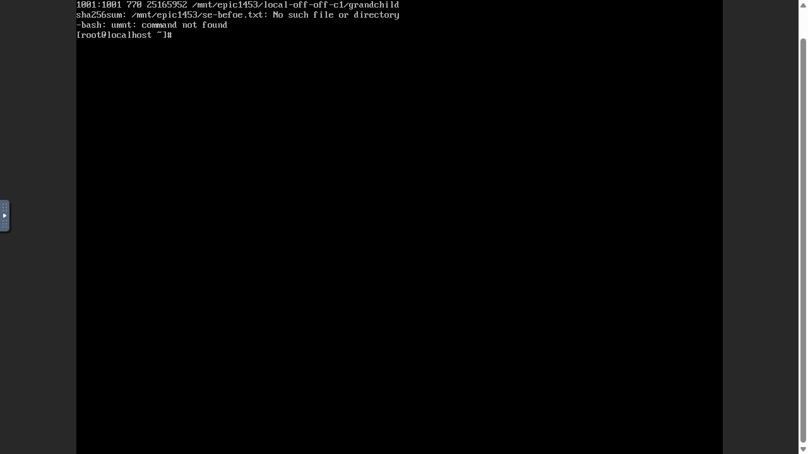
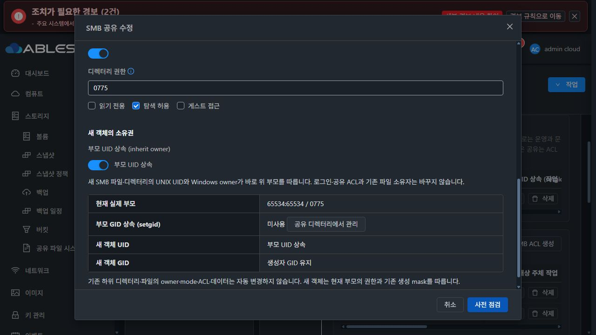

# #1453 R2 — 기본 SMB 호출 수정·13번 배포와 활성 release 보호 판정 결함

**2026-10-30 KST, #1453 OPEN / 인수 미완료. 제품 오류 확인 후 추가 구성·재시험을 중단했다.**

이번 수정 제품 commit은 `58c615491bae98ae65cc559c422e2cd03b7282a6`이다. 모듈 함수/객체 호출과 helper 직접 실행 순서의 이전 결함은 교정했다. 새 VM에서 기본 SMB 생성은 COMMITTED와 실제 클라이언트 쓰기까지 통과했다. 그러나 새 inherit owner를 켜는 UI 사전 점검이 정상 baseline updater5를 찾지 못해 차단됐다. 전체 인수 성공·AD 사용자 인수·이슈 종료로 표시하지 않는다.

## 1. 이전 결함 수정과 구현 전 실증

- 실제 `DirectoryPolicies` 객체는 보존하고 신규 모듈 함수2개는 별도 `directory_policy_module` 이름으로 호출한다. 기존 ACL/권한 엔진과 renderer를 다시 만들지 않았다.
- `shared_directory_policy.py`의 main 실행 블록을 모든 함수 정의 이후로 옮겼다.
- actual10-file baseline profile을 다시 생성·서명했다. 신뢰키/byte 제한/신원/기존 권한 변경·원복 보호는 유지했다.
- 제품 소스를 수정하기 **전에** 기존 전용 SystemVM의 private mount namespace에 후보2파일을 주입했다. 실제 전체 CLI prefix/import/객체·RuntimeAdapter/child dispatch를 사용했다. 모듈을 객체 대신 주입하지 않았다.
- inheritOwner 미제출/false/true의 실제 apply VERIFIED·testparm(no/no/windows and unix), 직접 helper CLI preview, 같은 요청 중복 무적용, 주입한 peer 실패 ROLLED_BACK/SUCCEEDED를 확인했다. 운영 코드/계정/설정/기존 데이터 불변과 전용 임시 DATA 제거를 확인했다.
- 실제 바인딩 단위 회귀는 이전 코드에서 세 경우 모두 AttributeError로 실패함을 확인했다.
- 이 native 시험은 기본 helper 배치 경로와 private 후보 dispatch를 검증했다. 아래 **bootstrap 후 활성 release 경로에서의 capability 조회**까지 보증하지 못했다. 이를 전체 배포 인수로 확대 해석하지 않는다.

[전체 CLI 실증 영수증](evidence/native-whole-cli-receipt.json) · [이전 코드 음성 회귀](evidence/old-binding-negative-result.json)

## 2. 동기화·빌드·배포

- local Europa를 upstream `31c147ca747f7a4ffc0380818bcd44887558a0c7`로 먼저 갱신하고 Epic을 rebase했다. local-base/upstream 차이0/0. locale 충돌은 JSON key 단위로 양쪽 변경을 보존했다.
- focused backend27(실제 API serializer·coordinator→DAO 저장/재조회 포함), UI58/6 suites, guest39, 변경 UI lint 통과.
- 관리 모듈151개 package, UI production build, 서명 payload·image 조립, qemu-img/bzip2 검증 통과.
- private namespace의 정상 서명 첫 bootstrap/반복2회와 active-feature downgrade guard 시험은 통과했다. 그러나 활성 release에서의 기능 capability 정상값을 충분히 검사하지 않았으며 이번 실환경 결함이 그 공백이다.
- 관리 JAR SHA256 `2e970d3de397c36be7d06340264de10d972df2b5441a99cd30a5f63456d9cd31`.
- UI index SHA256 `383a47880fd06b7bb4e0325adb04d8e914705cb0fece8178f38e84a3600ca531`.
- SystemVM image SHA256 `cd0a46bff895470af2982fef56f52be4135db51d192c56695ea76df6aa7cee0c`, 498355048 bytes, runtime `epic1438-1453-inherit-58c615491bae-r2`.
- 13번 관리/UI 배포·mold.service active·HTTP200·실제 UI 로그인 확인. config/외부 plugins/기존 systemvm assets 보존, 신규 DDL 없음. 배포 백업은 `/var/tmp/epic1438-1453-fix-58c615491bae-r2`.
- 이미지의 변경 guest8경로 외33,929경로와 WSL 계정 파일의 불변을 확인했다.

[빌드 해시](evidence/build-artifacts.json) · [배포 영수증](evidence/deployment.json) · [서명/bootstrap 부분 시험](evidence/native-signed-bootstrap.json) · [소스 동기화](evidence/source-sync.json)

## 3. 새 자원과 실제 UI·클라이언트 결과

자원 생성·설정/등록·ACK·상태 확인은 Mold UI로 실행했다. API 결과는 해당 UI 요청을 관측해 대조했다. AD OS 준비와 SystemVM 진단은 승인된 QGA를 사용했다. 클라이언트 작업은 실제 noVNC 콘솔에서 실행했다.

| 자원 | 실제 식별자 / 확인 |
|---|---|
| corrected SYSTEM template | a58eb2fc-d0bd-4fe7-90c4-d0fa8a61b53f, Ready / image checksum 일치 |
| 새 SharedFS | bbab37be-9937-4022-8173-e643be50ea3a, 10.10.13.245 |
| 새 Storage Service instance | c74b8e05-f121-4bb6-97d4-453134f88f5e |
| 새 SystemVM | 7229bd05-0ea0-3b1f-8f38-cd714a240553 / i-2-192-VM / host13.3 |
| 새 ROOT·DATA | ROOT4.88GiB / DATA10GiB XFS(c32a6e3e-ee08-4603-9fc6-501ba1dc51fa), 모두 UI SPARSE |
| 새 client1 | aaa3c43c-4f32-48f2-bdd5-e3930f908a07 / i190 / 10.10.254.224 / host13.1 / ROOT100GiB SPARSE |
| 새 client2 | e6744029-299e-4585-981b-65e312d9e752 / i191 / 10.10.254.223 / host13.2 / ROOT100GiB SPARSE |
| 새 독립 Samba AD DC | eed7f477-e439-4d8a-a932-3642aac0359e / i189 / 10.10.13.247 / ad1453.ablestack.local / ROOT SPARSE |

AD DC는 독립 USER template으로 배포하고 해당 VM에만 Samba AD 패키지·도메인 ABLESTACK.LOCAL·시험 사용자2개를 구성했다. DNS SRV 조회와 Administrator Kerberos 인증은 성공했다. **SharedFS의 AD 가입 및 실제 AD 사용자 I/O는 아직 수행하지 않았다.** 이전 Windows 설치 큐가 손상된 전용 AD 시도 VM은 정지했고 다른 Windows 자원은 변경하지 않았다.

### 통과한 실제 UI/API 단계

1. 새 SYSTEM template Ready/checksum → 새 SharedFS VM·ROOT·SPARSE DATA 생성 → 초기 NFS common1453r2/2049 생성과 ACL 전 준비·impact ACK·COMMITTED.
2. 기존 NFS NUMERIC 정책 적용(COMMITTED). 부모 UID/GID·mode·데이터를 변경하는 설정이 아니다.
3. SMB 전용10.10.13.245:445 엔드포인트를 UI로 추가, READY.
4. 부모 `/export/common1453r2`의 실제 `65534:65534 / 0775`를 ADOPT 등록. 정책 f5c8a5ac-260a-3b63-9802-619e805ec04a, inode8388736·FSUUID e6e5d2a7-1998-4cb4-b4cb-cafcf4ffd12b.
5. 공통 부모를 참조하고 inheritowner를 제출하지 않은 기본 SMB 생성 **COMMITTED**, operation35e662ff-782d-40fb-b007-e89c6f45e536. 실제 요청에서 owneruid/ownergid/directorymode/recursivepermission을 제출하지 않았다. 부모 권한 보존.
6. 로컬 RW(epic1453rw)/RO(epic1453ro) ACL 생성 모두 COMMITTED. 실제 NSS에서 UID/GID1001:1001 및1002:1002. 현재 부모 ACL에 해당 사용자의 명시적rwx/r-x가 있음을 읽기 전용으로 확인했다.
7. client1이 실제 NFS로 seed를 생성·hash/stat 후 unmount. SMB RW 로그인으로 파일·dir·nested 파일·grandchild 생성 성공.
8. client2가 NFS에서 같은 SMB 객체를 조회. inherit owner OFF/setgid OFF 상태에서 파일1001:1001/0660, dir1001:1001/0770, nested 파일1001:1001/0660, grandchild1001:1001/0770. 이후 unmount.
9. 생성된 설정 작업8개는 실제 UI 이력과 API에서 모두 COMMITTED/COMPLETED/NOT_NEEDED. 제품 오류가 나온 신규 inheritowner 사전 점검은 변경 명령을 실행하지 않았다.

콘솔 긴 입력에서 일부 문자가 누락된 시험 명령은 입력 방식을 교정했다. client2의 seed hash 재조회 명령은 경로 오타로 실패했으며 이를 성공으로 기록하지 않는다. seed 원본 해시·UID/GID·inode 보존은 client1의 최초 실제 NFS 결과와 오류 후 SystemVM 읽기 전용 진단을 대조했다.

[실제 UI 생성 요청](evidence/smb-create-ui-request.json) · [UI 작업 이력 API](evidence/ui-configuration-history.json) · [실제 NSS/seed](evidence/source-inspection.json) · [부모 ACL/testparm](evidence/posix-inspection.json)







## 4. 최초 제품 오류 — 보호 검사 경로가 활성 release와 맞지 않음

2026-10-30 00:22:44 KST, 실제 SMB 편집 UI에서 inheritowner만 켜고 사전 점검했다. 응답은 HTTP200의 configurationpreflight.status=UNKNOWN, revision8, blocking ERROR **SMB_PARENT_INHERITANCE_PROTECTION_REQUIRED**. 같은 오류를 재시도하거나 보호를 우회하지 않았다.

### 설치된 사실과 정확한 실패 경로

```
/usr/local/bin/ablestack-storagectl
  → /opt/ablestack/storage-runtime/releases/epic1438-1453-inherit-58c615491bae-r2/ablestack-storagectl
  → release/lib/ablestack-storage/configuration_transaction.py capability show
  → release/lib/ablestack-storage/shared_directory_policy.py
  → inheritance_protection_version()
  → Path(__file__).with_name("runtime_updater.py")    # 잘못된 lookup
  → release/lib/.../runtime_updater.py 없음
  → OSError를 받아 protection=0
  → server StorageServiceConfigurationPreflight.java:307~308 보호 필요로 차단
```

baseline updater는 release의 관리10파일에 포함되지 않는다. **실제 시스템 기준 경로 `/usr/local/lib/ablestack-storage/runtime_updater.py`에 정상 설치**되어 있다. root:root/0644, 일반 파일·비symlink,55903bytes, UPDATER_VERSION=5, SHA256 c43bb080bfc2d924475c019a9335e73cb98d0756436e26c152465b8f444a84fe.

같은 새 VM에서 읽기 전용으로 다음을 비교했다.

| 호출 | 결과 |
|---|---|
| 기본 경로 helper에서 보호 조회 | 1 |
| 실제 storagectl capability show(활성 release) | smbParentInheritanceVersion1 / smbParentInheritanceProtectionVersion0 |
| 활성 release helper 기본 lookup | sibling updater 없음 /0 |
| 활성 release helper에서 실제 baseline 경로를 명시한 진단 호출 |1 |

이는 AD/인증/네트워크·ROOT/DATA 포맷 문제가 아니다. 이미지에 updater5가 빠진 것도 아니다. **새 helper가 updater도 같은 release에 있다고 가정한 경로 계약 결함**이다. 실제 설정 적용 전에 차단되어 inheritowner는 기존false, setgid는 기존off, 부모65534:65534/0775·inode8388736 유지. seed SHA256 `623ccae67fd954f6388310d0def38f8cab61860b755d1ab53e423eef1785e2be`·inode8388737 유지.

[실제 public preflight](evidence/inherit-owner-preflight-response.json) · [baseline/CLI capability 대조](evidence/protection-diagnosis.json) · [활성 release 경로 원인 실증](evidence/active-release-diagnosis.json)

### UI에서 진단이 사라지는 경로

실제 오류 응답은 observedat와 expiresat가 같은 시각이다. SharedFSTab.vue의 checkConfigurationPreflight는 READY뿐 아니라 UNKNOWN에도 expiresat 기반 timer를 설정한다(현재5767~5768행). 따라서 setTimeout0으로 report가 지워진다. SmbParentInheritanceFields의 오류 문구 매핑이 있어도 화면에 유지되지 않는다. 실제 캡처에는 새 상속 토글과 사전 점검 버튼만 남았다.

이 부분은 단순 색/문구 차이가 아니라 **실패 원인 표시의 지속성 결함**이다. 성공 작업에서 rollback.NOT_NEEDED가 “변경 전 거부 · 원복 불필요”로 표시되는 별도의 문구 차이는 최종 UI 정리 때 처리할 표시 항목으로만 기록하며 이번 중단 이유가 아니다.



## 5. 다음 최소 개선안 — 아직 구현·재시험하지 않음

1. **기준 updater 위치를 신뢰 경계대로 조회**: inheritance_protection_version의 기본 경로를 고정된 시스템 baseline updater 경로로 바꾼다. release 내 후보나 사용자 입력/env 경로로 대체하지 않는다. 일반 파일·소유자·권한·크기·AST integer version 검증과 missing/unsafe→0 동작은 유지한다. updater를 runtime bundle에 추가하거나 보호 버전1을 강제로 반환하지 않는다.
2. **UI 실패 report 보존**: READY의 승인 만료 timer만 유지하고 BLOCKED/UNKNOWN 오류는 다음 편집/새 점검/닫기까지 유지한다. 적용 버튼은 계속 비활성이다. #1453의 보호 부족/기능 미지원 안내를 실제로 볼 수 있게 한다. VM 표준 공통 폼/모달·다크 스타일은 그대로 사용한다.
3. **구현 전 실제 SystemVM 증명**: 현재 새 VM의 private mount namespace에 후보 helper만 주입하되 **실제 활성 release/정상 child dispatch**를 유지한다. actual storagectl capability protection1, 실제 inherit-owner preflight, missing/old/updater-unsafe 차단을 확인한다. signed install·실제 설정은 보존한다.
4. **실제 오류 경로 회귀**: updater는 baseline에만 있고 서명 release에는 없는 배치를 만든 뒤 최초/반복 bootstrap→활성 storagectl capability→true preflight/전체 적용까지 연결한다. 모듈 직접 import 통과만으로 판정하지 않는다. 실제 UNKNOWN API 응답과 fake timer를 사용하는 컴포넌트 시험에서 진단 지속·적용 차단을 확인한다.
5. 통과 후 서명 profile·모듈/이미지 빌드와13배포, 현재 중단 지점부터 새 검증 계획을 실행한다. baseline/guest·서버 보호를 완화하는 우회는 하지 않는다. 새 API/DDL은 필요 없고 일반 SMB/AD join/포맷·네트워크를 수정하지 않는다.

## 6. 남은 인수와 보존 상태

- **미완료**: inheritowner ON 및 setgid 조합, AD 실제 가입·AD 사용자 I/O, 부모별 독립성, RO/미인가 실제 쓰기 거부, 충돌/동시 변경·UI 실패 원복, 새 기능 활성 후 VM·관리 재시작·UID/GID/mode/Windows owner·NFS 교차 데이터 보존.
- 기존 네 가지 이슈 인수 체크는 그대로 미체크다. 기본 OFF/OFF I/O나 native 부분 시험을 전체 성공으로 쓰지 않는다.
- 제품 오류 발견 뒤 추가 적용/재시작·다른 조합 재시험을 중단했다. 실패 원인 실증은 읽기 전용이다. 기준 updater 명시 진단값을 제품 실행 우회로 사용하지 않았다.
- 새 SharedFS/NFS/SMB 기본 서비스·AD DC·client2대와 seed는 후속 진단을 위해 보존했다. 클라이언트 NFS unmount, 메모리 인증 변수 unset/콘솔 logout, 이번 private DAO 시험 DB만 종료했다. MAC 임의 변경·THIN 생성·기존 데이터 재포맷 없음.
- Epic PR #1470 Draft와 #1453 OPEN 유지. 다른 이슈 분기·이슈 종료·추가 코드 수정은 하지 않는다.
