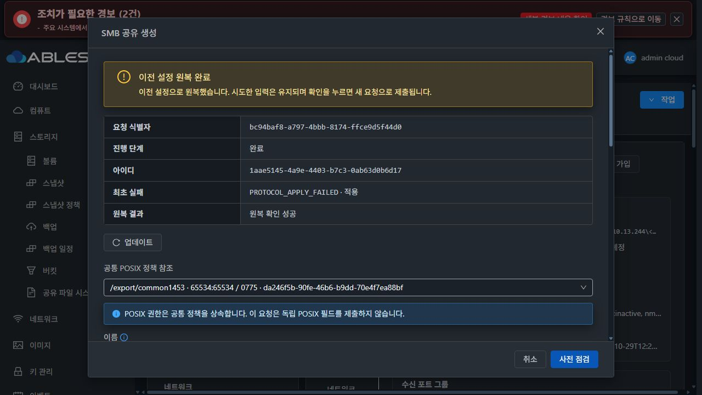
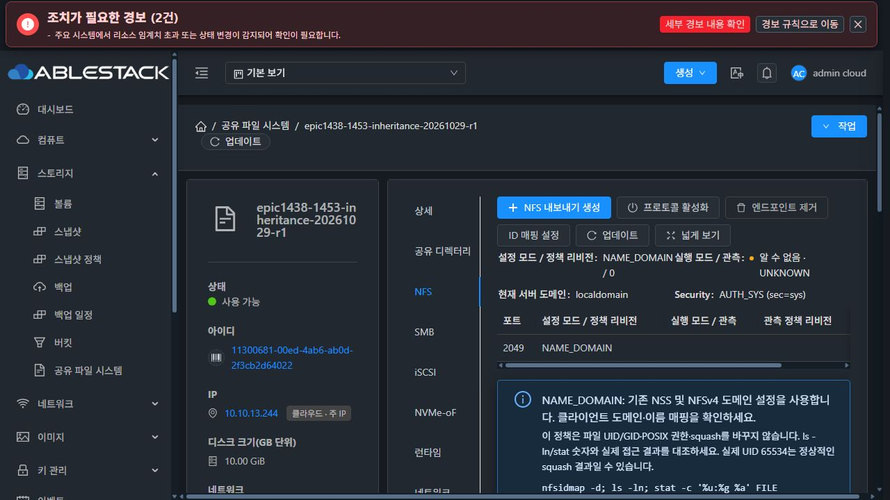
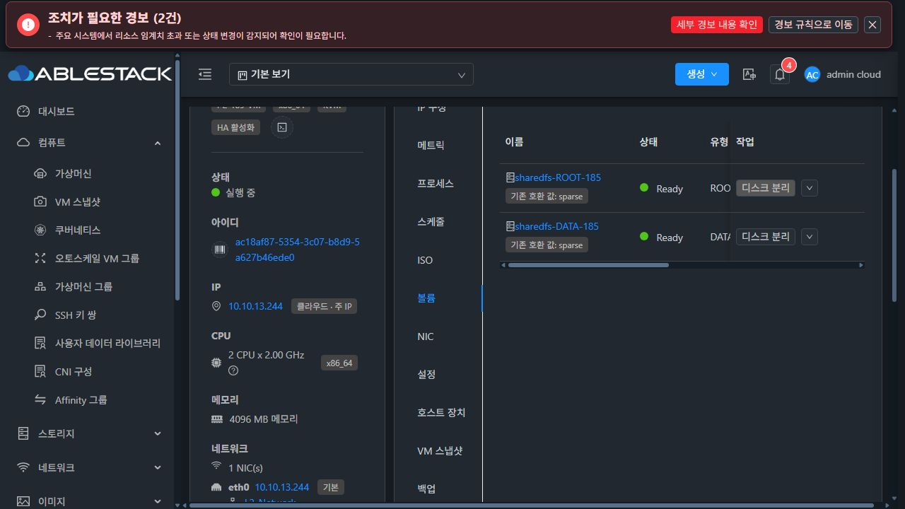

> **후속 상태(2026-10-30):** 아래는 R1 중단 당시의 역사 기록이다. 모듈/객체 호출 및 main 순서는 R2에서 수정·배포했고 기본 SMB 생성과 OFF/OFF I/O는 통과했다. 현재는 활성 release에서 baseline updater를 찾지 못하는 별도 보호 판정 결함으로 중단했다. [R2 수정·실환경 결과와 정확한 원인](../sharedfs-1453-fix-r2-20261030/README.md).

# #1453 실환경 검증 중단 보고 — SMB 실행 진입점 바인딩 결함

2026-10-29. **제품 오류 확인 후 수정·재시도·추가 구성을 중단했다. #1453 OPEN / Epic PR #1470 Draft.**
아래 구현 결함은 이번 #1453에서 추가한 코드의 문제다. AD 준비나 네트워크를 실패 원인으로 분류하지 않는다.

## 완료한 단계와 미완료

| 항목 | 확인 결과 |
|---|---|
| 최신 upstream/로컬 base/Epic 반영 | Europa `06d3c598c116d2f6bdd232ea6c09f066240098f4`, local/upstream 차이0/0. 기존90개 Epic commit을 rebase했다. |
| 빌드 소스 정합성 | 원 빌드 `b2459c366ee2`와 rebase 제품 commit `a174e152970`의 API/server/UI/SystemVM/engine/plugins는 동일하다. 추가 upstream 변경은 호스트 보안그룹 스크립트1개다. |
| 모듈 빌드 | 관리151모듈·Vue production·정상 서명 SystemVM 이미지 PASS. 서버27/UI58/guest38 회귀 PASS이나 아래 실제 진입점 누락이 있어 기능 인수로 인정하지 않는다. |
| 13번 배포 | 관리 JAR/UI 배포, service active/HTTP200 및 실제 UI 로그인/목록 확인. 기존 config·외부 plugins 보존. 신규 DDL 없음. |
| 새 이미지/VM/DATA | c4c9bb14-2279-4332-b794-e388159d11a7 SYSTEM 이미지 UI 등록·Ready·checksum 확인. 새 SharedFS VM ROOT4.88GiB/DATA10GiB XFS 모두 SPARSE 확인. |
| 초기 NFS와 공통 부모 등록 | 실제 UI 생성 및 ADOPT COMMITTED. 부모65534:65534/0775와 inode8388736 보존. |
| 새 Linux 클라이언트2대 | UI 생성·Running·ROOT100GiB SPARSE 확인. 실제 접속/I/O 시험은 아직 하지 않았다. |
| 기본 SMB 생성 | **FAIL**. 상속을 켜지 않은 첫 공유에서 PROTOCOL_APPLY_FAILED. ROLLED_BACK/SUCCEEDED 확인. |
| 나머지 인수 | UID/setgid 조합·충돌·동시 변경·재시작·클라이언트 권한/데이터와 실제 AD는 미완료. 이슈를 닫지 않는다. |

## 실제 실패와 호출 경로

- SharedFS `11300681-00ed-4ab6-ab0d-2f3cb2d64022`, instance `0c0e570b-3793-41de-9d2d-2129276e2f08`.
- SystemVM `ac18af87-5354-3c07-b8d9-5a627b46ede0` / i-2-185-VM / 13.3, 서비스IP13.244.
- DATA `da246f5b-90fe-46b6-b9dd-70e4f7ea88bf`, 공통 정책 `02832155-9814-3232-9136-5068642a78d8`.
- UI에서 공통 정책을 선택해 SMB `smb1453`을 생성했다. UID 상속은 끈 기본값이다.
- public 사전 점검은 READY였다. 실제 후보 journal의 SMB share config에는 **inheritOwner 자체가 없다**.
- 실패 operation `1aae5145-4a9e-4403-b7c3-0ab63d0b6d17`, request `bc94baf8-a797-4bbb-8174-ffce9d5f44d0`.
- journal: APPLYING / PROTOCOL_APPLY_FAILED → ROLLED_BACK / COMPLETED, rollback SUCCEEDED. baseRevision3 / targetRevision4.
- UI도 최초 실패 코드와 원복 확인 성공을 표시했다.

`createStorageSmbShare → coordinator → configuration_transaction.RuntimeAdapter → ablestack-storagectl smb share apply → apply_smb_shares의 Python heredoc`에서 실패한다.

### 확인된 원인1: 모듈 함수를 객체 메서드로 호출

`ablestack-storagectl:4729–4730`은 기존 정책 엔진을 다음처럼 만든다.

```python
from shared_directory_policy import DirectoryPolicies
directory_policies = DirectoryPolicies()
```

새 코드의4972행은 `directory_policies.validate_inheritance_share(...)`를 호출한다. 그러나 이 함수는 클래스 메서드가 아니라 **모듈 함수**다. 설치된 실제 코드의 import/객체 생성 부분만 실행해 조회했으며 결과는 다음과 같다. SMB 작업을 다시 실행한 것이 아니다.

```text
actualBindingType: DirectoryPolicies
instance.validate_inheritance_share: AttributeError
module.validate_inheritance_share: callable
instance.inheritance_enabled: AttributeError
module.inheritance_enabled: callable
```

최초 오류는 `'DirectoryPolicies' object has no attribute 'validate_inheritance_share'`다. 실제 설치 heredoc과 해당 operation의 SMB 후보로 쓰기·외부 명령을 차단한 진입 prefix를 guard까지 확인한 결과도 **동일4972행 AttributeError**였다. 설정 불변을 확인했고 전체 SMB 작업이나 서비스를 재실행하지 않았다. [읽기 전용 prefix 근거](evidence/real-prefix-receipt.json). 같은 잘못된 호출이5059행의 `directory_policies.inheritance_enabled(config)`에도 있다.

첫 guard는 활성 share가 하나라도 있으면 상속 bool과 무관하게 실행된다. 그래서 **기본 SMB 생성도 실패**한다. 이번 before-image의 SMB share는 비어 있어 원복 apply가 해당 반복문에 들어가지 않았고 원복은 성공했다. share가 있는 다른 상태의 원복까지 통과했다고 확대하지 않는다.

설치 storagectl SHA256 `6e0e5876c6b2d3be2456557a2c640fbf6c537f2ce57bf215b0cb780c3665d28e`, helper SHA256 `af390a7ffc3d38ade34bb2af7d1cb66b2df8ea12d3df96ba9f1eacab82cef5ca`. 현재 저장소 소스와 일치한다.

### 확인된 관련 결함2: 직접 CLI 실행 시 신규 함수 정의 순서

같은 helper는643행에서 main()을 호출하고 신규 함수들은651행 이후에 정의한다. 실제 SystemVM 설치 파일의 main 직전 namespace를 읽기 전용으로 확인했다.

- `DirectoryPolicies`는 존재한다.
- `inheritance_conflict`, `smb_runtime_settings`는 아직 존재하지 않는다.
- 해당 시점의 이름 조회는 `NameError: name 'inheritance_conflict' is not defined`다.
- server `StorageDirectoryPolicies:168`은 실제 `directory policy preview` CLI를 호출한다. SMB 참조가 있는 부모의 setgid 활성화 preview가 새 함수를 호출하면 이 순서 문제가 노출된다.

이는 **실제 UI SGID 실행 결과가 아니라 직접 실행 계약의 추가 결함 확인**이다. SGID 적용을 시도하지 않았고 함수 이름 조회 외의 변경도 하지 않았다. 첫 오류만 수정한 뒤 다음 단계에서 다시 막히지 않도록 함께 교정해야 한다.

## 사전 시험이 놓친 이유

실제 Samba와 SystemVM에서 실행했지만 전체 제품 진입점은 검증하지 못했다.

- native probe는 renderer AST 일부를 추출한 뒤 `scope["directory_policies"] = actual`로 **모듈**을 넣었다. 제품의 실제 바인딩인 **DirectoryPolicies 객체**와 달라 잘못된 호출을 가렸다.
- helper는 import 방식으로 시험해 함수가 모두 정의된 상태였다. 직접 CLI의 main-before-definitions 순서를 놓쳤다.
- 서명/bootstrap 검증은 파일·서명·profile 무결성을 확인하는 시험이므로 SMB 명령 실행 계약을 대신할 수 없다.
- API/DAO/UI58회귀 역시 실제 guest 전체 CLI 실행을 보증하지 않는다.

따라서 기존7개 native 검사 그룹의 성공은 그 시험 범위의 결과로만 보존한다. #1453 제품 인수 성공 근거로 사용하지 않는다.

## 최소 영향도 개선안 — 아직 미구현

1. 기존 `directory_policies` 객체는 유지하고 신규 함수2개만 명확한 모듈 alias 또는 직접 import로 호출한다. 기존 protected/ACL/원복 엔진을 바꾸지 않는다.
2. helper의 `if __name__ == "__main__"` 블록을 모든 함수 정의 뒤로 이동한다. UID/GID·mode·신원·baseline 보호·기존 masks는 유지한다.
3. 실제 product import/객체 바인딩을 바꾸지 않는 **전체 SMB 실행 진입점** 회귀를 추가한다. flag 미제출/false/true와 non-empty share를 포함한다. 직접 CLI preview와 import 경로를 둘 다 시험한다.
4. 코드 반영 전에 실제 SystemVM에서 후보 전체 명령을 검증하고 before-image/원복·NFS 상태·파일/권한 보존을 확인한다. 부분 renderer 추출만으로 통과시키지 않는다.
5. 그 뒤 관리 payload10파일 hash/profile·정상 서명 번들·이미지를 갱신하고, 실제 UI/새 SPARSE 자원과 클라이언트의 남은 #1453 인수를 진행한다.

API/DB나 NFS 알고리즘을 변경할 이유는 확인되지 않았다. 이번 중단 이후 제품 코드 수정·재시도·추가 구성은 하지 않았다.

## 원복·보존과 진단의 한계

- 현재 SMB share/ACL/endpoint는 UI에서 없음으로 확인했다.
- NFS common1453/2049는 UI READY, Ganesha unit도 active다. 부모65534:65534/0775·inode8388736·DATA UUID를 보존했다.
- 클라이언트 접속/파일 hash를 실제로 검증한 상태는 아니므로 데이터 I/O 인수 완료로 표시하지 않는다.
- journal에는 최초 실패 코드/phase와 원복 상태가 남아 있다. 최신 runner-result는 원복 성공으로 덮여 있어 최초 stderr 전체는 보존되지 않았다. 이를 실제 저장된 traceback이라고 주장하지 않고 설치 코드·실제 객체의 읽기 전용 조회로 하위 원인을 확인했다.
- 최종 HTTP POST의 원문은 브라우저 이벤트 buffer가 만료돼 보존하지 못했다. public UI preflight 응답과 실제 guest candidate는 보존했다. 미변경 POSIX 비제출의 전체 실환경 인수를 완료 처리하지 않는다.
- 기존 다른 SharedFS guest 코드를 교체하지 않았다. 등록된 새1453 이미지에는 이 결함이 있으므로 수정 이미지 검증 전 추가 시험 서비스 생성은 진행하지 않는다.

## AD 시험 기반

사용자 승인에 따라 새 Windows 시험 VM `ea9d2d88-5d88-40b2-99dd-9adf2328845c`와 SPARSE ROOT100GiB를 UI로 생성했다. 제가 잘못 지정한 UEFI는 UI 설정에서 해제해 BIOS로 교정했다. 이후 Windows 설치 로그에서 `MainQueueOnline*.que` 입력 파일 누락 및 `WdsExecuteWorkQueue failed / 0x00000002`를 확인했다. 이는 해당 OS 이미지의 초기 설치 단계이며 이번 SMB 제품 오류의 원인이 아니다.

AD 승격·도메인 가입은 아직 하지 않았다. 제품 오류 확인 뒤 AD 구성도 중단했다. 관련 없는 Windows VM/다른 자원은 변경하지 않았다.

## 근거

[배포 영수증](evidence/deployment.json) · [소스 동기화](evidence/source-sync.json) · [현재 시험 자원](evidence/resources.json) · [실제 바인딩 진단](evidence/smb-binding-diagnosis-receipt.json) · [실제 실패 journal](evidence/failed-operation-receipt.json) · [직접 실행 정의 순서](evidence/main-order-receipt.json) · [UI 사전 점검](evidence/preflight-witness.json)





완료 조건은 미충족이다. #1453을 닫거나 다음 이슈를 시작하지 않고 다음 지시를 기다린다.
