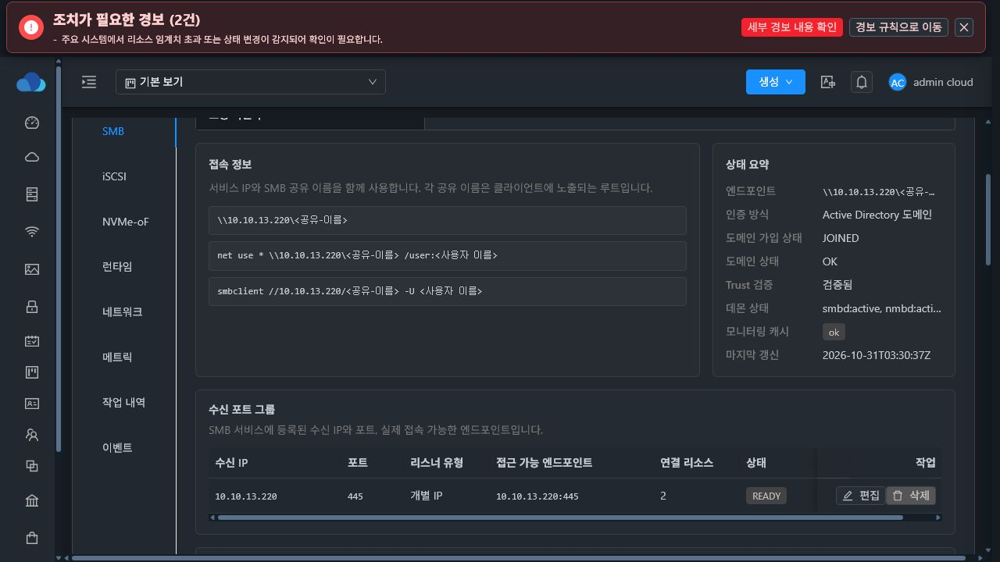
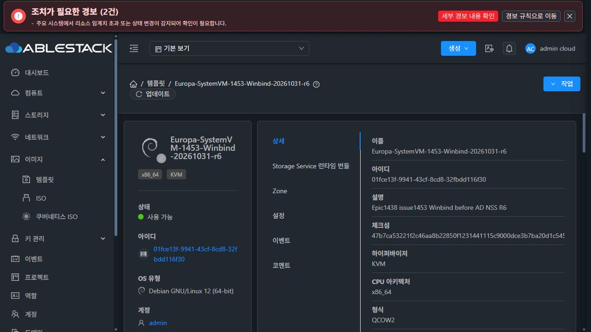
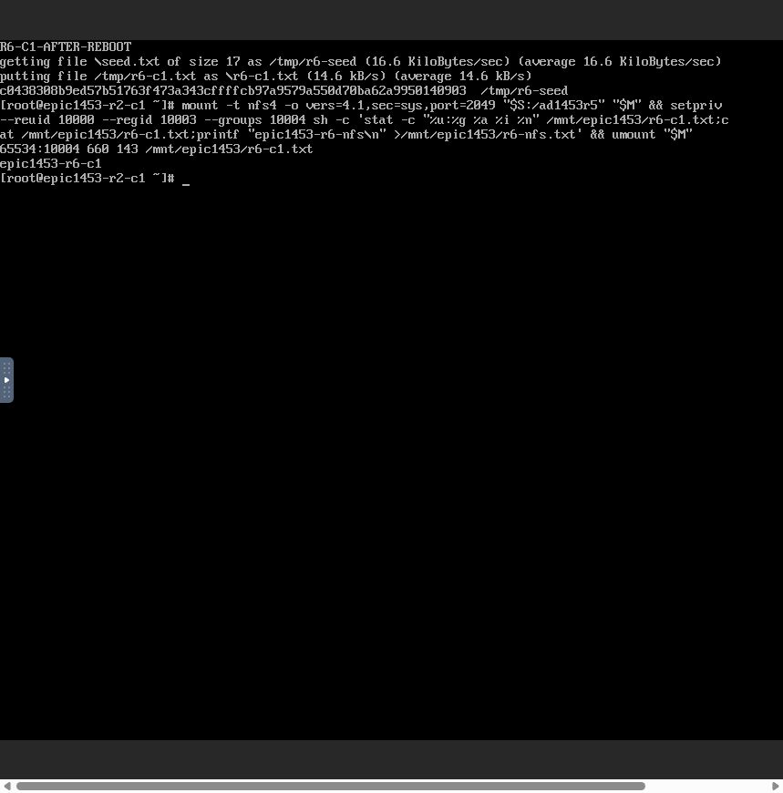
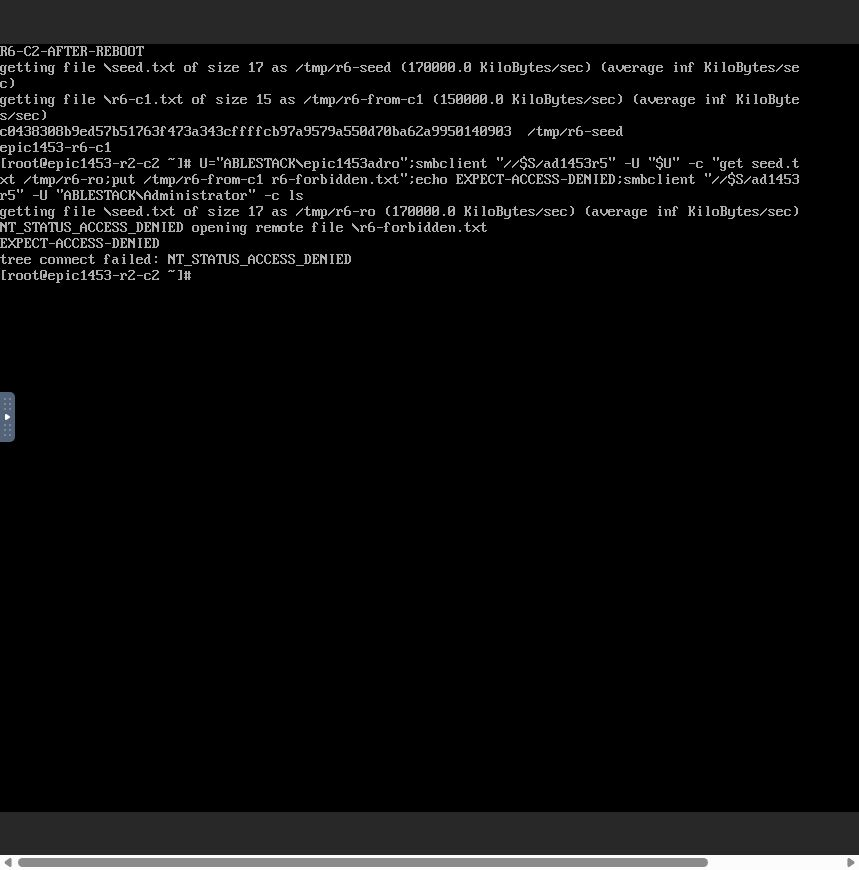
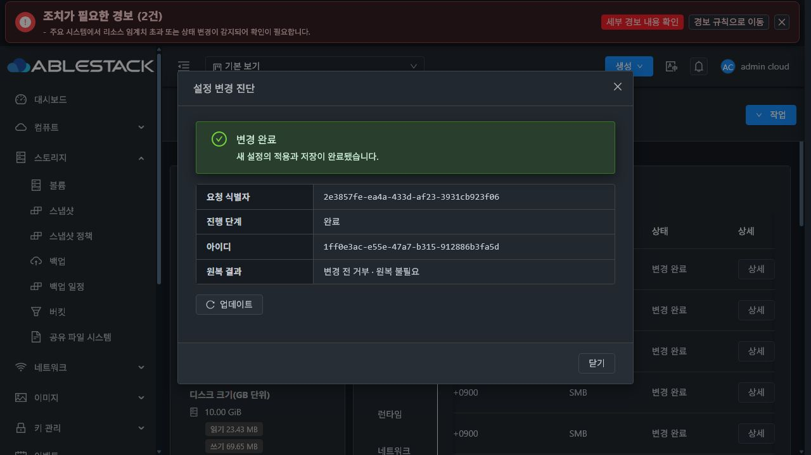

# #1453 R6 — AD ACL 콜드 부팅 복구 및 최종 인수

2026-10-31. **Winbind 선행 준비 결함을 수정하고, 실제 UI 재부팅·두 클라이언트·관리 서버 재시작 인수를 통과했다.** #1453의 기존 상속 기능 인수와 이번 남은 부팅 인수를 합쳐 종료한다. Epic 전체 완료나 PR 병합을 뜻하지 않는다.

## 변경과 원인

제품 commit: **c728c54b1d230de840bf45840a074da96a51dd7f**.

저장된 SMB 구성을 다시 적용할 때 공통 POSIX ACL의 `pwd.getpwnam`이 Winbind 기동보다 먼저 실행됐다. AD 가입 직후의 따뜻한 상태에서는 통과했지만, Winbind가 disabled/inactive인 콜드 부팅에서는 `DIRECTORY_PRINCIPAL_UNAVAILABLE`로 빠져 뒤쪽 restart에 도달하지 못했다. 도메인 가입, IP/MAC, 입력 escape 또는 DATA 손상이 원인이 아니었다.

수정 범위는 기존 guest CLI의 호출 1곳, 기존 shared directory helper의 작은 준비 함수, 해당 11개 회귀 시험과 baseline profile이다.

- 활성 AD USER/GROUP ACL이 있는 경우만 저장된 root 소유 regular/non-writable Samba 설정의 ADS·realm·NetBIOS를 확인한다.
- Winbind가 실행 중이지 않을 때만 start한다. trust와 bounded NSS 준비를 확인한 후 기존 공유·계정·ACL 적용 흐름으로 들어간다.
- AD 계정의 정확한 기존 이름을 조회한다. 가짜 로컬 계정, 숫자 identity fallback, 가입 재실행, 권한 완화는 없다.
- 로컬 전용·disabled 공유/ACL은 새 준비 명령을 실행하지 않는다. 따뜻한 Winbind를 이 준비 단계에서 불필요하게 재시작하지 않는다.
- 기본 smbd를 시작하거나 enable하지 않는다. 기존 관리 리스너와 적용 후 설정 반영, writer/revision·상속·권한·원복 보호는 유지한다.
- Java/UI 소스, API/DB/host agent 변경은 없다. 관리 JAR은 재생성한 baseline resource **한 entry**만 바꿨다.

## 구현 전 실제 콜드 상태 주입

대상 SystemVM **d9c423e9-ce89-3ba9-9cd8-f48cdb791da2**, host13.2/i-2-195-VM. 기존 R5 실패 상태를 사용했다.

1. Winbind inactive, AD getent exit2, `net ads testjoin` 정상임을 먼저 확인했다.
2. 저장소 제품 소스를 수정하기 전에 후보 CLI/helper를 별도 준비 경로에 만들었다.
3. private mount namespace 안에서 실제 활성 CLI/helper 경로에 후보를 bind하고 **실제 전체 boot-reconcile**를 MAX_ATTEMPTS=1로 실행했다. mock 데몬이나 가짜 NSS 결과로 대체하지 않았다.
4. NFS 두 export 및 SMB 전체 구성의 재적용이 **한 번에 exit0**으로 성공했다. trust·AD USER10000/primary GID10003·AD GROUP10004 조회가 성공했고 관리445만 실행됐다. 기본 smbd는 inactive였다.
5. 기존 **33객체/17파일의 UID/GID/mode/ACL/device/inode/hash와 XFS UUID가 동일**했다. namespace와 임시 주입 파일을 정리했다.

원문: [콜드 주입 결과](evidence/native-cold-pretest.json), [실행 시험 코드](evidence/native-cold-pretest.py), [후속 서명10파일 대조](evidence/verify-r5-payload.json).

시험 코드의 전체 runtime tree 해시 검사에 Python의 동적 __pycache__를 포함해 마지막 보존 assert가 실패했다. **제품 replay는 이미 exit0이고 데이터 비교도 일치했다.** 서명 대상10개만 기존 manifest와 별도로 대조해 전부 일치함을 확인했다. 이를 제품 오류나 추가 콜드 성공 회수로 계산하지 않았으며 설정 replay를 다시 실행하지 않았다. 전역 reconcile unit은 이 사전 주입 실행으로 성공 판정을 바꾸지 않았고, 아래 실제 배포 후 UI 재부팅으로 검증했다.

## 회귀·빌드·배포

- [새 실제 CLI AST/호출 순서·cold/warm/local·trust/timeout/설정 보호 회귀](../../../systemvm/test/test_smb_ad_resolution.py): **11 PASS**. 실제 embedded Python을 실행해 준비 호출이 공유 mutation loop 및 apply_acl_batch보다 앞서는지 확인한다.
- guest SMB34(32 PASS/2 native 전용 SKIP) + AD15 PASS + 공통 POSIX12 PASS: **합계59 PASS/2 SKIP**. 각 [실행 로그](evidence/)를 보존했다. 이번에 이전 R4/R5 전체 시험을 다시 실행한 것으로 합산하지 않는다.
- Maven server 및 의존 모듈 **process-resources BUILD SUCCESS**. checkstyle/spotbugs/license/rat skip 명시. 이번에 Java 전체 패키지나 전체 저장소 CI 통과를 주장하지 않는다.
- 정상 서명 runtime **1453.ad.winbind.r6**, manifest SHA256 **4fff09582baf2fb233244c479ba6c9ba161dc0addae98822c79572b4259d5107**. 기존 cluster13 DPAPI 보호 키를 memfd에서만 사용했다.
- 실제 보존 대상 SystemVM에는 운영자 모듈 배포로 서명·archive 계약·10파일 hash/mode/owner·상속 capability·기존 baseline을 검증한 뒤 새 release로 원자 전환했다. 기존 R5 release와 설정·데이터를 유지했다. **카탈로그 UI 업그레이드 인수로 대체하거나 주장하지 않는다.**
- 관리 JAR SHA256 **587b5d405304be71e92875555d9e984041caa2241942a7d91c936b76b44d1d19**. 변경 entry는 `storage-runtime/bootstrap/runtime-baseline-profile.json` 하나이며 다른 Java/class/resource byte는 동일하다. 관리 서비스를 재시작했고 active/HTTP200이다.
- UI index SHA256 **c37069d7fdd460ae2719ec49a549a35094f20fcc6f618eaf2f9120b25a176a48** 유지. 신규 schema migration 없음.
- R6 SYSTEM 이미지 **498,387,997 bytes / SHA256 47b7ca53221f2c46aa8b22850f1231441115c9000dce3b7ba20d1c54577bba39**. qemu-img check·bzip2·이미지 내부 정상 서명/10파일/profile·WSL 계정 파일 불변을 검증했다. R4 이미지 기반 조립에서 바뀐8경로와 보존33,929경로는 [빌드 영수증](evidence/guest-module-build.json)에 구분했다.
- 13번 UI에서 **Europa-SystemVM-1453-Winbind-20261031-r6 / 01fce13f-9941-43cf-8cd8-32fbdd116f30**를 SYSTEM·KVM·Debian12 x86_64로 등록했고, 다운로드 후 **Ready=true·crosszones=true·이미지 SHA256 일치**를 확인했다. 현재 DAO는 Ready SYSTEM을 ID 역순으로 선택하므로 신규 생성도 교정 템플릿을 사용할 수 있다. 기존 서비스를 새 ROOT로 교체해 보존 시험을 회피하지 않았다.

[관리 배포 영수증](evidence/management-deployment.json), [guest 배포 영수증](evidence/guest-deployment-fixed.json), [이미지 서명 검증](evidence/assembled-image-verification.json), [템플릿 UI/API](evidence/ui-api-template.json).

배포 준비 코드가 처음에 기존 공개 신뢰키의 runtime 경로를 잘못 지정해 읽기 단계에서 실패했다. template trust 경로로 교정했고 신뢰키를 추가·교체하지 않았다. 템플릿 등록도 시험 입력에서 SYSTEM에 단일 Zone을 지정해 정상431 거부를 받았다. cross-zone으로 교정하고 Zone 변경으로 초기화된 KVM/QCOW2 필드를 다시 선택한 뒤 정상 등록했다. 두 항목 모두 시험/배포 입력 교정이며 제품 소스 변경이나 같은 제품 오류의 반복 수정이 아니다.

## 실제 UI·API 재부팅 인수

보존 대상 SharedFS **3f0056db-4dfe-4f13-908d-b809dd565d34**, instance **c1eca707-a554-4c42-85cd-1e9e9744d804**, 원래 STATIC **10.10.13.220/16**, MAC **02:0d:00:cc:00:93**.

실제 UI **작업 → 공유 파일 시스템 재시작**, cleanup=false:
- API job **6b363413-5590-4b50-b7f4-21b01f2da5e4**: 2026-10-31 12:13:54 요청, **12:16:22 완료/jobstatus1**.
- 부팅 ID **f8c8bbab-a021-4be6-90e7-e379875b32f3**. 실제 bootstrap이 R6의10파일 integrity를 확인했다.
- **12:14:15 boot-reconcile 정상 종료**. 이번에는 수동 start/rejoin/reapply로 보완하지 않았다.
- 원래 IP/MAC·XFS UUID 보존, NFS2049·관리 SMB13.220:445 복구. 기본 smbd disabled/inactive, Winbind active(자동 enable하지 않음).
- 실제 UI에 가입JOINED·trust 검증됨·SMB445 READY·두 공유/네 ACL·상속 정책이 표시됐다. UI의 최근 AD 작업 식별자9f58...는 기존 R5 서비스 적용 기록이며 새 부팅 job과 혼동하지 않는다.

이어서 관리 모듈 배포로 **mold.service를 재시작**하고 실제 UI에 다시 로그인했다. 가입/Trust/READY와 설정·19개 구성 작업 및 상세 request2e3857fe.../operation1ff0e3ac... 이력을 확인했다. 두 클라이언트의 후속 재접속과 읽기도 성공했다.

[UI 실제 API 응답](evidence/ui-api-reboot.json), [관리 재시작 이후 API](evidence/ui-api-after-management.json), [실제 부팅 진단](evidence/reboot-readonly-diagnosis.json), [이력 화면](evidence/history-after-management.txt), [상세 진단](evidence/history-detail-after-management.txt).

기존 networking.service 실패 항목은 진단에 남아 있다. 이번 수정 전부터 관측된 항목이며, 현재 STATIC READY·원래 IP·NFS/SMB 접속·AD NSS가 정상인 사실과 구분한다. 이를 이번 Winbind 오류의 원인 또는 해소 항목으로 확대하지 않았다.

## 실제 noVNC 클라이언트2대 인수

클라이언트1 **aaa3c43c-4f32-48f2-bdd5-e3930f908a07 /10.10.254.224**, 클라이언트2 **e6744029-299e-4585-981b-65e312d9e752 /10.10.254.223**. 기존 이슈 전용 SPARSE 자원이며 이번에 THIN이나 MAC 변경은 없다. 모든 클라이언트 I/O는 Mold UI의 콘솔 보기로 연 실제 noVNC에서 실행했다.

| 확인 | 실제 결과 |
|---|---|
| 두 client AD SMB 재접속 | 성공, 기존 seed 17bytes SHA256 c0438308b9ed57b51763f473a343cffffcb97a9579a550d70ba62a9950140903 동일 |
| AD RW 새 SMB 파일 | client1 쓰기 → client2 읽기 성공. 부모 UID65534/GID10004 상속, mode0660 |
| NFS 교차 읽기/쓰기 | 두 client NFSv4.1 접속. SMB 파일 owner65534:10004/0660 확인. NFS UID10000 쓰기 유지·GID10004 상속 |
| NFS→SMB 역방향 | client2 AD SMB 읽기와 파일 SHA256 일치 |
| AD RO 및 미인가 AD | RO 읽기 성공/쓰기 ACCESS_DENIED, 미허용 Administrator tree connect 거부 |
| 기존 로컬 인증 | 별도 로컬 부모에서 RW 읽기·쓰기/RO 읽기 성공, RO 쓰기 거부 |
| 관리 서버 재시작 후 | client1 AD·client2 로컬 재접속, 동일 파일 hash 확인 |
| 보존 | 기존33객체/17파일 UID/GID/mode/ACL/device/inode/hash·XFS UUID 동일. 이번 새 파일3개는 기존 객체와 분리 |
| 원치 않는 생성 | forbidden 파일 없음, formatCount1 유지 |
| 정리 | 두 client NFS mount 없음·PASSWD unset·로그아웃, 임시 콘솔 탭 종료 |

[데이터 전후 대조](evidence/data-comparison.json), [최종 객체 관측](evidence/after-reboot-data.json).

## #1453 전체 종료 근거의 경계

이번 R6는 콜드 부팅 의존성만 변경했다. 기존 상속 렌더링·common journal·API·UI는 그대로다.

- 로컬 네 조합의 실제 UI/두 client 인수는 [R3 기록](../sharedfs-1453-baseline-r3-20261030/README.md)에 보존한다.
- AD 네 조합의 UID/GID/mode·Windows SID, 부모별 독립성, 기존 데이터, 고정 identity 충돌 사전 차단, 동시 요청1건만 반영, 실제 단발 실패 원복·재가입 없는 서비스 재적용은 [R5 기록](../sharedfs-1453-ad-r5-20261031/README.md)이다.
- R5에서 남은 VM 부팅과 최종 관리 서버 재시작·이력/두 client 인수는 이번 R6에서 완료했다. 과거 실패 시점 기록은 지우지 않는다.
- 전체 인수4항목을 충족한다. 별도 이슈/PR를 분기하지 않고 기존 Epic PR #1470에 반영한다. #1468 전면 UI는 HOLD, 다음 이슈는 별도 지시 전 미착수다.
- 새 제품 오류는 발견되지 않았다. 권한/서명/신원·중복 포맷 보호를 완화하지 않았다.
- 현재 UI의 일부 legacy setgid '알 수 없음' 중간 표시, 긴 표의 가로 스크롤, COMMITTED 진단의 원복 불필요 문구는 기존 최종 UI 범위와 구분해 기록한다. 기능·권한·실제 적용을 막는 오류로 해석하거나 이번에 화면 범위를 확장하지 않았다.

## 화면 증거

