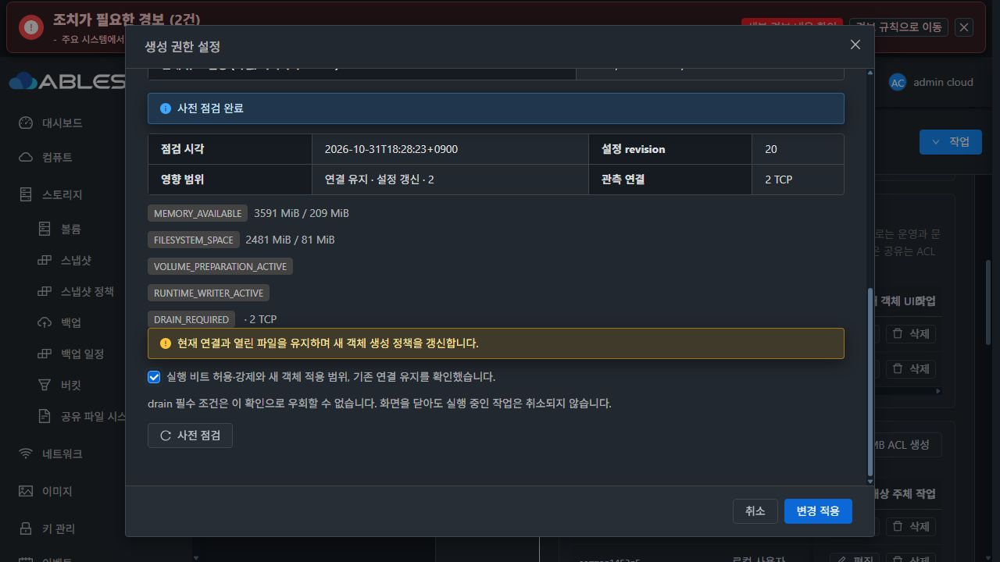
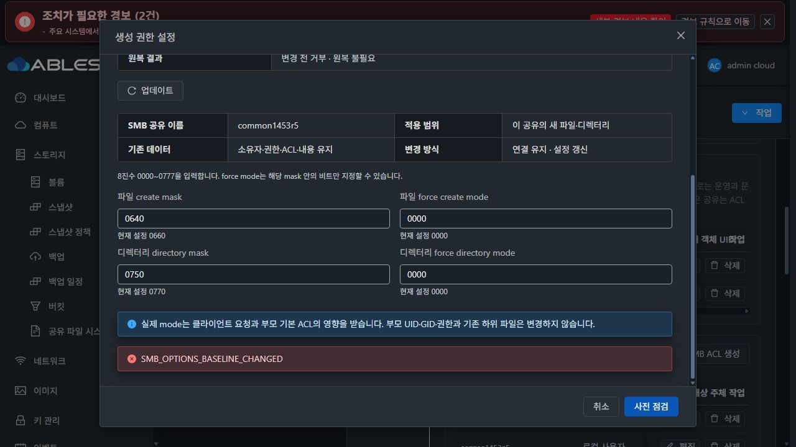

# #1454 구현·배포 및 첫 실환경 인수 중단 — 2026-10-31

**구현과 모듈 빌드·13번 배포는 완료했지만, 실제 UI의 첫 mask 변경이 제품 결함으로 거부되어 전체 인수는 미완료다. 이슈 OPEN, Epic PR #1470 Draft를 유지하며 추가 적용·재시작·재시험을 중단했다.**

- 구현: `c1ec5f343b908546f9aa79178b4571378028d643`, Epic `epic/1438-sharedfs`.
- local/origin/upstream Europa 기준 `1c5b169cd6283da23cc3e155d4b6d14e39e42793`, 착수 시 local/upstream 차이 0/0 확인.
- 요구사항: [#1454](https://github.com/ablecloud-team/ablestack-cloud/issues/1454), 설계: [기존 설계](../../design/sharedfs-1454-creation-policy-20261031/README.md).
- 기존 PR: [#1470](https://github.com/ablecloud-team/ablestack-cloud/pull/1470). 새 이슈/PR를 만들지 않았다.

## 구현한 범위

기존 SMB Create/Update API에 optional octal 문자열 4필드(create/directory mask, force create/directory mode)를 추가하고 기존 config_json 저장을 재사용한다. 생략 기본값은 0660/0770/0000/0000이며 미변경 필드는 보내지 않는다. force가 mask 밖 비트를 요구하면 거부한다. DDL 변경은 없다.

순수 옵션 편집은 기존 요청 식별자/revision/DAO/journal 체계에서 별도로 apply/verify/restore한다. backing volume 준비·계정/ACL·POSIX 수정·전체 smbd 재시작을 호출하지 않고, 소유 리스너의 PID/시작 시각/config hash를 확인해 targeted reload한다. 마지막 fingerprint 재검사와 부분 reload 실패 원복을 포함한다. 일반 생성/부팅 렌더러도 같은 4값을 사용한다.

VM 공통 MoldDialog/MoldDialogActions, 변경 전후/부모/포트별 유효값 사전 점검, 기존 데이터 불변 안내와 영향 확인을 추가했다. SMB 탭의 왼쪽 첫 primary 생성 버튼, 업데이트 아이콘/문구, 버튼 묶음 끝의 넓게 보기를 유지했다. #1468 전체 UI 정리는 착수하지 않았다.

정상 서명 bundle 1454.creation.1은 10파일/profile를 일치시켰고, protected baseline7은 별도 서명된 운영자 유지보수로 배포했다. 구 helper로 active custom 정책을 손실시키는 downgrade 보호를 유지했다.

## 빌드·사전 시험 결과

| 시험 | 확인 결과 | 한계 |
|---|---|---|
| 실제 API 입력 검증/serializer·coordinator→MariaDB DAO 포함 JUnit | 22 PASS | 전체 저장소 CI 결과가 아님 |
| 실제 API wire를 쓰는 UI 관련 3 suites | 30 PASS, targeted lint PASS | 실제 UI 인수와 별도 |
| 신규 guest creation-policy unit | 10 PASS | ACL 상태 플래그의 양쪽 직렬화 차이를 놓침 |
| 기존 관련 guest 회귀 | SMB/AD/POSIX/preflight/transaction/updater/NFS identity 통과, native 전용 2 skip | native 시험으로 별도 보완 |
| 실제 SystemVM private namespace 주입 | 실제 RuntimeAdapter apply/verify/commit·동일 요청/관찰·두 번째 reload 명령 실패 원복 통과, 두 parent PID/session/tree/open CIFS fd 유지, stop/restart0 | ACL이 빈 시험 fixture여서 이번 실환경 불일치를 검출하지 못함 |
| 서명/bootstrap | 10파일/profile 서명, 최초/반복 bootstrap3회·활성 CLI capability·구 helper 거부 PASS | 실환경 정책 적용 완료를 뜻하지 않음 |
| Maven module package·UI production build | PASS | checkstyle/rat 등 전체 CI는 실행하지 않음 |
| 13번 배포용 호환 UI | 실제 배포 UI 원본3ba82f711016에 이번 SharedFS 파일/locale delta만 overlay한 git archive export에서 build PASS | 두 번째 Git checkout을 만들지 않았고 canonical WSL 소스는 최신 Epic 유지 |

빌드 요약과 실제 native 결과는 [evidence](evidence/build-test-summary.json), [native product](evidence/native-product-release-result.json), [signed bootstrap](evidence/native-signed-bootstrap.json)에 구분해 보존했다.

## 배포와 자원

- 관리 모듈 변경 class/resource **13 entry**만 기존 관리 JAR에 패치. 외부 JAR/host-agent/DB schema/운영자 UI config 보존.
- 관리 JAR SHA-256 `8150530b9f53c38fd16246855b1d0f8fa1008bffd01e151c45959e725eb04d9b`.
- UI index SHA-256 `ede1f23e654b6116b848d65aa74512f2e58cb3239e194a1cc11f50d226293220`.
- 관리 정상 기동/HTTP200·실제 UI 로그인 확인. 예정된 mold 재시작 중 일시 접속 중단과 제품 오류를 구분했다.
- SystemVM current `1454.creation.1`, protected7. 게스트 모듈 배포 때 공유 재적용/프로토콜 재시작은 하지 않았다.
- 새 이미지 SHA-256 `804d992bebbb1985ec93b2c5d472ffc62ed48f13aebefb5ea57a481ee80bd124`, 기존 검증 이미지에서 8경로 변경/33,929경로 불변·qemu-img/bzip2 확인.
- 이미지 URL은 13번에 게시했지만 **SYSTEM 템플릿 등록/새 VM 인수는 중단으로 미수행**.
- 관리 rollback 자료: `/var/tmp/epic1438-1454-c1ec5f343b9`. guest baseline 자료: `/var/tmp/epic1454-baseline7-before`.
- SharedFS `3f0056db-4dfe-4f13-908d-b809dd565d34`, instance `c1eca707-a554-4c42-85cd-1e9e9744d804`, VM `d9c423e9-ce89-3ba9-9cd8-f48cdb791da2`.
- ROOT 4.88GiB/DATA 10GiB XFS 모두 **SPARSE**. DATA UUID `e070a0aa-dbf5-48c0-83e0-09f874446277`, FS UUID `9c8ddfe9-3e23-46f0-9476-5c794b004841`.
- 기존 MAC/IP는 변경하지 않았다. UI에서 같은 IP 10.10.13.220의 검증 포트1445를 추가했고 기존445와 모두 READY였다.

[관리 배포 영수증](evidence/management-deployment.json), [게스트 영수증](evidence/guest-deployment.json), [이미지 무결성](evidence/assembled-image-verification.json).

## 실제 UI/API/client 진행과 중단

1. 실제 UI에서 잘못된 octal0888, force0600/0040 조합의 오류·버튼 비활성화를 확인했다. 변경 요청은 제출되지 않았다.
2. 사전 점검 READY와 변경 전후 mask, 실제 부모, 포트별 설정, 연결 유지 안내를 확인했다. 30초 만료 후 점검 무효화도 동작했다.
3. UI에서 기존 IP의1445 포트를 추가했다. 클라이언트1은 로컬 계정으로445, 클라이언트2는 AD 계정으로1445에 noVNC 콘솔에서 CIFS 마운트했다.
4. 두 클라이언트가 새 hold1454 파일을 한 번 열고 반복 read/write/fsync하는 동안 common1453r5의 mask를 0660/0770→0640/0750으로 실제 UI에서 변경했다.
5. 사전 점검 READY·revision20·연결2였지만, 실행은 **SMB_OPTIONS_BASELINE_CHANGED / VALIDATING**으로 거부됐다. 작업 `f2f3068f-015d-48be-9acf-45d93d069548`, request `7041288f-a7e7-429c-bfad-83604e933f64`, async job `d498a5a5-d9ee-49de-994a-73f774b13eed`, jobstatus2/error530.
6. 상태 **ROLLED_BACK**, rollback **NOT_NEEDED**: 스냅샷/변경 전 검사에서 거부됐으므로 실제 설정 원복 동작을 실행한 성공 사례로 세지 않는다. UI는 실패 코드·phase·진단을 보존했다.
7. 같은 적용을 재시도하지 않았다. 읽기 전용 분석만 수행한 뒤 두 클라이언트 루프를 종료하고 마운트 해제/로그아웃했다.

[브라우저에서 실제 발생한 요청/응답](evidence/ui-api.json). 백그라운드 API로 상태를 만들어 성공으로 대체하지 않았다.

## 정확한 원인과 읽기 전용 실증

신규 `SmbCreationPolicies.snapshot()`의 baseline 비교가 **ACL 상태 표시 메타데이터**까지 전체 dict로 비교한다.

- 관리 desired builder는 ACL config에 `passwordSupplied: false/true`를 포함한다.
- 기존 `configuration_transaction.redact()`는 키에 password가 포함되면 제거한다. 리스너 stage의 `pending.value=redact(value)`가 commit되어 게스트 desired-state에는 해당 상태 플래그가 없다.
- 이번 새 비교는 listener/health/adJoin 관측 정보는 정규화했지만 `acls[*].config.passwordSupplied`는 정규화하지 않았다.
- 따라서 실제 ACL 주체·권한·경로·인증 정책이 같은데도 **필드 부재와 bool4개의 차이**로 baseline 변경이라고 오인한다.
- 실제 서명 CLI가 쓰는 helper SHA `678e0c8732aa0e74ed27d0712912e1b57a8565791fafc62a7b329f4ee292304a`와 c1ec 소스가 일치함을 확인했다. 전송 candidate hash도 guest journal과 동일했다.
- 실제 관리→guest 요청의 안전한 bool 메타데이터를 유지한 읽기 전용 snapshot 진단에서 동일 코드로 거부됐다. 해당 bool 필드만 제외한 구성은 같은 active helper의 읽기 전용 검사에서 통과했다. apply/서비스 reload/설정 파일 변경은 하지 않았다.

[필드 단위 차이](evidence/baseline-differences.json), [실제 active helper 읽기 전용 재현](evidence/readonly-baseline-reproduction.json).

사전 시험 fixture가 빈 ACL 목록을 사용해 관리 builder와 guest 저장/redact 사이의 이 비대칭을 검증하지 못했다. SystemVM에서 실제 명령을 돌렸다는 것만으로 실제 API→저장 구성 계약의 커버리지가 충분하다고 판단한 것이 누락이었다.

## 영향·현재 상태

- 요청한 mask 변경은 **미적용**. 기존0660/0770/0000/0000 유지.
- 두 포트의 설정 파일 bytes/hash·리스너 manifest·SMB session ID/tree ID 유지. 열린 파일 I/O 오류0.
- 기존 **36객체**의 UID/GID/mode/ACL/inode/device/파일hash 불변, FS UUID 불변, 금지 시험 파일 부재, 기본 smbd inactive 유지.
- 새 hold1454-c1/c2 파일2개만 시험 증거로 남겼다. [보존 결과](evidence/data-preservation-result.json).
- 실패를 일으킨 보호는 동작했지만 정상 옵션 변경이 차단되므로 #1454 완료로 판정할 수 없다.
- 실행 비트/force의 실제 UI 적용, 로컬/AD 새 파일 mode·RO 회귀, 일반 옵션 편집, 의도적 reload 실패의 UI 원복, VM/관리 재시작 인수는 **미완료**. 사전 주입 결과로 대체하지 않는다.
- 이번은 baseline 판정 결함이다. 네트워크·암호·DATA 손상으로 판단할 근거는 없다.

## 다음 수정 방향 — 아직 적용하지 않음

1. 새 SMB 옵션 비교에 사용하는 canonicalization에서 **명시적으로 `acls[*].config.passwordSupplied` 한 관측 필드만 제외**한다. 전역 redact/인증 저장 계약은 바꾸지 않는다.
2. 공유/리스너/ACL 정렬·관측 정보 처리를 하나의 helper로 재사용하되, ACL 주체·권한·인증/경로/볼륨/POSIX 변경 거부는 유지한다. 모든 password/unknown field를 무조건 무시하는 완화는 하지 않는다.
3. 실제 manager/API payload(로컬 false와 AD true 포함)→기존 listener stage/commit(redact)→옵션 snapshot 경로를 SystemVM에서 선행 회귀한다. bool 부재/false/true는 같은 서비스 정책으로 인식하고, 실제 ACL principal/permission 변경은 계속 거부하는 음성 시험을 포함한다.
4. UI의 READY→검증 실패 및 입력/진단 보존 회귀를 보완한다. 정상 적용이 통과하면 두 포트·두 클라이언트·force/실행 비트·실패 원복·재시작을 같은 범위에서 이어간다.
5. 수정/빌드/재배포/추가 인수는 다음 사용자 지시를 기다린다. 이슈를 닫거나 다음 이슈로 이동하지 않는다.

## UI 범위 확인

생성 권한 대화상자는 VM 공통 스타일·간격·고정 header/footer·본문 scroll·다크 토큰을 사용한다. 이번 실제 화면은 다크 모드에서 입력/오류/확인 안내 가독성을 확인했다. 실제 라이트 모드의 최종 적용 후 화면 인수는 중단으로 남았다. 기존 SMB 요약의 일시적 setgid '알 수 없음' 등 단순 표시 차이는 #1468 정리 대상으로만 기록하며 이번 중단 사유로 삼지 않았다.
