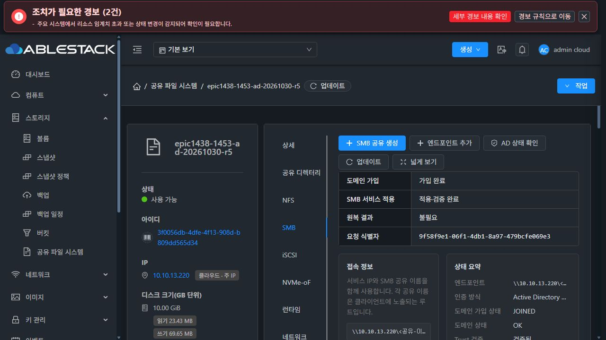
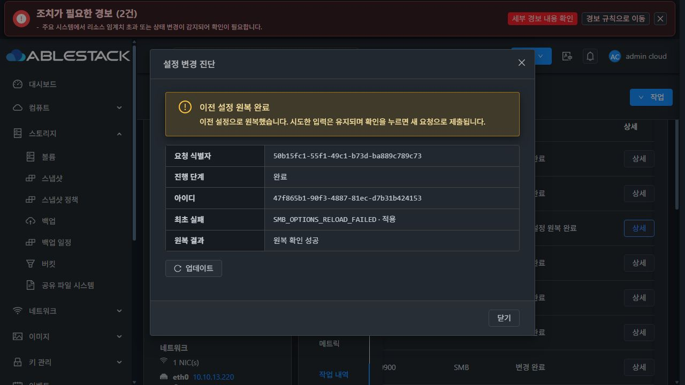
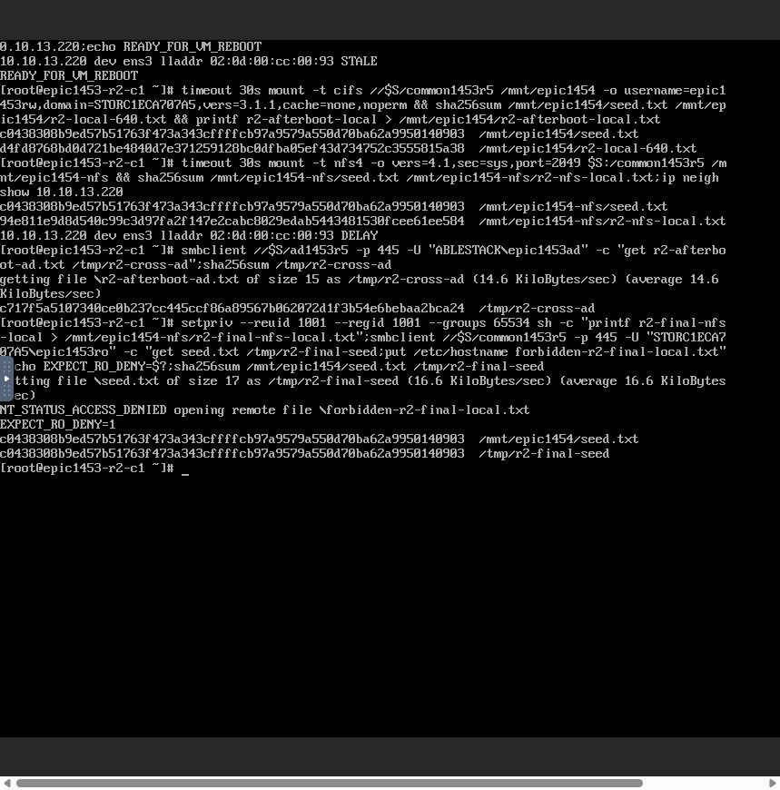
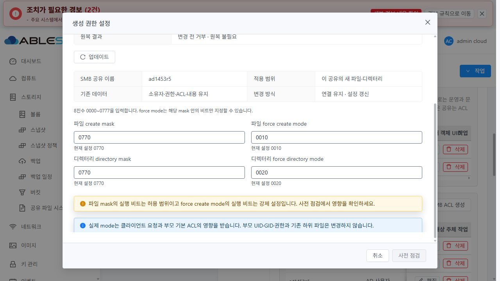
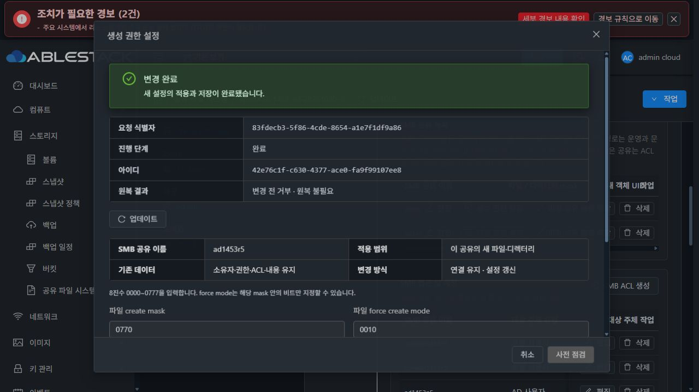

# #1454 최종 구현·13번 인수 완료 — 2026-10-31

**정책 조합·입력 보호·기존 객체/세션/NFS 보존·reload 실패 원복·VM/관리 재시작 인수를 통과했다. #1454 종료 조건을 충족한다. Epic PR #1470은 나머지 이슈를 위해 Draft/미병합으로 유지한다.**

- 구현 `4ab768a3ec7d69a2c34b780ad8cfeba84b6bfa5c`, 이전 구현 `c1ec5f343b908546f9aa79178b4571378028d643`.
- local/origin/upstream Europa `1c5b169cd6283da23cc3e155d4b6d14e39e42793`, 착수 fetch 후 local/upstream 0/0. canonical WSL `/root/work/ablestack-cloud`, 기존 `epic/1438-sharedfs`를 사용했다.
- [#1454](https://github.com/ablecloud-team/ablestack-cloud/issues/1454), [Epic #1438](https://github.com/ablecloud-team/ablestack-cloud/issues/1438), [기존 PR #1470](https://github.com/ablecloud-team/ablestack-cloud/pull/1470).
- [R1 중단 기록](../sharedfs-1454-creation-r1-20261031/README.md)은 당시의 실제 실패 기록이다. 현재 완료 판정은 본 R2 기록을 따른다. 새 이슈/PR를 만들지 않았다.

## 최소 수정과 회귀 계약

새 helper에 8줄을 추가해, 복사한 비교 대상의 **acls[*].config.passwordSupplied 한 상태 표시 필드만** 제거한다. 옵션 차이 검사와 guest 저장 baseline 비교 양쪽에서 같은 함수를 사용한다. 전역 secret 제거 함수, 실제 ACL 저장/적용, POSIX, 인증, 리스너/볼륨 신원 보호는 바꾸지 않았다.

실제 UI 요청이 관리 서버에서 구성한 operation payload를 fixture로 보존했다. 회귀 시험은 이 payload를 기존 **SmbListenerProfiles.stage→commit→파일 재조회** 경로에 통과시킨 뒤 옵션 snapshot과 비교한다. daemon 시작/관찰만 unit 경계에서 대체하며 stage/commit/redact/파일 저장·재조회/신규 비교는 실제 코드를 사용한다.

- 실제 로컬/AD bool 조합, 부재/false/true는 동일 정책으로 인식한다. 입력 객체를 변형하지 않는다.
- ACL principal/principalType/permission/state, 알 수 없는 보안 설정/passwordPolicy 변경은 계속 거부한다.
- 저장된 실제 ACL permission이 달라진 경우에는 baseline 변경으로 계속 거부한다.
- octal/force subset·신원/파일 안전성·fingerprint·기존 기본값·downgrade 보호도 유지했다.
- 변경한 payload 해시와 정확히 일치하도록 baseline profile을 재생성했다. manifest·profile·이미지 payload의 일치를 서명 검증으로 확인했다.

## 사전 시험·빌드

| 검증 | 결과 |
|---|---|
| SMB 관련 unit | 44 PASS/2 opt-in native SKIP, 이 중 creation 계약12 PASS |
| 실제 SystemVM의 creation 계약 unit | 12 PASS, 실제 API→listener 저장·재조회 포함 |
| 실제 SystemVM private 주입 | 실제 배포 guest baseline과 캡처한 API 비교 PASS. 두 native Samba/CIFS fd의 apply/verify/commit·동일 요청/관찰·부분 reload 실패 원복 PASS. 운영 구성 불변·임시 자원 제거 |
| 실제 API dispatcher/serializer JUnit | 4 PASS |
| Maven server 의존 모듈 package | BUILD SUCCESS |
| 정상 서명10파일·profile·최초/반복 bootstrap | BOOTSTRAPPED3회, 실제 활성 CLI feature/protection 확인, 구 helper downgrade 거부 PASS |
| 이미지 | qemu-img/bzip2·정상 서명 manifest10파일·baseline profile 일치 PASS, 지정8경로 외33,929경로 불변, WSL 계정 파일 불변 |

사전 native 시험을 실제 Mold UI 인수의 대체로 세지 않았다. UI 코드 변경은 이번 R2에 없으며 R1의 UI30건·lint/production build 결과와 이번 실제 UI 인수를 구분한다. 전체 저장소 CI는 이번 범위가 아니다.

[빌드 요약](evidence/build-test-summary.json), [SystemVM 회귀](evidence/native-unit-result.json), [native 적용/원복](evidence/native-result.json), [서명/bootstrap](evidence/native-signed-bootstrap-result.json).

## 모듈·배포 무결성

- 13번 current runtime **1454.creation.2**, protected updater **baseline7**. helper SHA-256 `f10615724fac8ee7f8e02b40dce2cd549b5fd718b58390c0e2819f8ba23ccd38`.
- manifest SHA-256 `cb2114defcb51c9593538e6328fd5ff41e194d3740831414f54bd3c531a6abcf`, 기존 신뢰 keyId `ablestack-runtime-cluster13`로 서명했다. 개인키 원문/암호를 파일에 기록하지 않았다.
- 게스트 모듈 배포는 공유 재적용/서비스 재시작 없이 수행했다. protected updater 본체는 이전 baseline7과 동일하다.
- 관리 JAR는 **storage-runtime/bootstrap/runtime-baseline-profile.json 1 entry만** 변경했다. 다른 entry bytes를 대조해 보존했다. UI·Java 로직·DB schema·host-agent 추가 변경0.
- 최종 관리 JAR SHA-256 `ec836625519820bac02eea1aeaf5ea00ffe5baa90e7bd61e265e7d832f06b0fd`. UI index는 기존 `ede1f23e654b6116b848d65aa74512f2e58cb3239e194a1cc11f50d226293220` 유지.
- rollback 자료: 관리 `/var/tmp/epic1438-1454-metadata-r2`, guest `/var/tmp/epic1454-metadata-r2-before`.
- 교정 이미지 `systemvm-epic1454-creation-r2.qcow2.bz2`: 498,372,419 bytes, SHA-256 `6957d252ee202dcac12e9f34b7f58285422457aa00f1ddf0e98a289b9669977c`.
- 실제 UI에서 cross-zone/KVM/QCOW2/Debian12 x86_64/SYSTEM으로 등록했다. template **7778f99f-753d-466f-ba2b-bfe230cffd72**, **사용 가능** 확인. 공개/추출/비밀번호 관리/직접 다운로드는 사용하지 않았다.
- 기존 ROOT4.88GiB/DATA10GiB XFS와 두 Linux client ROOT는 **SPARSE**다. THIN 생성0, MAC 변경0.
- SharedFS **3f0056db-4dfe-4f13-908d-b809dd565d34**, instance **c1eca707-a554-4c42-85cd-1e9e9744d804**, VM **d9c423e9-ce89-3ba9-9cd8-f48cdb791da2**.
- DATA **e070a0aa-dbf5-48c0-83e0-09f874446277**, FS UUID **9c8ddfe9-3e23-46f0-9476-5c794b004841**, IP **10.10.13.220** 유지.

[관리 영수증](evidence/management-deployment.json), [guest 영수증](evidence/guest-deployment.json), [이미지 검증](evidence/assembled-image-verification.json), [최종 guest 상태](evidence/final-guest-receipt.json).

## 실제 UI·API·클라이언트 인수

자원/설정/템플릿 등록·VM 재시작은 Mold UI로 실행했다. 클라이언트 접속·파일 생성·읽기/쓰기·정리는 Mold VM 메뉴에서 연 실제 noVNC 콘솔로 수행했다. SSH/QGA는 모듈 배포, 사전 주입, 제한된 실패 주입과 읽기 전용 대조에 사용했다. 숨은 API/QGA로 UI 설정 단계를 대신하지 않았다.

클라이언트1은 **aaa3c43c-4f32-48f2-bdd5-e3930f908a07 /10.10.254.224**, 클라이언트2는 **e6744029-299e-4585-981b-65e312d9e752 /10.10.254.223**이다. 445에 로컬 RW, 1445에 AD RW로 CIFS 마운트해 열린 fd의 read/write/fsync를 지속했다.

| 실제 UI 변경 | 실제 새 객체 결과 | 인수 |
|---|---|---|
| local0640/0750, force0000/0000 | 파일0640, 디렉터리0750, UID/GID1001:1001 | PASS |
| local0775/0770, force0111/0020 | 파일0775, 디렉터리0770, UID/GID1001:1001 | PASS |
| AD0770/0770, force0010/0020 | 파일0770, 디렉터리2770, UID65534/GID10004 | PASS |
| local 기본0660/0770, force0000/0000 복원 | 파일0660, 디렉터리0770, UID/GID1001:1001 | PASS |
| browseable false→true 단독 편집 | 최소 요청에 browseable만 제출, backing/POSIX/새 mask 미제출 | PASS |
| 잘못된0888 및0600/force0040 | UI 설명·점검 버튼 비활성, 변경 전 거부 | PASS |

실제 mode는 클라이언트 요청·부모 ACL의 영향을 받는다. AD 시험 파일명 r2-ad-670.txt의 '670'은 시험 이름이며 **관측 mode는0770**이다. 부모의 UID/GID/mode·기존 하위 객체는 자동 변경하지 않았다. 두 포트의 testparm 유효 mask/force/inherit-owner와 실제 생성 객체를 함께 대조했다.

[실제 객체·포트별 관측](evidence/object-policy-observations.json), [UI 요청/사전 점검](evidence/api-ui-requests.json), [7개 작업의 최종 API 상태](evidence/api-operations-final.json). UI 실행7작업 중 정상6 COMMITTED, 계획한 실패1 ROLLED_BACK/SUCCEEDED다.

## 실패 원복·기존 연결·진단

계획된 한 번의 실패는 두 번째 profile(445)의 정확한 소유 PID/config에 대한 reload-config에서만 발생하도록 제한했다. marker를 한 번 생성한 뒤 후속 원복 reload는 원래 smbcontrol로 전달하고, 120초 자동 해제도 마련했다. 서명 제품 파일·DATA·계정/ACL은 주입 때 변경하지 않았다.

- operation **47f865b1-90f3-4887-81ec-d7b31b424153**, request **50b15fc1-55f1-49c1-b73d-ba889c789c73**.
- 최초 실패 **SMB_OPTIONS_RELOAD_FAILED / APPLYING**, 최종 **ROLLED_BACK / SUCCEEDED**.
- 변경 전 설정/desired/객체가 동일하고 parent PID·session/tree ID와 열린 fd I/O를 유지했다. 전체 daemon restart fallback을 사용하지 않았다.
- 주입을 해제하고 원본 smbcontrol SHA-256을 확인했다. VM 재시작 뒤 임시 주입 디렉터리도 정리했다.
- 실제 UI에서 실패 코드/단계/원복 결과·시도 입력을 확인했다. 관리 재시작 후 작업 상세에도 같은 원인이 보존됐다.
- 이 계획된 실패는 R1의 예상하지 못한 baseline 결함이나 새로운 제품 오류와 구분한다.

[원복 대조](evidence/planned-rollback-preservation.json), [주입 해제](evidence/fault-disarm-result.json).

## 재시작·권한·데이터 보존

1. 로컬/AD RO 계정은 seed 읽기 성공, put은 NT_STATUS_ACCESS_DENIED를 반환했다. 금지 시험 파일은 없다.
2. 두 noVNC client에서 NFSv4로 같은 백킹 경로를 마운트했다. UID1001 및 UID10000/supplementary GID10004로 허용된 쓰기를 수행했다. NFS 생성 UID는 각각1001/10000, mode0644로 SMB 정책과 독립적인 POSIX 동작을 유지했다.
3. 열린 fd 시험을 마치고 연결을 해제한 뒤 UI에서 강제 옵션 없는 VM 재시작을 실행했다. 실제 reboot API jobstatus1. bootstrap/reconcile **Result=success/ExecMainStatus=0**.
4. 원래13.220 IP·동일 MAC으로445/1445 READY, 로컬/AD 재접속 성공. 양 포트에서 반대 공유의 같은 파일을 읽었다. 새 SMB 쓰기, NFS 재마운트·읽기/허용 쓰기, RO 보호가 계속 동작했다.
5. 관리 서비스를 재시작한 뒤 UI 재로그인, 성공/원복 이력·최초 실패 보존·두 포트/정책 재조회와 클라이언트 I/O를 확인했다. 관리 재시작 전후 guest PID·설정·기존 세션/트리 유지.
6. 기존 **38객체(원본36+R1 hold2)**의 UID/GID/mode/ACL/inode/device/파일 SHA 불변. 최종54객체 중16개만 이번 허용 시험의 새 객체다. FS UUID 불변, 기본 smbd inactive 유지.
7. seed SHA-256 **c0438308b9ed57b51763f473a343cffffcb97a9579a550d70ba62a9950140903** 일치.
8. client 시험 루프 종료·마운트 해제·런타임 자격 환경변수 제거·로그아웃, 임시 콘솔 탭 정리를 완료했다.

[VM 재시작 실제 API](evidence/vm-reboot-api.json), [최종 데이터 대조](evidence/final-preservation.json).

## VM UI 표준과 표시 차이

VM 표준 Breadcrumb/상세·세로 탭/탭 toolbar와 공통 MoldDialog/MoldDialogActions를 유지했다. 대화상자 header/footer는 화면 내에 있고 body만 overflow-y:auto다. 라이트·다크 모두 실제 UI에서 입력·오류·현재 값·설명·버튼과 간격을 확인하고 원래 다크 테마로 복원했다. 이번 R2에 새 CSS/컴포넌트 변경은 없다.

SMB 목록의 local setgid 관측이 갱신 시점에 따라 '미사용/알 수 없음'으로 달라지는 기존 표시 차이는 #1468 최종 UI 정리 항목이다. 실제 부모0775·setgid 미사용은 직접 관측했고 기능·권한·작업 판정에 영향이 없어 중단 사유로 삼지 않았다. #1468 작업은 시작하지 않았다.

[레이아웃 관측](evidence/ui-layout-proof.json).

## 종료 판정

- [x] 조합별 실제 mode·UID/GID 확인.
- [x] 잘못된 mask·force 충돌을 변경 전에 거부.
- [x] 기존 데이터·세션·NFS 교차 공유와 재부팅 후 정책 보존.
- [x] 단순 옵션 변경·실패 원복에서 daemon PID·세션·열린 fd와 허용 I/O 유지.

미완료 기능 인수나 새 제품 오류가 없다. 이전 R1 실패 기록을 삭제하지 않고 이 R2 완료 근거와 구분했다. 다음 과제는 **#1455 동일 백킹 볼륨 하위 디렉터리의 중첩 Export/Share 지원**의 설계이며 본 작업에서 시작하지 않았다.
