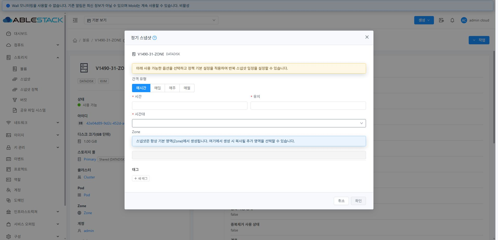
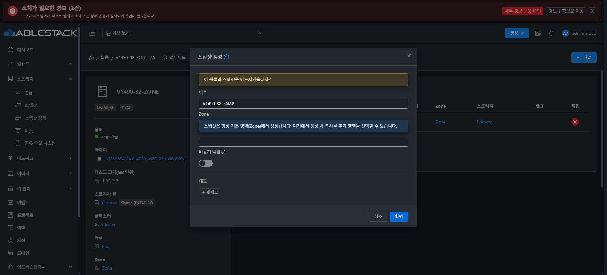
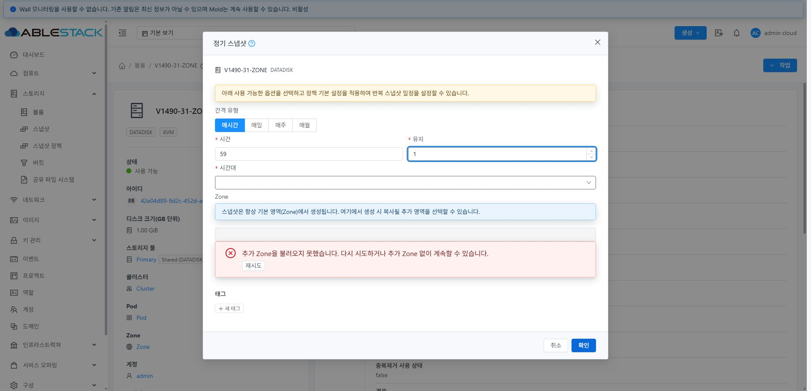
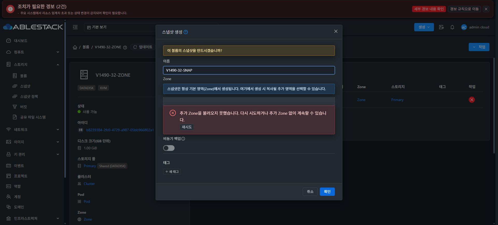
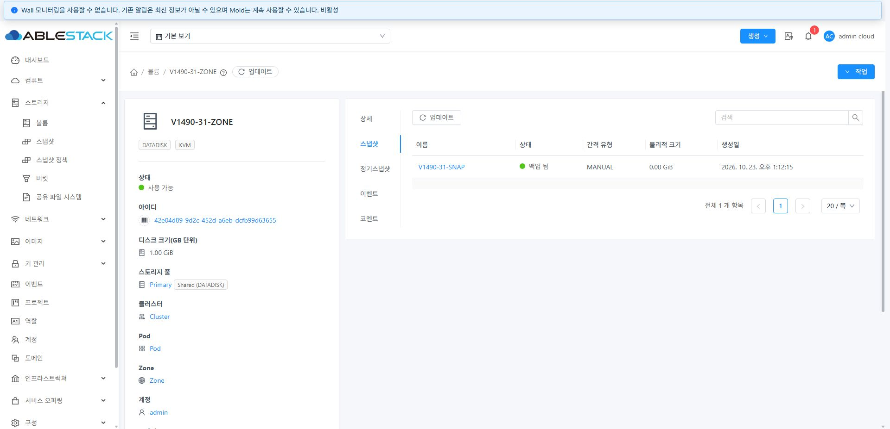
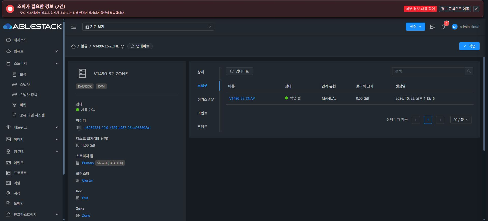

# #1490 완료 검증 보고

[이슈 #1490](https://github.com/ablecloud-team/ablestack-cloud/issues/1490) / [PR #1491](https://github.com/ablecloud-team/ablestack-cloud/pull/1491). Europa 기준 `bb40d23119e3554774471f262ddf6a61645f67a1`, 구현·배포 커밋 `e35c162bd5b8759b42e73caa7d9fd039c99eec3d`, 브랜치 `dhslove/issue-1490-snapshot-dialogs`.

## 원인과 최종 동작

기존 31·32 화면에서 `listZones`가 HTTP 200을 반환한 뒤에도 정기 스냅샷 Zone의 `.ant-select-loading`이 남는 것을 재현했다. `FormSchedule`의 `zoneLoading`이 data에 선언되지 않아 Vue 3 반응형 갱신이 되지 않는 것이 원인이다.

공통 믹스인에 목록·로딩·오류 상태를 선언했다. 페이지 전체 조회, 페이지당 20초 제한, 성공·빈 결과·실패 시 로딩 종료, 인라인 재시도, 문맥 변경·닫힌 폼의 이전 응답 무시를 적용했다. 두 생성 폼의 미지원 프라이머리 스토리지 복제 스위치와 연계 스토리지 선택·조회를 제거했다. 예전 폼 값이 남아도 `useStorageReplication=false`를 명시하고 `storageids`는 전송하지 않는다.

**사용자의 최종 정정대로 기본 영역과 Edge는 추가 Zone 목록에서 제외한다.** 31·32는 기본 영역만 있어 목록이 비어 있는 것이 정상이며 기본 영역에서 생성하는 동작은 유지된다. 기본 영역을 목록에 넣는 중간 커밋은 배포 전에 되돌렸고 최종 UI 트리는 테스트한 `69987306d1d`와 일치한다.

## 검증 결과

| 검증 | 결과 |
|---|---|
| SnapshotDialogZones, VolumeSnapshotPolicies, StorageUiStandard, StorageManagement | 4 suites / 74 tests 통과, 실패 0 |
| 변경 Vue/JS/검사 파일 lint | 오류 0 |
| WSL ext4, Node 14.21.3 production UI 빌드 | 성공, 550초 |
| 31 GFS2·32 RBD 실제 정기 스냅샷 폼 | 조회 완료 뒤 Zone 로딩 종료, 기본 영역 제외, 복제 옵션·스토리지 선택 없음 |
| 31 정기 폼 listZones HTTP 503 주입 | 로그인 유지, 인라인 오류, 로딩 종료, 재시도로 HTTP 200 복구 |
| 32 즉시 폼 listZones 응답 보류 | 20초 제한 후 오류 표시·로딩 종료, 스냅샷 이름 유지, 재시도로 복구 |
| 두 클러스터 UI 정기 정책 생성 | 매시간 59분 / UTC / 최대 1개, 상세 정기스냅샷 탭 표시 및 API 확인 |
| 두 클러스터 UI 즉시 스냅샷 생성 | GFS2·RBD 모두 BackedUp, 상세 스냅샷 탭 표시 및 DB store ref Ready 확인 |
| 실제 생성 POST 4건 | 모두 HTTP 200, usestoragereplication=false, storageids/추가 zoneids 미전송 |
| 미지원 복제용 스토리지 조회 | 검증 구간 listStoragePools 0건 |

지연 응답·다중 페이지·Edge/기본 영역 제외·503/시간 초과/잘못된 응답·재시도·문맥 변경/닫기·일반 일정 폼 회귀는 컴포넌트 검사에 포함된다. 실제 추가 영역 간 복사는 단일 영역 테스트 환경이므로 검증하지 않았다. 이번 변경은 UI 모듈만 해당하며 Maven/전체 Cloud/Release 빌드를 실행하지 않았다.

## 배포와 보존

31·32의 활성 `/usr/share/cloudstack-management/webapp`에 **정적 파일 914개**를 개별 반영하고 index를 마지막에 갱신했다. 양쪽 모두 산출물 SHA256이 일치하고 `/client/` HTTP 200을 확인했다. WEB-INF/META-INF/config, management JAR, Mold PID를 보존했고 32의 별도 monitoring-vm.qcow2도 크기·mtime·inode가 일치한다. 서비스/에이전트 재시작과 JAR/qemu 변경은 없다.

롤백 백업:
- 31: `/root/snapshot-dialog-1490-ui-e35c162bd5b-1792728598`
- 32: `/root/snapshot-dialog-1490-ui-e35c162bd5b-1792728601`

정적 배포 아카이브 SHA256: `3edfcb347ee40020cf6e4ae0354ac14eb9cec526d5b8ab310499b775bf69bb47`.

Windows/WSL 기존 FT 작업 트리의 HEAD·상태·diff·수정/미추적 파일별 해시를 전후 비교해 일치했다. 새로운 독립 작업 트리에서만 수정·빌드했다.

## 테스트 자원 정리

전용 1GiB 볼륨 V1490-31-ZONE / V1490-32-ZONE 각 1개, 정기 정책 각 1개, 즉시 스냅샷 각 1개만 생성했다. 검증 후 모두 정상 API로 삭제했다. 활성 API/DB의 전용 정책·스냅샷·볼륨은 각 0개이며, Primary 원본(GFS2 파일/RBD 이미지)과 Secondary 백업 파일의 실제 부재도 확인했다. 스냅샷 DB의 Destroyed 이력 행은 제품 삭제 의미대로 보존된다. 기존 볼륨·VM·컴퓨트/디스크 오퍼링 목록의 선택 필드는 전후 완전히 일치했다.

전체 구조화 결과와 인증정보를 제외한 생성 요청은 [result.json](result.json)에 있다. 테스트용 브라우저 오류 주입과 캐시 설정도 해제했다.

## 실제 화면

정기 스냅샷: 기본 영역 안내와 추가 Zone 입력을 유지하고 미지원 복제 항목을 제거했다.

즉시 스냅샷: 시간 초과 뒤 입력을 보존하고 재시도로 복구한 화면.

