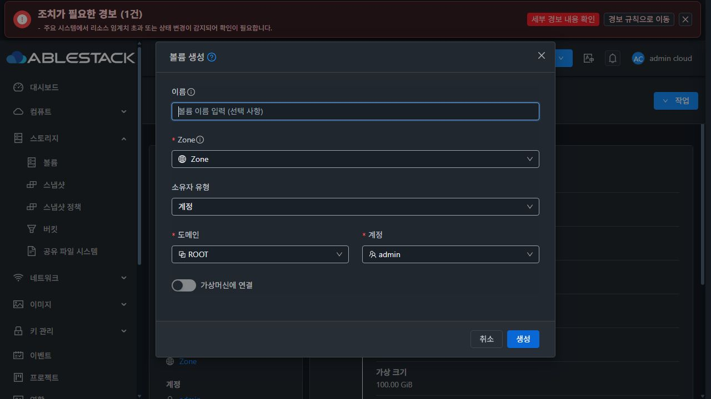
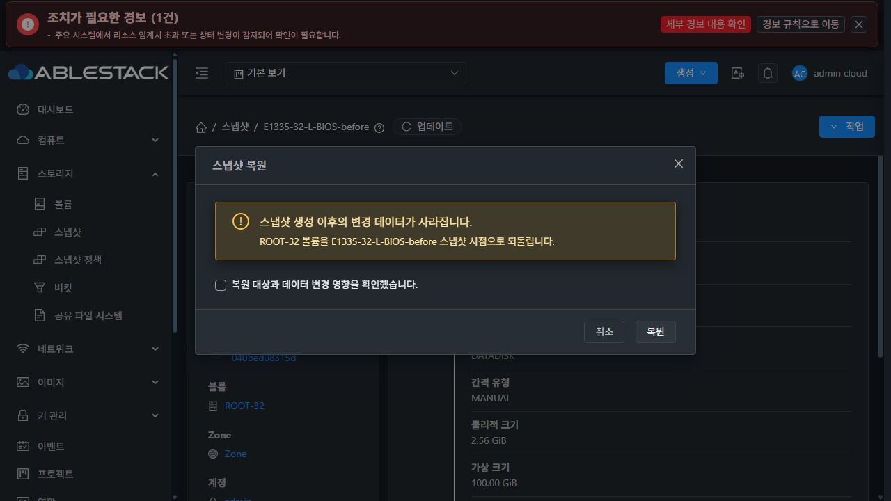
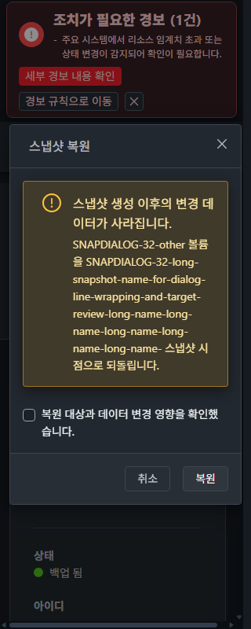

# 볼륨 생성·스냅샷 복원 대화상자 개선 결과

## 결과와 적용 범위

**PASS.** 2026-10-23~24에 설계·구현·최종 빌드·31/32 실환경 검증과 정리를 완료했다. 테스트한 코드의 SHA256은 `evidence/final-source-sha256.json`에 고정했다.

Epic 브랜치 `dhslove/epic-1473-storage-snapshots`에서 승인 목업의 두 대화상자를 개선했다. #1488의 볼륨 생성/스냅샷 되돌리기 범위다. 기존 상세 페이지의 정보 카드·탭·알림 통합과 SS-06 안전 검증을 유지한다. 전체 #1488 및 Epic #1473의 완료를 뜻하지 않는다.

[설계](design.ko.md) · [승인 목업](mockup/snapshot-action-dialog-review.html) · [증거 자동 대조](evidence/verification.json) · [파일 SHA256](evidence/files-sha256.json)

## 구현 결과

볼륨 생성은 상세 페이지와 중복되는 메타데이터 표와 갱신 버튼을 없애고 이름·Zone·소유자·VM 연결 순서로 배치했다. 관리자 소유자 영역을 embedded div로 넣어 중첩 form을 없앴다. 도메인/계정은 데스크톱 두 열, 모바일 한 열이다. 조건부 VM·장치 번호 선택과 기존 검증은 유지한다. 중복 영문 deviceID 설명은 제거하고 기존 한글 도움말을 사용한다.

복원은 원본 볼륨/스냅샷 이름을 영향 문장에 표시하고, 데이터 변경 경고·명시적 확인·취소/복원으로 구성했다. 긴 대상 이름은 줄바꿈한다. 정상 상태에서 빈 안전 요약을 렌더하지 않아 처리 중 잘린 스피너와 빈 공간도 제거했다. 제목·작업 종류도 원래 확인 대상과 함께 고정한다.

두 폼은 공통 `MoldDialog(md=720)` 헤더/고정 푸터, 24px 항목 간격·8px 레이블 간격, 모바일 여백과 본문 스크롤을 사용한다. 간격을 줄이는 대신 겹침의 원인인 중첩 폼과 상위 레이아웃을 바로잡았다. 다크 모드의 레이블·입력·선택값·placeholder·숫자 입력·오류·확인 문구·비활성 버튼에 기존 테마 토큰을 명시했다.

가상머신 공통 `ResourceLayout`, `InfoCard`, `ResourceView`, `MoldDialog` 소스 네 파일은 변경하지 않았다. 기존 VM 소형 연결 대화상자는 520px이며, 이번 화면은 승인 목업의 공통 md(720px) 프리셋을 적용했다. 두 폭을 동일하다고 보고하지 않는다. 기존 VM 대화상자의 일부 낮은 대비는 이번 스냅샷 전용 색상 수정 범위에 포함하지 않았다.

오류는 입력을 유지하고 인라인 재시도를 제공한다. 원본이 실제 소실된 경우 복구 가능 안내를 표시한다. 기존 미종결 작업이 있으면 재제출을 계속 차단하고 상단 알림의 작업 상세에서 기존 결과를 조회하도록 안내한다. 이 표시는 새로운 가용성 규칙이 아니라 기존 registry 잠금 판정을 사용한다. Escape 이후 초점이 BODY로 빠지는 실제 결함도 작업 버튼으로 복귀하도록 수정했다. 고정 푸터로 이동한 버튼에 Ctrl+Enter의 keyup을 연결해 키보드 생성도 유지했다. 수정 전 입력에서 Ctrl+Enter 시 버튼에 초점만 이동하고 요청이 나가지 않는 현상을 실제 재현했고, 최종 배포본에서 키보드 제출로 생성·DB·실물을 검증했다.

## 31·32 실환경 검증

| 검증 | 31 GFS2 | 32 RBD | 증거 |
|---|---|---|---|
| 생성/복원 × 라이트/다크 × 320/390/768/1280px | PASS | PASS | `evidence/ui/*-{create,restore}-{light,dark}-*-final` |
| 본문/문서 가로 넘침·컴포넌트 겹침·중첩 form·중복 요약 표 없음 | PASS | PASS | 32개 DOM/PNG 측정 |
| 긴 복원 대상 이름 줄바꿈, 조건부 VM/장치 번호 영역 | PASS | PASS | 긴 이름 복원 및 attachment 화면 |
| 실제 텍스트/placeholder/선택값·WebKit text fill 색상 | PASS | PASS | 각 JSON의 `colors`, `leafText` |
| Escape 종료·작업 버튼 초점 복귀 | PASS | PASS | `*-escape-focus-final.json` |
| 복원 확인 후 VM Stopped→Running 변경 | PASS | PASS | `*-restore-drift-blocked-final`, `*-restore-running-blocked-final` |
| Running 복원 API 거절·UI 제출 전 POST 차단 | PASS | PASS | `*-running-api-rejection`, `*-preflight-guard-network` |
| 실제 복원·원본 데이터 1MiB 0xa5→0x5a | PASS | PASS | `*-pattern-verify-changed-source`, `*-pattern-verify-source` |
| 정상 새 볼륨 생성, 정지 VM 연결·장치 번호 고정 | PASS | PASS | `*-ui-db-verified`, attachment 및 keyboard 화면 |
| 조회 503 → POST 차단·이름 유지 → 재시도로 복구 | PASS | PASS | `*-create-preflight-error/retry-*` |
| 원본 없는 스냅샷 생성·접수 응답 유실·연속 클릭 | PASS | PASS | `*-ui-db-verified`, `*-ui-mutations` |
| F5/재진입 후 미해결 잠금·안내·기존 UUID 조회 | PASS | PASS | `*-create-f5-pending-verified`, `*-job-complete-verified` |
| 생성된 볼륨의 1MiB 0x5a 일치 | PASS | PASS | `*-pattern-verify-*-ui-volume` |
| 기존 VM 상세·볼륨 탭·연결/생성 폼 회귀 | PASS | PASS | VM 회귀 화면·공통 소스 해시·집중 테스트 |

화면 측정은 실제 DOM의 요소 위치와 텍스트 노드 색상을 함께 확인했다. 데스크톱 폭은 720px, 390px에서는 366px, 320px에서는 296px이다. 최종 32개 기본 화면의 최소 텍스트 대비는 4.97:1이다. 처리 중 비활성 복원 버튼의 공통 로딩 색상 대비 4.25:1은 비활성 컨트롤로 구분했으며, 본문·확인 문구는 7.13:1 이상이다. 수직 본문 스크롤은 정상 동작이며 고정 헤더·푸터와 가로 넘침을 구분한다. 전역 VM 소형 폼의 기존 대비 측정은 회귀 참고 자료로 따로 남겼다.

응답 유실은 전용 프록시가 실제 서버에 요청을 전달해 접수한 뒤 응답을 끊고 해당 작업 조회에 503을 반환하는 방법으로 재현했다. 브라우저가 같은 customjobid의 POST를 두 번 전송했으나 각 클러스터의 DB job 1개·생성 볼륨 1개만 확인됐다. F5 이후에도 새로운 UUID를 제출하지 않고 기존 작업을 조회해 원래 스냅샷과 결과 링크를 확인했다. 전송 횟수와 업무 중복 실행을 구분한다.

일부 1280×800 확대 PNG에는 실제 브라우저 창보다 큰 캡처 영역의 타일 중복이 관찰돼 해당 PNG를 화질 판정에서 제외했다. 32개 조합의 DOM 위치·색상 측정은 유효하며, 보고서 대표 이미지는 별도 네이티브 창 캡처로 교체했다. 이 추가 캡처는 32의 기존 스냅샷 대화상자를 읽기 전용으로 열고 취소했으며, 확인 체크·생성/복원 제출은 하지 않았다. 긴 이름과 모바일은 전용 fixture의 기존 증거를 함께 사용한다.

테마·뷰포트 변경은 실제 설정 UI와 브라우저 에뮬레이션을 사용했고, 업무 동작은 네이티브 UI 입력으로 수행했다. 측정용 DOM 평가로 내부 Vue/store/session 상태를 조작하지 않았다. 뷰포트 에뮬레이션을 해제한 뒤 실제 클릭을 수행했다. 초기화/모달 애니메이션 중 stale 컨트롤을 조작한 자동화 시도는 성공 근거로 쓰지 않았다.

## 검사·배포

- 집중 Jest **191 tests / 13 suites PASS**. 작업 대상/제목 고정, stale 응답, VM 연결 값 보존, 권한·보안 범위, registry·F5·응답 유실, 삭제 복구 회귀를 포함한다. 새로운 UI 검사는 빈 로딩 요약 미노출과 pending 안내 우선순위를 확인한다.
- 전체 UI no-fix lint PASS, WSL ext4 production UI build PASS. 기존 Vue 아이콘 등록 경고·오래된 Browserslist·번들 크기 경고를 별도 기록했다. Jest는 `--runInBand --forceExit --collectCoverage=false`를 사용했다.
- 최종 보완 후 두 클러스터에 다시 배포하고 32개 화면 조합과 잠금/오류/키보드/처리 상태를 재확인했다. 이전 `initial`, `final` 중간 배포와 마지막 `verified` 배포 증거를 구분한다.
- 각 서버 정적 파일 921개를 manifest/hash로 확인했다. WEB-INF/META-INF·config·백엔드 JAR·management PID를 보존했다. Mold active, `/client/` HTTP 200, 기존 FTCTL 및 새 스냅샷 UI 마커, Agent 5개 Up와 정상 조회 8종을 확인했다.
- 최종 배포 백업: 양쪽 `/root/snapshot-dialogs-1488-20261023-verified`. 설정 자동 변경 파일은 배포/커밋에서 제외했다. Java/JAR 변경·Maven·전체 Cloud/Actions dispatch·qemu 빌드는 실행하지 않았다.

[집중 검사](evidence/focused-tests.log) · [린트](evidence/full-ui-lint.log) · [빌드](evidence/production-build.log) · [31 배포](evidence/31-ui-deploy-verified.json) · [32 배포](evidence/32-ui-deploy-verified.json)

## 시험 자원 정리와 보존

전용 `SNAPDIALOG-31-*` / `SNAPDIALOG-32-*` 자원으로 VM 2개, 볼륨 14개(ROOT 2개 포함), 스냅샷 8개를 사용했다. 원본 소실 시험에서 먼저 삭제한 볼륨도 포함한다. 프로젝트·계정·역할은 새로 생성하지 않았다. 새 복구 볼륨 → 스냅샷의 최신 참조 → 원본 볼륨 순서로 의존관계를 풀고 정상 API로 모두 정리했다. 강제삭제 fallback·수동 파일 삭제·DB 보정은 필요하지 않았다. 최종 활성 API/DB·미종결 참조·알려진 NFS 파일/GFS2·RBD 볼륨/세 호스트의 VM domain은 모두 0이다. DB의 Destroyed/removed 감사 이력은 보존한다. UI의 전용 스냅샷/볼륨 검색 결과도 0건이며 자원 카운터는 실제 활성 DB 집계와 일치한다.

운영 인벤토리 투영, 공통 VM 소스 네 파일의 SHA256, 보호된 Windows/WSL FTCTL worktree의 HEAD·tracked/untracked 상태·diff를 대조했다. 인증 정보·원시 운영 인벤토리·보호된 dirty diff는 커밋하지 않았다. 검증용 브라우저 탭과 프록시도 종료했다.

## 범위와 남은 항목

이번 결과는 볼륨 생성과 스냅샷 복원 대화상자의 개선이다. 템플릿/다운로드/복사/보관/다중·Zone 삭제 등 #1488의 나머지 화면, 실제 다중 Zone/NetBackup 엔진 복원, RBD 템플릿 형식/새 ROOT 부팅은 완료로 표시하지 않는다. #1489의 기존 절대 install_path 잔여·계정 삭제 usage 중복·32 Running hot-attach 진단도 별도다. 연결 실환경 검증에는 정지된 전용 VM을 사용했다.

#1488·Epic #1473은 열어 두고 PR #1492의 검토·병합을 기다린다. 집중 검사와 실환경 검증을 전체 Cloud CI 성공으로 표시하지 않는다.

## 실제 최종 화면

