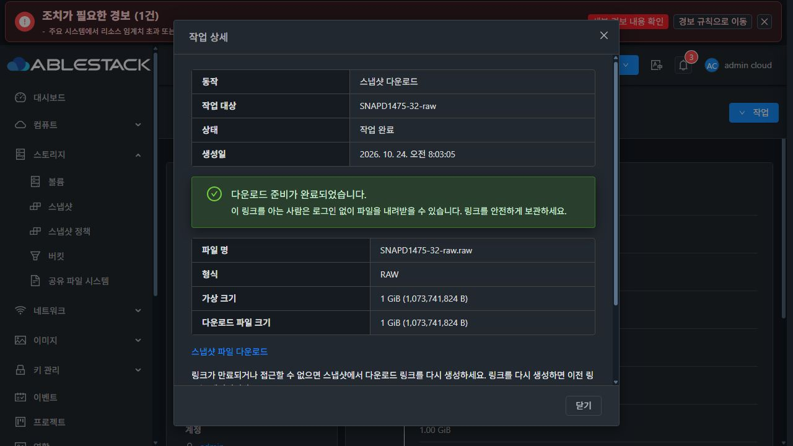
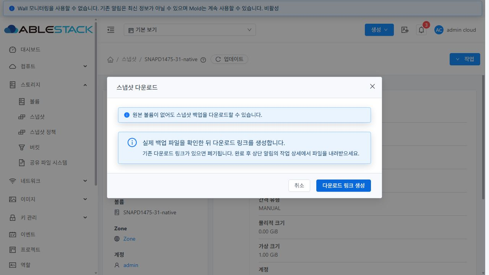

# #1475 스냅샷 다운로드 검증 결과

Epic #1473의 SS-02를 `dhslove/epic-1473-storage-snapshots`에서 구현했다. 32 RBD의 실제 QCOW2 백업에 `.raw` 링크를 반환하던 문제를 수정했으며, 31 GFS2와 32 RBD에서 실제 HTTP 다운로드 파일까지 검증했다. 구현 PR은 [#1492](https://github.com/ablecloud-team/ablestack-cloud/pull/1492)이며, 이슈의 완료 댓글에 최종 커밋과 이 보고서의 고정 링크를 남긴다.

## 변경 결과

- SSVM에서 #1474의 공통 판별기로 실제 형식과 가상 용량을 확인한다. 원본 볼륨이 삭제되어도 다운로드하며, 파일명만 바꾸어 이미지 변환으로 취급하지 않는다.
- 기존 `snapshot.url`을 유지하면서 완료 응답에 `filename`, `format`, `size`, `physicalsize`를 추가했다. `size`는 가상 용량, `physicalsize`는 전송 파일 길이다. 완료 상태 `DOWNLOAD_URL_CREATED`는 **다운로드 준비 완료**를 뜻한다.
- 기존 URL을 재검사 없이 재사용하지 않는다. 재생성·정상 스냅샷 삭제 시 이전 링크를 폐기하며, URL DB 저장 실패도 새 링크를 폐기하고 실패로 반환한다. 파일 경로와 임시 파일 정리는 범위를 확인하며 다른 파일과 원본 백업을 보존한다.
- 한글만 있는 스냅샷 이름은 한글 대상명을 유지하면서 안전한 UUID 파일명으로 내려받는다. 빈 파일명이나 HTML 응답 문자열을 만들지 않는다.
- 다운로드는 기존 상단 알림과 공통 작업 상세에 통합한다. 새 입력 대화상자는 `MoldDialog` md(720px), 공통 제목·본문·푸터·테마를 사용한다. 대상 고정·최신 상태 확인·중복 제출 보호를 유지했다. 다운로드와 무관한 볼륨 생성 안내와 기존 스냅샷을 “생성된 리소스”로 표시하던 링크도 제거했다.

## API / DB / 실제 파일 대조

| 클러스터 | 원본 볼륨 형식 | 실제 백업·다운로드 형식 | 확장자 | 가상 용량 | 전송 파일 길이 |
| --- | --- | --- | --- | --- | --- |
| 31 GFS2 | QCOW2 | QCOW2 | `.qcow2` | 1,073,741,824 B | 2,490,368 B |
| 32 RBD | RAW | QCOW2 | `.qcow2` | 1,073,741,824 B | 2,490,368 B |
| 31 GFS2 | QCOW2 | RAW | `.raw` | 1,073,741,824 B | 1,073,741,824 B |
| 32 RBD | RAW | RAW | `.raw` | 1,073,741,824 B | 1,073,741,824 B |

RAW 조합은 전용 백업을 변환하여 구성했다. 제품이 기본 RAW 백업을 생성했다고 주장하지 않는다. 원본 볼륨은 QCOW2/RAW 다운로드 전에 정상 API로 삭제했다. DB의 스냅샷 논리 용량, API 완료 응답, `qemu-img info`의 형식·가상 용량, 파일명·파일 길이가 일치했다.

네 조합을 API와 UI 생성 링크로 각각 검증하여 **8개의 HTTP 파일 검증 기록**을 남겼다. 전체 읽기 HTTP 200, 부분 읽기 HTTP 206, 백업/다운로드 SHA256 동일, 처음 1MiB `0x5a`와 마지막 1MiB `0xa5` 패턴 일치, 다운로드 전후 백업 SHA256 동일을 확인했다. UI에서 표시한 링크와 같은 주소의 HTTP 다운로드 사본을 관리 서버에 저장하여 검사했다.

미지원 형식·잘린 헤더·파일 누락·파일 읽기 거부는 양쪽 모두 job 실패와 DB URL 부재를 확인했다. 손상 파일은 실제 UI에서도 실패 알림과 원인을 표시하고 다운로드 링크를 제공하지 않았다. 전용 파일은 시험 후 원본으로 복구했다. 비인증 API 요청은 거부됐으며, 전용 export 디렉터리의 HTTP 403과 링크 재생성 후 복구도 확인했다.

만료는 **전용 DB 행의 시각을 만료 기준 이후로 이동하고 설치된 SSVM 정리 핸들러를 호출하는 제어 시험**으로 확인했다. 실제 링크가 200→404가 되고 재생성 후 정상화됐다. 관리 서버의 정기 정리 주기 전체를 기다린 시험은 아니다. 전역 만료 설정과 다른 자원의 URL은 변경하지 않았다.

## UI와 기존 안전 기능

최종 번들에서 입력 대화상자 4개(31/32 × 라이트/다크), RAW 결과 4개, QCOW2 결과 2개를 기록했다. 모두 폭 720px, 컴포넌트 겹침 없음, 해당 테마의 텍스트 색상을 확인했다. VM 편집 대화상자의 공통 Mold 셸·본문 여백도 비교했고 VM 설정은 변경하지 않았다. 파일 전송 자체의 완료로 오해할 문구를 사용하지 않는다.

RAW 제출 버튼을 두 번 클릭해도 각 클러스터에 UI job 한 건만 추가됐다. 새로고침 후 기존 알림·같은 다운로드 링크가 복원됐으며, 새로고침·테마 변경·대화상자 재열기로 제출 job이 늘지 않았다. 최종 결과에는 HTML 문자열·불필요한 리소스 생성 링크가 없고, 다운로드 링크는 프로토콜·파일명·형식을 검사하며 `noopener noreferrer`를 사용한다.

브라우저에서 링크 클릭과 같은 URL의 새 창을 확인했다. 인앱 브라우저의 다운로드 이벤트/로컬 저장 경로는 확보하지 못했으므로 OS 다운로드 폴더의 파일 검증으로 표시하지 않는다. 실제 전송 파일 검증은 위 HTTP 사본을 기준으로 한다.

## 검사·배포·정리

- WSL ext4에서 변경 Maven 모듈만 빌드했다. core 2, server 50, secondary-storage 60으로 **Java 112 tests**가 통과했다. API와 기본 이미지 저장소 드라이버 모듈도 checkstyle/install을 통과했다.
- **UI 193 tests / 14 suites**, no-fix lint, production build가 통과했다. 번들 용량과 Browserslist 경고는 남아 있으며 전체 Cloud CI 통과로 표현하지 않는다. 전체 Cloud/Actions dispatch·qemu 패키지 빌드는 실행하지 않았다.
- 관리 서버·SSVM의 변경 클래스와 정적 파일 **921개**를 검증했다. WEB-INF/META-INF·서버 설정·나머지 JAR entry를 보존했다. Mold active, `/client/` HTTP 200, 각 환경 agent 5개 Up을 확인했다.
- 32의 기존 Diplo SSVM에는 다운로드 메서드와 필요한 상수만 적용했다. 초기 `BASE_EXTRACT_PATH` 호환 오류는 성공 판정에서 제외했으며, 상수를 보완한 후 API·UI·DB·파일 시험을 다시 수행했다. 기존 #1474 NFS/공통 판별기와 그 외 메서드는 보존했다.
- 전용 **VM 2개·볼륨 8개(루트 포함)·스냅샷 8개**는 정상 API로 정리했다. 최종 활성 API/DB/저장소 참조·다운로드 참조, 알려진 NFS/GFS2/RBD 파일·RBD trash·VM domain·export 디렉터리는 0이다. 모든 알려진 다운로드 URL은 HTTP 404이며 스냅샷 DELETE 이벤트는 각각 한 번이다.
- 내려받은 시험 파일과 주입 복구용 백업도 제거했다. 배포 롤백 백업은 보존했다. 운영 자원의 전후 API 투영과 Windows/WSL의 보호된 FTCTL 작업 트리는 일치했고, 최종 자원 카운터는 DB 계산과 일치했다.

`scripts/verify.py`는 소스 해시, 검사 로그, API/DB/파일·UI·정리 증거와 파일 manifest를 다시 대조한다. `evidence/verification.json`에서 결과를 확인할 수 있다. 상세 증거는 `evidence/31-validation.json`, `evidence/32-validation.json`, `evidence/ui-final-observations.json`에 묶었다.

다음 작업은 **[#1476 스냅샷 복원 볼륨의 크기·디스크 오퍼링 상속 입력 수정](https://github.com/ablecloud-team/ablestack-cloud/issues/1476)**이다. 1GiB 복원에 무효한 크기를 요구하거나 요청한 크기와 결과가 달라지는 입력 계약을 맞춘다. 남은 기능 개선과 최종 대화상자 정리 이후 #1489 통합 회귀를 수행한다. Epic #1473과 PR #1492는 계속 열어 둔다.
